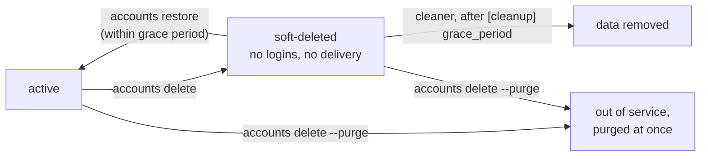

# Sora Admin CLI

`sora-admin` is the command-line tool for running a Sora installation. You use it to create
accounts and aliases, manage folders, restore deleted mail, share folders, upload Sieve scripts,
import and export maildirs, check S3 objects, drain a backend before maintenance, look at caches
and queues, and apply database migrations.

This document lists every command, subcommand and flag of `sora-admin` as built from
[cmd/sora-admin/](../cmd/sora-admin/), with defaults and with what each command changes. It is
written for operators who run Sora and for contributors who change the tool. Maildir import and
export have their own reference, [IMPORT_EXPORT.md](IMPORT_EXPORT.md).

## Contents

1. [Running sora-admin](#1-running-sora-admin)
2. [What each command needs](#2-what-each-command-needs)
3. [The `[admin_cli]` section](#3-the-admin_cli-section)
4. [accounts](#4-accounts)
5. [credentials](#5-credentials)
6. [mailbox](#6-mailbox)
7. [messages](#7-messages)
8. [acl](#8-acl)
9. [sieve](#9-sieve)
10. [import and export](#10-import-and-export)
11. [verify](#11-verify)
12. [uploader](#12-uploader)
13. [cache](#13-cache)
14. [auth-cache and affinity-cache](#14-auth-cache-and-affinity-cache)
15. [stats](#15-stats)
16. [connections](#16-connections)
17. [affinity](#17-affinity)
18. [backends](#18-backends)
19. [health](#19-health)
20. [relay](#20-relay)
21. [tls](#21-tls)
22. [config](#22-config)
23. [migrate](#23-migrate)
24. [version and help](#24-version-and-help)
25. [Destructive commands at a glance](#25-destructive-commands-at-a-glance)

---

## 1. Running sora-admin

### Building

`make sora-admin` (or `make build`, which builds both binaries) produces `./sora-admin`. You can
also build it directly:

```sh
go build -o sora-admin ./cmd/sora-admin
```

### Command line shape

```sh
sora-admin --config /etc/sora/config.toml <command> <subcommand> [flags]
```

- `--config PATH` is **required** for every command except `help` and `version`. There is no
  default path. The flag may appear anywhere on the line, and `--config=PATH` works too. Use two
  dashes: `-config` is not recognised and the tool stops with `--config flag is required`.
- `sora-admin` reads the same TOML file as the server. It loads it with the server's loader, so
  unknown keys and duplicate keys produce the same warnings, and a file the server cannot load
  stops the tool. It uses only some sections: `[database]`, `[s3]`, `[local_cache]`,
  `[uploader]`, `[cleanup]`, `[shared_mailboxes]`, `[tls]`, `[admin_cli]`, `[relay]`, `[sieve]`,
  `[cluster]` and the `[[server]]` blocks.
- The config file is loaded before anything else, so even `sora-admin --config PATH accounts
  --help` needs a file that loads. Only `sora-admin help`, `sora-admin --help`, `sora-admin -h`,
  `sora-admin version`, `sora-admin -v` and `sora-admin --version` work without one.
- Flags of a subcommand come **after** the subcommand. They are parsed with Go's `flag` package,
  so `--flag value`, `--flag=value` and `-flag value` all work. A boolean flag that defaults to
  `true` is turned off with `--flag=false`.
- `sora-admin <command> --help` lists the subcommands. `sora-admin <command> <subcommand> --help`
  prints the subcommand's flags.

### Output, logs and exit status

- Reports and tables go to standard output. Log lines (`INFO`, `WARN`, `ERROR`, with a
  timestamp) go to standard error. `sora-admin` does not use the `[logging]` section.
- The exit status is `0` on success and `1` on error. A few commands report problems but still
  exit `0`; this is noted where it applies (for example `verify s3`).
- Ctrl+C (SIGINT) or SIGTERM cancels the running operation. Long operations such as imports stop
  at the next safe point.

### Database connections

Commands that use PostgreSQL connect to the `[database.write]` endpoint only. They never use read
replicas, and they never apply migrations on their own (only `sora-admin migrate` does). See
[DATABASE.md](DATABASE.md) for the `[database]` section.

---

## 2. What each command needs

Some commands talk to PostgreSQL, some to S3, some to a running server's Admin API, and some only
read files on the host where you run them. This decides where you run each command and what its
config file must contain.

| Command | PostgreSQL | S3 (`[s3]`) | Admin API | Local files on this host |
|---|---|---|---|---|
| `accounts create, list, show, update, delete, restore` | yes | | | |
| `accounts delete --purge`, `accounts purge-domain` | yes | yes | | |
| `credentials *` | yes | | | |
| `mailbox *` | yes | | | |
| `messages *` | yes | | | |
| `acl *` | yes | | | |
| `sieve *` | yes | | | |
| `import maildir` | yes | yes | | the maildir, and `sora-maildir.db` written into it |
| `import s3` | yes | yes | | a temporary SQLite file in the system temp directory |
| `export maildir` | yes | yes | | the target directory |
| `verify s3` | yes | yes | | |
| `verify hash` | optional | yes | | `--download` targets |
| `uploader status` | yes | for the failed-uploads list | | |
| `uploader resolve` | yes | yes | | this host's upload spool (`[uploader] path`) |
| `cache stats`, `cache purge` | yes | | | this host's `[local_cache] path` |
| `cache metrics` | yes | | | |
| `auth-cache status`, `affinity-cache status` | | | yes, via `[admin_cli]` | |
| `stats blocked`, `stats connection` | | | yes, via `[admin_cli]` | |
| `connections list`, `connections kick` | | | yes, via `[admin_cli]` | |
| `affinity set, get, delete` | | | yes, via `[admin_cli]` | |
| `backends *` | yes (primary) | | | |
| `health status` | yes | | `--backends` only, via `[admin_cli]` | |
| `relay *` | | | | this host's relay queue directory |
| `tls *` | | the `[tls.letsencrypt.s3]` bucket, not `[s3]` | | `[tls.letsencrypt] fallback_dir` |
| `config validate`, `config dump` | | | | the config file only |
| `migrate *` | yes | | | |

Commands marked "local files on this host" act on the node where you run them. Run `uploader
resolve`, `cache purge`, `relay *` and `tls cache` on the node whose spool, cache, queue or
certificate directory you mean, with that node's config file.

---

## 3. The `[admin_cli]` section

`[admin_cli]` holds settings that only `sora-admin` reads. The server ignores it. The commands
that call a running server's Admin API use `addr` and `api_key`; the maildir importer uses
`import_message_limit`.

```toml
[admin_cli]
addr = "https://10.0.0.5:8080"   # the Admin API, with scheme
api_key = "the-admin-api-key"
# insecure_skip_verify = false   # default: skip only when addr is a loopback address
import_message_limit = "100mb"
```

| Key | Type | Default | What it does |
|---|---|---|---|
| `addr` | string | none | Base URL of an Admin API server (an `http_admin_api` `[[server]]` block), including `http://` or `https://`. Required by `auth-cache`, `affinity-cache`, `stats`, `connections`, `affinity` and `health status --backends`. |
| `api_key` | string | none | Sent as `Authorization: Bearer <api_key>`. Must match the `api_key` of that Admin API server. Required by the same commands. |
| `insecure_skip_verify` | bool | depends on `addr` | When unset, TLS certificate checks are skipped only if `addr` points at a loopback address (`localhost`, `127.0.0.0/8`, `::1`) and kept for any other host. `true` or `false` overrides this. Leave it unset or `false` for a remote Admin API: the API key travels in every request. |
| `import_message_limit` | size (`"50mb"`) | see below | Largest message `import maildir` accepts. Larger files are counted as failed. |

The `import_message_limit` default comes from the first enabled `[[server]]` block of type `imap`
in the same file: its `append_limit`, which itself defaults to 25 MB. With no IMAP server in the
file, the limit is 50 MB. An unparsable value logs a warning and falls back the same way.

The Admin API requests time out after 30 seconds. The Admin API itself is described in
[ADMIN_API.md](ADMIN_API.md).

---

## 4. accounts

An account is one mailbox owner. It has one or more credentials: addresses that log in and
receive mail. One credential is the primary identity. See [AUTHENTICATION.md](AUTHENTICATION.md)
for how logins are checked.



### accounts create

Creates an account with one credential, or with several from a JSON list.

```sh
sora-admin --config config.toml accounts create --email user@example.com --password 'secret'
```

| Flag | Default | Meaning |
|---|---|---|
| `--email` | | Address of the new account. Required unless `--credentials` is given. It becomes the primary identity. |
| `--password` | | Password to hash. Required unless `--password-hash` or `--credentials` is given. |
| `--password-hash` | | A ready-made hash, stored exactly as given. Use instead of `--password`. |
| `--hash` | `bcrypt` | Scheme for `--password`: `bcrypt` or `ssha512`. |
| `--credentials` | | JSON list of credentials. Cannot be combined with `--email`, `--password` or `--password-hash`. |

- `--password` and `--password-hash` are mutually exclusive.
- `bcrypt` hashes are stored as `{BLF-CRYPT}$2a$...` with the cost set by the top-level
  `bcrypt_cost` key (default 12), as on the server.
- `--password-hash` is not checked. A hash in a scheme Sora cannot verify is accepted here and
  then fails at every login. Sora verifies `{BLF-CRYPT}`, bare `$2a$`, `$2b$`, `$2y$` bcrypt,
  `{SSHA512}`, `{SSHA512.b64}`, `{SSHA512.HEX}`, `{SHA512}`, `{SHA512.b64}` and `{SHA512.HEX}`
  hashes. Quote the hash in single quotes so the shell leaves `$` alone.
- The address is validated and stored in lower case. Creation fails if any account (active or
  soft-deleted) already has this address.

The `--credentials` JSON is a list of objects:

| Field | Meaning |
|---|---|
| `email` | Address (required). |
| `password` | Password to hash. |
| `password_hash` | Ready-made hash, used instead of `password`. |
| `is_primary` | Exactly one credential must be `true`. |
| `hash_type` | Scheme for `password`. Default `bcrypt`. |

```sh
sora-admin --config config.toml accounts create --credentials \
  '[{"email":"user@example.com","password":"pass1","is_primary":true},
    {"email":"alias@example.com","password":"pass2","is_primary":false}]'
```

### accounts list

Lists the accounts whose **primary** address is in a domain. Soft-deleted accounts are not
listed.

```sh
sora-admin --config config.toml accounts list --domain example.com
```

| Flag | Default | Meaning |
|---|---|---|
| `--domain` | | Domain to list (required). |

Columns: ID, primary email, number of credentials, mailboxes, messages, storage used, creation
time, newest account first.

### accounts show

Shows one account: ID, status (`active` or `deleted`), primary address, creation and deletion
times, mailbox and message counts, storage used, and every credential.

| Flag | Default | Meaning |
|---|---|---|
| `--email` | | Any address of the account (required). |
| `--json` | `false` | Print JSON instead of text. |

### accounts update

Changes the password of one credential, or makes it the primary identity, or both.

```sh
sora-admin --config config.toml accounts update --email user@example.com --password 'new-secret'
sora-admin --config config.toml accounts update --email alias@example.com --make-primary
```

| Flag | Default | Meaning |
|---|---|---|
| `--email` | | The credential to change (required). |
| `--password` | | New password for this credential. |
| `--password-hash` | | New ready-made hash for this credential. |
| `--make-primary` | `false` | Make this credential the primary identity. The previous primary becomes an alias. |
| `--hash` | `bcrypt` | Scheme for `--password`: `bcrypt` or `ssha512`. |

- At least one of `--password`, `--password-hash` and `--make-primary` is required.
- Passwords belong to credentials, not to the account. Changing the password of
  `user@example.com` does not change the password of `alias@example.com`.
- `--make-primary` is refused when the new primary is in a different domain and the account
  already has messages: message bodies in S3 are stored under the primary address's domain, and
  the change would split them.
- A password change drops the account's cached logins on every node, as the Admin API does, so
  the old password stops working at once.

### accounts delete

Without `--purge`, soft-deletes the account. With `--purge`, deletes all of its data right away.

```sh
sora-admin --config config.toml accounts delete --email user@example.com --confirm
sora-admin --config config.toml accounts delete --email user@example.com --confirm --purge
```

| Flag | Default | Meaning |
|---|---|---|
| `--email` | | Any address of the account (required). |
| `--confirm` | `false` | Required. Without it the command refuses. There is no interactive prompt. |
| `--purge` | `false` | Delete everything right away instead of soft-deleting. Irreversible. |

**Soft delete** marks the account deleted. From then on it cannot log in and receives no mail. The
data stays until the cleaner removes it after `[cleanup] grace_period` (default `14d`; see
[STORAGE.md](STORAGE.md)). Until then, `accounts restore` brings everything back. Deleting an
account that is already soft-deleted is an error.

**Purge** first takes the account out of service and marks it for purging, the same mark the
Admin API sets. It then deletes the account's mailboxes, messages, S3 objects, search index,
credentials and the account itself. It needs `[s3]`. It cannot be undone. If it stops partway,
the account stays out of service and marked; a server's purge worker (on a node with object
storage) finishes it, or you run the command again. If a server's purge worker is already
purging the account, the command waits for it and reports when it is done.

Both forms end the account's open sessions and drop its cached logins on every node, as the
Admin API does.

### accounts restore

Restores a soft-deleted account and clears any pending purge request on it.

| Flag | Default | Meaning |
|---|---|---|
| `--email` | | Any address of the account (required). |

Restore before `[cleanup] grace_period` ends. Once the cleaner has started removing the
account's data, `restore` cannot bring that data back. A purged account cannot be restored.
Restoring an account that is not deleted is an error.

### accounts purge-domain

Purges every account whose primary address is in a domain, then deletes the remaining credentials
in that domain that are aliases of accounts kept elsewhere.

```sh
sora-admin --config config.toml accounts purge-domain --domain example.com --confirm
```

| Flag | Default | Meaning |
|---|---|---|
| `--domain` | | Domain to purge (required). |
| `--confirm` | `false` | Required. There is no interactive prompt. |

- Each account is purged as with `accounts delete --purge`, including soft-deleted accounts. It
  needs `[s3]` and cannot be undone.
- It is resumable. If it is interrupted, or some accounts fail, run the same command again:
  accounts already gone are skipped. The command exits `1` if any account or alias failed.
- Accounts whose primary address is in another domain are kept, but their aliases in this
  domain are deleted, so the domain stops receiving mail.

---

## 5. credentials

A credential is an address with its own password. Aliases are credentials that are not the
primary identity.

### credentials add

Adds a credential to an existing account.

```sh
sora-admin --config config.toml credentials add --primary user@example.com \
  --email alias@example.com --password 'alias-secret'
```

| Flag | Default | Meaning |
|---|---|---|
| `--primary` | | An existing address of the account to add to (required). Any credential of the account works, not only the primary. |
| `--email` | | The new address (required). |
| `--password` | | Password for the new credential. |
| `--password-hash` | | Ready-made hash for the new credential. |
| `--make-primary` | `false` | Make the new credential the primary identity. |
| `--hash` | `bcrypt` | Scheme for `--password`: `bcrypt` or `ssha512`. |

One of `--password` and `--password-hash` is required. `--make-primary` follows the same domain
rule as `accounts update --make-primary`.

### credentials list

Lists the credentials of the account that owns an address, marking the primary.

| Flag | Default | Meaning |
|---|---|---|
| `--email` | | Any address of the account (required). |

### credentials show

Shows one credential: its role (primary identity or alias), creation and update times, and a
summary of its account.

| Flag | Default | Meaning |
|---|---|---|
| `--email` | | The credential (required). |
| `--json` | `false` | Print JSON. |

### credentials delete

Deletes one credential. There is no confirmation prompt and no undo; add it again with
`credentials add` if needed.

| Flag | Default | Meaning |
|---|---|---|
| `--email` | | The credential to delete (required). |

The primary credential cannot be deleted: make another one primary first with `accounts update
--make-primary`. The last credential of an account cannot be deleted: delete the account
instead.

The deleted address's cached logins are dropped on every node, as the Admin API does.

---

## 6. mailbox

Mailbox names use `/` as the hierarchy delimiter (`Projects/2024`). Name lookups are
case-insensitive. Every subcommand takes `--email` (any address of the account, required).

### mailbox create

```sh
sora-admin --config config.toml mailbox create --email user@example.com --mailbox "Projects/2024/Q1"
```

| Flag | Default | Meaning |
|---|---|---|
| `--mailbox` | | Name to create (required). Missing parents are created. A trailing `/` is dropped. |

With `[shared_mailboxes] enabled = true`, a name under the shared namespace prefix creates a
shared mailbox, whatever `allow_user_create` says. See [SHARED_MAILBOXES.md](SHARED_MAILBOXES.md).

### mailbox list

| Flag | Default | Meaning |
|---|---|---|
| `--subscribed` | `false` | List only subscribed mailboxes. |

### mailbox delete

Deletes a mailbox. It disappears from the account at once.

```sh
sora-admin --config config.toml mailbox delete --email user@example.com --mailbox "Old" --confirm
```

| Flag | Default | Meaning |
|---|---|---|
| `--mailbox` | | Name to delete (required). |
| `--confirm` | `false` | Required. There is no interactive prompt. |
| `--purge` | `false` | Expunge every message in the mailbox before deleting it. |

- A mailbox with child mailboxes is refused, and nothing is changed. Delete the children first.
- Without `--purge`, the cleaner removes the mailbox and its messages later, after `[cleanup]
  grace_period`. There is no command that brings back a deleted mailbox.
- With `--purge`, the messages are marked expunged right away, the same way IMAP EXPUNGE does.
  They then show up in `messages list-deleted` and can be restored with `messages restore` until
  the cleaner reclaims them after `[cleanup] grace_period`. The cleaner deletes an S3 object only
  when no other message (a copy in another folder) still uses it.

### mailbox rename

Renames or moves a mailbox, with its children.

| Flag | Default | Meaning |
|---|---|---|
| `--old-name` | | Current name (required). |
| `--new-name` | | New name (required). Missing parents are created. |

Refused when the new name contains path traversal, lies below the mailbox itself, or (with shared
mailboxes enabled) would move a mailbox across the shared namespace boundary.

### mailbox subscribe and mailbox unsubscribe

| Flag | Default | Meaning |
|---|---|---|
| `--mailbox` | | Name to subscribe to or unsubscribe from (required). |

### mailbox fix-utf7

Finds mailbox names that still contain IMAP modified UTF-7 sequences (for example
`R&AOk-pertoire`) and renames them to UTF-8 (`Répertoire`). Children follow their parents.

```sh
sora-admin --config config.toml mailbox fix-utf7 --dry-run
sora-admin --config config.toml mailbox fix-utf7 --email user@example.com
```

| Flag | Default | Meaning |
|---|---|---|
| `--email` | all accounts | Limit to one account. Optional for this subcommand. |
| `--dry-run` | `false` | Print `WOULD RENAME` lines and change nothing. |

Names that do not decode, or decode to themselves, are reported as `SKIP`.

---

## 7. messages

Expunged messages stay in the database, marked with their expunge time, until the cleaner
removes them after `[cleanup] grace_period` (default `14d`). Until then you can list and restore
them. See [STORAGE.md](STORAGE.md) for two-phase deletion.

### messages list-deleted

```sh
sora-admin --config config.toml messages list-deleted --email user@example.com --since 2026-11-01
```

| Flag | Default | Meaning |
|---|---|---|
| `--email` | | Any address of the account (required). |
| `--mailbox` | | Only messages that were in this mailbox (case-insensitive). |
| `--since` | | Only messages expunged at or after this time. |
| `--until` | | Only messages expunged at or before this time. |
| `--limit` | `100` | Maximum rows, newest expunge first. |

Times are `YYYY-MM-DD` (midnight UTC) or RFC 3339 (`2026-11-01T08:00:00Z`). The ID column is the
message's database ID, which `messages restore --ids` takes.

### messages restore

Puts expunged messages back into the mailboxes they came from.

```sh
sora-admin --config config.toml messages restore --email user@example.com --mailbox INBOX
sora-admin --config config.toml messages restore --email user@example.com --ids 123,456 --confirm
```

| Flag | Default | Meaning |
|---|---|---|
| `--email` | | Any address of the account (required). |
| `--ids` | | Comma-separated message IDs from `list-deleted`. |
| `--mailbox` | | All expunged messages from this mailbox. |
| `--since` | | Messages expunged at or after this time. |
| `--until` | | Messages expunged at or before this time. |
| `--confirm` | `false` | Skip the prompt. |

- At least one of `--ids`, `--mailbox`, `--since` and `--until` is required. Given together,
  they all apply.
- Without `--confirm`, the command lists up to ten of the matching messages and asks
  `Continue with restoration? (yes/no)`. Only `yes` or `y` continues.
- A mailbox that no longer exists is created again. Restored messages get new UIDs.
- With sharing enabled in the config file you pass, a mailbox recreated in the shared namespace
  is a shared mailbox of the account, as `mailbox create` makes one, and so is a parent recreated
  there. The ACL entries it had before it was deleted are not restored: it starts with the
  initial ACL of a new shared mailbox ([SHARED_MAILBOXES.md](SHARED_MAILBOXES.md)), and the
  restore logs a warning naming it. Grant the rights again with `acl grant`.
- Restores run in chunks, each committed on its own. If a run fails partway, the restored
  messages stay restored; run the same command again for the rest. Messages already back are
  skipped, not duplicated.

---

## 8. acl

Manages access control lists (RFC 4314) on shared mailboxes. Rights, identifiers and the
same-domain rule are explained in [SHARED_MAILBOXES.md](SHARED_MAILBOXES.md). The tool acts as
a trusted administrator: it does not need the `a` right.

| Subcommand | Flags | What it does |
|---|---|---|
| `grant` | `--email`, `--mailbox`, `--identifier` (or `--user`), `--rights` | Sets the identifier's rights on the mailbox. The given rights **replace** any it already had. |
| `revoke` | `--email`, `--mailbox`, `--identifier` (or `--user`) | Removes the identifier's entry. It is an error if there is none. |
| `list` | `--email`, `--mailbox` | Lists the entries and their rights. |

- `--email` is the mailbox owner (required). `--mailbox` is the owner's mailbox name, for
  example `Shared/Sales` (required).
- `--identifier` is an address or `anyone`. `--user` is another name for it.
- `--rights` is a string of the letters `l r s w i p k x t e a` (required for `grant`).
- A grant is checked: the mailbox must be shared, and the grantee must be an active account in
  the owner's domain other than the owner. `anyone` is accepted only when `[shared_mailboxes]
  allow_anyone_identifier` allows it.

```sh
sora-admin --config config.toml acl grant --email owner@example.com --mailbox "Shared/Sales" \
  --user bob@example.com --rights lrs
```

---

## 9. sieve

Manages a user's Sieve scripts. Every subcommand takes `--email` (required). See
[SIEVE.md](SIEVE.md) for the Sieve engine and its extensions.

| Subcommand | Flags | What it does |
|---|---|---|
| `list` | `--email` | Lists the account's scripts and which one is active. |
| `show` | `--email`, `--name` | Prints a script. |
| `put` | `--email`, `--name`, `--file` | Creates a script, or replaces the content of the script with that name. |
| `delete` | `--email`, `--name` | Deletes a script, also the active one. No prompt. |
| `activate` | `--email`, `--name` | Makes this script the active one and deactivates every other. |
| `deactivate` | `--email` | Deactivates all scripts: no Sieve script runs for the account. |
| `rename` | `--email`, `--old`, `--new` | Renames a script. |

- `put` reads the script from `--file`, or from standard input when `--file` is missing or `-`.
- `put` refuses a script larger than 65536 bytes, and a script that does not compile with the
  extensions in `[sieve] enabled_extensions`. `activate` checks the stored script the same way.
- A new script is inactive. Updating a script keeps its active state.
- Script names (for `put` and `rename --new`) may contain only letters, digits, `-`, `_` and `.`,
  up to 128 characters. An account can have at most 100 scripts.

```sh
sora-admin --config config.toml sieve put --email user@example.com --name main --file main.sieve
sora-admin --config config.toml sieve activate --email user@example.com --name main
```

---

## 10. import and export

| Command | What it does |
|---|---|
| `import maildir` | Imports a maildir (Dovecot or other) into an account, with flags, Dovecot keywords, UIDs, subscriptions and a Sieve script. |
| `import s3` | Recovery: creates database rows for message objects already in S3 under an account's prefix. |
| `export maildir` | Writes an account's mail to a maildir, optionally with Dovecot files. |

All three, with every flag, the SQLite cache and the re-run rules, are described in
[IMPORT_EXPORT.md](IMPORT_EXPORT.md).

```sh
sora-admin --config config.toml import maildir --email user@example.com \
  --maildir-path /var/vmail/example.com/user/Maildir --dovecot
```

---

## 11. verify

Checks message bodies in S3 against the database.

### verify s3

Compares one account's messages in the database with the objects under its S3 prefix.

```sh
sora-admin --config config.toml verify s3 --email user@example.com --show-missing
```

| Flag | Default | Meaning |
|---|---|---|
| `--email` | | The account (required). Its domain and local part also form the S3 prefix that is listed. Use the primary address. |
| `--show-missing` | `false` | List every missing, orphaned and corrupt key. |
| `--deep` | `false` | Download, decrypt and BLAKE3-hash every object. Slow: it transfers all of the account's mail. |
| `--fix-orphaned` | `false` | Delete S3 objects under the prefix that no message uses, expunged or not. |
| `--fix-missing` | `false` | Set `uploaded = false` on live messages whose object is missing. |
| `--dry-run` | `false` | With the `--fix-*` flags, report and change nothing. |
| `--batch-size` | `1000` | Messages per batch in the database-to-S3 pass. |

It runs two passes:

1. **Database to S3.** Every live (not expunged) message's key gets a HEAD request; with
   `--deep`, the full body is also downloaded and checked.
2. **S3 to database.** Every object under `domain/localpart/` of `--email` is looked up among all
   message rows that reference it, expunged or not and in any account. Objects that no row uses
   are reported as orphaned.

Things to know before you use the fix flags:

- `--fix-orphaned` leaves alone an object that an expunged message still uses: that message can
  still be restored with `messages restore` during the grace period.
- `--fix-missing` does not recover a body. Objects that pass HEAD but fail `--deep` are not
  "missing", and `--fix-missing` does not touch them.

The command exits `0` even when it finds problems; read the summary.

### verify hash

Checks one object. The key is built from `--email` and `--hash` alone (`domain/localpart/hash`),
so the S3 part needs no database.

```sh
sora-admin --config config.toml verify hash --email user@example.com --hash 31feeacf... --details
```

| Flag | Default | Meaning |
|---|---|---|
| `--hash` | | Content hash (required). |
| `--email` | | Address whose domain and local part form the key (required). This is the primary address the message was stored under. |
| `--details` | `false` | List the messages that use this hash. |
| `--skip-db` | `false` | Do not connect to the database. |
| `--download PATH` | | Save the raw stored object (still encrypted, if `[s3] encrypt` is on), including whatever a truncated object returns. |
| `--download-decrypted PATH` | | Save the decrypted message. Fails on a corrupt object. |

Steps: HEAD the key; download, decrypt and BLAKE3-hash the body; then, best effort, list the
database messages that use the hash and their upload state. If the database cannot be reached,
the last part is skipped and the S3 result still stands.

---

## 12. uploader

Messages delivered to a backend are written to its local spool and uploaded to S3 by its upload
worker. An upload that keeps failing is "parked" once it reaches `[uploader] max_attempts`
(default 20 when the key is unset). See [STORAGE.md](STORAGE.md) for the uploader.

### uploader status

Shows the queue: pending uploads and their size, parked ("failed") uploads, the oldest pending
upload, a per-instance breakdown, and up to `--failed-limit` parked uploads with an S3 existence
check.

| Flag | Default | Meaning |
|---|---|---|
| `--show-failed` | `true` | List parked uploads. |
| `--failed-limit` | `10` | How many parked uploads to list. |

### uploader resolve

Decides, for each parked upload, whether its body is safe, and acts on it.

```sh
sora-admin --config config.toml uploader resolve --dry-run
sora-admin --config config.toml uploader resolve
```

| Flag | Default | Meaning |
|---|---|---|
| `--dry-run` | `false` | Print the decisions and change nothing. |
| `--limit` | `100` | Maximum parked uploads to process. |

| Result | When | Action |
|---|---|---|
| `[REPAIR]` | The object exists in S3. | Marks the messages uploaded and removes the pending row. |
| `[REARM]` | Not in S3, owned by this host, and the spool file is here with the right size. | Resets the attempt count; this host's uploader tries again. |
| `[SKIP]` owned by other host | Not in S3 and another instance owns it. | Nothing. Run `resolve` on that host. |
| `[SKIP]` size differs | The spool file is here but has another size. | Nothing. Inspect it by hand. |
| `[DELETE]` | Not in S3, owned by this host, and no spool file. | Deletes the message rows and the pending row. The message is lost. |

"This host" is the instance ID from `[uploader] instance_id`, or the hostname when unset. The
spool is `[uploader] path`, with the server's default when unset. Run `resolve` on the backend
that owns the uploads, with its own config file. Always look at a `--dry-run` first.

---

## 13. cache

The local cache keeps recently fetched message bodies on a backend's disk. See
[STORAGE.md](STORAGE.md).

| Subcommand | What it does |
|---|---|
| `stats` | Shows the cache path, object count, total size, capacity, maximum object size and utilisation. |
| `metrics` | Shows hit and miss ratios that the servers record in the database, per instance. |
| `purge` | Deletes every cached object and clears the cache index. |

`stats` and `purge` act on `[local_cache] path` (the server's default when unset) **on the host
where you run them**, and they also connect to the database.

`cache purge` flags:

| Flag | Default | Meaning |
|---|---|---|
| `--confirm` | `false` | Skip the `(y/N)` prompt. |

A purge loses nothing: the bodies are in S3 and are fetched again on the next miss.

`cache metrics` flags:

| Flag | Default | Meaning |
|---|---|---|
| `--instance` | all | Only this instance ID. |
| `--history` | `false` | Show history instead of the latest record per instance. |
| `--since` | `24h` | With `--history`: how far back. Accepts Go durations and whole days (`7d`). |
| `--limit` | `50` | With `--history`: maximum records. |
| `--json` | `false` | Print JSON. |

---

## 14. auth-cache and affinity-cache

Both call the Admin API set in `[admin_cli]`. Neither takes flags; `--help` after `status`
prints the usage.

| Command | Admin API endpoint | Shows |
|---|---|---|
| `auth-cache status` | `GET /admin/auth-cache/stats` | Whether the proxy auth cache is enabled, entries, session hits and misses, hit rate, lifetime hits. |
| `affinity-cache status` | `GET /admin/affinity/stats` | Whether the affinity cache is enabled, entries, TTL, cleanup interval, entries per protocol, gossip broadcast queue use. |

The figures are those of the server that answers at `addr`. The caches are described in
[PROXY.md](PROXY.md).

---

## 15. stats

Both subcommands call the Admin API set in `[admin_cli]`.

### stats blocked

Lists IP addresses and IP-plus-username pairs that authentication rate limiting has blocked,
with the time left and the failure counts. See [AUTHENTICATION.md](AUTHENTICATION.md).

| Flag | Default | Meaning |
|---|---|---|
| `--protocol` | all | Filter: `imap`, `pop3`, `managesieve`, `imap_proxy`, `pop3_proxy`, `managesieve_proxy` or `userapi`. |

### stats connection

Shows connection counts by protocol, or one user's connections.

| Flag | Default | Meaning |
|---|---|---|
| `--user` | | Show this user's connections, with local and cluster-wide counts per protocol. |
| `--detail` | `true` | With `--user`: print the per-protocol table. |

Connection tracking lives in memory: on IMAP, POP3 and ManageSieve backends, and on proxies in a
cluster, which share it through the cluster. The answer
says where its figures come from. See [CLUSTER.md](CLUSTER.md).

---

## 16. connections

Both subcommands call the Admin API set in `[admin_cli]`.

### connections list

| Flag | Default | Meaning |
|---|---|---|
| `--user` | | Only this user (asked of the API). |
| `--domain` | | Only users in this domain (filtered by the tool). |
| `--protocol` | | Only trackers whose name is this protocol, for example `IMAP`, `POP3`, `LMTP` (case-insensitive). |
| `--instance` | | Only trackers whose name contains this text. |

Columns: user, protocol, server, local count, count on other nodes, last update.

### connections kick

Closes a user's connections on every node: the Admin API broadcasts the kick through the
cluster.

```sh
sora-admin --config config.toml connections kick --user user@example.com --protocol IMAP -y
```

| Flag | Default | Meaning |
|---|---|---|
| `--user` | | The user to kick. Required in practice (see below). |
| `--protocol` | all | Only `IMAP`, `POP3` or `ManageSieve` (case-insensitive). |
| `--confirm`, `-y` | `false` | Skip the `(y/N)` prompt. |
| `--server`, `--client`, `--all` | | Accepted, but the command refuses them with an error. |

The Admin API that answers must run on a node with connection tracking: one that runs IMAP, POP3
or ManageSieve servers, or proxies with the cluster enabled. Otherwise it answers `503 Connection tracking not available (requires cluster mode)`. A kick
does not stop the user from logging in again.

---

## 17. affinity

Affinity pins a user to a backend, per protocol, on proxies. See [PROXY.md](PROXY.md).

| Subcommand | Flags | What it does |
|---|---|---|
| `set` | `--user`, `--protocol`, `--backend` | Pins the user to the backend; the change is gossiped to every node. |
| `get` | `--user`, `--protocol` | Prints the user's backend, or says there is none. |
| `delete` | `--user`, `--protocol` | Removes the pin; gossiped to every node. |

- `--protocol` is `imap`, `pop3` or `managesieve`. `--backend` is a backend address as the proxy
  knows it, for example `10.0.0.21:993`; the Admin API refuses a backend that is not in its
  configured list for that protocol.
- These commands call the Admin API set in `[admin_cli]`, like the other Admin API commands.

---

## 18. backends

Puts a backend into maintenance so you can stop it without losing mail or cutting users off
abruptly. In maintenance, proxies send it no new logins or deliveries, re-route users with
affinity to it, and close its IMAP sessions gradually. After `[backend_maintenance]
refuse_after` (default `30s`) the backend also refuses new sessions itself. It keeps running so
that it can finish the uploads only its own spool holds. The whole mechanism is described in
[PROXY.md](PROXY.md).

```sh
sora-admin --config config.toml backends maintenance on --host storage2.example.com --reason "disk swap" --wait
sora-admin --config config.toml backends status
sora-admin --config config.toml backends maintenance off --host storage2.example.com
```

### backends maintenance on

| Flag | Default | Meaning |
|---|---|---|
| `--host` | | Backend host as the proxies know it: a name or an IP, **without a port** (required). Maintenance covers every port. |
| `--instance` | the host | The backend's uploader instance ID (`[uploader] instance_id`, default its hostname). An ID no node has ever reported under is refused, and the error lists the IDs seen in the last 24 hours. |
| `--reason` | | A note that `status` shows. |
| `--wait` | `false` | Then block until the backend is safe to stop. |

The command records who set the maintenance (`user@host` of the shell running it). Proxies pick
up the change within `[backend_maintenance] poll_interval` (default `5s`); they need database
access to see it.

### backends maintenance off

| Flag | Default | Meaning |
|---|---|---|
| `--host` | | The backend (required). |

Proxies route to it again within one poll. Users moved off it keep their new backend until
their affinity expires.

### backends status

| Flag | Default | Meaning |
|---|---|---|
| `--host` | all | Show only this backend. Exits `1` if it is not in maintenance. |
| `--wait` | `false` | Block until `--host` is safe to stop (`--host` is required with it). |

For each backend in maintenance it shows since when and by whom, the reason, the uploader
instance, the node's own addresses, pending and parked uploads, open client sessions and whether
new sessions are refused yet.

"Safe to stop" means: no upload pending for the instance, and the node's own recent report says
no client session is open while it refuses new ones. `--wait` re-checks every 10 seconds, and
gives up if maintenance is turned off. Parked uploads never drain on their own: run `uploader
resolve` on that node. Before stopping the node, also check its relay queue with `relay stats`
on it. All reads go to the primary database.

---

## 19. health

### health status

Shows the component health that running servers record in the database: an overall status, the
number of healthy, degraded and unhealthy components (for example `database`, `s3_storage` and
circuit breakers), and failures.

| Flag | Default | Meaning |
|---|---|---|
| `--hostname` | all | Only this server. |
| `--component` | all | Only this component. |
| `--detailed` | `false` | Include each component's metadata. |
| `--json` | `false` | Print JSON. |
| `--backends` | `false` | Instead, show the proxies' backend health from the Admin API (`GET /admin/proxy/backends`), which needs `[admin_cli]`. Backends in maintenance are marked. |

Health checks and what to alert on are covered in [METRICS.md](METRICS.md).

---

## 20. relay

Reads and edits the disk relay queue of **this host**. The queue holds outgoing redirect and
vacation messages; see [RELAY.md](RELAY.md). The commands work only when `[relay] type` is set,
and use `[relay.queue] path` (default `/var/spool/sora/relay`). Each message is a `<id>.json`
metadata file and a `<id>.msg` body in one of `pending/`, `processing/` or `failed/`.

| Subcommand | Flags | What it does |
|---|---|---|
| `stats` | | Counts messages in each queue. Reports a queue the server has not created yet, and does not create it. |
| `list` | `--queue` (default `pending`), `--limit` (default `100`) | Lists messages: ID, type, sender, recipient, attempts, queued time, next retry. |
| `show` | `--id` (required), `--queue` (default `pending`) | Prints a message's metadata, error history and body. |
| `delete` | `--id` (required; `all` for every message), `--queue` (default `failed`), `--confirm` (required) | Deletes the message files. No undo. |
| `requeue` | `--id` (required; `all` for every failed message), `--confirm` (required) | Moves messages from `failed/` to `pending/`, with attempts reset and errors cleared, ready for the next worker run. |

`--queue` is `pending`, `processing` or `failed`. `--confirm` does not prompt; without it,
`delete` and `requeue` refuse.

---

## 21. tls

Manages the Let's Encrypt certificates that Sora keeps in S3 when `[tls.letsencrypt]` is
configured; see [TLS.md](TLS.md). These commands use the `[tls.letsencrypt.s3]` bucket
settings (endpoint default `s3.amazonaws.com`), not `[s3]`, and need no database. Certificates
are stored under `autocert/` with hashed names; the local mirror is `--cache-dir`, which
defaults to `[tls.letsencrypt] fallback_dir`, or `/var/lib/sora/certs`.

| Subcommand | Flags | What it does |
|---|---|---|
| `list` (or `ls`) | `--cache-dir`, `--details`, `--json` | Lists certificates in S3: domain, type (ECDSA or RSA), expiry, whether this host has a local copy, and the S3 key. `--details` adds issuer, serial and algorithms and shows full keys. |
| `delete` (or `del`, `rm`) | `--domain` or `--key`, `--cache-dir`, `--dry-run` | Deletes a certificate from S3 (see the notes below for the local mirror). No prompt. |
| `clean` | `--cache-dir`, `--dry-run`, `--force` | Deletes expired certificates from S3 and the local mirror, after a `[y/N]` prompt unless `--force`. |
| `cache` (or `sync`) | `--cache-dir`, `--domain`, `--force` | Downloads the certificates of `[tls.letsencrypt] domains` (or only `--domain`) from S3 into the local mirror, both ECDSA and RSA. Expired ones are skipped. Existing files are kept unless `--force`. |

Notes on `delete`:

- Give exactly one of `--domain` and `--key`.
- `--key` takes the full S3 key as `tls list --details` shows it (`autocert/cert-...`). A value
  that is not a key in the bucket, or one ending in `...`, is treated as a prefix; it must match
  exactly one key. A key that exists is deleted even when it is also the prefix of another key.
- `--domain` deletes both the ECDSA and the RSA certificate of the domain, from S3 and from the
  local mirror.
- `--key` leaves the local mirror alone.

Notes on `clean`:

- A node can renew an expired certificate while `clean` runs, after `clean` has read the
  expired one. On a bucket that keeps versions (Backblaze B2 buckets always do), `clean`
  deletes only the version it read and found expired, so the renewal, a newer version, stays.
  If deleting that version brings back an older one that has expired too, `clean` deletes that
  one as well. This needs the right to delete object versions: `s3:DeleteObjectVersion` on
  AWS, the `deleteFiles` capability on Backblaze B2.
- Without a usable version id, including a `null` version exposed after a version delete,
  `clean` sends the inspected object's ETag in `If-Match`. A changed object is kept.
  This requires conditional DELETE support from the S3 provider; a missing ETag or an
  unsupported condition fails that cleanup operation and keeps the object. `clean` never
  retries it as an unconditional delete. Versioned B2 objects continue to use version ids.
- A local copy is removed only if it still holds an expired certificate when `clean` removes
  it. A renewal written over it during the run stays.

`cache` writes files with mode `0600` as the user running the command. Run it as the user the
server runs as, or fix the ownership afterwards.

---

## 22. config

Checks and prints a config file. These subcommands read only the file.

| Subcommand | Flags | What it does |
|---|---|---|
| `validate` | | Loads the file with the server's loader (warnings for unknown and duplicate keys) and runs the checks `sora` makes on the file before it starts anything ([CONFIGURATION.md section 4](CONFIGURATION.md#4-checks-at-startup)), without connecting to anything. Prints `[OK] Configuration is valid!` and the servers, or a `[FAIL]` line for each problem. Exits `1` on errors. |
| `dump` | `--format` (`toml` or `json`, default `toml`), `--mask-secrets` (default `true`) | Prints the configuration as loaded, with defaults applied. |

`--mask-secrets` masks the database passwords, `[s3]` access key, secret key and encryption key,
the `[tls]` certificate and key paths, the Let's Encrypt S3 keys, `[cluster] secret_key`,
`[admin_cli] api_key`, `[relay] auth_token`, `[spam_training] auth_token`, and the `api_key`,
`jwt_secret`, `master_password`, `master_sasl_password` and remote lookup `auth_token` of each
`[[server]]`.

See [CONFIGURATION.md](CONFIGURATION.md) for the file itself.

---

## 23. migrate

Applies and reverts the database schema migrations built into the binary
([db/migrations/](../db/migrations/)). See [DATABASE.md](DATABASE.md) for how migrations fit into
upgrades.

| Subcommand | Flags | What it does |
|---|---|---|
| `up` | | Applies every pending migration. |
| `down` | `--limit N` (default `1`), `--all` | Reverts the last N migrations, or all of them. No prompt. |
| `version` | | Prints the current version and whether it is dirty. Safe while servers run: a plain read of `schema_migrations`, no lock. |
| `force VERSION` | | Records VERSION as the current version and clears the dirty flag, without running anything. |

- Stop the Sora servers before `up`, `down` and `force`.
- `down` runs the reverse migrations, which drop tables and columns and the data in them. Take a
  backup first.
- `force` is for a dirty state after a failed migration: fix the schema by hand, then force the
  version that matches it.
- `migrate` connects to the first host of `[database.write] hosts` with `port`, `user`,
  `password`, `name` and `tls`, with the server's port rules: a port in the host entry wins, and
  `port` defaults to `5432`.

---

## 24. version and help

```sh
sora-admin version      # also -v and --version
sora-admin help         # also --help and -h
```

`version` prints `sora-admin version VERSION (commit: COMMIT, built at: DATE)`, set at build
time. Neither needs a config file.

---

## 25. Destructive commands at a glance

| Command | What it removes | Undo | Confirmation |
|---|---|---|---|
| `accounts delete` | Soft-deletes the account. | `accounts restore` within `[cleanup] grace_period`. | `--confirm` flag required. |
| `accounts delete --purge` | The account, its mailboxes, messages, S3 objects, search index, credentials. | None. | `--confirm` flag required. |
| `accounts purge-domain` | Every account with its primary address in the domain, as above, and the domain's remaining aliases. | None. | `--confirm` flag required. |
| `credentials delete` | One alias. | Add it again. | None. |
| `mailbox delete` | The mailbox; its messages after the grace period. | None for the mailbox. | `--confirm` flag required. |
| `mailbox delete --purge` | Expunges the messages at once, then deletes the mailbox. | `messages restore` within the grace period. | `--confirm` flag required. |
| `sieve delete` | One script, also the active one. | None. | None. |
| `acl revoke` | One ACL entry. | `acl grant` again. | None. |
| `verify s3 --fix-orphaned` | S3 objects that no message uses, expunged or not. | None. | None; try `--dry-run` first. |
| `verify s3 --fix-missing` | Sets `uploaded = false` on messages with no object. | None. | None; try `--dry-run` first. |
| `uploader resolve` | `[DELETE]`: message rows whose body is in neither S3 nor the spool. | None. | None; try `--dry-run` first. |
| `cache purge` | The local cache of this host. | Refills from S3. | `(y/N)` prompt unless `--confirm`. |
| `relay delete` | Queued relay messages. | None. | `--confirm` flag required. |
| `tls delete` | A certificate in S3 (with `--domain`, also from the local mirror). | Let's Encrypt issues a new one. | None. |
| `tls clean` | Expired certificates. | None needed. | `[y/N]` prompt unless `--force`. |
| `migrate down` | Schema objects and their data. | `migrate up` restores the schema, not the data. | None. |
| `connections kick` | Open sessions (users can log in again). | Not applicable. | `(y/N)` prompt unless `--confirm` or `-y`. |
