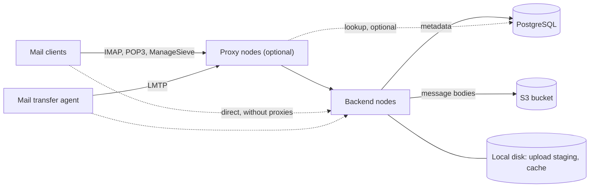
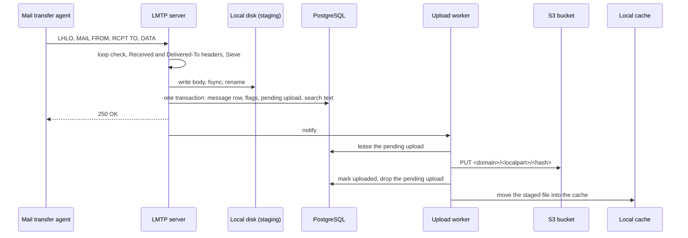

# Sora Architecture

This document explains how Sora is built and how its parts work together. It covers the two
programs, the roles a node can play, where each kind of data lives, the life of one message
from delivery to deletion, the background workers, and the identifiers Sora uses.

It is written for operators who plan or run a deployment, and for contributors who need the
big picture before they change code. The details of message storage (S3, the upload queue,
the local cache, deletion and retention) are in [STORAGE.md](STORAGE.md). Proxies are covered
in [PROXY.md](PROXY.md), the gossip cluster in [CLUSTER.md](CLUSTER.md), and search in
[SEARCH.md](SEARCH.md).

## Contents

1. [What Sora is](#1-what-sora-is)
2. [The two programs](#2-the-two-programs)
3. [Node roles](#3-node-roles)
4. [Components](#4-components)
5. [Where data lives](#5-where-data-lives)
6. [The life of a message](#6-the-life-of-a-message)
7. [Background workers](#7-background-workers)
8. [Node identity](#8-node-identity)
9. [Identifiers](#9-identifiers)
10. [Starting and stopping](#10-starting-and-stopping)
11. [When a dependency fails](#11-when-a-dependency-fails)
12. [Where to look in the code](#12-where-to-look-in-the-code)

---

## 1. What Sora is

Sora is a mail server written in Go. It stores mail for many accounts and serves it to mail
clients. It speaks these protocols:

- **IMAP**, which mail clients use to read and organise mail.
- **POP3**, which older clients use to download mail.
- **LMTP**, the protocol your mail transfer agent (for example Postfix) uses to hand incoming
  messages to Sora.
- **ManageSieve**, which clients use to upload Sieve filter scripts.
- **HTTP**: an Admin API for operators and a User API for web and mobile apps.

IMAP, POP3, LMTP, ManageSieve and the User API also have a **proxy** variant. A proxy
accepts the client's connection, checks the login (for LMTP: looks up the recipient), picks
a backend server and then passes the traffic through.

Sora splits every message into two parts and keeps them in different places:

- The **metadata** lives in PostgreSQL: which account and mailbox the message is in, its UID,
  flags and keywords, the headers that searches use, its MIME structure, and its size.
- The **body**, the raw message exactly as stored, lives in S3-compatible object storage.

Sora does not accept outgoing mail from users: it has no SMTP submission service. It sends
mail only on behalf of Sieve scripts (redirects and vacation replies), through a relay you
configure. See [RELAY.md](RELAY.md).

---

## 2. The two programs

The repository builds two programs. `make build` builds both.

| Program | Source | What it does |
|---|---|---|
| `sora` | [cmd/sora](../cmd/sora) | The server. One process runs every listener and background worker configured for the node. |
| `sora-admin` | [cmd/sora-admin](../cmd/sora-admin) | The command-line tool for accounts, mailboxes, messages, imports, the upload queue, caches and more. Most commands read the same config file and talk to PostgreSQL and S3 directly; some go through the Admin API. See [ADMIN_CLI.md](ADMIN_CLI.md). |

`sora` takes two flags:

```
sora -config /etc/sora/config.toml
sora -version          # or -v: prints "sora version <v> (commit: <c>, built at: <date>)" and exits
```

`-config` defaults to `config.toml` in the working directory. If you name a file that does
not exist, `sora` stops with an error. If you give no `-config` and `config.toml` does not
exist, `sora` starts from its built-in defaults. Those define no listeners, so it then stops
with "no servers configured". The config file is described in
[CONFIGURATION.md](CONFIGURATION.md).

### Listeners are `[[server]]` blocks

Each `[[server]]` block in the config file starts one listener. A block names its `type`, a
unique `name` and an `addr` to listen on:

```toml
[[server]]
type = "imap"
name = "imap"
addr = ":143"

[[server]]
type = "lmtp"
name = "lmtp"
addr = "127.0.0.1:24"
```

| `type` | What it starts |
|---|---|
| `imap`, `pop3`, `lmtp`, `managesieve` | A backend protocol server. See [PROTOCOLS.md](PROTOCOLS.md). |
| `imap_proxy`, `pop3_proxy`, `managesieve_proxy`, `lmtp_proxy` | A proxy for that protocol. See [PROXY.md](PROXY.md). |
| `http_admin_api` | The Admin API. See [ADMIN_API.md](ADMIN_API.md). |
| `http_user_api` | The User API. See [USER_API.md](USER_API.md). |
| `user_api_proxy` | A proxy for the User API. See [USER_API.md](USER_API.md). |
| `metrics` | The Prometheus metrics endpoint. See [METRICS.md](METRICS.md). |

A block without a `type`, `name` or `addr` stops the server at startup, and so do two blocks
with the same `name`, or the same `addr`. So does an unknown `type`, with
`invalid server type '<type>', must be one of: ...`.

---

## 3. Node roles

A **node** is one running `sora` process. What a node does depends only on the `[[server]]`
blocks in its config. There are two basic roles, and one node can play both.

- **Backend.** Runs `imap`, `pop3`, `lmtp` and usually `managesieve`. A backend holds the
  mail: it writes message bodies to S3 and metadata to PostgreSQL, and it runs the storage
  workers (upload, cleanup, purge, search indexing).
- **Proxy.** Runs the `*_proxy` types. A proxy holds no mail and never talks to S3. It
  authenticates the user (an LMTP proxy looks up the recipient instead), chooses a backend
  (by remote lookup, named pool, affinity, consistent hash or round robin) and relays the
  connection. See [PROXY.md](PROXY.md).

A small deployment runs one node with backend servers only. A larger one puts proxies in
front of several backends that share one PostgreSQL database and one S3 bucket.



### What a node starts

At startup `sora` looks at the server types in the config and decides what it needs:

| The node runs | PostgreSQL | S3 and the storage workers |
|---|---|---|
| `imap`, `pop3` or `lmtp` | Connects (required) | Starts the S3 client, the local cache, the upload worker, the cleanup worker, the purge worker and the search indexing worker |
| `managesieve` | Connects (required) | No |
| `http_admin_api` | Connects (required) | Only if the node also runs `imap`, `pop3` or `lmtp` |
| `http_user_api` | Connects (required) | Starts the S3 client, to serve message bodies |
| A proxy that checks passwords in the database (no remote lookup, or `[server.remote_lookup]` with `lookup_local_users = true`) | Connects (required) | No |
| Only proxies that use remote lookup, or `metrics` | Not needed | No |

If a server type needs PostgreSQL and the config has no database endpoint, `sora` stops with
`[database]: server "<name>" (<type>) needs the database, but it is not configured in
[database.write] or [database.read]`. With `[database.read]` hosts but no `[database.write]` hosts
it stops with `[database.write]: server "<name>" (<type>) needs the database, but [database.write]
has no hosts; ...`: the migrations and every write go to `[database.write]`. On a node that needs S3, `[s3] endpoint` and `bucket` must
be set, or `sora` stops with `[s3]: endpoint is required ...` or `[s3]: bucket is required ...`;
without `access_key` and `secret_key` the AWS default credential chain must supply them.
`sora-admin config validate` refuses such a file too.

A node without storage workers does not need the upload staging directory or the local
cache, and an Admin API on it cannot deliver messages. Run the Admin API on a node that also
runs `imap`, `pop3` or `lmtp` when you need its delivery endpoint.

---

## 4. Components

This section names the main parts of the server and what each one is for.

**Protocol servers** ([server/imap](../server/imap), [server/pop3](../server/pop3),
[server/lmtp](../server/lmtp), [server/managesieve](../server/managesieve)). They accept
client connections, authenticate, and turn commands into database queries and body reads.
Behaviour that clients see is in [PROTOCOLS.md](PROTOCOLS.md).

**Proxies** ([server/imapproxy](../server/imapproxy), [server/pop3proxy](../server/pop3proxy),
[server/managesieveproxy](../server/managesieveproxy), [server/lmtpproxy](../server/lmtpproxy),
[server/userapiproxy](../server/userapiproxy), with the shared routing code in
[server/proxy](../server/proxy)). See [PROXY.md](PROXY.md).

**HTTP APIs** ([server/adminapi](../server/adminapi), [server/userapi](../server/userapi)). The
Admin API manages accounts, delivers messages, and reports on connections, caches and the
upload queue. The User API gives web and mobile apps mailbox access with JWT logins.

**Delivery** ([server/delivery](../server/delivery)). The delivery steps the Admin API's
message delivery uses: loop check, trace headers, Sieve, staging the body and inserting the
message. LMTP runs the same steps in its own session code. Delivery also holds the relay
handlers for Sieve redirects and vacation replies.

**Sieve** ([server/sieveengine](../server/sieveengine)). Runs filter scripts at delivery. See
[SIEVE.md](SIEVE.md).

**Storage client** ([storage](../storage), wrapped by [pkg/resilient](../pkg/resilient)).
Talks to S3: put, get, delete, copy. Adds client-side encryption when enabled, and retries
and circuit breakers through the wrapper. See [STORAGE.md](STORAGE.md#5-the-s3-client).

**Upload worker** ([server/uploader](../server/uploader)). Moves message bodies from the
node's local staging directory to S3. See [STORAGE.md](STORAGE.md#6-the-upload-pipeline).

**Local cache** ([cache](../cache)). Keeps recently used message bodies on the node's disk so
that reads do not always go to S3. See [STORAGE.md](STORAGE.md#8-the-local-cache).

**Cleanup worker and purge worker** ([server/cleaner](../server/cleaner)). The cleanup worker
removes expunged messages after the grace period, enforces retention, finishes deleted
accounts and prunes old records. The purge worker deletes accounts that an operator asked to
purge at once. See [STORAGE.md](STORAGE.md#11-the-cleanup-cycle).

**Search indexing worker** ([server/fts](../server/fts)). Turns staged message text into
PostgreSQL full-text search vectors. See [SEARCH.md](SEARCH.md).

**Database layer** ([db](../db), wrapped by [pkg/resilient](../pkg/resilient)). All SQL lives
in `db`. The resilient wrapper adds retries, timeouts, circuit breakers and the split between
the write pool and the read pool. Schema migrations are in [db/migrations](../db/migrations).
See [DATABASE.md](DATABASE.md).

**Cluster** ([cluster](../cluster)). Gossip membership between nodes. It shares the proxies'
per-user and per-IP connection counts, kicks, proxy affinity and the proxies' authentication rate
limits, and elects the Let's Encrypt leader. See [CLUSTER.md](CLUSTER.md).

**TLS manager** ([tlsmanager](../tlsmanager)). Certificates from files or from Let's Encrypt.
See [TLS.md](TLS.md).

**Relay queue** ([server/relayqueue](../server/relayqueue)). A disk queue for outgoing Sieve
redirects and vacation replies. See [RELAY.md](RELAY.md).

**Auth cache and affinity cache** ([authcache](../authcache), [affinitycache](../affinitycache)).
Small SQLite files that proxies use to survive restarts without a burst of database lookups.
See [PROXY.md](PROXY.md).

**Health and metrics** ([pkg/health](../pkg/health), [pkg/metrics](../pkg/metrics)). Component
health checks and Prometheus metrics. See [METRICS.md](METRICS.md).

---

## 5. Where data lives

Knowing where each kind of data lives tells you what to back up and what you can lose
safely.

| Data | Where | Notes |
|---|---|---|
| Accounts, addresses (credentials), password hashes | PostgreSQL | |
| Mailboxes, subscriptions, ACLs, IMAP METADATA | PostgreSQL | |
| Message metadata, flags, keywords, UIDs, MODSEQ | PostgreSQL (`messages`, `message_state`) | |
| Search vectors | PostgreSQL (`messages_fts_v2`) | The only copy: rebuilding needs every body fetched from S3 again. See [SEARCH.md](SEARCH.md). |
| Sieve scripts, vacation reply records | PostgreSQL | |
| The upload queue and node heartbeats | PostgreSQL (`pending_uploads`, `instance_heartbeats`) | |
| Message bodies | S3 bucket | Keyed `<domain>/<localpart>/<content hash>`. See [STORAGE.md](STORAGE.md#2-s3-keys). |
| Bodies not yet uploaded | Local disk of the node that accepted them, `[uploader] path` (default `/tmp/sora/uploads`) | The only copy until the upload finishes. |
| Cached bodies | Local disk, `[local_cache] path` (default `/tmp/sora/cache`) | Disposable. |
| Outgoing relay messages | Local disk, `[relay.queue] path` (default `/var/spool/sora/relay`) | See [RELAY.md](RELAY.md). |
| Auth cache, affinity cache | Local SQLite files on proxy nodes | Disposable. See [PROXY.md](PROXY.md). |
| Let's Encrypt certificates | The S3 bucket in `[tls.letsencrypt.s3]`, mirrored to a local fallback directory | See [TLS.md](TLS.md). |
| Login rate-limit counts | Memory; the IMAP, POP3 and ManageSieve proxies share Tier 2 blocks and counts between nodes by gossip | Lost on restart. See [AUTHENTICATION.md](AUTHENTICATION.md) and [CLUSTER.md](CLUSTER.md#66-authentication-rate-limits-imap-pop3-and-managesieve-proxies). |
| Per-user and per-IP connection counts on IMAP, POP3 and ManageSieve proxies, affinity | Memory, shared between nodes by gossip | Lost on restart. See [CLUSTER.md](CLUSTER.md). |
| Client sessions | Memory of the node that holds the connection | |

The default paths under `/tmp` are fine for a laptop and wrong for production: the staging
directory holds the only copy of mail that has not reached S3 yet, and many systems clear
`/tmp` at boot. Set `[uploader] path` to a persistent directory. See
[STORAGE.md](STORAGE.md#14-what-to-back-up).

---

## 6. The life of a message

This section follows one message from the moment it arrives until it is deleted for good.

### 6.1 Delivery over LMTP



1. **The recipient is checked.** At `RCPT TO`, Sora resolves the address (an alias, or an
   address with a `+detail`) to its account and the account's primary address.
2. **The message is read.** Sora reads the whole message into memory.
3. **Trace headers are added.** Sora rejects a message that has looped back to it (its own
   loop marker and a `Delivered-To` for this recipient). Otherwise it adds a `Received:`
   header and a `Delivered-To:` header with the primary address.
4. **The staging limit is checked.** If `[uploader] max_staging_size` is set and this node
   already holds that much mail waiting for upload, Sora answers
   `452 4.3.1 Insufficient system storage` before Sieve runs, so a refused delivery has no
   side effects.
5. **Sieve runs.** The server-wide default script runs first, then the user's active script.
   A script can file the message into a folder, discard it, redirect it, send a vacation
   reply, set flags or edit headers. A discarded message stops here. See
   [SIEVE.md](SIEVE.md).
6. **The body is hashed.** Sora computes a BLAKE3 hash of the final bytes, after any header
   edits. This *content hash* names the body from now on.
7. **The body is written to local disk**, as `<[uploader] path>/<account id>/<content hash>`.
   Sora writes a temporary file, syncs it to disk, renames it into place and syncs the
   directory. If the disk is full or read-only, Sora answers `452 4.3.1`.
8. **The metadata is inserted** in one PostgreSQL transaction: the message row, its flags, a
   `pending_uploads` row that says "this body still has to go to S3", and the text for search
   indexing. If the same account already has this exact body in S3 under the same key, the
   message is marked uploaded at once and no upload is queued.
9. **Sora answers `250`.** The message is now in the mailbox. Clients connected to this node
   can read it straight from the staging file.
10. **The body goes to S3 in the background.** The upload worker writes it to S3, marks the
    message rows uploaded, removes the `pending_uploads` row, and moves the staged file into
    the local cache.

Sora does not wait for S3 before it answers. The message is safe once the body is synced to
the local disk and the transaction has committed. If the database transaction fails, Sora
answers `451 4.3.0`, keeps the staged file (the commit may have happened even though the
reply was lost) and lets the upload worker's orphan sweep remove it later if nothing refers
to it. A redelivery of a message whose `250` was lost is recognised by a hash of the bytes as
received, and is accepted without storing a second copy.

### 6.2 Other ways in

- **IMAP APPEND** follows the same path: staging limit, staged file, one transaction with a
  pending upload, background upload. When the staging limit is reached, APPEND answers
  `NO [UNAVAILABLE]`.
- **Admin API delivery** (`server/delivery`) runs the same steps as LMTP. Its `Received:`
  header says `with HTTP`.
- **`sora-admin` maildir import** writes bodies straight to S3 and inserts message rows that
  are already marked uploaded. See [IMPORT_EXPORT.md](IMPORT_EXPORT.md).

### 6.3 Reading a message

Most of what a client asks for comes from PostgreSQL alone: the message list, flags,
envelope, MIME structure, sizes and search results. Sora reads the body only when the client
asks for message content. For a message that is already uploaded, it tries, in order:

1. the local cache;
2. S3, and then stores the body in the cache if it is no larger than
   `[local_cache] max_object_size`;
3. the staging file, if S3 fails and the file is still on this node.

For a message that is not uploaded yet, Sora reads the staging file first. On another node,
where that file does not exist, it tries S3. While the upload is still pending, IMAP answers
`NO [UNAVAILABLE]` so the client retries later instead of showing an empty message. The
details are in [STORAGE.md](STORAGE.md#7-reading-a-body).

### 6.4 Changing a message

- **Flags and keywords** are rows in `message_state`. Changing them never touches S3.
- **COPY** inserts new message rows that point at the same body. Within one account no new
  object is written to S3.
- **MOVE** inserts the new rows and expunges the old ones in the same transaction.
- **A copy into another account's shared mailbox** copies the S3 object under the owner's key,
  because every account's bodies live under its own keys.

### 6.5 Deleting a message

Deletion has two phases, so that a mistake can be undone.

1. **Expunge.** When a client expunges a message (or moves it away, or deletes its mailbox),
   Sora sets `expunged_at` on the message row. Clients no longer see it. An operator can
   still list and restore it with `sora-admin messages list-deleted` and
   `sora-admin messages restore`, or through the Admin API.
2. **Removal.** The cleanup worker runs every `[cleanup] wake_interval` (default 1 hour).
   Once the last expunge of a body in an account is older than `[cleanup] grace_period`
   (default 14 days), and no live message of that account uses the body, it deletes the S3
   object and then the message rows.

The cached copy on each node is removed later by the cache's own sweep. The full timeline,
retention with `max_age_restriction`, and account deletion are in
[STORAGE.md](STORAGE.md#9-two-phase-deletion).

---

## 7. Background workers

Besides the listeners, a node runs background workers. The storage workers run only on nodes
that run `imap`, `pop3` or `lmtp`. This document calls those **storage nodes**.

| Worker | Runs on | How often | What it does |
|---|---|---|---|
| Upload worker | Every storage node | Every 10 s, and at once when a message is queued | Uploads this node's staged bodies to S3. Every minute it records a heartbeat; every 5 minutes it reports the queue and removes orphaned staging files. See [STORAGE.md](STORAGE.md#6-the-upload-pipeline). |
| Cleanup worker | Every storage node, but one node per cycle across the deployment | At startup, then every `[cleanup] wake_interval` (default 1 h, at least 1 min) | Removes expunged messages and their bodies after the grace period, enforces `max_age_restriction`, finishes deleted accounts and mailboxes, prunes old records. A PostgreSQL advisory lock makes sure only one node works at a time. See [STORAGE.md](STORAGE.md#11-the-cleanup-cycle). |
| Purge worker | Every storage node | At startup, every `[cleanup] purge_poll_interval` (default 30 s, at least 5 s), and at once when the Admin API on this node marks an account | Deletes accounts marked for purging. A per-account lock keeps two nodes from purging the same account. See [STORAGE.md](STORAGE.md#13-deleting-accounts). |
| Search indexing worker | Every storage node | Every 30 s | Builds search vectors from staged text. See [SEARCH.md](SEARCH.md). |
| Cache purge | Every storage node | At startup, then every `[local_cache] purge_interval` (default 12 h) | Trims the cache to its capacity and removes long-unused entries of deleted messages. See [STORAGE.md](STORAGE.md#8-the-local-cache). |
| Cache metrics | Every storage node | Every `[local_cache] metrics_interval` (default 5 min) | Writes this node's cache hit and miss counts to the `cache_metrics` table; once a day removes rows older than `metrics_retention`. |
| Relay worker | Nodes with `[relay]` configured | Every `[relay.queue] worker_interval` | Sends queued redirects and vacation replies. See [RELAY.md](RELAY.md). |
| Health checks | Every node | 30 to 60 s per check | Checks the database, S3, the cache and other components. See [METRICS.md](METRICS.md). |
| Metrics collector | Every node with a database | Every 60 s | Updates gauges from the database. See [METRICS.md](METRICS.md). |
| Backend maintenance poller | Nodes that run a proxy and have a database | Every `[backend_maintenance] poll_interval` (default 5 s) | Re-reads which backends are in maintenance. See [PROXY.md](PROXY.md). |

The upload worker is the only one that is tied to a single node by the data itself: a body
waiting for upload is a file on the disk of the node that accepted it, so only that node can
upload it. Every other worker can run on any node and coordinates through PostgreSQL.

---

## 8. Node identity

A node has three names. They answer different questions, and mixing them up causes real
damage, so it helps to know them apart.

| Name | Where it comes from | What uses it |
|---|---|---|
| **Mail hostname** | The operating system's hostname. Not configurable. If the host has none, `sora-unknown-host.invalid`. | The protocol greetings, the `by` host of the `Received:` header on every delivery, and the domain of vacation `Message-ID`s. Sora logs `Mail hostname is not fully qualified` at startup when it has no dot. Give the host a fully qualified name. |
| **Instance ID** | `[uploader] instance_id`, else the hostname, else `sora-unknown-host`. | Owns this node's pending uploads (`pending_uploads.instance_id`) and its heartbeat row (`instance_heartbeats`). Internal; never sent to clients. |
| **Cluster node ID** | `[cluster] node_id`. | The node's name in the gossip cluster. See [CLUSTER.md](CLUSTER.md). |

The instance ID matters most. A body waiting for upload exists only on the disk of the node
that accepted it, so a pending upload is handed only to the instance named on its row. Two
rules follow:

- **Every `sora` process that shares a database needs its own instance ID.** Two processes on
  one host would otherwise share the hostname and claim each other's uploads. Set
  `[uploader] instance_id` for each.
- **Keep the instance ID stable.** If it changes while uploads are queued (a new hostname, a
  container that gets a random one), the queued rows keep the old ID. No running node claims
  them, and the cleanup worker eventually treats the old owner as gone and deletes those
  messages. To rename a node, stop delivery to it, wait until `sora-admin uploader status`
  shows nothing pending for it, and only then restart under the new name.

At startup the server logs `Resolved instance ID` and `Resolved mail hostname`.

---

## 9. Identifiers

| Identifier | Form | Notes |
|---|---|---|
| Account, mailbox and message IDs | PostgreSQL `BIGSERIAL` integers | Internal. Clients never see them. |
| IMAP UID | Integer per mailbox, from the mailbox's `highest_uid` | With the mailbox's UIDVALIDITY, as RFC 3501 requires. |
| MODSEQ | One PostgreSQL sequence (`messages_modseq`) for all messages | Used for CONDSTORE and QRESYNC. |
| Content hash | BLAKE3-256 of the stored bytes, 64 lowercase hex characters | Names the body in S3, in the staging directory and in the cache. |
| Delivery hash | BLAKE3-256 of the bytes as received, before Sora adds its headers | Lets a retried delivery be recognised as a duplicate. |
| Generated IDs | 20 lowercase base32 characters ([server/idgen](../server/idgen)) | Session IDs, the `id` in Sora's `Received:` header, and gossip event IDs. |

The generated IDs are 12 bytes: a 4-byte timestamp in seconds, a 3-byte node part chosen at
random when the process starts, a 2-byte counter and 3 random bytes. They sort roughly by
time. They are not used as database keys.

---

## 10. Starting and stopping

At startup `sora` does these steps in order:

1. Loads and validates the config. Any error stops the start.
2. Starts logging and logs the version.
3. Resolves the instance ID and the mail hostname.
4. On a storage node, creates the S3 client and turns on encryption if configured. Sora does
   not contact S3 at this point and does not create the bucket.
5. Connects to PostgreSQL, if the node needs it.
6. Opens the auth cache, if enabled.
7. On a storage node, opens the local cache and starts the search indexing, cleanup, purge
   and upload workers.
8. Starts the relay queue, the cluster, the TLS manager, health checks and the metrics
   collector, as configured.
9. Starts every listener.

On SIGINT or SIGTERM, Sora closes the listeners, waits up to 10 seconds for them to finish,
waits 3 more seconds for connections to drain, and then stops the workers and closes the
database. An upload whose S3 write finished is still recorded in the database before the
process exits; one cut off mid-transfer stays queued and is retried after the restart.

SIGHUP reloads the config: each listener applies the settings it can, and the global sections
that need a restart (among them `[cleanup]` and `[metadata]`) are logged as such. See
[OPERATIONS.md](OPERATIONS.md) for signals, reloads and shutdown in detail.

---

## 11. When a dependency fails

| What fails | What happens | Read more |
|---|---|---|
| S3 | Delivery and APPEND keep working: bodies wait on the staging disk. Cached and staged bodies stay readable; other bodies give `NO [UNAVAILABLE]` in IMAP. The upload worker backs off and resumes on its own. The cleanup worker deletes nothing that depends on S3 while it is down. | [STORAGE.md](STORAGE.md#12-when-s3-is-unavailable) |
| PostgreSQL | Anything that needs metadata fails. LMTP answers with a temporary `451` reply, so your mail transfer agent keeps the message and retries. | [DATABASE.md](DATABASE.md) |
| A backend node | Proxies can send new connections to other backends ([PROXY.md](PROXY.md) says when). Every uploaded body is readable from any backend. Bodies that were still waiting on the lost node's disk are unreadable until it comes back; if its disk is gone for good, those messages are removed after `instance_liveness_threshold` and `grace_period`. | [STORAGE.md](STORAGE.md#10-failed-uploads-and-lost-nodes) |
| The staging disk fills | Delivery answers `452 4.3.1`, APPEND answers `NO`. | [STORAGE.md](STORAGE.md#6-the-upload-pipeline) |
| The relay | Redirects and vacation replies wait in the relay queue. | [RELAY.md](RELAY.md) |

---

## 12. Where to look in the code

| Package | Purpose |
|---|---|
| [cmd/sora](../cmd/sora) | Server startup, dependency wiring, signals, reload |
| [cmd/sora-admin](../cmd/sora-admin) | The admin tool |
| [config](../config) | Config structs, defaults, validation, node identity ([config/instance_id.go](../config/instance_id.go)) |
| [server](../server) | Shared session code, addresses, rate limiting, connection tracking, gossip events |
| [server/imap](../server/imap), [server/pop3](../server/pop3), [server/lmtp](../server/lmtp), [server/managesieve](../server/managesieve) | Protocol servers |
| [server/proxy](../server/proxy) and `server/*proxy` | Proxies and routing |
| [server/delivery](../server/delivery) | Delivery steps for the Admin API, relay handlers, vacation |
| [server/uploader](../server/uploader) | Upload worker |
| [server/cleaner](../server/cleaner) | Cleanup worker, account purge, purge worker |
| [server/fts](../server/fts) | Search indexing worker |
| [server/idgen](../server/idgen) | Generated IDs |
| [storage](../storage) | S3 client and encryption |
| [cache](../cache) | Local body cache |
| [db](../db) | All SQL; migrations in [db/migrations](../db/migrations) |
| [pkg/resilient](../pkg/resilient) | Retries, timeouts and circuit breakers around the database and S3 |
| [cluster](../cluster), [tlsmanager](../tlsmanager) | Gossip cluster, certificates |

For conventions and how to make a change, see [HACKING.md](HACKING.md).
