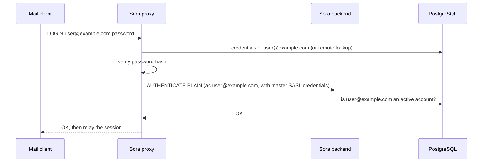

# Sora Authentication

This document explains how Sora checks a login. It covers accounts and their credentials, how a
login name is read, the password schemes Sora accepts and writes, the bcrypt cost, master
credentials, the login commands and SASL mechanisms of each protocol, the authentication rate
limiter with its delays and blocks, and how cached logins are cancelled when a password changes. It
is written for operators who run Sora and for contributors who
change the login code.

Related documents:

- [SECURITY.md](SECURITY.md): TLS and plaintext logins (`insecure_auth`), trusted networks and the
  PROXY protocol, connection limits, timeouts and the other protections.
- [PROXY.md](PROXY.md): how proxies route a user, remote lookup, the proxies' lookup cache and the
  SQLite auth cache.
- [ADMIN_CLI.md](ADMIN_CLI.md) and [ADMIN_API.md](ADMIN_API.md): creating accounts and credentials.
- [USER_API.md](USER_API.md): logins and tokens of the HTTP User API.

## Contents

1. [Where logins are checked](#1-where-logins-are-checked)
2. [Accounts and credentials](#2-accounts-and-credentials)
3. [How a login name is read](#3-how-a-login-name-is-read)
4. [Password schemes](#4-password-schemes)
5. [bcrypt cost and rehashing](#5-bcrypt-cost-and-rehashing)
6. [A login on a backend, step by step](#6-a-login-on-a-backend-step-by-step)
7. [A login on a proxy](#7-a-login-on-a-proxy)
8. [Master credentials](#8-master-credentials)
9. [Login commands and SASL mechanisms](#9-login-commands-and-sasl-mechanisms)
10. [Authentication rate limiting](#10-authentication-rate-limiting)
11. [Trusted networks and logins](#11-trusted-networks-and-logins)
12. [Cached logins and password changes](#12-cached-logins-and-password-changes)
13. [Logs and metrics](#13-logs-and-metrics)
14. [Code map](#14-code-map)

---

## 1. Where logins are checked

Sora has two kinds of mail listeners that accept logins:

- **Backends** (`type = "imap"`, `"pop3"`, `"managesieve"`) hold the mailboxes. A backend checks a
  password against the `credentials` table in PostgreSQL.
- **Proxies** (`type = "imap_proxy"`, `"pop3_proxy"`, `"managesieve_proxy"`) sit in front of
  backends. A proxy checks the password itself, with a remote lookup service or with PostgreSQL. It
  then picks a backend and logs in there on the user's behalf with the **master SASL** credentials
  (section 8). The backend trusts that login and does not see the user's password.



LMTP (`lmtp`, `lmtp_proxy`) has no login. Who may deliver is decided by the client's network address
([SECURITY.md](SECURITY.md#3-trusted-networks-and-the-proxy-protocol)).

The HTTP Admin API uses an API key, and the HTTP User API exchanges a password for a JWT. See
[ADMIN_API.md](ADMIN_API.md) and [USER_API.md](USER_API.md).

---

## 2. Accounts and credentials

An **account** owns the mailboxes, messages and Sieve scripts. A **credential** is an address that
can log in to an account. Each credential has its own password hash. The tables are `accounts` and
`credentials`.

- Every account has exactly one **primary** credential (`primary_identity = true`). It may have any
  number of other credentials, often called aliases.
- A login with any credential's address and that credential's password opens the account. Inside the
  session the user is always the account's primary address. The IMAP log line then shows both, for
  example `login_address=alias@example.com primary_address=user@example.com`.
- Each credential address is also an address the account receives mail on: LMTP looks the recipient
  up in the same table.
- An account that has been deleted and is in its grace period cannot log in. The reply is the same
  as for a wrong password.
- Sora refuses to delete the primary credential, and refuses to delete the last credential of an
  account.
- Sora refuses to make a credential in another domain the primary one if the account already has
  messages.

Addresses are stored in lower case, and every lookup compares in lower case.

Create and change credentials with `sora-admin` ([ADMIN_CLI.md](ADMIN_CLI.md)) or the Admin API
([ADMIN_API.md](ADMIN_API.md)). For example:

```sh
sora-admin --config config.toml accounts create --email user@example.com --password 'a-long-passphrase'
sora-admin --config config.toml credentials add --primary user@example.com \
  --email alias@example.com --password 'another-passphrase'
sora-admin --config config.toml accounts update --email user@example.com --password 'changed-passphrase'
```

Every change to a password, a credential address or an account's status also drops the account's
cached logins on every node, whichever tool or SQL statement made it (section 12).

---

## 3. How a login name is read

Every login name goes through the same parser ([server/address.go](../server/address.go)) before
Sora looks it up:

1. Spaces at the start and end are removed. A name with a space, tab or line break inside is
   refused.
2. The name must be valid UTF-8 and must contain `@`.
3. If the name contains a **second** `@`, everything after it is a **suffix**:
   `user@example.com@SUFFIX`. The suffix keeps its case. Section 8 and [PROXY.md](PROXY.md#4-remote-lookup)
   explain what a suffix does.
4. The address part is lower-cased. The local part must be an RFC 5321 dot-string; non-ASCII
   characters are allowed (RFC 6531). An internationalised domain is converted to its ASCII form
   (`xn--...`).
5. Length limits: 256 bytes for the local part, 255 for the domain, 512 for the whole address.
6. **Plus addressing.** Everything from the first `+` in the local part is dropped for the login. So
   `user+lists@example.com` logs in as `user@example.com`, with that account's password.

The address that Sora then looks up is the **base address**: lower case, no `+tag`, no suffix.

A name that does not parse fails the login like a wrong password: the client gets the protocol's
bad-credentials reply (section 6), and the attempt counts as a failed login for the rate limiter. The
reply does not say that the name was malformed, so it cannot be used to probe which names Sora
accepts.

The same holds for every credential no account can have: a name that does not parse, an empty
password, and a name or password that is not valid UTF-8 (on POP3, and in a SASL PLAIN message on
every listener, section 9). They are refused without a lookup, but after the progressive delay and
the rate-limit check, and recorded as a failed login, so a client sending such credentials is
slowed and blocked like one guessing passwords. They cannot be any master password, so counting
them reveals nothing about one.

A suffix that is not the configured `master_username`, and the `master_username` suffix with any
password other than `master_password` (section 8.1):

- on a proxy with remote lookup, is part of the name sent to the lookup service, which can treat it
  as a token ([PROXY.md](PROXY.md#4-remote-lookup));
- everywhere else, is ignored: the base address is checked with the password given.

---

## 4. Password schemes

The stored hash is either a bare bcrypt hash or Dovecot's `{SCHEME}data` form, where the scheme
name says how to check it. Sora verifies these ([db/password_hash.go](../db/password_hash.go),
[db/auth.go](../db/auth.go)):

| Stored hash starts with | Scheme | Notes |
|---|---|---|
| `$2a$`, `$2b$`, `$2y$` | bcrypt | Standard bcrypt. |
| `{BLF-CRYPT}` | bcrypt | Dovecot's name for bcrypt. Sora writes new bcrypt hashes in this form: `{BLF-CRYPT}$2a$12$...`. |
| `{CRYPT}` | bcrypt | Only when the data is a bcrypt hash (`$2a$`, `$2b$` or `$2y$`). |
| `{SSHA512}` | salted SHA-512 | The decoded value is the 64-byte SHA-512 of password + salt, followed by the salt. Base64 by default. |
| `{SHA512}` | SHA-512 without salt | Accepted for logins of old accounts. Base64 by default; a value of exactly 128 characters is read as hex when it is valid hex. |

As in Dovecot, the scheme name is not case-sensitive, and an encoding suffix may follow it:
`.b64` or `.base64` for base64, `.hex` for hex (`{SSHA512.HEX}...`). Base64 data may contain
spaces and line breaks. Comparisons of SHA-512 digests are constant-time.

Sora does not verify any other scheme. This includes the other crypt(3) algorithms (`$1$`, `$5$`,
`$6$`, `{SHA512-CRYPT}`, `{MD5-CRYPT}`), Argon2, PBKDF2, SCRAM and plaintext schemes. A stored hash
that Sora cannot check (an unknown scheme, data that does not decode, a wrong length or a malformed
bcrypt hash) is not treated as a wrong password: no password could ever match it, so the login gets
a temporary failure and is not counted by the rate limiter (section 6). Sora logs
`Password hash cannot be verified` at ERROR with the reason, but never any part of the stored value.

**Writing hashes.** When Sora is given a plaintext password it writes:

- `bcrypt` (the default): `{BLF-CRYPT}` plus a bcrypt hash.
- `ssha512`: `{SSHA512}` plus base64 of SHA-512(password + 8 random bytes of salt) and the salt.

SHA-512 without salt is not written for new passwords: `sora-admin` (`--hash` and a
`--credentials` JSON list) and the Admin API's `credentials` array refuse `sha512` as a hash
type.

bcrypt uses at most 72 bytes of a password. Sora refuses to write a bcrypt hash for a longer
password: the account or credential change fails with an invalid-request error.

`--password-hash` (sora-admin) and `password_hash` (Admin API) store a hash you computed elsewhere,
exactly as given. Sora first checks that it is a hash it can verify (the table above) and refuses
the change otherwise, so a credential that no password could open is never stored.

**Which to use.** Use bcrypt. A salted or unsalted SHA-512 hash takes one SHA-512 computation to
check, so a stolen database can be guessed against very fast. Sora never converts an SHA-512 hash to
bcrypt by itself: the rehash in section 5 only touches bcrypt hashes. To move an account to bcrypt,
set its password again (`sora-admin accounts update --password ...` writes bcrypt by default).

---

## 5. bcrypt cost and rehashing

`bcrypt_cost` is a top-level key (outside any section):

```toml
bcrypt_cost = 12
```

| Property | Value |
|---|---|
| Type | integer |
| Default | `12` |
| Allowed | 10 to 14. A smaller value is raised to 10 and a larger one lowered to 14, without a warning. |
| When read | At startup of `sora`, and by each `sora-admin` command. A SIGHUP reload does not change it. |

Each step up doubles the CPU time of every bcrypt check. Raise it only if your nodes have CPU to
spare at the login peak (for example after a restart, when every client logs in again).

`bcrypt_cost` is used for:

- bcrypt hashes the server writes (Admin API account and credential changes);
- bcrypt hashes `sora-admin` writes (`accounts create`, `accounts update`, `credentials add`);
- the rehash target;
- what a failed login costs: the dummy check for an unknown address, and the least a wrong
  password costs whatever the stored hash (section 6).

**Rehash.** After a successful login that was checked against PostgreSQL, Sora looks at the stored
hash. If it is bcrypt (bare, `{BLF-CRYPT}` or `{CRYPT}`) and its cost differs from `bcrypt_cost`,
higher or lower, Sora computes a hash at the configured cost in the background and stores it. The
login does not wait for this.

- The new hash keeps the `{BLF-CRYPT}` prefix if the old hash had one. Any other bcrypt hash,
  including a `{CRYPT}` one, is stored as a bare bcrypt hash.
- Sora stores the new hash only if the credential still has the hash that was checked, still
  belongs to the same account, and the account is still active. A password change or deletion
  made while bcrypt was running is never overwritten.
- A successful rehash logs `Rehash: Successfully rehashed and updated password`. Because the stored
  hash changed, the account's cached logins are dropped as for any password change (section 12),
  and the next login is checked against the database again.

- Backends (IMAP, POP3, ManageSieve) run at most half as many rehashes at once as the node has CPUs
  (at least one). When all slots are busy, the rehash is skipped and happens at a later login.
- Proxies rehash after logins they checked in PostgreSQL.
- No rehash happens for logins answered from a cache, for master logins, for logins answered by a
  remote lookup service, or for User API logins.
- A rehash does not change the credential's `updated_at`, so User API tokens stay valid.

---

## 6. A login on a backend, step by step

This is the order on an IMAP, POP3 or ManageSieve backend. The code is in `server/imap/login.go`,
`server/imap/sasl.go`, `server/pop3/session.go` and `server/managesieve/session.go`.

1. **Connection admission.** Before any login, the connection passed the connection limits, and on
   IMAP the check for an IP that the rate limiter has blocked
   ([SECURITY.md](SECURITY.md#4-connection-limits), section 10.7 below).
2. **Plaintext gate.** On a connection without TLS, a login is accepted only if the listener allows
   plaintext logins ([SECURITY.md](SECURITY.md#2-tls-and-plaintext-logins)).
3. **Empty password.** Refused after the rate-limit check (step 6), without a lookup, as a failed
   login (section 3).
4. **Rate-limit key.** Sora derives the key for this attempt (section 10.2).
5. **Progressive delay.** If rate limiting is on and the client's IP has recent failures, Sora waits
   before going on (section 10.3).
6. **Rate-limit check.** If the IP, or the IP and this name, is blocked, the login fails with the
   same reply as a wrong password (section 10.7).
7. **Master forms.** If the name or the SASL authorization identity is a master login, it is handled
   as in section 8.
8. **Lookup cache.** Each backend listener keeps a small in-memory cache of recent logins (below).
9. **Database.** Sora reads the credential's account ID and hash, joined with `accounts` to skip
   deleted accounts. The query runs on the read pool and is retried up to two times on errors.
10. **Unknown address.** Sora runs a bcrypt check against a dummy hash at the current cost, so that
    the reply takes about as long as for a wrong password. The address does not leak through timing.
11. **Verify** the password against the hash (section 4). A wrong password costs at least one
    bcrypt check at `bcrypt_cost`, whatever the stored hash: after a failed SHA-512 check Sora runs
    one against a dummy hash, and after a failed check of a bcrypt hash below `bcrypt_cost` one at
    each cost from the hash's up to `bcrypt_cost` - 1, which adds up to one check at `bcrypt_cost`.
    A wrong password then takes about as long as an unknown address, whatever the account's scheme.
    A bcrypt hash above `bcrypt_cost` takes longer, until the rehash (section 5) brings it down.
12. **Failure.** The attempt is recorded for the rate limiter and the reply is the "bad credentials"
    reply of the protocol. A database error, or a stored hash Sora cannot check (section 4), is not
    a failed login: it gets a temporary failure (below).
13. **Success.** The attempt is recorded as a success, which clears the failure counts of this IP
    and of this IP and name (section 10.2). Sora caches the login and queues a rehash if needed.
    IMAP and POP3 also create the account's default mailboxes if they are missing, and refuse the
    login with a temporary failure if this backend is in maintenance mode
    ([PROXY.md](PROXY.md#9-backend-maintenance-mode)). Last, the per-user connection limit is applied
    ([SECURITY.md](SECURITY.md#4-connection-limits)).

The bad-credentials replies are:

| Protocol | Reply |
|---|---|
| IMAP | `NO [AUTHENTICATIONFAILED] Invalid address or password` |
| POP3 | `-ERR [AUTH] Authentication failed` |
| ManageSieve | `NO "Authentication failed"` |

A login that cannot be checked gets a temporary failure instead and is not recorded as a failure:
`NO [UNAVAILABLE] ...` (IMAP), `-ERR [SYS/TEMP] ...` (POP3) or `NO (TRYLATER) ...` (ManageSieve).
This covers a database error, a database that does not answer in time, a stored hash Sora cannot
check, and a server that is shutting down. During a database outage, clients are told to try again
later, and once the database is back the user logs in normally. The same holds for master logins
(section 8).

### The backend lookup cache

Each backend listener caches recent logins in memory, keyed by the base address. It is on by default.

- A success entry is used only while it is younger than `positive_revalidation_window` (30 seconds)
  and only for the same password. The password is compared through a salted, keyed digest; the
  plaintext password is never stored. Sora still verifies the cached hash. What it saves is the
  database round trip.
- An older entry goes to the database. A different password drops the success entry first and then
  goes to the database. So during a database outage, guesses at the password get a temporary
  failure; they are never checked against the cached hash, where the rate limiter would not see
  them.
- A failure entry never refuses a login. The next attempt is always checked against the database.
  Failure entries hold no password material.
- The cache serves no logins until the node has read the credential change feed (section 12), and
  an account's entries are dropped when its password, credentials or status change.

Settings are in `[server.lookup_cache]` inside the server block:

| Key | Default | Meaning |
|---|---|---|
| `enabled` | `true` | Set `false` to turn the cache off. Keys left out of the table keep their defaults. |
| `positive_ttl` | `5m` | How long a success entry is kept. |
| `negative_ttl` | `1m` | How long a failure entry is kept. |
| `max_size` | `10000` | Entries per listener. `0` or less gives 10000. When full, the entry that expires first is removed. |
| `cleanup_interval` | `5m` | How often expired entries are removed. |
| `positive_revalidation_window` | `30s` | Age up to which a success entry can answer a login. |

Durations take Go units (`30s`, `5m`, `1h`) or whole days (`1d`). An unparseable value falls
back to the default with a log line. The proxies use the same table with different rules; see
[PROXY.md](PROXY.md#10-lookup-cache).

---

## 7. A login on a proxy

The IMAP, POP3 and ManageSieve proxies check the password before they choose a backend. For the IMAP
proxy the order is ([server/imapproxy/session.go](../server/imapproxy/session.go); the POP3 and
ManageSieve proxies follow the same plan):

1. Plaintext gate, as on a backend. An empty password, and on the POP3 proxy a name or password
   that is not valid UTF-8, is refused after the rate-limit check (step 3), without a lookup, as a
   failed login (section 3).
2. Progressive delay for the client's IP (section 10.3).
3. Rate-limit check. A blocked attempt ends the connection (section 10.7), whether or not the login
   is cached.
4. The proxy's lookup cache ([PROXY.md](PROXY.md#10-lookup-cache)). A hit with the same password
   answers the login without a database query.
5. A name with the proxy's `master_username` as suffix is checked against the proxy's
   `master_password` here (section 8).
6. With remote lookup configured, the lookup service authenticates and routes the user
   ([PROXY.md](PROXY.md#4-remote-lookup)). As on a backend, only a real verdict is a failed
   login: a `401` or `403` refuses the account, and a wrong password against the hash the service
   returned is a wrong password. An answer that says nothing about the password (the service
   down, a `5xx`, `408`, `429` or other `4xx`, a `200` that is not a valid answer, or a returned
   hash Sora cannot check) gives the client a temporary failure and is not counted. The status
   codes are listed in [PROXY.md](PROXY.md#43-status-codes).
7. Otherwise, or when the lookup says the user is not found and `lookup_local_users = true`, the
   proxy checks PostgreSQL. With `[auth_cache]` on, it tries the local SQLite cache first
   ([PROXY.md](PROXY.md#11-auth-cache)). On success it may rehash (section 5).
8. The proxy picks a backend and logs in there with `AUTHENTICATE PLAIN`, using the user's base
   address (or the address the lookup returned) as authorization identity, and its own
   `master_sasl_username` and `master_sasl_password` as the credentials.

So every backend behind a proxy needs the same `master_sasl_username` and `master_sasl_password` as
the proxy. Restrict where those may come from with `master_sasl_allowed_networks` (section 8).

What a client cannot do through a proxy:

- Act as another user with a SASL authorization identity. The IMAP and ManageSieve proxies accept
  one that names the user the login reaches (the authentication identity, or the address the login
  resolved to, such as the master username form's target) and refuse any other once the password
  checked out, with the backends' replies (section 8.2): `NO [AUTHORIZATIONFAILED] Proxy login not
  permitted for this user.` (IMAP), `NO "Proxy authentication requires master credentials"`
  (ManageSieve). Such a refusal is not a successful login: it does not clear the rate limiter's
  failure counts, is not counted as a success in the metrics, and leaves the connection
  unauthenticated. The POP3 proxy refuses an `AUTH PLAIN` whose authorization identity differs from
  the authentication identity, with
  `-ERR [AUTH] Authorization identity not supported on proxy (configure master SASL on backend)`.
- Use master SASL credentials. Those are for the proxy's own login to backends.

A backend behind proxies usually listens without TLS on a private address. Plaintext logins are then
allowed on it, and the proxies' master SASL password crosses that network in clear unless the
backend leg uses TLS ([PROXY.md](PROXY.md#8-the-backend-leg)). Make sure only the proxies can reach
backend ports.

---

## 8. Master credentials

Master credentials let one secret log in as any user. There are two kinds, set per `[[server]]`
block.

### 8.1 Master username: `master_username` and `master_password`

A person who knows the master password logs in as a user by appending `@` and the master username
to the user's address, and giving the master password:

```toml
[[server]]
type = "imap"
name = "imap"
addr = ":993"
tls = true
master_username = "support"
master_password = "a-long-random-secret"
```

```
a1 LOGIN user@example.com@support a-long-random-secret
```

- Works with IMAP `LOGIN` and `AUTHENTICATE PLAIN`, POP3 `USER`/`PASS` and `AUTH PLAIN`, and
  ManageSieve `AUTHENTICATE` and `LOGIN`, on backends and on the three mail proxies. A proxy checks
  the master password itself and then routes the user like any other login.
- The suffix must equal `master_username` exactly, including case.
- On a backend with SASL PLAIN, if the client also sends an authorization identity, that identity is
  the user to log in as. Otherwise it is the address before the suffix. A proxy logs in only as the
  address before the suffix and refuses an authorization identity naming anybody else (section 7).
- The target must be an active account. A target that is not a valid address, or a target account
  that does not exist, gets the protocol's bad-credentials reply and is counted as a failed login.
  If the database cannot be asked about the target, the login gets a temporary failure and is not
  counted.
- Any other password is not a master login. The name is then handled like a name with any other
  suffix (section 3): the user's own password logs in as the user, and anything else gets the
  bad-credentials reply. The failure is counted under the master credential's key, the success
  under the user's (section 10.2).

### 8.2 Master SASL: `master_sasl_username` and `master_sasl_password`

This is the standard SASL PLAIN way to act as another user: the **authentication identity** is the
master SASL username, the **password** is the master SASL password, and the **authorization
identity** is the user to log in as. It is how proxies log in to backends.

```
AUTHENTICATE PLAIN base64("user@example.com" NUL "proxyuser" NUL "proxy-secret")
```

- Accepted by the backends only: IMAP `AUTHENTICATE PLAIN`, POP3 `AUTH PLAIN` and ManageSieve
  `AUTHENTICATE PLAIN`. ManageSieve's `LOGIN` command never accepts master SASL credentials.
- On a proxy, these two keys are the credentials it uses towards its backends. Clients cannot use
  them through the proxy.
- Without an authorization identity, the submission is not a master login. It is handled as an
  ordinary login by that username and fails like any wrong password, unless an account really has
  that address. Sora logs `master SASL password presented without an authorization identity; not a
  master login, falling through to regular authentication` at WARN, which helps when a proxy is
  misconfigured.
- A client that does not use the master SASL username, and sends an authorization identity that
  differs from its authentication identity, is refused: `NO [AUTHORIZATIONFAILED] Proxy login not permitted for this user.`
  (IMAP), `-ERR [AUTH] Proxy authentication requires master credentials` (POP3), `NO "Proxy
  authentication requires master credentials"` (ManageSieve). The refusal comes only after the
  password checked out, and logs `authorization failed`.

### 8.3 `master_sasl_allowed_networks`

A list of IPs or CIDRs, per backend `[[server]]` block (`imap`, `pop3`, `managesieve`). When it is
set, master logins of **both** kinds are accepted only from those source addresses: master SASL
(8.2) and the master username form (8.1). Both let one secret log in as anyone, so one list confines
both. The check uses the real TCP peer, which a PROXY header, XCLIENT or IMAP ID forwarding cannot
change. So list the proxy hosts, not client networks.

```toml
master_sasl_allowed_networks = ["10.20.0.5", "10.20.0.6"]
```

- Empty (the default): master logins are accepted from any source. If master SASL is configured
  without this list, the backend logs a warning at startup, for example `IMAP: master SASL enabled
  without master_sasl_allowed_networks; backend trusts any source that knows the secret. ...`
- An entry that is not an IP or CIDR is refused: startup stops, `sora-admin config validate` fails
  the file, and a SIGHUP reload skips that server's block, which keeps its previous settings.
- A login with a correct master secret from another address gets the bad-credentials reply, is
  counted as a failed login, and logs, for example, `master SASL credentials valid but source not in
  master_sasl_allowed_networks; rejecting` (or `master username credentials valid ...`).
- The proxies do not read this key. A proxy checks the master username form itself (section 7), so
  restrict who can reach a proxy that has `master_username` set, or leave that key unset on proxies.

### 8.4 Rules common to both

- Startup is refused if `master_username` is set and `master_password` is empty, or
  `master_sasl_username` is set and `master_sasl_password` is empty. The message is, for example:
  `server "imap": master_username is set but master_password is empty; refusing to start (an empty
  password would allow impersonation of any account)`.
- Secrets are compared in constant time.
- Every failure reply looks like a wrong password, so a reply cannot confirm a guessed master
  username or password. The real reason is logged at WARN.
- Every refusal also takes as long as a wrong password. A wrong master password is checked as the
  base address's own login, so it costs one password check like any other wrong password. A correct
  master secret that is then refused (a source outside `master_sasl_allowed_networks`, a target that
  does not parse, a target with no account) is checked the same way before the refusal, so it costs
  the same. The response time therefore cannot confirm a guessed master username or password
  either.
- Rate limiting counts master attempts under the master credential's own key, never under the
  account they name (section 10.2). A wrong master password therefore cannot lock out the user it
  names, and each source IP gets the normal number of guesses at the master password.
- On SIGHUP, `master_sasl_username`, `master_sasl_password` and `master_sasl_allowed_networks` are
  reloaded on backends, and `master_sasl_username` and `master_sasl_password` on the IMAP, POP3 and
  ManageSieve proxies. `master_username` and `master_password` need a restart. See
  [OPERATIONS.md](OPERATIONS.md).
- A master login logs `authentication successful ... method=master`.

---

## 9. Login commands and SASL mechanisms

| Listener | Plain login | SASL | Notes |
|---|---|---|---|
| `imap` | `LOGIN` | `AUTHENTICATE PLAIN` | Advertises `AUTH=PLAIN` when logins are allowed, `LOGINDISABLED` otherwise. |
| `imap_proxy` | `LOGIN` | `AUTHENTICATE PLAIN`, with or without an initial response | Before login it advertises `IMAP4rev2 IMAP4rev1 SASL-IR LITERAL- AUTH=PLAIN` (with `STARTTLS`, and `LOGINDISABLED` in place of `AUTH=PLAIN`, on a STARTTLS port before the upgrade). |
| `pop3` | `USER` / `PASS` | `AUTH PLAIN` | No APOP. `USER` and `SASL PLAIN` appear in `CAPA` only where logins are allowed. |
| `pop3_proxy` | `USER` / `PASS` | `AUTH PLAIN` | As above. |
| `managesieve` | `LOGIN` (not part of RFC 5804) | `AUTHENTICATE "PLAIN"` | The `SASL` capability is `"PLAIN"` where logins are allowed, `""` otherwise. |
| `managesieve_proxy` | none | `AUTHENTICATE "PLAIN"` | |
| `lmtp`, `lmtp_proxy` | none | none | Admission by network address. |

No other SASL mechanism is offered (no `LOGIN`, `CRAM-MD5`, `SCRAM-*`, `XOAUTH2` or `OAUTHBEARER`).
Because PLAIN carries the password in clear, Sora refuses these commands on an unencrypted
connection unless plaintext logins are allowed on that listener
([SECURITY.md](SECURITY.md#2-tls-and-plaintext-logins)).

RFC 4616 defines every field of a PLAIN message (authorization identity, authentication identity,
password) as UTF-8. On every listener above, a PLAIN message with a field that is not valid UTF-8
names no account: it gets the bad-credentials reply (section 6) before anything is looked up, and
counts as a failed login, like a name that does not parse (section 3). The POP3 proxy refuses any
authorization identity other than the authentication identity before the lookup anyway.

On the IMAP backend, `AUTH=PLAIN` cannot be removed with `disabled_caps` or a `client_filters` entry.
Sora logs a warning for such an entry and keeps advertising the mechanism wherever logins are
allowed.

On the POP3 backend, `USER` and `PASS` arguments wrapped in double quotes are unquoted.

---

## 10. Authentication rate limiting

The rate limiter slows down and then blocks password guessing. It counts failed logins by client IP
and by IP plus login name, makes repeated failures wait longer, and blocks for a while after too many.
The code is in [server/auth_rate_limiter.go](../server/auth_rate_limiter.go) and
[server/auth_delay_helper.go](../server/auth_delay_helper.go).

### 10.1 Turning it on

Rate limiting is **off** unless a server block turns it on. It is set per `[[server]]` block, in an
`auth_rate_limit` table:

```toml
[[server]]
type = "imap_proxy"
name = "imap-proxy"
addr = ":993"
tls = true
remote_addrs = ["10.20.1.10:143", "10.20.1.11:143"]

[server.auth_rate_limit]
enabled = true
```

The dotted form inside the block works too: `auth_rate_limit.enabled = true`.

It applies to `imap`, `pop3`, `managesieve`, `imap_proxy`, `pop3_proxy`, `managesieve_proxy`,
`http_user_api` and `user_api_proxy` blocks. Turn it on wherever clients log in: on the proxies when
you run proxies, on the backends otherwise.

A `user_api_proxy` limits every login that passes it, with one count per client: those its backends
answer, and those it answers itself (with named pools, a login for an address the remote lookup does
not know or refuses; [USER_API.md](USER_API.md#121-how-a-request-is-routed)). Leave the limiter off
on the `http_user_api` backends behind it: they see only the logins for addresses the lookup knows,
so their delays and blocks would show which addresses those are.

With `enabled = true`, every key you leave out, or set to `0`, gets its default. A `0` therefore never
switches a tier off or removes a size cap.

The duration keys take Go units (`"90s"`, `"15m"`, `"1h"`) or whole days (`"1d"`), like the other
durations.

| Key | Default | Meaning |
|---|---|---|
| `enabled` | `false` | Turn rate limiting on for this server. |
| `max_attempts_per_ip_username` | `5` | Tier 1: failures of one name from one IP before that pair is blocked. |
| `ip_username_block_duration` | `15m` | Tier 1: how long the pair stays blocked. |
| `ip_username_window_duration` | `10m` | Tier 1: a pair's count is forgotten once it has had no failure for this long. |
| `max_attempts_per_ip` | `50` | Tier 2: failures from one IP, any name, before the whole IP is blocked. |
| `ip_block_duration` | `30m` | Tier 2: how long the IP stays blocked. |
| `ip_window_duration` | `30m` | Tier 2: an IP's count is forgotten once it has had no failure for this long. |
| `max_attempts_per_username` | `10` | Statistics only. Shown in the limiter's stats; it never blocks. |
| `username_window_duration` | `60m` | Statistics only: how long a name's failure count is kept. |
| `delay_start_threshold` | `2` | Failures from an IP before its logins are delayed. |
| `initial_delay` | `1s` | The first delay. |
| `max_delay` | `30s` | The longest delay. An HTTP login's write timeout starts after it (section 10.3). |
| `delay_multiplier` | `2.0` | Each further failure multiplies the delay by this. |
| `cleanup_interval` | `5m` | How often expired entries are removed and the gauges updated. |
| `max_ip_username_entries` | `100000` | Size cap of the Tier 1 table. |
| `max_ip_entries` | `50000` | Size cap of the Tier 2 table. |
| `max_username_entries` | `50000` | Size cap of the statistics table. |
| `exempt_networks` | not set | IPs and CIDRs never counted or blocked (section 10.5). |

### 10.2 The two tiers

**The key.** Every attempt is counted under the client IP and a name key:

- the base address of the login name, lower case, without `+tag` (section 3). `User@Example.com`,
  `user+a@example.com` and `user@example.com` are one key, so varying them does not get more tries;
- for the master username form `user@example.com@support`, the key `master:support`, so the attempt
  is charged to the master credential and not to `user@example.com`. A success with the user's own
  password instead of the master password (section 8.1) is the user's login: it is recorded under
  `user@example.com`, so it cannot clear the failed guesses at the master password;
- for a master SASL login, the master SASL username;
- for a name that does not parse, the name itself, trimmed and lower-cased.

For a client behind a trusted host that forwards its address (PROXY protocol, XCLIENT or IMAP ID),
the IP is the forwarded client address. See section 11.

**Tier 1, IP and name.** Each failure adds one to the count of that IP and name. When the count
reaches `max_attempts_per_ip_username`, that name is blocked from that IP for
`ip_username_block_duration`. Other names from the same IP, and the same name from other IPs, are not
affected. This protects shared addresses such as office gateways: one user who mistypes cannot block
the office. When the block ends, the count starts again from zero.

**Tier 2, IP.** Each failure from the IP, whatever the name, adds one to the IP's count. When it
reaches `max_attempts_per_ip`, the whole IP is blocked for `ip_block_duration`. This catches one
address trying many names.

**Forgetting.** A count is forgotten when there has been no failure for the window
(`ip_username_window_duration` or `ip_window_duration`). Sora checks this every `cleanup_interval`,
so the real time can be up to one interval longer. An IP's Tier 2 count is not reset when its block
ends: if a failure comes in after the block ends but before the count is forgotten, the IP is blocked
again at once.

**Success.** A successful login clears the failure counts of that IP (Tier 2), of that IP and name
(Tier 1), and the name's statistics. A user behind a shared address who logs in correctly therefore
resets the shared address's count. While an address is blocked, every login from it is refused,
cached or not, so a success never lifts a block.

**Statistics.** Every failure, from any IP, also counts towards the name's statistics, kept for
`username_window_duration`. They feed the stats output only and never block: blocking by name alone
would let anyone lock any user out.

### 10.3 Progressive delays

Before it handles a login, Sora looks at the client IP's Tier 2 count. If the IP has at least
`delay_start_threshold` failures, the login waits first. The wait is `initial_delay` at the threshold
and is multiplied by `delay_multiplier` with each further failure, up to `max_delay`. With the
defaults:

| Failures from this IP so far | Wait before the next login is handled |
|---|---|
| 0 or 1 | none |
| 2 | 1 s |
| 3 | 2 s |
| 4 | 4 s |
| 5 | 8 s |
| 6 | 16 s |
| 7 or more | 30 s |

The wait applies to every login from that IP, including a correct password, until a success clears
the count or the count is forgotten. It applies once per login command. A client that closes the
connection while waiting ends the wait.

On the User API and the User API proxy the wait runs inside the HTTP request, whose 30-second write
timeout has already started. The timeout is moved to the end of the wait, so a delayed login is
answered and still has 30 seconds for its own work and its answer, whatever `max_delay` is. The wait
is never shortened to fit the timeout.

### 10.4 Waits in parallel

At most **10** logins from one IP may be waiting at the same time on a node, counted over all
listeners. The 11th is refused at once instead of waiting. This keeps an attacker from tying up
goroutines with delayed logins. The limit is fixed. The replies are:

| Listener | Reply |
|---|---|
| IMAP backend | `* BYE [ALERT] Too many concurrent authentication attempts. Please try again later.` |
| POP3 backend | `-ERR [IN-USE] Too many concurrent authentication attempts. Please try again later.` |
| ManageSieve backend | `NO "Too many concurrent authentication attempts. Please try again later."` |
| IMAP proxy | `<tag> NO Authentication failed` |
| POP3 proxy | `-ERR [AUTH] Authentication failed` |
| ManageSieve proxy | `NO "Authentication failed"` |
| User API, User API proxy | HTTP 429 `Too many concurrent authentication attempts. Please try again later.` |

### 10.5 Exempt networks

Logins from exempt addresses are never counted in Tier 1 or Tier 2, never blocked and never delayed.
Their failures still count in the name statistics.

```toml
[server.auth_rate_limit]
enabled = true
exempt_networks = ["10.20.0.30/32"]   # the webmail host
```

| `exempt_networks` | Who is exempt |
|---|---|
| not set | the addresses in `[servers] trusted_networks` (for `http_user_api`: nobody) |
| `[]` | nobody |
| a list | only those addresses |

Entries may be CIDRs or bare IPs. An entry that is neither, such as a host name, stops startup, and a
reload with it is skipped for that server. Keep the list short: your own webmail or relay hosts that
log in for many users from one address.

The check uses the client address after forwarding (section 11). On a backend behind proxies that
forward client addresses, listing the proxies in `trusted_networks` therefore does not exempt their
clients. Behind proxies that do not forward, every login on the backend comes from a proxy address,
which is exempt when it is in `trusted_networks`.

### 10.6 Size caps

Each table has a cap (`max_ip_username_entries`, `max_ip_entries`, `max_username_entries`). When a
table is full and a new entry is needed, the entry with the oldest first failure is dropped,
preferring entries that are not blocked. Making room never removes an active block. The caps keep
memory bounded during a large distributed attack. Raise them if the logs show the tables full at
normal load (`Auth rate limiter stats` lines, below).

### 10.7 What the client sees

| Listener | Login while blocked | Connection |
|---|---|---|
| `imap` | `NO [AUTHENTICATIONFAILED] Invalid address or password`, the same as a wrong password | Stays open. In addition, a new TCP connection from a Tier 2 blocked IP is closed before the TLS handshake, with no greeting; when a PROXY header names the blocked client, it gets `* BYE [ALERT] Too many failed authentication attempts. Please try again later.` instead, after the TLS handshake on an implicit-TLS listener ([SECURITY.md](SECURITY.md#4-connection-limits)). |
| `pop3` | `-ERR [AUTH] Authentication failed`, the same as a wrong password | Stays open, but every error counts towards the POP3 error limit (4 errors, then the connection closes; [SECURITY.md](SECURITY.md#6-limits-on-failed-logins-per-connection)). |
| `managesieve` | `NO "Authentication failed"`, the same as a wrong password | Stays open; 10 errors close it. |
| `imap_proxy` | `<tag> NO Authentication failed`, then `* BYE [ALERT] Too many failed authentication attempts. Please try again later.` | Closed. |
| `pop3_proxy` | `-ERR [AUTH] Authentication failed`, the same as a wrong password | Closed. |
| `managesieve_proxy` | `NO "Authentication failed"`, the same as a wrong password | Closed. |
| `http_user_api`, `user_api_proxy` | HTTP 401 `Invalid credentials`, the same as a wrong password | n/a |

Backends hide the block on purpose: a reply that differs from a wrong password would tell an attacker
that an account or address is being limited. The IMAP proxy is the exception and says so with an
`[ALERT]`.

The wait of section 10.3 comes before the reply in every case.

### 10.8 Scope

- Each `[[server]]` block has its own limiter, in memory. Failures on the IMAP listener do not count
  on the POP3 listener, and two IMAP backend listeners on one node count separately.
- In cluster mode, with `[cluster.rate_limit_sync] enabled` (the default), the `imap_proxy`,
  `pop3_proxy` and `managesieve_proxy` limiters share their state with the proxies of the same type
  on every node, their own node included: Tier 2 blocks (`sync_blocks`), Tier 2 counts from
  `delay_start_threshold` on and the successes that clear them (`sync_failure_counts`), and the
  name statistics. A shared count only raises a listener's own, its `exempt_networks` are not
  counted, and a shared wait is capped at its `max_delay`. Tier 1 blocks stay on the listener that
  set them. See
  [CLUSTER.md](CLUSTER.md#66-authentication-rate-limits-imap-pop3-and-managesieve-proxies) for the
  details and [CONFIGURATION.md](CONFIGURATION.md#814-cluster-cluster) for the keys.
- A restart forgets all counts and blocks.
- `auth_rate_limit` is read at startup. A SIGHUP reload does not change it.

### 10.9 Seeing who is blocked

```sh
sora-admin --config config.toml stats blocked
sora-admin --config config.toml stats blocked --protocol imap_proxy
```

This asks the Admin API at `[admin_cli] addr` (`GET /admin/auth/blocked`, optionally
`?protocol=...`), so it shows the blocks of that one node. Protocol names are `imap`, `pop3`,
`managesieve`, `imap_proxy`, `pop3_proxy`, `managesieve_proxy`, `userapi` and `userapi_proxy`. Each
entry has the IP, the name for a Tier 1 block, `blocked_until`, the failure count, the first and
last failure and the type (`ip_username` or `ip`). A Tier 2 block that several listeners of one
protocol share (section 10.8) is listed once. There is no command to lift a block early; a restart
of the node clears them all. See [ADMIN_API.md](ADMIN_API.md#16-authentication-statistics).

---

## 11. Trusted networks and logins

`[servers] trusted_networks` lists the hosts Sora trusts to tell it a client's real address. It is
empty by default. Its full effect is described in
[SECURITY.md](SECURITY.md#3-trusted-networks-and-the-proxy-protocol). For logins it matters in two
ways:

- **The client IP.** A host in the list may pass on the client's address with a PROXY header (on a
  listener with `proxy_protocol = true`), with IMAP ID forwarding parameters, or with POP3
  `XCLIENT`. Logs and the rate limiter then use that forwarded address. From a host not in the
  list, ID forwarding is ignored, `XCLIENT` is refused, and the TCP peer is the client; a
  `proxy_protocol = true` listener closes the connection.
- **Behind a PROXY header**, the client the header names is the one judged: a client behind a
  trusted load balancer cannot replace its address with ID or `XCLIENT` unless its own address is
  in the list ([SECURITY.md](SECURITY.md#31-trusted_networks)).
- **Rate-limit exemption.** Unless `exempt_networks` is set, addresses in the list are exempt from
  rate limiting (section 10.5).

The master SASL gate (`master_sasl_allowed_networks`) is separate and always uses the TCP peer.

---

## 12. Cached logins and password changes

Sora keeps recent logins in three kinds of cache:

- the **lookup cache** of each backend listener (section 6) and of each proxy listener
  ([PROXY.md](PROXY.md#10-lookup-cache)), in memory;
- the **auth cache** (`[auth_cache]`, proxies only), in SQLite, which keeps successful PostgreSQL
  checks across restarts ([PROXY.md](PROXY.md#11-auth-cache)).

When a password changes, these caches must stop answering with the old one on every node. Sora does
this with a **credential change feed** in PostgreSQL.

### 12.1 The credential change feed

The table `credential_changes` (migration 69) gets a row, from database triggers, whenever:

- a credential's password, address or account changes;
- a credential is removed (also by an account purge);
- an account is taken out of service (soft-deleted or marked for purging), or deleted.

The triggers fire for every change, whether it was made by `sora-admin`, the Admin API, the User API
or SQL run by hand, and they are part of the same transaction.

Every node with database access reads the feed from the primary database every **5 seconds**, and
at once when a listener starts. For each changed account it then:

1. drops the account's entries from every lookup cache on the node, and from the node's auth cache;
2. if the account was taken out of service or deleted, ends the account's mail sessions on the node.
   A password change alone does not end open sessions.

The node remembers how far it has read only after all of this has succeeded. If any step fails, it
reads the same changes again at the next poll. A change committed late, by a long transaction, is
not skipped: the read position follows the database's transaction IDs, not the time of the change.

A kick or an account change through the Admin API also reaches the other nodes through the cluster,
which can be sooner than the next poll ([CLUSTER.md](CLUSTER.md)).

Rows are kept for **7 days** after a node first saw them, then deleted. The auth cache's `max_age`
is capped at those 7 days, so no cached login can be older than the feed that would cancel it.

### 12.2 When caches are not used

A cache that might hold a cancelled login answers nothing. Logins are then checked against the
database, so they still work, just without the cache's speed-up. This is the case:

- **At startup**, and for a listener added by a reload, until the node has read the feed once.
- **After a failed read** of the feed, or a failed step, until a later read succeeds. Sora logs
  `Credential changes: initial synchronization failed; ...` when the read at startup fails.
- **For the auth cache, until it is bound to the database.** The SQLite file records which database
  (by its UUID) and which feed version its entries came from. If either does not match, for example
  a file copied from another installation or one written before the feed existed, its entries are
  deleted before use. A file that matches keeps its entries across a normal restart.

A normal poll drops only the entries of changed accounts. The rest of the cache stays warm.

**After a long gap.** If a node could not read the feed for 7 days or more, or the database clock or
the feed's position went backwards, the node can no longer tell which accounts changed. It then
empties all its login caches and ends all its mail sessions before it uses the caches again.

### 12.3 Logins that race a change

A login that started before a change and finishes after it cannot put the old verdict back into a
cache: each cache entry carries a counter taken before its lookup, and an entry whose counter is
older than the last change is not stored.

A login that is checked just before its account is taken out of service (or kicked), and opens its
session just after, is disconnected at once. To keep this cheap, Sora keeps one counter per group of
accounts (1024 groups, by account ID), not one per account. A login of another account in the same
group, made in that same moment, can be disconnected too and must reconnect. Sessions that are
already open are never affected by another account's change.

### 12.4 The User API, remote lookup, and restores

- **User API.** The User API has no login cache. A login reads the address the same way as the
  mail protocols (lower case, internationalised domain converted to its ASCII form; a name that does
  not parse, or has a suffix, is a failed login answered with 401). It then reads the password hash
  and the credential's version from the primary database. A token refresh checks the credential
  there too, and is refused when the account is gone, when the address now belongs to another
  account, when the password changed after the token was issued, or when the token carries no
  credential version. An access token stays valid until it expires: the feed does not cancel tokens
  already issued ([USER_API.md](USER_API.md)). A `lookup_cache` table on an `http_user_api` block is
  ignored with a warning.
- **Remote lookup.** Credentials that a remote lookup service owns are not in PostgreSQL, so the feed
  knows nothing of them. Their cache follows the lookup cache's own lifetimes
  ([PROXY.md](PROXY.md#10-lookup-cache)). Nodes without database access read no feed.
- **Restoring PostgreSQL** to an earlier state keeps the database UUID, so the auth cache would trust
  entries newer than the restored data. Delete the auth cache file on every proxy node before you let
  logins in again.
- **Upgrades.** Only nodes that run a Sora version with the feed drop cancelled logins. Upgrade every
  node that caches logins.

---

## 13. Logs and metrics

Log lines (INFO unless noted), with the session's fields:

| Message | Meaning |
|---|---|
| `authentication successful` | A login succeeded. `method` is `main_db`, `cache`, `master` or `remotelookup`; `cached` says whether a cache answered. |
| `authentication failed` | A login failed. `reason` is `user_not_found`, `invalid_password` or `transient_error`. |
| WARN `authentication unavailable` | The password could not be checked, so the client got a temporary failure and the attempt was not counted. `reason` is `transient_error` (the database could not be asked) or `unverifiable_hash` (the stored hash cannot be checked, for example an unknown scheme). |
| `authorization failed` | On a backend: the password was right, but the client asked to act as another user (`authzid`) without master credentials (section 8.2). On the IMAP or ManageSieve proxy: the password was right, but the `authzid` names another user than the one the login reaches (section 7). |
| `rate limit exceeded` | A login was refused by the rate limiter; with `reason` (`ip_blocked` or `ip_username_blocked`), `failure_count`, `blocked_until`. |
| `Auth rate limiter: IP+username blocked (Tier 1)` | A Tier 1 block started. |
| `Auth rate limiter: IP blocked (Tier 2)` | A Tier 2 block started. |
| `IMAP: Rejected connection from rate-limited IP` | The IMAP backend closed a connection from a blocked IP. |
| `Auth delay: Queue full, rejecting connection` | The limit of section 10.4 was hit. |
| `Auth rate limiter stats` | Every 10th cleanup: table sizes and caps. |
| `Rehash: Successfully rehashed and updated password` | Section 5. |
| `Slow password verification` | A hash check took more than 100 ms. bcrypt at the default cost often takes about that long, so expect this line. A wrong password takes about that long whatever the scheme (section 6). |
| ERROR `Password hash cannot be verified` | A stored hash is not one Sora can check (section 4). The `type` and `error` fields say why; the value itself is never logged. Fix the credential with a new password. |
| WARN `Credential changes: initial synchronization failed; ...` | The node could not read the credential change feed at startup. Its login caches stay off until a read succeeds (section 12.2). |
| WARN `master username authentication failed (invalid master password)` | Section 8. |
| WARN `master SASL credentials valid but source not in master_sasl_allowed_networks; rejecting` | Section 8.3. |

Metrics (see [METRICS.md](METRICS.md)):

| Metric | Labels | Meaning |
|---|---|---|
| `sora_authentication_attempts_total` | `protocol`, `server_name`, `hostname`, `result` | Logins by result (`success`, `failure`, and on some listeners `rate_limited` or `unavailable`). |
| `sora_password_verification_attempts_total` | `hash_type`, `result` | Hash checks by scheme (`bcrypt`, `blf_crypt`, `crypt`, `ssha512`, `sha512`, `unknown`) and result. |
| `sora_password_dummy_verifications_total` | none | bcrypt checks against the dummy hash, run for failed logins that have no stored hash to check (an unknown address), so that they cost what a wrong password costs. |
| `sora_auth_rate_limiter_ip_username_entries` | `protocol`, `server_name`, `hostname` | Tier 1 table size. |
| `sora_auth_rate_limiter_ip_entries` | same | Tier 2 table size. |
| `sora_auth_rate_limiter_username_entries` | same | Statistics table size. |
| `sora_auth_rate_limiter_blocked_ips` | same | IPs blocked by Tier 2. |
| `sora_auth_delay_queue_depth` | `protocol` | Logins waiting on a delay. |
| `sora_auth_delay_completed_total`, `sora_auth_delay_cancelled_total`, `sora_auth_delay_rejections_total` | `protocol` | Delays that ran out, were cut short by a closed connection, or were refused (section 10.4). |

Per-address detail is in the logs and, for blocks, in `GET /admin/auth/blocked` (section 10.9).

---

## 14. Code map

| Path | What it holds |
|---|---|
| [server/address.go](../server/address.go) | Parsing login names, plus addressing, suffixes. |
| [db/auth.go](../db/auth.go) | Hash verification, hash generation, bcrypt cost, rehash, credential lookup, the dummy check for unknown addresses. |
| [db/accounts.go](../db/accounts.go) | Accounts and credentials. |
| [pkg/resilient/authentication.go](../pkg/resilient/authentication.go) | Retries; the proxies' database login with the auth cache and rehash. |
| [pkg/lookupcache/lookupcache.go](../pkg/lookupcache/lookupcache.go) | The in-memory lookup cache. |
| [server/imap/login.go](../server/imap/login.go), [server/imap/sasl.go](../server/imap/sasl.go) | IMAP backend logins. |
| [server/pop3/session.go](../server/pop3/session.go) | POP3 backend logins. |
| [server/managesieve/session.go](../server/managesieve/session.go) | ManageSieve backend logins. |
| [server/imapproxy/session.go](../server/imapproxy/session.go), [server/pop3proxy/session.go](../server/pop3proxy/session.go), [server/managesieveproxy/session.go](../server/managesieveproxy/session.go) | Proxy logins and the login to the backend. |
| [server/auth_rate_limiter.go](../server/auth_rate_limiter.go) | The two tiers, exemptions, size caps, blocked-entry listing. |
| [server/auth_rate_limit_key.go](../server/auth_rate_limit_key.go) | The rate-limit key, including the master keys. |
| [server/auth_delay_helper.go](../server/auth_delay_helper.go) | Progressive delays and the per-IP limit on waiting logins. |
| [server/master_sasl_gate.go](../server/master_sasl_gate.go) | `master_sasl_allowed_networks`. |
| [db/password_hash.go](../db/password_hash.go) | Parsing stored hashes: schemes, encodings, the check of a supplied hash. |
| [db/migrations/000069_credential_changes.up.sql](../db/migrations/000069_credential_changes.up.sql) | The credential change feed and its triggers. |
| [server/credchanges/watcher.go](../server/credchanges/watcher.go), [cmd/sora/credential_changes.go](../cmd/sora/credential_changes.go) | Reading the feed, dropping cached logins, suspending the caches. |
| [config/config.go](../config/config.go) | `AuthRateLimiterConfig`, its defaults and the merge of defaults; `GetBcryptCost`; master credential validation. |
