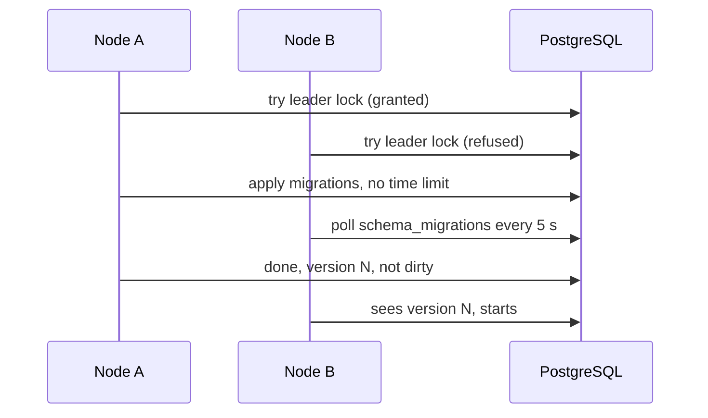

# Sora Database

This document explains how Sora uses PostgreSQL: what it stores there, what PostgreSQL needs,
how Sora connects (write and read endpoints, pools, TLS), which queries go where, the timeouts,
how Sora reacts when the database fails, how to run it behind PgBouncer, and how schema
migrations are applied and rolled back.

It is written for operators who run the PostgreSQL behind Sora, and for contributors who change
the database code. Search, which is the heaviest user of the database, has its own document,
[SEARCH.md](SEARCH.md). Message bodies live in S3; see [STORAGE.md](STORAGE.md).

## Contents

1. [What Sora keeps in PostgreSQL](#1-what-sora-keeps-in-postgresql)
2. [Requirements](#2-requirements)
3. [Connecting: the write and read endpoints](#3-connecting-the-write-and-read-endpoints)
4. [Connection pools](#4-connection-pools)
5. [Which queries use which endpoint](#5-which-queries-use-which-endpoint)
6. [Timeouts](#6-timeouts)
7. [Failover, retries and circuit breakers](#7-failover-retries-and-circuit-breakers)
8. [PgBouncer and other connection poolers](#8-pgbouncer-and-other-connection-poolers)
9. [Migrations](#9-migrations)
10. [Maintenance](#10-maintenance)
11. [Monitoring](#11-monitoring)
12. [Troubleshooting](#12-troubleshooting)

---

## 1. What Sora keeps in PostgreSQL

PostgreSQL is Sora's source of truth for everything except message bodies. Every account, login,
folder, message header, flag and search vector is a row in it. Message bodies are in S3, keyed
by their BLAKE3 hash.

| Table | What it holds |
|---|---|
| `accounts` | One row per account, with its deletion and purge marks. |
| `credentials` | Login addresses (the primary address and aliases) and their password hashes. |
| `mailboxes` | Folders. Deleted folders stay as tombstones until the cleaner removes them. |
| `subscriptions` | IMAP subscriptions, by folder name, per account. |
| `mailbox_acls` | Access rights to shared folders ([SHARED_MAILBOXES.md](SHARED_MAILBOXES.md)). |
| `messages` | One row per message per folder: UID, MODSEQ, dates, size, header columns, body structure, S3 location, expunge state. |
| `message_state` | Flags and keywords of each message, kept apart from `messages` so that a flag change does not rewrite the large message row. |
| `mailbox_stats` | Message count, unseen count, total size, highest MODSEQ and keyword list per folder, kept current by database triggers. |
| `messages_fts_v2` | Body search vectors. The only copy of this data; see [SEARCH.md](SEARCH.md#4-the-fts-table-and-the-fts-worker). |
| `pending_uploads` | Bodies waiting to be uploaded to S3, with the node that owns each and its upload lease. |
| `instance_heartbeats` | When each uploader instance was last alive. |
| `instance_sessions` | Open sessions each node reports, used to drain a backend for maintenance. |
| `backend_maintenance` | Backends taken out of rotation ([PROXY.md](PROXY.md)). |
| `sieve_scripts` | Sieve scripts per account. |
| `vacation_responses` | Which senders got a vacation reply and when. |
| `redirect_log` | Sieve redirects per account, for the redirect rate limit. |
| `metadata` | IMAP METADATA entries. |
| `locks` | Named locks with an expiry, for work that must run on exactly one node (TLS certificate issuance). |
| `health_status` | Current health of each node's components. |
| `cache_metrics` | Hit and miss counts of each node's local cache. |
| `schema_migrations` | The schema version and its dirty flag ([section 9](#9-migrations)). |

Two older tables, `messages_fts` and `message_contents`, are still in the schema. Sora does not
read or write them.

The schema is defined by the migration files in [db/migrations/](../db/migrations/). They are the
authoritative description of every table, index, trigger and function.

---

## 2. Requirements

### PostgreSQL

Use PostgreSQL 14 or later. Every node that serves the same users (backends, API servers, proxies
that look up local users) connects to the same database, directly or through replicas and
poolers. A proxy that only routes needs no database.

Create the database with UTF-8 encoding. Sora stores folder names, subjects and addresses as
UTF-8 text.

### Extensions

The migrations need two extensions from PostgreSQL's contrib package:

| Extension | Created by | Used for |
|---|---|---|
| `pg_trgm` | migration 000001 | Trigram indexes the schema creates on header columns. |
| `btree_gin` | migration 000050 | The search index on `(account_id, text_body_tsv)`, which scopes a body search to one account. |

The migrations run `CREATE EXTENSION IF NOT EXISTS` as Sora's database user. Both extensions are
"trusted", so a user with the `CREATE` privilege on the database (for example its owner) can
create them without being a superuser. Your distribution may ship contrib as a separate package
(for example `postgresql-contrib`). If Sora's user may not create extensions, create them
yourself before the first start:

```sql
CREATE EXTENSION IF NOT EXISTS pg_trgm;
CREATE EXTENSION IF NOT EXISTS btree_gin;
```

### Privileges

Migrations create and alter tables, indexes, triggers and functions. The simplest setup is a
database owned by Sora's user:

```sql
CREATE ROLE sora LOGIN PASSWORD 'change-me';
CREATE DATABASE sora_mail_db OWNER sora ENCODING 'UTF8' TEMPLATE template0;
```

### Server settings

- **`max_connections`**: large enough for every Sora process, see [section 4](#4-connection-pools).
- **`idle_in_transaction_session_timeout`**: if you set it, keep it well above one minute. Some
  of Sora's transactions stay open on purpose while they hold a lock across an S3 call, and
  run a statement at least every minute to stay alive (see [section 8](#8-pgbouncer-and-other-connection-poolers)).

---

## 3. Connecting: the write and read endpoints

Sora's `[database]` section has global settings and two endpoints:

- **`[database.write]`**: the primary. All writes go here, and so do reads that must see the
  latest data.
- **`[database.read]`**: optional read replicas. Most reads go here.

A minimal configuration with one PostgreSQL server:

```toml
[database.write]
hosts = ["db.example.com"]
port = 5432
user = "sora"
password = "change-me"
name = "sora_mail_db"
```

With two read replicas:

```toml
[database.write]
hosts = ["db-primary.example.com"]
port = 5432
user = "sora"
password = "change-me"
name = "sora_mail_db"

[database.read]
hosts = ["db-replica1.example.com", "db-replica2.example.com"]
port = 5432
user = "sora"
password = "change-me"
name = "sora_mail_db"
```

### Endpoint keys

`[database.write]` and `[database.read]` take the same keys. Defaults are what Sora uses when the
key is missing from the file.

| Key | Type | Default | Meaning |
|---|---|---|---|
| `hosts` | list of strings | `["localhost"]` | Database hosts. Each entry is a name or address, optionally with a port (`"db1.example.com:5433"`). With several hosts, Sora uses one at a time and fails over to the next ([section 7](#7-failover-retries-and-circuit-breakers)). |
| `port` | integer or string | `5432` | Port for host entries written without one. |
| `user` | string | `"postgres"` | Database user. |
| `password` | string | `""` | Password. |
| `name` | string | `"sora_mail_db"` | Database name. |
| `tls` | boolean | `false` | Encrypt the connection. See [TLS](#tls) below. |
| `max_connections` | integer | `100` | Most connections in one pool. See [section 4](#4-connection-pools). |
| `min_connections` | integer | `0` | Connections opened at startup and kept open. |
| `min_idle_connections` | integer | `5` (write), `10` (read) | Idle connections the pool keeps ready. The pool opens them in the background. |
| `max_conn_lifetime` | duration | `"1h"` | A connection older than this is closed and replaced. |
| `max_conn_idle_time` | duration | `"5m"` | An idle connection above `min_idle_connections` is closed after this time. |
| `query_timeout` | duration | `"30s"` | Timeout of read queries. See [section 6](#6-timeouts). |

Always set at least `hosts`, `user` and `name`.

Durations take Go units such as `"30s"`, `"5m"`, `"1h"`, or a whole number of days such as
`"7d"`. Setting `max_connections`, `min_connections` or `min_idle_connections` to `0` (or a
duration to `""`) leaves it to the driver's default (for `max_connections`, 4 or the number of
CPUs, whichever is larger).

### Rules that are easy to miss

- **Nothing is inherited.** `[database.read]` does not copy `user`, `password` or `name` from
  `[database.write]`. Repeat them, or the read endpoint uses the defaults above.
- **An endpoint you do not write is not configured.** Without a `[database.write]` (or
  `[database.read]`) section in the file, Sora has no such endpoint. This is how a proxy-only node
  runs without a database. A node that needs a database and has none refuses to start, and
  `sora-admin config validate` refuses the file, with `[database]: server "<name>" (<type>) needs
  the database, but it is not configured in [database.write] or [database.read]`.
- **User name and password** may contain any characters. Sora escapes them in the connection URL.
- **IPv6 addresses** go in brackets with a port: `hosts = ["[2001:db8::10]:5432"]`.

### Global keys

These keys go directly under `[database]`:

| Key | Type | Default | Meaning |
|---|---|---|---|
| `query_timeout` | duration | `"30s"` | Base timeout of read queries. See [section 6](#6-timeouts). |
| `search_timeout` | duration | `"1m"` | Timeout of search queries and some long reads. |
| `write_timeout` | duration | `"15s"` | Timeout of write transactions. |
| `lock_timeout` | duration | `"10s"` | How long a statement in a write transaction waits for a row lock. `"0"` turns it off. |
| `migration_timeout` | duration | `"2m"` | How long other nodes wait while one node applies migrations: three times this value. |
| `fetch_chunk_size` | integer | `5000` | Messages read per database query when a large FETCH is streamed. `0` or less means the default. |
| `debug` | boolean | `false` | Log every SQL statement and its arguments. |

`debug` logs the arguments too, which include password hashes, addresses and message text. Use it
only on a test system.

`sora-admin` uses the same defaults.

Changes to `[database]` take effect on restart. A reload (SIGHUP) reports them as changed but
requiring a restart.

### TLS

`tls = true` connects with PostgreSQL's `sslmode=require`: the connection is encrypted, but Sora
does not check the server's certificate. There is no key for a CA file.

The driver Sora uses (pgx) reads the standard libpq environment variables, and the connection
string Sora builds does not override the certificate ones. So, in Sora's environment:

- `PGSSLROOTCERT=/etc/sora/db-ca.pem` makes it verify the certificate chain against that CA
  (libpq's `verify-ca`: the host name is not checked);
- `PGSSLROOTCERT=system` makes it verify the chain against the system's CAs and check the host
  name (libpq's `verify-full`);
- `PGSSLCERT` and `PGSSLKEY` give a client certificate.

These variables apply to every connection the process makes, the write and read endpoints alike.
With `tls = false`, Sora sends `sslmode=disable`, and `PGSSLMODE` cannot turn TLS on.

---

## 4. Connection pools

Each Sora process (`sora` or `sora-admin`) keeps its own pools of connections. Size PostgreSQL,
or your pooler, for all of them together.

### Pool size

For **every host** in `hosts`, Sora opens connections with that endpoint's settings:
`max_connections` sets the upper limit and `min_idle_connections` the idle connections kept
ready. The pools grow only as load needs, but the upper limit is what PostgreSQL must be ready
for.

`sora-admin` connects to the write hosts only, and never to replicas.

### Pool behaviour

- A new connection times out after 5 seconds (`connect_timeout=5`).
- Every 15 seconds the pool checks its idle connections and replaces dead ones, closes those past
  `max_conn_lifetime` or `max_conn_idle_time`, and opens connections up to
  `min_idle_connections`.
- A connection that is already closed is never handed out.
- The pools also hold some connections for a long time on purpose, see
  [section 8](#8-pgbouncer-and-other-connection-poolers).

### Mailbox-level queueing

Before it takes a connection to insert a message (delivery, `APPEND`, import), a Sora process
makes other inserts into the same mailbox wait in memory (1024 stripes, keyed by mailbox ID). Many
deliveries to one mailbox then wait in Sora, not holding connections from the pool. This applies
within one process only. The wait is measured in `sora_go_mailbox_lock_wait_seconds`.

---

## 5. Which queries use which endpoint

| Work | Endpoint |
|---|---|
| Every write and every write transaction | write |
| Advisory locks ([section 8](#8-pgbouncer-and-other-connection-poolers)) | write |
| Migrations | the first write host that connects |
| Reads: login lookups, folder lists, message lists, FETCH metadata, SEARCH, SORT, THREAD, the User API, metrics statistics, the cleaner's candidate scans | read |
| Reads in a session that has already written something | write |
| Reads that must not be fooled by a lagging replica | write |

**Sessions that have written.** An IMAP, POP3, LMTP or ManageSieve session sends all of its later
reads to the write endpoint once it has written anything (for example an IMAP `APPEND`, `STORE`,
`COPY`, `MOVE`, `EXPUNGE`, `CREATE`, `RENAME`, `DELETE` or `SETACL`). The session then sees its
own changes, even when a replica lags. This lasts until the session ends.

**Checks that never trust a replica.** Some reads always go to the write endpoint, because a
stale answer would do harm:

- Before LMTP answers "no such user" (a permanent `550` that makes the sender bounce the mail),
  it repeats the lookup on the write endpoint.
- Before IMAP or POP3 reports a message body as missing, it checks on the write endpoint whether
  the body is still waiting to be uploaded.
- The cleaner re-checks on the write endpoint before it deletes an account's search data, and
  re-validates every deletion candidate inside the deleting transaction.

**What replica lag means for users.** A new message, folder or flag change made in another
session can take as long as your replication lag to show up in a session that has not written.
Search results lag in the same way.

Without `[database.read]`, all of this goes to the write endpoint.

---

## 6. Timeouts

Sora enforces its database timeouts in the client: each operation gets a deadline, and when it
passes, the driver cancels the query in PostgreSQL. Sora does not set `statement_timeout`.

| Operation | Timeout |
|---|---|
| Reads | The read endpoint's `query_timeout` (or the write endpoint's, without a read endpoint). If that is `"0"`, `[database] query_timeout`. |
| Search queries (IMAP `SEARCH`, `SORT`, `THREAD`, multi-mailbox `ESEARCH`, User API search), each chunk of a streamed FETCH, the cleaner's large scans | `[database] search_timeout` |
| Write transactions | `[database] write_timeout` |
| Login lookups | `[database] write_timeout`, but at most 10 seconds |
| Administrative and bulk work (account and credential changes, imports, restores, FTS indexing and pruning) | 75% of `[database] search_timeout` |
| Waiting for a row lock inside a write transaction | `[database] lock_timeout` |
| Waiting for another node's migrations | 3 × `[database] migration_timeout` |

Things to know:

- **The endpoint `query_timeout` wins for reads.** Both default to 30 seconds. To change the read
  timeout, set `query_timeout` in `[database.read]` (or `[database.write]` when you have no read
  endpoint). Setting only `[database] query_timeout` changes it for a few session-level lookups,
  not for ordinary reads.
- **IMAP commands have their own limits too.** `SEARCH`, `SORT`, `THREAD` and multi-mailbox
  `ESEARCH` stop after 30 seconds by default (`timeouts.imap_command_timeouts` in an IMAP
  `[[server]]` block), before the default `search_timeout` of one minute. See
  [SEARCH.md](SEARCH.md#9-limits) and [PROTOCOLS.md](PROTOCOLS.md).
- **A timed-out operation is not retried.**
- **`lock_timeout`** is set with `SET LOCAL lock_timeout` at the start of each write transaction,
  so it works behind any pooler. A statement that waits longer for a row lock fails with SQLSTATE
  `55P03` and frees its connection, instead of holding it for the whole `write_timeout`. Keep it
  at or below `write_timeout`. IMAP answers such a failure with `NO [UNAVAILABLE]`.
- **The migration leader has no timeout.** The node applying migrations runs until they finish
  ([section 9](#9-migrations)).

What clients see when the database is slow or down depends on the protocol: IMAP answers
`NO [UNAVAILABLE] Service temporarily unavailable, please try again later`, and LMTP answers with
a temporary `451` reply so your mail transfer agent retries later. See
[PROTOCOLS.md](PROTOCOLS.md).

---

## 7. Failover, retries and circuit breakers

### Several hosts in one endpoint

`hosts` can list several hosts, for example several PgBouncer instances in front of one primary,
or several replicas. Sora treats each host separately and uses **one host at a time** per
endpoint, the "current" one. It does not spread load across them.

- At startup, Sora connects to every listed host. A host that cannot be reached, read or write,
  is retried in the background after 30 seconds, 1, 2, 5 and then every 10 minutes. If no write
  host can be reached, Sora exits with `Failed to initialize resilient database`.
- If no read host can be reached at startup, reads use the write endpoint until a replica comes
  back.
- Every 30 seconds Sora pings each host (5-second timeout). A host that fails one ping is marked
  unhealthy, and the next operation switches to the next healthy host of that endpoint. A host
  that answers again is marked healthy.
- When no read host is healthy, reads use a healthy write host, as at startup, until a replica
  answers again. When every write host is unhealthy, Sora keeps using the current one.
- On a write host, the check also runs `SELECT pg_is_in_recovery()`. A primary that has become a
  standby after a failover is marked unhealthy and its connections are dropped. The same happens
  when a write fails with SQLSTATE `25006` (read-only transaction). New connections then reach
  whatever the host name or address points to at that moment.

So point `[database.write] hosts` at a name or address that always reaches the current primary:
a DNS name your failover tooling updates, a virtual IP, or a pooler that follows the primary. You
can also list every server that may become primary. The check marks the standbys unhealthy, and
writes move to the server that answers as primary within one check interval.

### Advisory locks across a failover

Sora orders the deletion of a message body in S3 (the cleaner, account purges, `import rekey`)
against the writes that claim one (uploads, restores, cross-account copies) with advisory locks
on the write host. A lock excludes only what runs on the server that holds it. So when Sora stops
writing through a server, it revokes the locks it holds there: the work they guard is cancelled
(a cleanup batch or purge runs again in a later cycle; a copy or `import rekey` fails and can be
retried). It does so when it switches to another write host, before it writes anything there, and
when it reconnects its write host because the server answered read-only or in recovery, as soon
as it has dropped the old connections. The log shows `Database: fencing advisory locks`.

Each node notices a failover by itself, at its next health check or at its first write that
fails. Until then, a node still connected to the old primary keeps its locks there, and they
exclude nothing on the new one. Your failover tooling must therefore fence the old primary before
the new one accepts writes: shut it down, or terminate every client session on it
(`pg_terminate_backend`) and refuse new ones. Making it read-only is not enough, because a session
that is already open keeps its locks.

Fencing ends the locks, but not at once the work they guard. Sora notices that the session
holding a lock is gone only at the lock's next keepalive, which runs at most a minute after the
lock's last statement (twice the 30-second keepalive interval) and gives up on a server that does
not answer after 5 seconds. Until then the guarded work goes on: an S3 delete that was already
under way, and its retries, can still remove the body of a message the new primary has just
accepted. So the new primary must not accept writes until more than 65 seconds after the old one
was fenced.

### Retries

Sora retries an operation that failed for a reason that usually passes:

- a deadlock (`40P01`) or serialization failure (`40001`);
- too many connections (`53300`);
- a connection error (class `08`);
- a network timeout on the socket.

Reads are retried up to 3 times and write transactions up to 4 times, with growing pauses
(starting at 250 ms). Other errors are not retried, and neither are timeouts. When a `COMMIT`
itself fails, Sora does not retry it: the transaction may already have been applied, and running
it again could, for example, copy messages twice. Sora logs `Write transaction commit failed,
outcome unknown`.

### Circuit breakers

If most database operations fail within a short window, Sora stops sending new ones for a while
and fails them at once. This keeps a struggling database from being flooded.

| Breaker | Opens when | Stays open |
|---|---|---|
| Reads | at least 8 reads in 15 seconds, and 60% or more of them failed | 45 seconds |
| Writes | at least 5 writes in 10 seconds, and 50% or more of them failed | 30 seconds |

After that time a few operations are let through to test the database. The breaker closes again
when they succeed. When a health check sees the database answer again, it lets test operations
through at once. Expected outcomes (user not found, folder already exists, no rows, the search
result cap) do not count as failures, nor, for writes, a deadlock or serialization failure that is
retried. Timeouts do count.

State changes are logged as `Database query circuit breaker state changed` and
`Database write circuit breaker state changed`.

---

## 8. PgBouncer and other connection poolers

Sora works behind PgBouncer in **session** or **transaction** pooling mode. It does not work in
**statement** mode, which forbids the multi-statement transactions Sora uses everywhere.

### What Sora does to be pooler-safe

- Every timeout it sets is `SET LOCAL`, scoped to one transaction. Sora keeps no session state on
  a connection: no `SET`, no `LISTEN`, no temporary tables.
- Every advisory lock is transaction-scoped (`pg_advisory_xact_lock`). A lock is held in a
  dedicated transaction that stays open exactly as long as the lock is needed, so a pooler cannot
  move it to another server connection.

### What you must set up

- **Prepared statements.** Sora's driver prepares and caches statements on each connection. In
  transaction mode PgBouncer must track them: use PgBouncer 1.21 or later with
  `max_prepared_statements` set above zero.
- **Idle transactions.** A held lock keeps its transaction open across an S3 call and runs a
  statement at least once a minute. Keep PostgreSQL's `idle_in_transaction_session_timeout` and
  PgBouncer's `idle_transaction_timeout` well above one minute, or turn them off. A shorter
  setting kills the lock holder; the guarded work is then abandoned and done again later, not
  lost.
- **Pool size for Sora's user.** See below.

### Connections held across S3 calls

These hold one server connection behind the pooler for as long as they run:

| Holder | How many |
|---|---|
| The cleanup cycle | Two on the node running the cycle: one for the whole cycle, one during each batch of S3 deletes. |
| An account purge | One per node while it purges an account. |
| IMAP `COPY` into a folder owned by another account | One per copy in progress, across the S3 copy. |
| Migrations | Two on the node applying them, for the whole run: the leader lock and the connection the migrations run on. |

S3 uploads hold no connection across the transfer. An upload uses the pool only for a few short
statements, so `[uploader] concurrency` is bounded by S3, not by the pool.

Size the pooler's pool for Sora's database user with this in mind:

```
pool_size >= 2 + headroom for interactive writes, cross-account copies and uploader statements
```

A pool sized only for short IMAP and LMTP transactions can queue mail delivery behind the
cleaner's S3 deletes, most visibly during an S3 outage, when those deletes wait in retries.

### For contributors

Never add a session-level advisory lock (`pg_advisory_lock`). Behind a transaction pooler the
lock and its unlock land on different server connections. The lock then stays behind until the
pooler closes that connection, and enough of them fill PostgreSQL's shared lock table, after
which every session fails with `out of shared memory` (SQLSTATE `53200`). Use `AdvisoryLockTx`
([db/advisory_lock_tx.go](../db/advisory_lock_tx.go)). The test
`TestNoSessionLevelAdvisoryLocksInProductionCode` enforces this for Sora's own code.

---

## 9. Migrations

The schema is changed by numbered migration files in [db/migrations/](../db/migrations/), each
with an `up` and a `down` file. They are built into both binaries. The applied version is stored
in `schema_migrations`, which also has a `dirty` flag that is set while a migration runs.

A migration file with several statements runs as one transaction. If it fails, none of its
changes stay, but `schema_migrations` is left at that version with `dirty` set.

### How migrations are applied

There are two ways, and they do the same thing:

1. **Automatically, at startup.** Every `sora` process that opens the database applies pending
   migrations before it starts serving, through the first host of `[database.write] hosts` that
   it can connect to. If a migration fails, the node does not start.
2. **By hand**, with `sora-admin migrate up`.

When several nodes start at once, they elect one leader with a transaction-scoped advisory lock:



- A node that finds the schema already at or above the newest version it knows starts at once
  (`Database: migrations are up to date. Skipping migration infrastructure setup`).
- The leader logs `Database: acquired migration leader lock, proceeding with migrations`, then
  `Database: migrations are still actively running... please wait` every 30 seconds, and
  `Database: migration complete` with the version.
- The other nodes log `Database: another instance is currently running migrations. Waiting...`
  and poll every 5 seconds. If the migrations are not done after 3 × `migration_timeout`
  (6 minutes by default), they exit with `timed out waiting for another instance to complete
  migrations`. The leader carries on.
- A node that becomes leader and finds the schema dirty refuses to start with `database is in a
  dirty migration state (version N). Manual intervention required`.

A node does not refuse to start when the schema is **newer** than its binary. An older node keeps
running after a newer node migrated the database.

### sora-admin migrate

```sh
sora-admin migrate version --config /etc/sora/config.toml
sora-admin migrate up      --config /etc/sora/config.toml
sora-admin migrate down    --config /etc/sora/config.toml --limit 1
sora-admin migrate force   --config /etc/sora/config.toml 49
```

| Subcommand | What it does |
|---|---|
| `version` | Prints the current version and whether it is dirty (`Dirty state: no`). A plain read: safe while Sora runs. |
| `up` | Applies every pending migration. |
| `down` | Reverts the last migration, or `--limit N` of them, or `--all`. |
| `force VERSION` | Sets the version and clears the dirty flag, without running anything. |

The tool's help asks you to stop Sora before `up`, `down` and `force`. `migrate` connects through
`[database.write]`, with the same host and port rules as the server. All options are in
[ADMIN_CLI.md](ADMIN_CLI.md).

### Before you upgrade

1. **Back up the database.** Down migrations cannot bring back data a migration removed, and the
   search vectors exist nowhere else ([section 10](#10-maintenance)).
2. **Read the new migration files.** Compare `sora-admin migrate version` with the files in
   `db/migrations/` of the new release. Read the comment at the top of each new `up` file. On a
   large database some must be prepared by hand first; see [Large databases](#large-databases)
   below.
3. **Check the extensions** the new migrations need ([section 2](#2-requirements)).
4. **Decide who applies the migrations.** On a small database, the first upgraded node can do it
   at startup. Otherwise run `sora-admin migrate up` yourself, and start the upgraded nodes
   after it finishes. They then find nothing to do. This also keeps a long migration from making
   other nodes give up after 3 × `migration_timeout`.
5. **Plan the mixed-version window.** While nodes are upgraded one by one, old and new binaries
   run against the new schema. See [OPERATIONS.md](OPERATIONS.md) for upgrade order.

### After you upgrade

1. Run `sora-admin migrate version`. It should show the newest version and `Dirty state: no`.
2. Check each node's log for `Database: migration complete` or `migrations are up to date`.
3. Run `ANALYZE` on any table or index you built by hand.
4. If you use replicas, check that they have replayed the changes before you send reads to them.
5. Watch the metrics a migration touches, for example `sora_fts_queue_depth` after a search
   change ([section 11](#11-monitoring)).

### A failed migration

When a migration fails, the version is left dirty and nodes refuse to start. Because the failed
file's changes were rolled back as a whole:

1. Read the error in the log. It names the problem, for example a missing prerequisite.
2. Fix the cause.
3. Set the version back to the last migration that completed: `sora-admin migrate force <N-1>`,
   where N is the version shown as dirty. The numbering has gaps (there is no 000032), so use the
   number of the previous file that exists.
4. Start Sora again, or run `sora-admin migrate up`.

If a migration file had a statement that cannot run inside a transaction, check by hand what was
applied before you force a version.

### Rolling back

`sora-admin migrate down` runs the `down` files. They drop the tables, columns and indexes the
`up` files created, with their data. For example, reverting 000050 drops `messages_fts_v2`, the
only copy of body search data. Restore from a backup instead when you can, and never run
`down --all` on a live system: it reverts every migration after 000001 and deletes their data.
The down file of 000001 is commented out on purpose, so the initial tables stay; to tear down a
database completely, drop and recreate it.

### Large databases

A migration runs inside one transaction under the leader lock. A plain `CREATE INDEX` on a large
table holds a lock that blocks writes (or reads and writes) for the whole build, and
`CREATE INDEX CONCURRENTLY` cannot run inside a migration. So for large tables the migration files
describe an out-of-band procedure in their header comment. Their statements are written with
`IF NOT EXISTS` and `IF EXISTS`, so once you have done the work by hand, the migration finds
nothing left to do.

Do the out-of-band work on the primary, over a direct connection (not through a transaction
pooler), off-peak. The migrations on `main` that need it on a large database:

| Migration | Change | What to do first |
|---|---|---|
| 000041 | Folder names unique regardless of case. | It stops if one account has two folders whose names differ only in case. Find them with `SELECT account_id, lower(name), count(*) FROM mailboxes GROUP BY 1, 2 HAVING count(*) > 1;` and rename or merge them. |
| 000047 | `messages.delivery_hash` and its index. | The column is added under an exclusive lock held across the index build. Run both statements from the file's comment first (`ALTER TABLE messages ADD COLUMN IF NOT EXISTS delivery_hash VARCHAR(64);` then `CREATE INDEX CONCURRENTLY IF NOT EXISTS idx_messages_mailbox_delivery_hash ...`). |
| 000050 | `messages_fts_v2`, the per-account search table, and `btree_gin`. | See [Migration 000050](#migration-000050) below. |
| 000051 | Replaces seven indexes on `messages` with `idx_messages_mailbox_active`. | Create the new index with `CREATE INDEX CONCURRENTLY`, then drop the seven old ones with `DROP INDEX CONCURRENTLY`, one at a time. |
| 000052 | `idx_messages_mailbox_headers`, the covering index for header search. | Fix over-long rows with [scripts/fix_oversized_header_columns.sql](../scripts/fix_oversized_header_columns.sql), then build the index with `CREATE INDEX CONCURRENTLY`, using exactly the definition in the file. |
| 000062 | `idx_messages_mailbox_sent_date_unknown`, the messages without a usable `Date:` header, which SENTBEFORE, SENTON and SENTSINCE leave out. | Build the index with `CREATE INDEX CONCURRENTLY`, using exactly the definition in the file, and check that it is valid. On more than 25,000 messages the migration refuses to build it itself. |

Older migrations (for example 000008, 000010, 000012, 000014, 000038 and 000039) carry the same
kind of note. Copy index definitions exactly from the migration file: the migration only checks
the name, and a different definition would be kept silently (000050 is the exception: it checks
the shape and stops if it is wrong).

When a `CREATE INDEX CONCURRENTLY` fails, it leaves an invalid index behind. Check with
`SELECT indisvalid FROM pg_index WHERE indexrelid = 'index_name'::regclass;` and drop it with
`DROP INDEX CONCURRENTLY` before you try again.

#### Migration 000050

000050 creates `messages_fts_v2` and fills it from the older table `messages_fts`:

- If `messages_fts` has **at most 25,000 rows**, the migration copies them itself. Nothing to do.
- If it has **more**, the migration stops with `messages_fts has more than 25000 rows and the
  out-of-band backfill has not completed` unless
  [scripts/fts_v2_backfill.sql](../scripts/fts_v2_backfill.sql) has recorded its completion.
  Applying it without the copy would leave existing mail unsearchable by body.

The procedure, on the primary, over a direct connection:

1. `CREATE EXTENSION IF NOT EXISTS btree_gin;`
2. Create the table with the `CREATE TABLE` statement from the migration file, and only its
   `idx_messages_fts_v2_queue` and `idx_messages_fts_v2_sent_date` indexes. Do not create the
   search index yet: loading first and indexing afterwards is much faster.
3. Load the script with `psql -f scripts/fts_v2_backfill.sql`, then run its procedures, **each
   `CALL` as a separate statement** (the procedures commit between batches):

   ```sql
   CALL fts_v2_backfill_recent(interval '24 months', 5000, 200);  -- newest mail first
   CALL fts_v2_backfill_rest(5000, 200);                          -- everything older
   CALL fts_v2_catchup(0);                                        -- mail that arrived meanwhile
   ```

   `5000, 200` are the batch size and the milliseconds to sleep between batches. The first
   argument of `fts_v2_backfill_recent` is how far back to start, and that of `fts_v2_catchup` is
   the message id to start from. Watch replica lag and raise the sleep if it grows. Every
   procedure can be stopped and run again; it continues where it stopped.
   `SELECT * FROM fts_v2_verification();` shows progress.
4. Raise `maintenance_work_mem` in your session, then create `idx_messages_fts_v2_account_tsv`
   and `idx_messages_fts_v2_account_id` exactly as in the migration file, without
   `CONCURRENTLY` (nothing uses the table yet), and set
   `ALTER INDEX idx_messages_fts_v2_account_tsv SET (fastupdate = off);` as the migration does.
5. `ANALYZE messages_fts_v2;` This is not optional: without statistics the planner may choose
   the slow plan the new index exists to avoid.
6. Check that the replicas have the table and index, then upgrade the nodes. The migration finds
   the work done and checks the table's primary key and index definition.
7. Nodes still running a release from before 000050 write new mail only to `messages_fts`.
   Keep running `CALL fts_v2_catchup(<id>);` during the rolling upgrade, starting from the id
   the previous pass printed, until it reports 0 rows twice in a row.

If you decide to copy only recent mail and accept that older mail is not searchable by body,
record that decision instead of running `fts_v2_backfill_rest`:

```sql
INSERT INTO fts_v2_backfill_state (step) VALUES ('accept_partial');
```

If the migration already stopped and left the version dirty at 50, do the work above, then
`sora-admin migrate force 49` and start Sora again.

#### Migration 000052

[scripts/fix_oversized_header_columns.sql](../scripts/fix_oversized_header_columns.sql) prepares
the header index. A B-tree index entry cannot exceed 2704 bytes, so the build fails on the first
row whose subject or address columns are longer than the bounds Sora applies to new mail (600
bytes for the subject, 200 bytes for each address column). The script lists those rows in a work
table with one full scan, cuts their values to the bounds without splitting a UTF-8 character,
and checks the result. Run it with `psql`, not through a transaction pooler. Then build the index
with `CREATE INDEX CONCURRENTLY`, using the definition from the migration file. The migration's
header comment lists the session settings that help a large build (`maintenance_work_mem`,
`temp_file_limit`, `statement_timeout`).

---

## 10. Maintenance

### Backups

Back up the whole database with your usual PostgreSQL tooling (base backups with WAL archiving,
or `pg_dump`). Include `messages_fts_v2`: its vectors are the only copy of the body search data,
and Sora has no command to rebuild them from S3. A database backup alone is not a mail backup:
the bodies are in S3. See [STORAGE.md](STORAGE.md) and [OPERATIONS.md](OPERATIONS.md).

### Autovacuum on messages

Header search ([SEARCH.md](SEARCH.md#2-header-search)) is answered from the index alone, which is
fast only while the table's visibility map is current. Each new message's row is updated once
more when its body has been uploaded, which clears the page's visibility bit until the next
vacuum. On a busy server, consider vacuuming `messages` more often than PostgreSQL's default, for
example:

```sql
ALTER TABLE messages SET (autovacuum_vacuum_scale_factor = 0.01);
```

### Statistics

Run `ANALYZE` on any table you filled or indexed by hand (see [section 9](#9-migrations)).
Autovacuum keeps statistics current after that. Sora's row-count metrics read the planner's
estimates, so they lag a little behind the real counts.

### What Sora cleans up itself

The cleaner ([STORAGE.md](STORAGE.md)) deletes expunged messages after the grace period, deleted
folders, deleted accounts, expired search vectors ([SEARCH.md](SEARCH.md#6-fts-retention)),
orphaned search rows and old `health_status` rows (`[cleanup] health_status_retention`). Each node
with a local cache deletes its old `cache_metrics` rows (`[local_cache] metrics_retention`). You
do not need cron jobs for these.

---

## 11. Monitoring

| Metric | Meaning |
|---|---|
| `sora_db_queries_total{operation,status,role}` | Queries by operation, outcome and endpoint (`read` or `write`). |
| `sora_db_query_duration_seconds{operation,role}` | Query time. Search shapes have their own `operation` values ([SEARCH.md](SEARCH.md#8-how-a-search-is-run)). |
| `sora_db_transactions_total{status}` | Committed and rolled-back transactions. |
| `sora_db_transaction_duration_seconds` | Transaction time. |
| `sora_db_pool_total_conns{role}`, `sora_db_pool_idle_conns{role}`, `sora_db_pool_in_use_conns{role}` | Connections of the write and read pools, summed over hosts. |
| `sora_db_pool_exhaustion_total{role}` | Times a pool was found more than 95% in use. |
| `sora_go_mailbox_lock_wait_seconds` | Time writers waited for the in-memory mailbox lock. |
| `sora_fts_queue_depth` | Search rows waiting for the FTS worker ([SEARCH.md](SEARCH.md#12-operating-search)). |

The health checks `database` (critical) and `database_read_pool` ping the database every 30
seconds. Every 30 seconds Sora also logs `Pools health status` with the connection counts, and
`Database pool near exhaustion` when a pool is more than 95% in use. See [METRICS.md](METRICS.md).

On the PostgreSQL side, `pg_stat_activity` shows Sora's connections; the ones in state `idle in
transaction` for a long time are usually the lock holders of [section 8](#8-pgbouncer-and-other-connection-poolers).

---

## 12. Troubleshooting

| Symptom | Cause | Fix |
|---|---|---|
| Startup fails with `[database]: server "<name>" (<type>) needs the database, but it is not configured ...` | `[database.write]` is missing. | Configure the write endpoint ([section 3](#3-connecting-the-write-and-read-endpoints)). |
| Startup fails with `Failed to initialize resilient database` | No write host could be reached. | Check the host, port, credentials and network. The line before it names the error. |
| Startup fails with `dirty migration state` | A migration failed earlier. | See [A failed migration](#a-failed-migration). |
| Nodes exit with `timed out waiting for another instance to complete migrations` | A long migration on another node. | Let it finish, then start them; for long migrations, run `sora-admin migrate up` first or raise `migration_timeout`. |
| `prepared statement ... does not exist` behind PgBouncer | Transaction pooling without prepared-statement support. | PgBouncer 1.21 or later with `max_prepared_statements` above zero. |
| `out of shared memory` (SQLSTATE `53200`) | The shared lock table is full. | Look for long-held locks in `pg_locks`; with a transaction pooler, look for session-level advisory locks left behind. |
| Writes fail with `read-only transaction` after a failover | The write host name still points at the old primary. | Point it at the new primary (DNS, virtual IP or pooler); Sora reconnects on its own. |
| Clients get `NO [UNAVAILABLE]` under load | Timeouts, lock timeouts, an open circuit breaker or an exhausted pool. | Check the circuit breaker log lines, `sora_db_pool_in_use_conns` and slow queries in PostgreSQL. |
