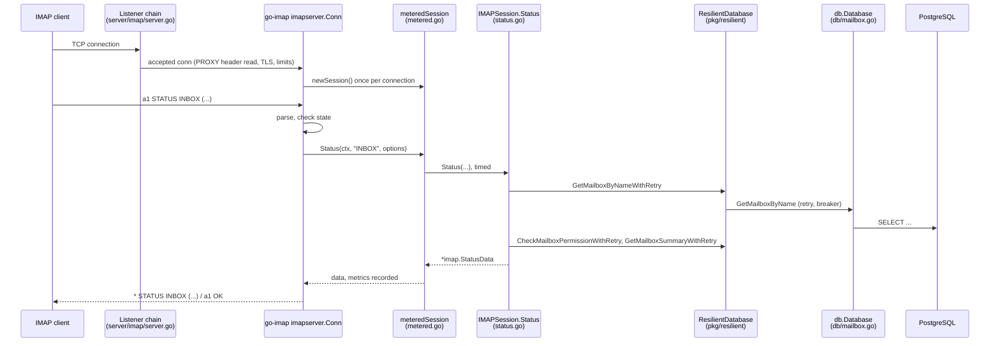

# Sora Hacking Guide

This guide is for contributors who change Sora's code. It explains where things live, how a
client command travels from the network to PostgreSQL, the conventions the code follows, and how
to make the common kinds of change: a new IMAP command, a new configuration key, a new database
migration and a release build.

How to run the tests is in [TESTING.md](TESTING.md). How the running system fits together is in
[ARCHITECTURE.md](ARCHITECTURE.md).

## Contents

1. [Repository layout](#1-repository-layout)
2. [Building](#2-building)
3. [Dependencies and the Migadu forks](#3-dependencies-and-the-migadu-forks)
4. [How a command flows: IMAP STATUS](#4-how-a-command-flows-imap-status)
5. [The other protocols](#5-the-other-protocols)
6. [Conventions](#6-conventions)
7. [Adding an IMAP command or extension](#7-adding-an-imap-command-or-extension)
8. [Adding a configuration key](#8-adding-a-configuration-key)
9. [Adding a database migration](#9-adding-a-database-migration)
10. [Adding a metric](#10-adding-a-metric)
11. [Making and sending a change](#11-making-and-sending-a-change)

---

## 1. Repository layout

Sora is one Go module, `github.com/migadu/sora`. It builds two programs: `sora`, the server, and
`sora-admin`, the command-line admin tool. Everything else is a library package used by those two.

### 1.1 Top-level directories

| Directory | What it holds |
|---|---|
| [`cmd/sora`](../cmd/sora) | The server program. It loads the config, connects to PostgreSQL and S3, starts one listener per `[[server]]` block, and handles reload (SIGHUP) and shutdown. |
| [`cmd/sora-admin`](../cmd/sora-admin) | The admin tool: accounts, credentials, mailboxes, ACLs, migrations, maildir import and export, caches, connections, backends and health. See [ADMIN_CLI.md](ADMIN_CLI.md). |
| [`config`](../config) | The configuration structs and their TOML keys, the defaults (`NewDefaultConfig`), the `Get...()` parsing helpers, validation, named pools and reload support. |
| [`consts`](../consts) | Shared sentinel errors, context keys, PostgreSQL advisory lock IDs and default mailbox names. |
| [`db`](../db) | All PostgreSQL access: accounts, mailboxes, messages, flags, search, full-text indexing, cleanup queries. The schema migrations live in [`db/migrations`](../db/migrations) and are embedded into the binaries. |
| [`storage`](../storage) | The S3 client for message bodies, with optional client-side encryption. |
| [`cache`](../cache) | The local disk cache of message bodies, with its index in SQLite. |
| [`authcache`](../authcache) | A persistent SQLite cache of credential lookups, used by proxies. |
| [`affinitycache`](../affinitycache) | A persistent SQLite store of user-to-backend affinity, used by proxies. |
| [`cluster`](../cluster) | Gossip membership and leader election on top of HashiCorp memberlist. |
| [`tlsmanager`](../tlsmanager) | Certificates for the listeners, either from files or from Let's Encrypt with S3 storage. |
| [`logger`](../logger) | The structured logger (a wrapper around `log/slog`) that all code logs through. |
| [`helpers`](../helpers) | Shared utilities: MIME parsing and body structure, previews, attachment detection, mailbox names and modified UTF-7, subject handling, trusted-network checks. |
| [`pkg`](../pkg) | Infrastructure packages, listed below. |
| [`server`](../server) | The protocol servers and background workers, listed below. The `server` package itself holds the pieces they share. |
| [`integration_tests`](../integration_tests) | The integration suite, one Go package per area, plus shared helpers in `integration_tests/common`. See [TESTING.md](TESTING.md#5-integration-tests). |
| [`testutils`](../testutils) | Small test helpers: a database setup helper that reads `config-test.toml`, a file-based S3 mock, a fake PostgreSQL that records the credentials a client sends, a proxy that records the SQL a code path sends, and a counter of password verifications. See [TESTING.md](TESTING.md#51-how-they-are-built). |
| [`testdata`](../testdata) | Test fixtures: a sample Dovecot maildir and a self-signed certificate (`sora.crt`, `sora.key`). |
| [`scripts`](../scripts) | `reset-test-db` (empties the test database), `check-closing-refs` (the pull request check in [section 11](#11-making-and-sending-a-change)) and SQL scripts for operators. |
| [`.github/workflows`](../.github/workflows) | The one check GitHub runs on pull requests, `Closing references` ([section 11](#11-making-and-sending-a-change)). No workflow builds the code or runs the tests. |
| [`dist`](../dist) | Service files: `sora.service` for systemd and `sora.rc` for FreeBSD. |

### 1.2 The `pkg` packages

| Package | What it does |
|---|---|
| [`pkg/resilient`](../pkg/resilient) | Wraps `db` and `storage` with retries, circuit breakers and failover between database hosts. Protocol code calls the `...WithRetry` methods here, not `db` directly. |
| [`pkg/retry`](../pkg/retry) | Exponential backoff with jitter. |
| [`pkg/circuitbreaker`](../pkg/circuitbreaker) | The circuit breaker used for the database, S3 and outbound HTTP calls. |
| [`pkg/health`](../pkg/health) | Component health checks and the records written to the `health_status` table. |
| [`pkg/metrics`](../pkg/metrics) | Every Prometheus metric definition, and the collector that refreshes gauges from the database. |
| [`pkg/lookupcache`](../pkg/lookupcache) | The in-memory cache of authentication and routing lookups. |
| [`pkg/spamtraining`](../pkg/spamtraining) | The client that sends a message to a training endpoint when a user moves it into or out of Junk. |
| [`pkg/errors`](../pkg/errors) | The error handler `cmd/sora` uses to report fatal startup errors and exit. |
| [`pkg/sqlitefile`](../pkg/sqlitefile) | Turns a configured SQLite database name into its file and the DSN that opens exactly that file. Used by every SQLite store: `cache`, `authcache`, `affinitycache` and the maildir import and export cache. |

### 1.3 The `server` packages

| Package | What it does |
|---|---|
| [`server`](../server) | Shared building blocks: the `Session` type and its log helpers, connection limits and tracking, authentication rate limiting, PROXY protocol, gossip messages, timeouts and slow-client protection, address parsing, the backend maintenance gate. |
| [`server/imap`](../server/imap) | The IMAP backend. One file per command or feature (`status.go`, `select.go`, `fetch.go`, `search.go`, ...). |
| [`server/pop3`](../server/pop3) | The POP3 backend, an adapter on top of the go-pop3 library. |
| [`server/lmtp`](../server/lmtp) | The LMTP backend: mail delivery, with Sieve. |
| [`server/managesieve`](../server/managesieve) | The ManageSieve backend, an adapter on top of the go-managesieve library. |
| [`server/imapproxy`](../server/imapproxy), [`pop3proxy`](../server/pop3proxy), [`lmtpproxy`](../server/lmtpproxy), [`managesieveproxy`](../server/managesieveproxy) | The proxy for each protocol: log the client in or read its recipient, pick a backend, then relay bytes. |
| [`server/proxy`](../server/proxy) | Routing shared by all proxies: backend selection, affinity, consistent hashing, named pools, remote lookup, backend TLS, health checks and maintenance. See [PROXY.md](PROXY.md). |
| [`server/adminapi`](../server/adminapi) | The admin HTTP API. See [ADMIN_API.md](ADMIN_API.md). |
| [`server/userapi`](../server/userapi), [`server/userapiproxy`](../server/userapiproxy) | The user HTTP API and its proxy. See [USER_API.md](USER_API.md). |
| [`server/delivery`](../server/delivery) | Message delivery shared by LMTP and the admin API's delivery endpoint: Sieve, vacation, redirect. |
| [`server/sieveengine`](../server/sieveengine) | Runs Sieve scripts (on top of go-sieve) and caches compiled scripts. |
| [`server/uploader`](../server/uploader) | The background worker that uploads staged message bodies to S3. |
| [`server/cleaner`](../server/cleaner) | Background cleanup: expunged messages, unused S3 objects, retention, and account purges. |
| [`server/fts`](../server/fts) | The background worker that builds full-text search vectors. See [SEARCH.md](SEARCH.md). |
| [`server/relayqueue`](../server/relayqueue) | The disk queue for outbound mail (redirects and vacation replies). See [RELAY.md](RELAY.md). |
| [`server/aclservice`](../server/aclservice) | Grant, revoke and list mailbox ACLs. Used by `sora-admin` and the admin API. |
| [`server/credchanges`](../server/credchanges) | Reads the credential changes the primary database records, every 5 seconds, and applies them on this node: it drops the changed accounts from the login caches and ends their sessions. See [AUTHENTICATION.md](AUTHENTICATION.md). |
| [`server/idgen`](../server/idgen) | Short, time-sortable IDs for sessions, gossip events and `Received` headers. Message and mailbox IDs are PostgreSQL integers, not these. |

### 1.4 Files at the repository root

| File | What it is |
|---|---|
| `Makefile` | Build, cross-build and test targets. See [section 2](#2-building) and [TESTING.md](TESTING.md). |
| `config.toml.example` | An annotated example configuration. Copy it to `config.toml` to start. `config.toml` itself is ignored by git. |
| `config-test.toml` | The database settings for the `db` package tests. See [TESTING.md](TESTING.md#6-the-test-database). |
| `config-proxy-only.toml` | A small example of a proxy with no database. |
| `flake.nix`, `.envrc` | A Nix development shell (see [section 2.4](#24-the-nix-shell)). |
| `makefile_test.go` | Tests of the Makefile itself, in the root package `sora`. See [TESTING.md](TESTING.md#3-unit-tests). |

---

## 2. Building

### 2.1 Requirements

You need Go 1.26 or newer. `go.mod` says `go 1.26.0`. Every dependency is pure Go, so you do not
need a C compiler. The SQLite driver is `modernc.org/sqlite`, which needs no cgo.

### 2.2 Make targets

| Target | What it does |
|---|---|
| `make` or `make build` | Builds `./sora` and `./sora-admin` in the repository root, with the version stamped in. |
| `make sora`, `make sora-admin` | Builds one of the two. |
| `make install` | Runs `go install` for both. This target does not stamp the version, so the binaries report `dev`. |
| `make clean` | Removes the built binaries, including `integration_tests/sora-admin`. |
| `make build-linux-musl` | Builds `sora-linux-amd64` and `sora-admin-linux-amd64`. It sets `CC` to `x86_64-linux-musl-gcc` and links with `-extldflags -static`. |
| `make build-freebsd` | Builds `sora-freebsd-amd64` and `sora-admin-freebsd-amd64` with `CGO_ENABLED=0`. |
| `make help` | Lists the targets. |

You can rename the output files with environment variables: `SORA_BINARY`, `SORA_ADMIN_BINARY`,
`SORA_LINUX_BINARY`, `SORA_ADMIN_LINUX_BINARY`, `SORA_FREEBSD_BINARY` and
`SORA_ADMIN_FREEBSD_BINARY`. For example, `SORA_BINARY=mysora make build`.

The test targets are described in [TESTING.md](TESTING.md#2-the-test-tiers-at-a-glance).

### 2.3 Version stamping

Both programs have three variables in `package main`: `version`, `commit` and `date`. Without
stamping they read `dev`, `none` and `unknown`. The Makefile sets them with linker flags:

| Variable | Makefile default |
|---|---|
| `VERSION` | `git describe --tags --always --dirty --match='v*'` |
| `COMMIT` | `git rev-parse --short HEAD` |
| `DATE` | the current UTC time, `%Y-%m-%dT%H:%M:%SZ` |

You can override each one: `make build VERSION=v1.2.3`.

Check the result with `./sora -version` (or `-v`) and `./sora-admin version` (or `-v`,
`--version`). The server prints:

```text
sora version v1.2.3 (commit: abc1234, built at: 2026-01-01T00:00:00Z)
```

`sora-admin` prints the same line with `sora-admin version` at the start. The server also logs the
three values at startup in its `SORA application starting` line.

### 2.4 The Nix shell

`flake.nix` defines a development shell with Go, `gotools`, `golangci-lint`, `delve`,
`go-junit-report`, `go-task`, PostgreSQL and the Garage S3 server. `.envrc` contains `use flake`,
so `direnv` loads the shell when you enter the directory. You can also run `nix develop`.

The shell hook of `flake.nix` also initialises a PostgreSQL data directory under the checkout,
sets the `PG*` variables, defines `start_postgres` and `stop_postgres` helpers, and sets up a
Garage configuration.

### 2.5 Release builds

A release build is an ordinary build of a tagged commit with the version stamped in:

```sh
git checkout v1.2.3
make build
./sora -version
```

`git describe` then returns the tag itself, so `VERSION` is `v1.2.3`. A build from a checkout with
local changes gets a `-dirty` suffix.

For Linux servers you can also build without cgo, which needs no C toolchain at all:

```sh
VERSION=$(git describe --tags --always --dirty --match='v*')
COMMIT=$(git rev-parse --short HEAD)
DATE=$(date -u +"%Y-%m-%dT%H:%M:%SZ")
LDFLAGS="-X 'main.version=$VERSION' -X 'main.commit=$COMMIT' -X 'main.date=$DATE'"
CGO_ENABLED=0 GOOS=linux GOARCH=amd64 go build -ldflags "$LDFLAGS" -o sora-linux-amd64 ./cmd/sora
CGO_ENABLED=0 GOOS=linux GOARCH=amd64 go build -ldflags "$LDFLAGS" -o sora-admin-linux-amd64 ./cmd/sora-admin
```

Use `GOARCH=arm64` for ARM servers. How to install and upgrade the binaries is in
[OPERATIONS.md](OPERATIONS.md).

### 2.6 Running a development server

`.gitignore` lists `start-dev.sh`, `reset-db.sh` and `config.toml`, so a fresh clone has none of
them. These commands do the same work. They assume a PostgreSQL that the role `postgres` can use
without a password ([TESTING.md](TESTING.md#1-what-you-need) describes the setup), an S3 bucket,
and a `config.toml` in the repository root.

Start the server with the race detector:

```sh
go build -race -o sora ./cmd/sora && ./sora -config config.toml
```

`-config` defaults to `config.toml`. The first start migrates the database named in
`[database.write]`.

A `[database.write]` section for a local development database, and local paths for the files
the server keeps on disk:

```toml
[database.write]
hosts = ["localhost"]
port = 5432
user = "postgres"
name = "sora_dev"

[uploader]
path = "/tmp/sora-dev/uploads"

[local_cache]
path = "/tmp/sora-dev/cache"
```

The default paths are `/var/spool/sora/uploads` and `/var/cache/sora/cache`, which a normal user
usually cannot create. A staged upload is the only copy of a message body until it reaches S3, so
use `/tmp` only on a development machine.

Reset the development database (stop the server first):

```sh
dropdb -h localhost -U postgres --if-exists sora_dev
createdb -h localhost -U postgres sora_dev
```

The next start migrates the empty database. `sora-admin` does not migrate, so create accounts
after the first start, or run `./sora-admin --config config.toml migrate up` first:

```sh
./sora-admin --config config.toml accounts create --email user@example.com --password devpassword
```

For a standard set of test accounts, run `./seed-dev.sh` (or `./seed-dev.sh other.toml`). It
builds `sora-admin`, migrates the database, and creates these accounts, all with the password
`password`:

| Account | Use it for |
|---|---|
| `alice@example.com`, with the alias `alice.alias@example.com` | logging in by alias |
| `bob@example.com`, `carol@example.com`, `dave@example.com` | sharing and ACL grants within one domain |
| `eve@example.org` | cross-domain ACL refusals |
| `legacy@example.com` | an SSHA512 password hash |
| `josé@example.com` | a non-ASCII local part (SMTPUTF8, IMAP UTF8) |

Accounts that already exist are skipped, so the script can be run again after every reset. It
refuses a config whose `[database.write]` hosts are not all `localhost` or loopback. The
integration tests do not use these accounts: they create their own in the test database.

`./sora-admin --config config.toml config validate` checks a config file without connecting to
anything.

---

## 3. Dependencies and the Migadu forks

Sora uses Migadu's own versions of six mail libraries. Each library owns its protocol's wire
format: reading commands, parsing arguments, writing responses. Sora implements the library's
session interface and supplies the behaviour behind it. So a change to a protocol's syntax, or a
new command, usually starts in the library and reaches Sora through a version bump.

| Library | Module Sora requires | How it is pinned in `go.mod` | Imported as |
|---|---|---|---|
| IMAP | `github.com/migadu/go-imap` | `require` at a release tag | `github.com/migadu/go-imap`, `.../imapserver`, `.../imapclient` |
| POP3 | `github.com/migadu/go-pop3` | `require` at a release tag | `github.com/migadu/go-pop3/pop3`, `.../pop3server` |
| ManageSieve | `github.com/migadu/go-managesieve` | `require` at a release tag | `github.com/migadu/go-managesieve/managesieve`, `.../managesieveserver` |
| Sieve | `github.com/migadu/go-sieve` | `require` at a release tag | `github.com/migadu/go-sieve`, `.../interp` |
| SMTP and LMTP | `github.com/emersion/go-smtp` | a `replace` directive points it to `github.com/migadu/go-smtp` at a release tag of the fork (for example `v0.24.0-migadu.2`) | `github.com/emersion/go-smtp` |
| MIME | `github.com/emersion/go-message` | a `replace` directive points it to `github.com/migadu/go-message` at a release tag of the fork | `github.com/emersion/go-message`, `.../mail`, `.../textproto`, `.../charset` |

The go-smtp and go-message forks keep the upstream module path in their own `go.mod`. That is why
they need a `replace` and why the code still imports the `emersion` paths. The other four have
Migadu module paths and need no `replace`. `go.mod` has exactly these two `replace` directives.

### 3.1 Bumping a fork

For a library required directly, ask for the new tag or commit and tidy:

```sh
go get github.com/migadu/go-imap@v1.2.4
go mod tidy
```

For a replaced library, edit the `replace` line:

```sh
go mod edit -replace=github.com/emersion/go-smtp=github.com/migadu/go-smtp@v0.24.0-migadu.2
go mod tidy
```

You can also name a commit hash while a fork change is not tagged yet. The go command turns it
into a pseudo-version the next time it loads the module graph. Pin a release tag before the
change ships.

Then build and run the tests that cover the protocol. Commit `go.mod` and `go.sum` together.

A pin may combine fork pull requests that have not merged yet. Before you replace it with a release
tag, check that the tag contains each of their changes. A fork pull request that shows as closed
may have been closed without being merged (see [section 11](#11-making-and-sending-a-change)).

### 3.2 Working on a fork and Sora at the same time

A Go workspace lets Sora build against a local checkout of a fork without touching `go.mod`. The
files `go.work` and `go.work.sum` are listed in `.gitignore`, so a workspace never ends up in a
commit. With the fork checked out next to Sora:

```sh
cd sora
go work init . ../go-imap
go build ./...
```

A module listed in `go.work` replaces the required version. This also works for the go-smtp and
go-message forks: their module path is the `emersion` path that the `replace` names, so the
workspace copy wins over the `replace`.

Before you push, check that Sora builds without the workspace, against the versions in `go.mod`:

```sh
GOWORK=off go build ./...
GOWORK=off go vet ./...
```

The usual order for a change that spans both: merge the library change and tag it, bump the pin
in Sora, then remove the workspace.

### 3.3 The SQLite driver and its libc

`modernc.org/sqlite` is SQLite translated to Go. Each release is built against one exact version
of `modernc.org/libc` and `modernc.org/memory`, and a module that uses it must require those
same versions. `go get -u` does not know that, and moves them to the newest release. Everything
still compiles, but SQLite then runs on a libc it was not built for, which the modernc project
does not support.

So after any `go get -u`, or when you bump `modernc.org/sqlite`:

1. Look up the versions this sqlite release requires:

   ```sh
   go mod graph | grep -E '^modernc.org/sqlite@v[^ ]+ modernc.org/(libc|memory)@'
   ```

2. Require exactly those, for example:

   ```sh
   go get modernc.org/libc@v1.80.1 modernc.org/memory@v1.12.1
   go mod tidy
   ```

3. Check that `go.mod` lists the same `modernc.org/libc` and `modernc.org/memory` versions that
   step 1 printed.

---

## 4. How a command flows: IMAP STATUS

This section follows one IMAP command, `STATUS`, from the socket to PostgreSQL and back. The other
commands follow the same path, so this is the map to use when you look for where something
happens.

The client sends:

```text
a1 STATUS INBOX (MESSAGES UNSEEN UIDNEXT)
```



### 4.1 Accepting the connection

[`IMAPServer.Serve`](../server/imap/server.go) builds a chain of listeners around the TCP socket:

1. A listener that reads the PROXY protocol header, if the server expects one
   (`WrapProxyProtocol`). The header comes before TLS on the wire, so this layer sits below TLS.
2. A TLS listener for implicit TLS (`SoraTLSListener`), or a plain one (`SoraListener`), which is
   also the one used when the server offers STARTTLS. Both add idle timeouts and the slow-client
   checks. The TLS handshake itself is deferred until the connection's own goroutine runs, so one
   slow client does not hold up the accept loop.
3. A listener that enforces the connection limits.

It then hands the listener to the go-imap server, which was built in `imap.New` with
`imapserver.New(&imapserver.Options{NewSession: s.newSession, ...})`.

### 4.2 Creating the session

For each connection, go-imap calls [`IMAPServer.newSession`](../server/imap/server.go). It
finishes the TLS handshake, reads the real client IP from the PROXY header, captures the JA4 TLS
fingerprint, gives the session an ID (`idgen.New()`) and logs `connected`. It returns the session
wrapped in a `meteredSession`.

`IMAPSession` ([`server/imap/session.go`](../server/imap/session.go)) embeds `server.Session`,
which carries the session ID, remote IP, protocol, server name and, after login, the user. That is
where the session log helpers come from (see [section 6.1](#61-logging)).

### 4.3 Parsing and dispatch

go-imap reads the command line, finds `STATUS` in its dispatch switch (`imapserver/conn.go` in the
go-imap module) and calls its `handleStatus`. That function parses the mailbox name and the item
list, checks that the connection is in the authenticated state, rejects `RECENT` for IMAP4rev2
clients, and then calls `session.Status(ctx, mailbox, &options)`.

Sora never parses IMAP syntax itself. If a command is missing or parses wrongly, the fix is in
go-imap.

### 4.4 Metrics wrapper

[`meteredSession.Status`](../server/imap/metered.go) times the call and records
`sora_commands_total{protocol="imap",command="STATUS",status=...}` and
`sora_command_duration_seconds`. The status label is `success`, `client_error` or `server_error`
(see `commandStatus`). A server error is also logged at WARN as `command failed`.

### 4.5 The handler

[`IMAPSession.Status`](../server/imap/status.go) does the work:

1. `s.pinnedContext(ctx)` marks the context to use the primary database if this session has
   written something before, so the session reads its own writes.
2. It takes the session's read lock only to copy the account ID, then releases it. Database calls
   run outside the session lock.
3. `s.server.rdb.GetMailboxByNameWithRetry` looks the mailbox up. A missing mailbox becomes
   `NO [NONEXISTENT]`.
4. `CheckMailboxPermissionWithRetry(..., 'r')` checks the ACL read right. Without it the answer is
   `NO [NOPERM]`.
5. `GetMailboxSummaryWithRetry` reads the cached counters. If the cached unseen count has gone
   negative, the handler recomputes it from the messages.
6. It fills in only the items the client asked for and returns `*imap.StatusData`.

Any other failure goes through `s.internalError(...)`, described in
[section 6.3](#63-errors).

### 4.6 The resilient layer and the database

[`ResilientDatabase.GetMailboxByNameWithRetry`](../pkg/resilient/mailbox_operations.go) wraps the
call in `executeReadWithRetry`: a per-operation timeout, the query circuit breaker, and retries
with backoff for transient errors. `consts.ErrMailboxNotFound` is passed as a non-retryable error,
so a missing mailbox returns at once. It picks a healthy read pool, or the write pool when the
context says so.

[`db.GetMailboxByName`](../db/mailbox.go) runs the SQL with `db.GetReadPoolWithContext(ctx)`,
which returns the write pool when the context carries `consts.UseMasterDBKey`. It records
`sora_db_queries_total` and `sora_db_query_duration_seconds` with the operation name
`mailbox_get_by_name`.

### 4.7 The response

Back in go-imap, `writeStatus` writes `* STATUS INBOX (MESSAGES 12 UNSEEN 3 UIDNEXT 40)`, then the
tagged `a1 OK`. If the handler returned an `*imap.Error`, go-imap writes it as the tagged `NO` or
`BAD` response instead.

### 4.8 Where to look for other commands

| Command or feature | File in `server/imap` |
|---|---|
| LOGIN, AUTHENTICATE | `login.go`, `sasl.go` |
| SELECT, EXAMINE | `select.go` |
| FETCH | `fetch.go`, `body_section_cache.go`, `preview.go` |
| SEARCH, SORT, THREAD | `search.go`, `search_validate.go`, `search_rate_limit.go`, `sort.go`, `thread.go`, `multisearch.go` |
| STORE | `store.go` |
| APPEND, COPY, MOVE | `append.go`, `copy.go`, `move.go` |
| EXPUNGE | `expunge.go` |
| CREATE, DELETE, RENAME, LIST | `create.go`, `delete.go`, `rename.go`, `list.go` |
| IDLE and changes between commands | `idle.go`, `poll.go` |
| ACL, METADATA, NAMESPACE, ID | `cmd_acl.go`, `cmd_metadata.go`, `namespaces.go`, `id.go` |
| Capabilities, session creation | `server.go` |

---

## 5. The other protocols

The other servers follow the same pattern: a library owns the wire, and a Sora package supplies
the session behind it.

- **POP3.** The go-pop3 library (`pop3server`) parses commands. [`server/pop3`](../server/pop3)
  implements `pop3server.Session` and its optional interfaces in `session.go`.
- **ManageSieve.** The go-managesieve library (`managesieveserver`) owns the protocol.
  [`server/managesieve`](../server/managesieve) implements its `Session` interface: login, script
  storage in PostgreSQL, and script validation with go-sieve.
- **LMTP.** The go-smtp fork runs the LMTP conversation. [`server/lmtp`](../server/lmtp)
  implements `Mail`, `Rcpt` and `Data` in `session.go`. Delivery itself, with Sieve and vacation,
  is in [`server/delivery`](../server/delivery), which the admin API's delivery endpoint also uses.
- **Proxies.** Each proxy in `server/*proxy` reads enough of the protocol to authenticate the user
  (or, for LMTP, to read the recipient), asks [`server/proxy`](../server/proxy) for a backend,
  logs in to the backend, and then copies bytes in both directions.
- **HTTP APIs.** [`server/adminapi`](../server/adminapi) and [`server/userapi`](../server/userapi)
  are plain `net/http` routers (`router.go`) that call `pkg/resilient`.

---

## 6. Conventions

### 6.1 Logging

Use the [`logger`](../logger/logger.go) package, never the standard `log` package:

```go
logger.Info("Starting server", "name", name, "addr", addr)
logger.Warn("Failed to set auth idle timeout", "name", s.name, "error", err)
```

The functions are `logger.Debug`, `Info`, `Warn` and `Error`, plus `...Context` variants. Pass
key-value pairs after the message, not formatted strings.

`logger.Initialize` also makes the logger the `slog` default, and Go then routes the standard
`log` package's default output through it at INFO level. So a stray `log.Printf` is not lost, but
it has no level and no fields.

**Inside a session, log through the session.** Once a session exists, every log line must carry
its context, so that `grep <session-id>` finds the whole session. Backend sessions embed
`server.Session`, which has `InfoLog`, `DebugLog`, `WarnLog` and `ErrorLog`
([`server/session.go`](../server/session.go)). Each line gets `protocol`, `remote`, `proxy` (when
the connection came through a proxy), `user`, `account_id`, `session` and connection counts:

```go
s.DebugLog("mailbox does not exist", "mailbox", mboxName)
s.WarnLog("failed to acquire read lock")
```

So do not repeat `remote`, `user` or an `IMAP:` prefix in the message.

Proxy sessions have methods with the same names, backed by `server.ProxySessionLogger`
([`server/proxy_logging.go`](../server/proxy_logging.go)). They add `proto`, `name`, `remote`,
`user`, `account_id`, `session` and, when known, `ja4`. The proxy also passes its session ID to
the backend: every proxy in its PROXY v2 header, the IMAP proxy in its `ID` command and the POP3
proxy in XCLIENT, depending on the setup. The LMTP proxy sends it only in a PROXY v2 header: the
Sora LMTP backend's XCLIENT has no attribute for it. The backend logs it as `proxy_session`: one
from a PROXY v2 header on the line that announces the connection (`connected`, or `new session`
for LMTP), one from `ID` or XCLIENT on a `forwarding parameters accepted` line.

One difference matters: a proxy session's `DebugLog` writes only when the proxy's own `debug`
setting is on. A backend session's `DebugLog` is filtered only by the global log level. Turning a
plain `logger.Debug` call in a proxy into `s.DebugLog` therefore hides it unless the proxy's
`debug` is on. `InfoLog`, `WarnLog` and `ErrorLog` are not gated.

Code that runs before a session exists (the accept loop, listener setup, rejections by the
connection limiter, constructors, shutdown, background goroutines) has no session ID and uses
`logger` directly.

### 6.2 Database access

- Protocol and API code calls `pkg/resilient` (`s.server.rdb.<Name>WithRetry`), not `db`
  directly. The wrapper adds the timeout, retries and circuit breaker.
- When you add a database operation, add the method to `db`, then a `...WithRetry` wrapper in
  `pkg/resilient` that uses `executeReadWithRetry` (reads) or `executeWriteInTxWithRetry`
  (writes in a transaction). Pass "expected" errors such as `consts.ErrMailboxNotFound` as
  non-retryable.
- After a session writes, it sets `s.useMasterDB.Store(true)`. Reads then go through
  `s.pinnedContext(ctx)` so they use the primary and see the write. Code outside a session that
  needs the same sets `consts.UseMasterDBKey` on the context.
- Do not hold the session mutex across a database or S3 call. Take the lock to read or update
  session state, release it, then do the I/O (see `status.go`).
- In `db`, use the pool from `GetReadPoolWithContext(ctx)` for reads, so the pin works.
- Production PostgreSQL may sit behind PgBouncer in transaction mode. Do not use session-level
  state: no session advisory locks, no `SET` outside a transaction. Use transaction-scoped
  advisory locks (`Database.BeginAdvisoryLockTx` in
  [`db/advisory_lock_tx.go`](../db/advisory_lock_tx.go)). See [DATABASE.md](DATABASE.md).

### 6.3 Errors

Errors are classified in layers, and each layer adds what the next one needs.

**In `db`.** Functions return sentinel errors that callers test with `errors.Is`:
`consts.ErrMailboxNotFound`, `consts.ErrDBNotFound`, `consts.ErrDBUniqueViolation`,
`consts.ErrUIDConflict` and others in [`consts/errors.go`](../consts/errors.go), plus the
connection errors in [`db/errors.go`](../db/errors.go). `db.ClassifyDBError` turns a raw pgx error
into one of those connection sentinels (`ErrNoConnections`, `ErrConnectionRefused`,
`ErrTooManyClients`, `ErrMaxClientConn`, `ErrFailedToConnect`, `ErrDBLockTimeout`) by SQLSTATE or
message text.

**In `pkg/resilient`.** Only transient errors are retried: serialization failures and deadlocks
(`40001`, `40P01`), too many connections (`53300`), connection exceptions (class `08`) and network
timeouts. An open circuit breaker, a cancelled context or a deadline stops the retries at once.

**In the protocol server.** A handler turns an error into what the client sees. In IMAP:

- A client condition becomes an `*imap.Error` with a fitting code: `NONEXISTENT`, `NOPERM`,
  `TRYCREATE`, `TOOBIG`, and so on.
- Anything unexpected goes through `s.internalError(format, args...)`
  ([`server/imap/session.go`](../server/imap/session.go)). It logs the message, then:
  - if the error is `context.Canceled` (the client went away), it returns a plain `NO`;
  - if `isTransientError` ([`server/imap/transient.go`](../server/imap/transient.go)) says the
    error is temporary (database connection errors, lock timeouts, open circuit breakers, S3 fetch
    failures, exhausted retries, deadlines, a full or read-only disk, anything wrapped in
    `server.TransientError`), it returns `NO [UNAVAILABLE]` so the client backs off;
  - otherwise it returns `NO [SERVERBUG]`.
- `classifyAndTrackError` counts errors in `sora_protocol_errors_total` with an `error_type` and a
  `severity` of `client_error` or `server_error`, and logs them at WARN as `protocol error`.

When you write a new handler, return an `*imap.Error` for anything the client caused, and use
`s.internalError` for the rest. Wrap a temporary failure that the helpers do not recognise in
`&server.TransientError{Err: err}`.

The other protocols follow the same idea with their own response codes. A POP3 temporary failure
is `-ERR [SYS/TEMP] ...`, an LMTP one is a `451` reply. [PROTOCOLS.md](PROTOCOLS.md) and
[PROXY.md](PROXY.md) list what clients see.

### 6.4 Formatting, vetting and git

- Run `gofmt` on what you change. The tree is gofmt-clean.
- `go vet ./...` and `go vet -tags=integration ./...` both pass on `main`. Keep it that way.
- In scripts and other non-interactive shells, use `git --no-pager` so git does not wait for a
  pager.

### 6.5 Listener order: PROXY protocol below TLS

A client behind a proxy or load balancer sends the PROXY protocol header in plain text, before
its TLS ClientHello. So every listener that accepts both must stack its layers in this order:

```
TCP listener → ProxyProtocolListener → SoraTLSListener (or tls.NewListener)
```

[`ProxyProtocolListener`](../server/proxyprotocol_listener.go) reads the header during Accept,
and the TLS handshake then reads through the connection it returns. The order matters because the
kernel often delivers the header and the ClientHello in one segment, so the header parser's buffer
already holds the first ClientHello bytes. Wrapped the other way round, the handshake either reads
the raw socket and misses those bytes, or tries to handshake against the plain-text `PROXY ...`
line.

Two more rules come with it:

- **Read headers off the accept path.** Each header is read in the connection's own goroutine,
  never in Accept. A peer that connects and sends no header (a proxy without
  `remote_use_proxy_protocol`, a TCP health probe) then stalls only its own connection until the
  header timeout, instead of blocking every other client behind it.
- **No I/O before the handshake.** A `SoraTLSConn` refuses `Read` and `Write` until
  `PerformHandshake` has run. If a wrapper hides the TLS connection from the handshake trigger,
  the connection fails loudly instead of greeting the client in plain text on a TLS port.

The tests that pin this are `TestSoraTLSConnRefusesIOBeforeHandshake` in
[`server/sora_tls_guard_test.go`](../server/sora_tls_guard_test.go), and the integration tests
that use `PrefixConn` from [`integration_tests/common/prefixconn.go`](../integration_tests/common/prefixconn.go),
which sends the header and the ClientHello in a single write.

---

## 7. Adding an IMAP command or extension

1. **Library first.** If go-imap does not parse the command yet, add the parser, the session
   interface method and the response writer to go-imap. go-imap probes optional features with
   type assertions on the session (`imapserver.SessionMove`, `SessionACL`, `SessionMetadata`,
   ...), so a new extension usually comes with a new optional interface. Tag the library and bump
   the pin ([section 3.1](#31-bumping-a-fork)), or use a workspace while you work
   ([section 3.2](#32-working-on-a-fork-and-sora-at-the-same-time)).
2. **The handler.** Add a method on `*IMAPSession` in a new file in `server/imap`, named after
   the command. Follow `status.go`: pinned context, short lock, `...WithRetry` calls, `*imap.Error`
   for client errors, `s.internalError` for the rest, `s.DebugLog` and friends for logging.
3. **The metrics wrapper.** If it is a client command, add a method with the same signature on
   `meteredSession` in [`metered.go`](../server/imap/metered.go) that calls `recordCommand`. If go-imap
   probes a new optional interface, add a compile-time assertion to the `var (...)` block there,
   such as `_ imapserver.SessionThread = (*meteredSession)(nil)`. Without it, a signature mismatch
   makes go-imap treat the command as unsupported, without any error.
4. **The capability.** Add the capability to the `caps` set in `imap.New`
   ([`server/imap/server.go`](../server/imap/server.go)) if the extension has one. Capabilities
   that depend on configuration are added or removed in the same function.
5. **Database.** Add the `db` function, its `pkg/resilient` wrapper, and a migration if the schema
   changes ([section 9](#9-adding-a-database-migration)).
6. **Tests.** Add an integration test in `integration_tests/imap`, and unit tests next to the code
   for pure logic. See [TESTING.md](TESTING.md#11-writing-tests).

For POP3 and ManageSieve the steps are the same with go-pop3 and go-managesieve. For LMTP, the
go-smtp fork.

---

## 8. Adding a configuration key

1. Add the field with its `toml:"..."` tag to the right struct in
   [`config/config.go`](../config/config.go). Server-block keys go in `ServerConfig`.
2. Decide the default. Either set it in `NewDefaultConfig`, or keep the field a string and add a
   `Get...()` helper that returns the default when it is empty (see `S3Config.GetTimeout`). A
   default in `config.toml.example` alone is not a default.
3. If a `[[server]]` key only applies to some server types, say which ones, so that
   `WarnUnusedConfigOptions` reports the key when it is set in the wrong kind of block:
   - a plain server key goes into `serverTypeKeys` in [`config/config.go`](../config/config.go);
   - a `[server.remote_lookup]` or `[server.lookup_cache]` key that not every reader of its table
     reads goes into `serverTableKeys`;
   - a `[server.limits]` key goes into `serverLimitKeys`, and into `limitsAppliedBy` in
     `config/unapplied_keys_test.go`. `TestLimitsAppliedByCoversEveryKey` fails until it is
     there.
4. Decide whether a SIGHUP reload applies it. To make a server-block key reloadable, apply it in
   that server's `ReloadConfig` and add its TOML key to `reloadableServerSettings` in
   [`cmd/sora/server_reload.go`](../cmd/sora/server_reload.go).
   `TestReloadableServerSettingsMatchEachReloadConfig` checks that the two agree. A reload
   reports every other changed key as needing a restart (see `RestartRequiredChanges` in
   [`config/reload.go`](../config/reload.go)).
5. If the value is a secret (a password, key or token), tag the field `secret:"true"`. Every
   output meant to be read or shared, such as `sora-admin config dump`, then masks it.
   `TestConfigDumpMasksEverySecretField` fails for a setting that looks like a secret and has no
   tag.
6. Document it in `config.toml.example` and in the reference doc for its section. See
   [CONFIGURATION.md](CONFIGURATION.md). `TestConfigExampleServerKeysExist` fails when the example
   shows a `[[server]]` key that the loader does not read.

The loader warns about unknown keys, so a typo in a config file shows up in the startup output.

---

## 9. Adding a database migration

Sora uses [golang-migrate](https://github.com/golang-migrate/migrate). The migration files are
embedded into both binaries with `//go:embed migrations/*.sql` in [`db/db.go`](../db/db.go). There
is no list to register them in: a file in `db/migrations` is part of the next build.

### 9.1 Naming and numbering

Each migration is two files with the same six-digit number and name:

```text
db/migrations/000074_add_example_column.up.sql
db/migrations/000074_add_example_column.down.sql
```

- Use the next number after the highest one in `db/migrations`. Find it with
  `ls db/migrations | tail -2`.
- Every migration on `main` has both an `up` and a `down` file. Keep it that way:
  `sora-admin migrate down` needs the `down` file.
- The `down` file must undo the `up` file, so that a rollback leaves the schema as it was.

`main` has no migration `000032` and no `000063`: the files go from `000031` to `000033`, and from
`000062` to `000064`. A gap by itself is harmless, because golang-migrate moves on to the next file
it finds.

### 9.2 What goes wrong with numbers

golang-migrate reads the database's current version from `schema_migrations`, then looks for that
version among the files. If the version is not there, it stops, and the error contains:

```text
failed to run migrations: no migration found for version 59
```

This happens when two branches each add a migration and a database has been migrated by the other
branch. For example: another branch adds `000059` and migrates the shared test database to 59.
Your branch adds `000060` and has no `000059`. Every test that connects with migrations on now
fails, because version 59 is not a file in your tree.

The other direction is quieter. If the database is ahead of your tree (at 60 while your newest
file is 58), Sora treats it as up to date and starts. Your code then runs against a schema with
changes it does not know about.

So:

- Before you open a pull request, check that nobody else has taken your number on `main` or in an
  open pull request, and renumber if needed.
- Test a branch with new migrations in a database of its own. Set `SORA_TEST_DB_NAME` (see
  [TESTING.md](TESTING.md#6-the-test-database)) instead of migrating the shared test database.

### 9.3 How migrations run

When `sora` starts, the first write pool that connects runs the migrations (see `migrate` in
[`db/db.go`](../db/db.go)). A migration that fails stops startup.

1. The instance tries to take the migration leader lock, a transaction-scoped advisory lock. The
   one that gets it is the migration leader. The lock lives in a transaction that stays open
   while the migrations run, so it also works through PgBouncer in transaction mode.
2. If `schema_migrations` already shows the newest version (or a newer one) and is not dirty,
   startup goes on.
3. The leader runs the migrations on a single connection of its own and logs
   `Database: migrations are still actively running... please wait` every 30 seconds.
4. Other instances poll `schema_migrations` every 5 seconds until the leader finishes. They give
   up after three times `[database] migration_timeout` (default `2m`).
5. If the database is in a dirty state, the leader refuses to start:
   `database is in a dirty migration state (version N). Manual intervention required`.

golang-migrate's own PostgreSQL drivers take a session-level advisory lock, which does not work
behind a pooler in transaction mode. Sora therefore runs golang-migrate with a driver of its own,
in [`db/migrate_driver.go`](../db/migrate_driver.go), that takes no lock: every migrator holds the
leader lock instead.

`sora-admin` does not run migrations when it connects. Use `sora-admin migrate up`, `down`,
`version` and `force` to manage them by hand; see [ADMIN_CLI.md](ADMIN_CLI.md) and
[DATABASE.md](DATABASE.md). `up`, `down` and `force` take the same leader lock. While another
migrator holds it, they stop at once with
`another instance holds the migration leader lock and is running migrations`.

### 9.4 Writing the SQL

- **One file is one transaction.** The driver sends the whole file as one simple-protocol query,
  and PostgreSQL runs such a query as one implicit transaction. If any statement fails, the whole
  file rolls back and the version is left marked dirty.
- **Statements that refuse transactions must stand alone.** `CREATE INDEX CONCURRENTLY` cannot run
  in a transaction, so it works only as the only statement in its file (comments are fine).
  `000028_optimize_expunge_lookup.up.sql` is an example.
- **Make it re-runnable.** Use `IF NOT EXISTS` and `IF EXISTS`. Operators can then run an
  expensive step by hand before the upgrade, and the migration becomes a no-op.
- **Think about big tables.** A plain `CREATE INDEX` or a table rewrite on `messages` blocks
  delivery for as long as it runs. For such changes, write the operator steps into the comment at
  the top of the migration: what to run out of band (for example the `CONCURRENTLY` form), in
  which order relative to the application deploy, and how to check it. `000052` is an example.
- **Mixed versions.** During a rolling upgrade, old binaries run against the new schema. Prefer
  changes the old code can live with: add a nullable column before you write it, stop reading a
  column before you drop it. See [OPERATIONS.md](OPERATIONS.md).
- **Extensions.** Migrations create the extensions they need with `CREATE EXTENSION IF NOT
  EXISTS` (`pg_trgm` in `000001`, `btree_gin` in `000050`).

### 9.5 Testing a migration

- The test helpers migrate their database to the newest version when they connect, so any
  integration or `db` test runs your migration.
- Run your branch against its own database: `SORA_TEST_DB_NAME=sora_test_db_mybranch`. Create it
  first with `createdb`. See [TESTING.md](TESTING.md#6-the-test-database).
- Test the `down` file too: apply it with `sora-admin --config <file> migrate down` against a
  throwaway database, then `migrate up` again.
- Tests that need a specific old version, like `db/concurrent_migration_test.go`, use a database of
  their own (`<test db>_migrations`), never the shared one.

---

## 10. Adding a metric

1. Define it in [`pkg/metrics`](../pkg/metrics) with `promauto`, named `sora_<area>_<what>` and
   ending in `_total` for counters and `_seconds` for durations.
2. Keep the number of label values small. A label whose values come from users (addresses,
   mailbox names) or from the network (IP addresses) can grow without limit, and every value is
   a separate series in memory and in every scrape.
3. Instrument the code with `.Inc()`, `.Observe()` or `.Set()`. Gauges that come from the
   database belong in the collector (`pkg/metrics/collector.go`).
4. Document it in [METRICS.md](METRICS.md).

---

## 11. Making and sending a change

1. Branch from `main`.
2. Make the change. Keep it focused: one fix or one feature per pull request.
3. Add or update tests. A bug fix usually comes with a test that failed before the fix.
4. Run, at least:
   - `go build ./...` and `go vet ./...`
   - `go vet -tags=integration ./...`, which compiles every integration test
   - the unit tests of the packages you touched
   - the integration tests of the protocols you touched, against your own test database if your
     branch adds migrations

   [TESTING.md](TESTING.md) has the commands.
5. Commit with a message in the style the history uses, `type(scope): summary`, for example
   `fix(imap): ...`, `feat(lmtp): ...`, `test(proxy): ...`, `chore(deps): bump ...`.
6. Open a pull request against `main`. Say which tests you ran: GitHub runs no tests, only the
   `Closing references` check below, so the reviewer relies on that list.

If your change needs a new version of one of the forks, land the library change first, then bump
the pin in the same Sora pull request as the code that needs it.

Use closing keywords (`Fixes #N`, `Closes`, `Resolves` and their other forms) only for the Sora
issues the pull request resolves. GitHub reads them in the description and in the commit messages
when the pull request merges, and in the title, which becomes the merge commit's message. It closes
what they name in other repositories too, and closes a pull request it names without merging it.
Refer to a fork pull request without a keyword, for example `Depends on migadu/go-imap#227`. The
`Closing references` check fails a pull request whose title, description or commit messages put a
keyword in front of another repository's issue or pull request. It cannot tell a Sora pull
request's `#N` from an issue's, so do not put a keyword in front of a Sora pull request either. To
run it on a description before you open the pull request:

```sh
go run ./scripts/check-closing-refs < body.md
```
