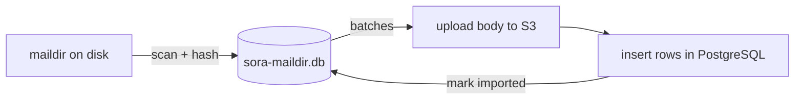

# Sora Import and Export

Sora can import mail from a maildir, export an account's mail to a maildir, and rebuild database
rows for message bodies that are already in S3. You use these to migrate users from another mail
server (Dovecot in particular), to take a portable copy of a mailbox, and to recover after a
database loss.

This document covers the three commands of `sora-admin` that do this: `import maildir`,
`import s3` and `export maildir`. It lists every flag and explains what is stored, how re-runs
behave, and what the SQLite cache file is for. It is for operators who plan a migration and for
contributors who change [cmd/sora-admin/importer.go](../cmd/sora-admin/importer.go),
[exporter.go](../cmd/sora-admin/exporter.go) or [s3_importer.go](../cmd/sora-admin/s3_importer.go).
The rest of `sora-admin` is in [ADMIN_CLI.md](ADMIN_CLI.md).

## Contents

1. [Overview](#1-overview)
2. [Before you import](#2-before-you-import)
3. [The maildir layout Sora reads](#3-the-maildir-layout-sora-reads)
4. [import maildir flags](#4-import-maildir-flags)
5. [What Sora stores for each message](#5-what-sora-stores-for-each-message)
6. [Dovecot files: keywords, subscriptions and UIDs](#6-dovecot-files-keywords-subscriptions-and-uids)
7. [Importing a Sieve script](#7-importing-a-sieve-script)
8. [The SQLite cache, sora-maildir.db](#8-the-sqlite-cache-sora-maildirdb)
9. [Re-runs, duplicates and incremental imports](#9-re-runs-duplicates-and-incremental-imports)
10. [Dry runs](#10-dry-runs)
11. [Failures, retries and exit status](#11-failures-retries-and-exit-status)
12. [Batches and speed](#12-batches-and-speed)
13. [import s3](#13-import-s3)
14. [export maildir](#14-export-maildir)
15. [Round trips and known limits](#15-round-trips-and-known-limits)

---

## 1. Overview

| Command | Reads | Writes | Typical use |
|---|---|---|---|
| `import maildir` | A maildir on the local disk | S3 objects, PostgreSQL rows, `sora-maildir.db` in the maildir | Migrating users from Dovecot, Courier or any maildir server. |
| `import s3` | Objects under one account's S3 prefix | PostgreSQL rows | Recovery: bodies are in S3 but their database rows are gone. |
| `export maildir` | PostgreSQL rows and S3 objects | A maildir, `sora-maildir.db` in it | A copy of an account's mail, or a move to another server. |



All three need the `[database]` and `[s3]` sections of the config file. They do not need a
running Sora server, and they can run while servers are running.

---

## 2. Before you import

- **The account must exist.** Create it first with `sora-admin accounts create`, with its
  aliases. The importer looks the account up by `--email` and stops if it is missing, also in a
  dry run.
- **Use the primary address for `--email`.** Bodies are stored in S3 under the domain and local
  part of the address you pass (`domain/localpart/hash`), whichever credential of the account it
  is. Sora keeps that key on each message row, so another address works, but tools that build
  keys from an address, such as `verify hash`, then need that same address.
- **Run it where the maildir is.** The importer reads the files directly and writes its cache,
  `sora-maildir.db`, **into the maildir directory**. The user running `sora-admin` needs write
  access to that directory, even for a dry run.
- **Check the size limit.** Messages larger than `[admin_cli] import_message_limit` are not
  imported and count as failed. Unset, the limit is the `append_limit` of the first IMAP
  `[[server]]` block in the file (default 25 MB), or 50 MB without one. See
  [ADMIN_CLI.md](ADMIN_CLI.md#3-the-admin_cli-section).
- **Decide on body search for old mail.** `--fts-retention` (or `[cleanup] fts_retention`) keeps
  old messages out of the full-text index. See [section 5](#5-what-sora-stores-for-each-message).
- **Shell environment.** `SORA_ADMIN_SKIP_S3=1` makes `import maildir` skip S3 entirely and store
  rows without bodies. It exists for tests; never set it for a real import.

---

## 3. The maildir layout Sora reads

`--maildir-path` must point at the **root of one user's maildir**: the directory whose `cur/` and
`new/` hold the INBOX. A directory without `cur/` or `new/` is refused; if it has a `Maildir`
subdirectory or other maildirs below it, the error names them. `tmp/` is not required, and files
in it are never imported.

The importer walks the whole tree below the root. Every directory that has `cur/` or `new/` is a
folder. Its mailbox name comes from its path relative to the root:

1. The root itself is `INBOX`.
2. A leading `.` is removed and the remaining `.` characters become `/`. So the Maildir++ folder
   `.Work.2024` becomes `Work/2024`. A folder without a leading dot (`Sent`) is read the same
   way. Nested directories (`Work/2024`) keep their `/`.
3. In each level, `\` followed by two hex digits is the character with that value, as Dovecot's
   storage name escape character (`\` by default) writes it: `.v1\2e2.Notes` becomes
   `v1.2/Notes`. Only printable US-ASCII characters are restored; any other `\` stays as it is.
   An escaped `/` is refused: Sora cannot represent a literal hierarchy delimiter inside one
   level, and treating it as hierarchy would merge distinct source folders.
4. IMAP modified UTF-7 is decoded: `.R&AOk-pertoire` becomes `Répertoire`.
5. Leading and trailing spaces are trimmed. A name containing a tab, CR or LF is skipped with a
   warning.
6. Some names are mapped to Sora's standard folders, compared case-insensitively, for the whole
   name only (`Work/Sent` is not mapped):

| Folder name | Mailbox in Sora |
|---|---|
| `sent`, `sent items`, `sent mail` | `Sent` |
| `drafts`, `draft` | `Drafts` |
| `trash`, `deleted`, `deleted items` | `Trash` |
| `junk`, `spam` | `Junk` |
| `archive`, `archives` | `Archive` |

Mailboxes are created as needed. With `[shared_mailboxes] enabled = true` in the config file
you pass, a folder in the shared namespace (`.Shared.Team` with the default prefix) becomes a
shared mailbox the account owns, as `sora-admin mailbox create` makes one; see
[SHARED_MAILBOXES.md](SHARED_MAILBOXES.md). The namespace root itself (`Shared`) is only created
as the parent of such folders: it is a container IMAP clients cannot select, so the messages of a
folder named like it (`.Shared`) are not imported and are reported as failed. Rename that folder
in the maildir to import them.

Within each folder, every regular file in `cur/` and `new/` whose name does not start with `.`
is a message. Files in `new/` usually carry no flags, so they arrive unread.

The maildir may have been written by its owner, while the import runs with more privileges, so
source messages and Dovecot metadata are read through the opened maildir root. Symbolic links
below it cannot redirect those reads outside the root. `--maildir-path` itself
may be a link. Below it, a folder that is a link is not walked and is named in a warning. A message
file, a `cur/` or `new/` directory, or a `subscriptions`, `dovecot-keywords` or `dovecot-uidlist`
file that is a link is read only when the link is relative and its target is below the root. Any
other link (one pointing outside the root, or any absolute link, even to a file inside the root)
is not read: such a message file is reported as failed by its path, and such a `cur/` or `new/` is
skipped with a warning naming it.

This policy covers source message and Dovecot metadata contents and `cur/`/`new/` listings. It
does not change how the SQLite cache or an explicitly supplied `--paths-file` file are opened;
`--sieve` has its own rule ([section 7](#7-importing-a-sieve-script)). Folder discovery and file
existence/timestamp checks still use ordinary paths.

---

## 4. import maildir flags

```sh
sora-admin --config config.toml import maildir --email user@example.com \
  --maildir-path /var/vmail/example.com/user/Maildir [flags]
```

| Flag | Default | Meaning |
|---|---|---|
| `--email` | | Account to import into (required). See [section 2](#2-before-you-import). |
| `--maildir-path` | | Root of the maildir (required). |
| `--dry-run` | `false` | Report what would be imported and change nothing in the account. See [section 10](#10-dry-runs). |
| `--incremental` | `false` | Import only files the cache does not mark as imported. See [section 9](#9-re-runs-duplicates-and-incremental-imports). |
| `--dovecot` | `false` | Read Dovecot's `dovecot-keywords`, `subscriptions` and `dovecot-uidlist` files. Implies `--preserve-uids`. See [section 6](#6-dovecot-files-keywords-subscriptions-and-uids). |
| `--preserve-uids` | `false` | Keep the UIDs and UIDVALIDITY from each folder's `dovecot-uidlist`. |
| `--sieve PATH` | | Store this file as the user's Sieve script. See [section 7](#7-importing-a-sieve-script). |
| `--preserve-flags` | `true` | Take flags from the file names. With `--preserve-flags=false`, every message is imported unread and without flags. |
| `--mailbox-filter` | all | Comma-separated mailbox names to import, compared case-insensitively with the mapped names of [section 3](#3-the-maildir-layout-sora-reads). A trailing `*` matches a prefix: `INBOX,Sent,Archive*`. Folders that do not match are not scanned. |
| `--start-date` | | `YYYY-MM-DD`. Skip files modified before this day (UTC). |
| `--end-date` | | `YYYY-MM-DD`. Skip files modified after the end of this day (UTC). |
| `--paths-file PATH` | | Scan only the message files listed in PATH, one per line, absolute or relative to the maildir root. Paths outside the root are skipped. |
| `--fts-retention` | `[cleanup] fts_retention` | Make only messages sent within this window body-searchable, for example `180d`. Go durations and whole days work. Unset in both places: index everything. |
| `--jobs` | `4` | Parallel workers for hashing files and for uploads within a batch. |
| `--batch-size` | `20` | Messages per batch. |
| `--batch-transaction` | `false` | Insert each batch in one database transaction. See [section 12](#12-batches-and-speed). |
| `--cleanup-db` | `false` | Delete `sora-maildir.db` after a run that completed without errors. After a failed or interrupted run the file is kept for the next run. |

The date filters look at the **file modification time**, not at the `Date:` header. Filtered
files are still scanned and hashed, and are counted as skipped.

---

## 5. What Sora stores for each message

**Body.** The file content is uploaded to S3 as it is, or decompressed when Dovecot stored it
compressed (the `zlib` plugin, `mail_compress` in Dovecot 2.4). The format is recognised by the
file's first bytes, never by its name; a file that starts with none of these is a plain message:

| Format | First bytes | Import |
|---|---|---|
| gzip | `1f 8b` | Decompressed. |
| bzip2 | `BZh`, a level digit `1` to `9`, then a block (`31 41 59 26 53 59`) or end-of-stream (`17 72 45 38 50 90`) signature | Decompressed. |
| Dovecot lz4 | `Dovecot-LZ4` then `0d 2a 9b c5` | Decompressed. This is Dovecot's own chunked layout, not the LZ4 frame format. |
| zstd | `28 b5 2f fd` | Decompressed. A frame that needs a window above 128 MiB (libzstd's default limit) is refused. |
| xz | `fd 37 7a 58 5a 00` | Refused: `xz-compressed maildir file is not supported; decompress it first`. |
| LZ4 frame format | `04 22 4d 18` | Refused: `lz4-compressed maildir file is not supported; decompress it first`. |

Decompression stops at 256 MiB of output. A refused file, a corrupt one, and one that
decompresses to more than 256 MiB count as failed
([section 11](#11-failures-retries-and-exit-status)).

The body is encrypted on the way to S3 when `[s3] encrypt` is on, like any other body. Imported
messages are marked uploaded at once; they never go through the upload spool.

**Content hash.** The importer names the S3 object, and fills `content_hash`, with the
**BLAKE3** hex digest of the decompressed content, as delivery and APPEND do. A message imported
here and the same message delivered later share one S3 object, and `sora-admin verify` checks
imported messages like any other.

**Size limit.** Larger than `[admin_cli] import_message_limit` counts as failed. For compressed
files the limit applies to the decompressed size.

**Flags.** From the info part of the file name, after `:2,`:

| Letter | IMAP flag |
|---|---|
| `S` | `\Seen` |
| `R` | `\Answered` |
| `F` | `\Flagged` |
| `D` | `\Draft` |
| `T` | `\Deleted` |
| `a` to `z` | Custom keyword, looked up in `dovecot-keywords` ([section 6](#6-dovecot-files-keywords-subscriptions-and-uids)) |

`P` (passed) has no IMAP flag and is ignored. `\Recent` is never set. A keyword letter with no
entry in the keyword file is logged and ignored. Keywords that are not valid IMAP keywords, or
longer than 100 characters, are dropped by the database layer.

**INTERNALDATE** (the arrival time IMAP clients sort by) is the leading Unix timestamp of the file
name (`1700000000.M123P456.host:2,S`), or the file's modification time when the name has none.

**Sent date** is the `Date:` header, or the file's modification time when the header is missing
or unreadable.

**Headers and search.** Subject, Message-ID, In-Reply-To, References and recipients are parsed
as on delivery, and the body structure is computed. A message with no Message-ID gets a synthetic
one derived from its content hash, so re-runs still recognise it. The plain-text body is queued
for the full-text index unless the message was sent before the `--fts-retention` window; such a
message is stored in full and its headers are searchable, but its body is not. See
[SEARCH.md](SEARCH.md).

---

## 6. Dovecot files: keywords, subscriptions and UIDs

`--dovecot` turns on three things. `--preserve-uids` turns on only the third.

### Keywords (`dovecot-keywords`)

Dovecot stores custom keywords as letters `a` to `z` in file names. Each folder has its own
`dovecot-keywords` file that maps those letters (`0 $Label1`, `1 $Junk`, ... : index 0 is `a`).

- Each folder's own `dovecot-keywords` file maps that folder's letters.
- A folder without its own file uses the root file's mapping.

### Subscriptions (`subscriptions`)

With `--dovecot`, the `subscriptions` file at the maildir root is read:

1. Sora's default mailboxes are created: `INBOX`, `Sent`, `Drafts`, `Archive`, `Junk`, `Trash`.
2. Each name in the file is read as a folder name is, by rules 3 to 6 of
   [section 3](#3-the-maildir-layout-sora-reads) (escaped characters restored, modified UTF-7
   decoded, the folder mapping), and recorded as a subscription. Dovecot writes a folder's
   subscription in the same form as the folder's directory name, so `v1\2e2` subscribes the
   folder `.v1\2e2`, imported as `v1.2`. Dovecot's version-2 file separates the parts of a nested
   name with tab characters; they are joined with `/`, so `Work` + tab + `2024` subscribes
   `Work/2024`. No mailbox is created for it: subscriptions are names, and Dovecot allows
   subscriptions to folders that do not exist.

### UIDs (`dovecot-uidlist`)

With `--preserve-uids` (or `--dovecot`), each folder's `dovecot-uidlist` is read. Its header
gives the folder's UIDVALIDITY (`V`) and next UID (`N`); each line maps a UID to a file name.
File names are matched without their `:2,` flags part and without `,S=` and `,W=` size fields, so
a message whose flags changed since the list was written still matches. A list that cannot be
parsed is logged, and that folder's UIDs are not kept.

Keeping UIDs means IMAP clients that already cached the folder do not download it again. Sora
keeps them under these rules:

1. Before any message is imported, each folder that has a uidlist gets its mailbox. If that
   mailbox is **empty**, Sora sets its UIDVALIDITY to Dovecot's `V` and its highest UID to
   `N - 1`.
2. If the mailbox already has messages and a **different** UIDVALIDITY, Sora logs `Mailbox not
   empty and UIDVALIDITY mismatch - cannot safely update`, leaves it alone, and gives that
   folder's messages new UIDs. Clients then see a new folder and resynchronise it.
3. A message listed in the uidlist gets its Dovecot UID. A message not listed gets the next free
   UID, above `N - 1`.
4. If the Dovecot UID is already used in the mailbox, the message is **not imported** and is
   reported as failed with `preserved UID already in use in the target mailbox`.

Rule 4 is what you hit when Sora delivers new mail into a folder (taking UIDs from `N`) and a
later import pass brings Dovecot messages that Dovecot numbered from `N` too. Import before Sora
receives mail for the account, or finish with a final pass before delivery switches; see the
migration guide in the wiki. `--dovecot` always keeps UIDs; to import such messages with new UIDs,
run without `--dovecot` and without `--preserve-uids`.

Very large UIDVALIDITY values in the uidlist are truncated to 32 bits.

---

## 7. Importing a Sieve script

`--sieve PATH` stores the file as a Sieve script of the account before the messages are
imported. If the file does not exist, it is ignored with a log line.

The file is read through its directory. The usual file from Dovecot, the user's
`~/.dovecot.sieve`, is a symbolic link the user owns, so a link is followed only when it is
relative and its target is within that directory, as Pigeonhole's own
`.dovecot.sieve -> sieve/<name>.sieve`. Any other link (one out of the directory, or any absolute
link) is refused: the log names the file and nothing is stored. Where Pigeonhole's script
directory is not below the link's directory, its link is absolute; name the script it points to
instead.

| Situation | Result |
|---|---|
| The script compiles, the user has an active script | The active script's content is replaced, under its existing name, and it stays active. |
| The script compiles, no active script | Stored as `imported` and activated. |
| The script does not compile | Stored as `imported-invalid`, inactive, so delivery keeps working. The import goes on. |
| It does not compile, and an earlier run's `imported-invalid` compiles | The user fixed it; it is kept and the file is not stored. |

Compilation uses `[sieve] enabled_extensions` from the config file. The summary ends with a
`Sieve script:` line that says what happened. Dovecot's global or `sieve_before` scripts are not
imported; see [SIEVE.md](SIEVE.md) for what Sora supports.

---

## 8. The SQLite cache, sora-maildir.db

The importer keeps a SQLite database in the maildir, `<maildir-path>/sora-maildir.db` (with
`-wal` and `-shm` files while it is open). It records every message file it has seen and whether
that file has been imported. It makes re-runs cheap and safe.

Table `messages`:

| Column | Meaning |
|---|---|
| `path`, `filename` | Where the file was found. |
| `hash` | BLAKE3 hash of the (decompressed) content. |
| `size` | Content size in bytes. |
| `mailbox` | Mapped mailbox name. |
| `s3_uploaded`, `s3_uploaded_at` | `1` once the message is in S3 and PostgreSQL. |

Rows are unique per (`hash`, `mailbox`) and per (`filename`, `mailbox`).

On every run:

1. **Recovery.** Rows marked imported whose message never reached PostgreSQL are reset to "not
   imported". This repairs a run that stopped between the database and the cache. A message the
   user deleted in Sora since then stays deleted.
2. **Scan.** The whole maildir (or the `--paths-file` list) is walked and every file is read and
   hashed. New files get rows; files already known keep theirs.
3. **Import** of the selected rows ([section 9](#9-re-runs-duplicates-and-incremental-imports)).
   After each batch is stored, its rows are marked imported.

A cache written by an older build, without the `s3_uploaded` columns, is upgraded on open: the
columns are added and existing rows are marked imported, then step 1 checks them against
PostgreSQL. `--cleanup-db` deletes the file after a run without errors. `export maildir` uses a file of
the same name and layout in its target directory ([section 14](#14-export-maildir)).

---

## 9. Re-runs, duplicates and incremental imports

Running the importer again is safe: it does not create duplicates.

**Duplicate rule.** A message is skipped when the target mailbox already has a live message with
the same Message-ID and the same content hash. Skipped messages are counted as `Skipped` and
marked imported in the cache.

**Without `--incremental`** (the default), every message file in the cache is read again,
uploaded to S3 again, and offered to the database, which skips the duplicates. This is slow for a
large maildir but needs nothing from the cache.

**With `--incremental`**, only rows not marked imported are processed. Use it for every pass
after the first.

Things a later pass does not do:

- It does not apply **flag changes**. A file renamed because its flags changed keeps its first
  row, and the message already in Sora is skipped as a duplicate.
- It does not **delete** from Sora what was deleted from the maildir.
- A message **moved** to another folder in the maildir is imported into that folder too; the
  copy in the first folder stays.

Two copies of the same content in one folder are one row in the cache, so only one is imported.
The same content in two folders is imported into both.

---

## 10. Dry runs

`--dry-run` scans the maildir and prints, per mailbox, each message as `IMPORT` or `SKIP` (with
subject, file date, size, short hash and flags), then a summary. A message is reported as `SKIP`
when the mailbox already has a live message with the same hash.

A dry run uploads nothing and changes nothing in the account: no message, mailbox,
subscription, UIDVALIDITY or Sieve script.

- It needs the account and writes `sora-maildir.db` into the maildir.
- With `--sieve`, it only reports what it would do with the script.

The dry-run duplicate check compares the hash only, so its numbers can differ slightly from a
real run.

---

## 11. Failures, retries and exit status

A file that cannot be read, decompressed, parsed, uploaded or inserted is counted as failed and
its row stays "not imported". At the end the summary lists every failed path with its reason:

```
Import Summary:
  Total messages:    ...
  Imported:          ...
  Skipped:           ...
  Failed:            ...
```

followed by `Failed Messages (N):` and one `- PATH (Reason: ...)` line each. If any message
failed, the command exits `1` with `import completed with N failed messages`.

S3 uploads are tried three times per message (after 500 ms and 1 s). To retry the failures, fix
the cause and run again with `--incremental`: only rows not yet imported are processed.
`--paths-file` limits the **scan** to the listed files; combine it with `--incremental` so that
only those files that are not yet imported are processed (without `--incremental`, every row in
the cache is processed again).

---

## 12. Batches and speed

The importer loads the selected rows and processes them in batches of `--batch-size` (default
20):

1. **Upload.** The batch's files are read, decompressed, parsed and uploaded to S3, up to `--jobs`
   at a time.
2. **Insert.** By default, the uploaded messages are inserted per mailbox in chunks of up to 500
   rows, with duplicates filtered out. If a chunk fails as a whole, its messages are inserted one
   by one so that each failure is reported by path.
3. **Mark.** The inserted messages are marked imported in the cache.

With `--batch-transaction`, step 2 inserts the whole batch in one transaction. It is faster, but
an error other than a duplicate or a UID conflict rolls back the whole batch, and all of its
messages count as failed. If marking the cache fails after the commit, the importer deletes the
batch's messages from PostgreSQL again.

Raise `--jobs` and `--batch-size` for faster imports over a fast network; lower them to reduce
load on PostgreSQL and S3.

---

## 13. import s3

`import s3` is for recovery. It finds message bodies that are in S3 under an account's prefix but
have no live database row, and creates rows for them.

```sh
sora-admin --config config.toml import s3 --email user@example.com --dry-run
sora-admin --config config.toml import s3 --email user@example.com --workers 10
```

| Flag | Default | Meaning |
|---|---|---|
| `--email` | | The account (required). Its domain and local part form the prefix that is listed. The account must exist. |
| `--dry-run` | `false` | List each object as `IMPORT`, `REIMPORT` or `SKIP`, as the import would treat it, and change nothing in the account (not even its default mailboxes). |
| `--workers` | `5` | Objects imported in parallel. |
| `--max-objects` | `0` (no limit) | Stop the listing after this many objects. |
| `--batch-size` | `1000` | Every this many listed objects, the key is remembered as a resume point (printed at the end as `Resumption token`). |
| `--continuation-token KEY` | | Start listing after this key. Pass a `Resumption token` from an earlier run. |
| `--force-reimport` | `false` | Import objects even when a live message of the account in another mailbox already has that hash (`REIMPORT`). An object whose message INBOX already holds is still skipped. |
| `--import-delay` | `0` | Pause after each imported message (Go duration, for example `200ms`). |
| `--cleanup-db` | `true` | Delete the temporary SQLite file at the end. |
| `--fts-retention` | `[cleanup] fts_retention` | As for `import maildir`. |

How it works:

1. It lists `domain/localpart/` and keeps keys of the form `domain/localpart/<64 hex digits>`,
   recording them in a temporary SQLite file `sora-s3-import-<random>.db` in the system's
   temporary directory. Every run creates a file of its own, readable by its owner only, so
   runs for several users can go in parallel.
2. For each object, it skips it when a live message of the account already has that content hash
   (with `--force-reimport`, only when that message is in INBOX). Otherwise it downloads and
   decrypts the object, parses it, and inserts it into **INBOX**: S3 holds no folder
   information. INTERNALDATE and sent date are the `Date:` header (or the current time), and the
   message has no flags.
3. It prints a summary. If any object failed, the command exits `1`.

Running it again is safe: imported objects are skipped as existing.

---

## 14. export maildir

`export maildir` writes an account's mail to a maildir.

```sh
sora-admin --config config.toml export maildir --email user@example.com \
  --maildir-path /var/backup/user/Maildir --dovecot
```

| Flag | Default | Meaning |
|---|---|---|
| `--email` | | Any address of the account (required). |
| `--maildir-path` | | Target directory (required). Created if missing. |
| `--dry-run` | `false` | List each message as `EXPORT` or `SKIP` and write no messages. The target directory and its cache file are still created. |
| `--mailbox-filter` | all | Comma-separated mailbox names, case-insensitive, `*` suffix for a prefix. |
| `--start-date`, `--end-date` | | `YYYY-MM-DD`, by INTERNALDATE (UTC); the end day is included. |
| `--dovecot` | `false` | Also write `dovecot-keywords` per folder, the `subscriptions` file, and `dovecot-uidlist` files. |
| `--export-dovecot-uidlist` | `false` | Write `dovecot-uidlist` files only. |
| `--overwrite-flags` | `false` | Rewrite messages exported earlier with their current flags. |
| `--jobs` | `4` | Messages exported in parallel within a mailbox. |
| `--delay` | `0` | Pause after each exported message (Go duration). |

**What is exported.** Every mailbox the account can see, including shared mailboxes it has access
to, and every message that is not expunged. Bodies are downloaded from S3 under the key stored on
each message and decrypted.

**Layout.** INBOX is the root (`cur/`, `new/`, `tmp/`). Every other mailbox is a directory under
the root, with one directory per level of its name: `Work/2024` becomes `<root>/Work/2024/cur`.
Each level is written in IMAP modified UTF-7, as Dovecot names folders on disk (`Données` becomes
`Donn&AOk-es`, `R&D` becomes `R&-D`), and a `.` or `\` in it is escaped as `\2e` or `\5c`
(`v1.2` becomes `v1\2e2`), because the importer reads a `.` as the Maildir++ separator. A level
named after an entry of the directory that holds it, whatever its case, escapes its first
character the same way: `cur`, `new`, `tmp`, `dovecot-uidlist` and `dovecot-keywords` at every level, and
`subscriptions` at the top level (the root holds the `subscriptions` file). So `subscriptions`
becomes `\73ubscriptions` and `Work/dovecot-uidlist` becomes `Work/\64ovecot-uidlist`, and the
folder does not take the place of its parent's own directories and files. A mailbox
with a level `.` or `..` fails to export. This is not the Maildir++ layout with dotted names
(`.Work.2024`) that Dovecot uses by default; a Dovecot reading the export needs a
filesystem-style folder layout (Dovecot's `LAYOUT=fs`), and shows escaped names right only with
`\` as its storage name escape character (the 2.3 `listescape` plugin, or
`mailbox_list_storage_escape_char` in 2.4). Sora's own importer reads each name back as it was
exported, under the rules of [section 3](#3-the-maildir-layout-sora-reads).

**Files.** Each message is written to `tmp/`, synced to disk and renamed into `cur/`, so a reader
never sees half a file. The name is `<INTERNALDATE as Unix time>.M<same>P<UID>.<hostname>:2,<flags>`
and the file's modification time is set to INTERNALDATE. Flags are written as `D`, `F`, `R`, `S`,
`T`, in alphabetical order; `\Recent` is not written.

**Keywords.** Only with `--dovecot`: each folder gets a `dovecot-keywords` file and keywords
become letters `a` to `z`. Keywords are numbered in sorted order; an existing file's numbering is
kept. A folder can name at most 26 keywords; further ones are logged and left out. Without
`--dovecot`, keywords are not exported.

**Subscriptions.** With `--dovecot`, `subscriptions` at the root lists every subscribed name,
also of folders that no longer exist, in Dovecot's version-2 format: a `V` + tab + `2` line and an
empty line, then one name per line, with the levels of a nested name separated by tab
characters. Each level is written as a folder's directory is (modified UTF-7, `.` and `\`
escaped, and so is the first character of a level named after a directory entry), as Dovecot
writes it, so `v1.2` is subscribed as `v1\2e2`.

**UID lists.** With `--dovecot` or `--export-dovecot-uidlist`, each exported folder gets a
`dovecot-uidlist` with the mailbox's UIDVALIDITY and each message's Sora UID. An existing
uidlist in the target is merged: its entries for files still present are kept.

**Re-runs.** The exporter keeps `sora-maildir.db` in the target directory, with the same schema
as the importer's ([section 8](#8-the-sqlite-cache-sora-maildirdb)), and records each exported
message by content hash and mailbox. On a re-run:

- A message already recorded whose file is still in its folder's `cur/` is skipped.
- A message recorded whose file is not there is written again under its recorded name. That
  includes a folder an older version wrote under another directory name (one with `.`, `\`, `&`
  or non-ASCII characters in its name, or named after a directory entry such as `subscriptions`):
  its messages are written to the folder's directory as named now, and the old directory is left
  as it was, so remove it or export into an empty directory. An old directory that sits where the
  export writes a file (`subscriptions`, a `dovecot-uidlist`) makes writing that file fail.
- With `--overwrite-flags`, recorded messages are written again with their current flags and the
  old file is removed.
- Two messages with the same content in one mailbox are exported as one file.

If an earlier run failed to write a `dovecot-uidlist`, an ordinary re-run that only skips
existing message files does not rebuild that UID list. Fix the path that prevented the
write and re-run with `--overwrite-flags`, or export into a fresh directory, to generate
the UID lists again.

Each message is tried three times. If any message or mailbox fails, the command exits `1` with
`export incomplete: N message(s) and M mailbox(es) failed`. It also exits `1`, naming the file,
when the `subscriptions` file or a folder's `dovecot-uidlist` cannot be written; the other folders'
uidlists are still written.

---

## 15. Round trips and known limits

- **Backslashes in folder names.** The importer reads `\` and two hex digits in a directory name
  or a subscription as an escaped character ([section 3](#3-the-maildir-layout-sora-reads)), so a
  folder from another system whose name really contains `\2e` is imported with a `.` there
  instead. The same applies to a subscription to such a name in an export made before
  subscriptions were escaped.
- **Exporting into an imported maildir.** Export and import share the file name
  `sora-maildir.db`. Export into an empty directory, not into a maildir you imported from.
- **Not imported:** Dovecot's index files (`dovecot.index*`), quota files, ACL files, and
  anything in `tmp/`. Flags come from the file names, keywords from `dovecot-keywords` and UIDs
  from `dovecot-uidlist`; nothing is read from Dovecot's indexes.
