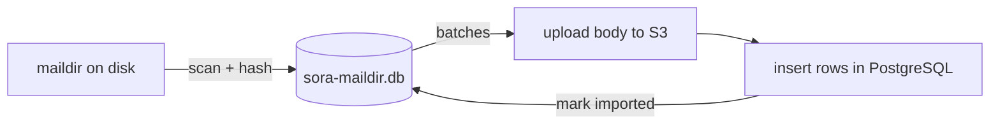

# Sora Import and Export

Sora can import mail from a maildir, export an account's mail to a maildir, and rebuild database
rows for message bodies that are already in S3. You use these to migrate users from another mail
server (Dovecot in particular), to take a portable copy of a mailbox, and to recover after a
database loss.

This document covers the four commands of `sora-admin` that do this: `import maildir`,
`import s3`, `import rekey` and `export maildir`. It lists every flag and explains what is
stored, how re-runs behave, and what the SQLite cache file is for. It is for operators who plan
a migration and for contributors who change
[cmd/sora-admin/importer.go](../cmd/sora-admin/importer.go),
[exporter.go](../cmd/sora-admin/exporter.go), [s3_importer.go](../cmd/sora-admin/s3_importer.go)
or [rekey.go](../cmd/sora-admin/rekey.go).
The rest of `sora-admin` is in [ADMIN_CLI.md](ADMIN_CLI.md).

## Contents

1. [Overview](#1-overview)
2. [Before you import](#2-before-you-import)
3. [The maildir layout Sora reads](#3-the-maildir-layout-sora-reads)
4. [import maildir flags](#4-import-maildir-flags)
5. [What Sora stores for each message](#5-what-sora-stores-for-each-message)
6. [Dovecot files: keywords, subscriptions and UIDs](#6-dovecot-files-keywords-subscriptions-and-uids)
7. [Importing a Sieve script](#7-importing-a-sieve-script)
8. [The SQLite cache, sora-maildir.db](#8-the-sqlite-cache-sora-maildirdb)
9. [Re-runs, duplicates and incremental imports](#9-re-runs-duplicates-and-incremental-imports)
10. [Dry runs](#10-dry-runs)
11. [Failures, retries and exit status](#11-failures-retries-and-exit-status)
12. [Batches and speed](#12-batches-and-speed)
13. [import s3](#13-import-s3)
14. [import rekey](#14-import-rekey)
15. [export maildir](#15-export-maildir)
16. [Round trips and known limits](#16-round-trips-and-known-limits)

---

## 1. Overview

| Command | Reads | Writes | Typical use |
|---|---|---|---|
| `import maildir` | A maildir on the local disk | S3 objects, PostgreSQL rows, `sora-maildir.db` in the maildir | Migrating users from Dovecot, Courier or any maildir server. |
| `import s3` | Objects under one account's S3 prefix | PostgreSQL rows | Recovery: bodies are in S3 but their database rows are gone. |
| `import rekey` | One account's stored bodies | S3 objects, PostgreSQL rows | Repair: bodies an older `import maildir` stored under their SHA-256 digest. |
| `export maildir` | PostgreSQL rows and S3 objects | A maildir, `sora-maildir.db` in it | A copy of an account's mail, or a move to another server. |



All of them need the `[database]` and `[s3]` sections of the config file. They do not need a
running Sora server, and they can run while servers are running.

---

## 2. Before you import

- **The account must exist.** Create it first with `sora-admin accounts create`, with its
  aliases. The importer looks the account up by `--email` and stops if it is missing, also in a
  dry run.
- **Use the primary address for `--email`.** Bodies are stored in S3 under the domain and local
  part of the address you pass (`domain/localpart/hash`), whichever credential of the account it
  is. Sora keeps that key on each message row, so another address works, but tools that build
  keys from an address, such as `verify hash`, then need that same address.
- **Run it where the maildir is.** The importer reads the files directly and writes its cache,
  `sora-maildir.db`, **into the maildir directory**. The user running `sora-admin` needs write
  access to that directory, even for a dry run. Except on Linux with `fs.protected_hardlinks = 1`,
  no other user may be able to write in it, or to rename it through a directory above it
  ([section 8](#8-the-sqlite-cache-sora-maildirdb)).
- **Check the size limit.** Messages larger than `[admin_cli] import_message_limit` are not
  imported and count as failed. Unset, the limit is the `append_limit` of the first IMAP
  `[[server]]` block in the file (default 25 MB), or 50 MB without one. See
  [ADMIN_CLI.md](ADMIN_CLI.md#3-the-admin_cli-section).
- **Decide on body search for old mail.** `--fts-retention` (or `[cleanup] fts_retention`) keeps
  old messages out of the full-text index. See [section 5](#5-what-sora-stores-for-each-message).
- **Shell environment.** `SORA_ADMIN_SKIP_S3=1` makes `import maildir` skip S3 entirely and store
  rows without bodies. It exists for tests; never set it for a real import.

---

## 3. The maildir layout Sora reads

`--maildir-path` must point at the **root of one user's maildir**: the directory whose `cur/` and
`new/` hold the INBOX. A directory without `cur/` or `new/` is refused; if it has a `Maildir`
subdirectory or other maildirs below it, the error names them. `tmp/` is not required, and files
in it are never imported.

The importer walks the whole tree below the root. Every directory that has `cur/` or `new/` is a
folder. Its mailbox name comes from its path relative to the root:

1. The root itself is `INBOX`.
2. A leading `.` is removed and the remaining `.` characters become `/`. So the Maildir++ folder
   `.Work.2024` becomes `Work/2024`. A folder without a leading dot (`Sent`) is read the same
   way. Nested directories (`Work/2024`) keep their `/`.
3. In each level, `\` followed by two hex digits is the character with that value, as Dovecot's
   storage name escape character (`\` by default) writes it: `.v1\2e2.Notes` becomes
   `v1.2/Notes`. Only printable US-ASCII characters are restored; any other `\` stays as it is.
   An escaped `/` is refused: Sora cannot represent a literal hierarchy delimiter inside one
   level, and treating it as hierarchy would merge distinct source folders.
4. IMAP modified UTF-7 is decoded: `.R&AOk-pertoire` becomes `Répertoire`.
5. Leading and trailing spaces are trimmed. A folder whose name is not a valid mailbox name is
   skipped with a warning: one containing a tab, CR or LF, an empty level, or a level `.` or
   `..`.
6. Some names are mapped to Sora's standard folders, compared case-insensitively, for the whole
   name only (`Work/Sent` is not mapped):

| Folder name | Mailbox in Sora |
|---|---|
| `sent`, `sent items`, `sent mail` | `Sent` |
| `drafts`, `draft` | `Drafts` |
| `trash`, `deleted`, `deleted items` | `Trash` |
| `junk`, `spam` | `Junk` |
| `archive`, `archives` | `Archive` |

Mailboxes are created as needed. With `[shared_mailboxes] enabled = true` in the config file
you pass, a folder in the shared namespace (`.Shared.Team` with the default prefix) becomes a
shared mailbox the account owns, as `sora-admin mailbox create` makes one; see
[SHARED_MAILBOXES.md](SHARED_MAILBOXES.md). The namespace root itself (`Shared`) is only created
as the parent of such folders: it is a container IMAP clients cannot select, so the messages of a
folder named like it (`.Shared`) are not imported and are reported as failed. Rename that folder
in the maildir to import them.

Within each folder, every regular file in `cur/` and `new/` whose name does not start with `.`
is a message. Files in `new/` usually carry no flags, so they arrive unread.

### Links and file ownership

The import often runs as root or as another privileged user, while the maildir belongs to the
mail user, who can change it while the import runs. The rules below keep the import from reading
files into the account that the maildir's owner could not read. They are Unix UID and mode-bit
checks; they do not look at filesystem ACLs.

**Links on the way to the maildir.** `--maildir-path`, or a directory on the way to it, may be a
symbolic link only when the link belongs to one of:

- root, as `/var/mail/alice -> /srv/mail/alice`;
- the user running `sora-admin`, as `/srv/import/alice -> /var/vmail/alice` made by an operator;
- the owner of the directory it leads to, as a user's own `~/Maildir -> ~/mail/Maildir`.

Without this rule, a user who can replace `~/Maildir` could point it at another user's maildir
and have that mail read into the account. A link of root or of the user running `sora-admin`
leads only where that user could name directly.

A link of the user running `sora-admin`, when that user is not root, must also sit where no other
user can have put it:

- the directory holding the link belongs to root or to that user, and its group and others may
  not write in it (sticky bit or not);
- every directory above it belongs to root or to that user, and others may write in it only
  where the sticky bit is set (as on `/tmp`).

So `/tmp/ops/alice`, in the operator's own `0755` directory, is followed, and `/tmp/alice` is
not: in `/tmp` another user could have moved one of the operator's links there from a directory
they can write, or hard-linked one there. This holds whether or not the system protects hard
links, since moving a link needs none.

On systems where users may hard-link files they do not own (macOS, the BSDs, and Linux with
`fs.protected_hardlinks = 0`), a symbolic link with more than one name is refused too:
`ln -P /var/mail/bob ~/Maildir` would otherwise pass as root's link. The import sees only the
names a link has when it runs. A hard link made earlier to root's link has one name again once
the original name is removed, and is then followed as its owner's link. On such systems, name
the maildir's own directory, with no link on the way, as `--maildir-path` (and `--sieve`).

Any other link makes the import refuse to start, before `sora-maildir.db` is created. The error
names the link, its owner and the directory it leads to (for the running user's link, the
directory that others can create or rename entries in). Name that directory itself instead.
The directories above the maildir need only be searchable (`x`) by the user running the import,
not readable.

**Links inside the maildir.** Everything below the root is read through the opened root
directory, so a link there cannot lead outside the root:

- A folder that is a link is not walked; a warning names it.
- A message file, a `cur/` or `new/` directory, or a `subscriptions`, `dovecot-keywords` or
  `dovecot-uidlist` file that is a link is read only when the link is relative and its target is
  below the root. Any other link (pointing outside the root, or absolute, even to a file inside
  the root) is not read: such a message file is reported as failed by its path, and such a
  `cur/` or `new/` is skipped with a warning.

**Files that not everyone may read.** A hard link is another name for the same file, and the
import cannot tell it from the file's first name. So a message or metadata file that does not
have all three read bits (`0444`) is read only when:

- the directory that really holds it belongs to the file's owner and grants neither group nor
  others write access, and
- for an owner other than root, the owner-read bit is set. (Unix applies one permission class,
  so an other-read bit alone does not let the owner read the file.)

For such a file every symbolic link on its path is checked as well, up to eight links:

- each link's target stays below the directory holding the link (no absolute target, no `..`);
- the link and its directory belong to root or to the file's owner, and the directory grants
  neither group nor others write access;
- directories reached after a link pass the same owner and write checks, and the last one belongs
  to the file's owner.

A refused message is reported as failed by its path; a refused metadata file is treated as one
that cannot be read. Hard links between the owner's own files still work, as Dovecot's
`maildir_copy_with_hardlinks` and `cp -al` backups make them. A maildir extracted as root into a
directory root created keeps its messages, but its top-level `subscriptions`, `dovecot-keywords`
and `dovecot-uidlist` may belong to another user than the directory: give the directory to those
files' owner first.

**What these rules cover.** They apply to the contents of messages and Dovecot files and to the
listings of `cur/` and `new/`. Finding folders and checking whether a file exists or how old it
is use ordinary paths. The SQLite cache has its own rules ([section 8](#8-the-sqlite-cache-sora-maildirdb)),
a `--paths-file` is opened normally, and `--sieve` has its own rule
([section 7](#7-importing-a-sieve-script)).

---

## 4. import maildir flags

```sh
sora-admin --config config.toml import maildir --email user@example.com \
  --maildir-path /var/vmail/example.com/user/Maildir [flags]
```

| Flag | Default | Meaning |
|---|---|---|
| `--email` | | Account to import into (required). See [section 2](#2-before-you-import). |
| `--maildir-path` | | Root of the maildir (required). |
| `--dry-run` | `false` | Report what would be imported and change nothing in the account. See [section 10](#10-dry-runs). |
| `--incremental` | `false` | Import only files the cache does not mark as imported. See [section 9](#9-re-runs-duplicates-and-incremental-imports). |
| `--dovecot` | `false` | Read Dovecot's `dovecot-keywords`, `subscriptions` and `dovecot-uidlist` files. Implies `--preserve-uids`. See [section 6](#6-dovecot-files-keywords-subscriptions-and-uids). |
| `--preserve-uids` | `false` | Keep the UIDs and UIDVALIDITY from each folder's `dovecot-uidlist`. |
| `--sieve PATH` | | Store this file as the user's Sieve script. See [section 7](#7-importing-a-sieve-script). |
| `--preserve-flags` | `true` | Take flags from the file names. With `--preserve-flags=false`, every message is imported unread and without flags. |
| `--mailbox-filter` | all | Comma-separated mailbox names to import, compared case-insensitively with the mapped names of [section 3](#3-the-maildir-layout-sora-reads). A trailing `*` matches a prefix: `INBOX,Sent,Archive*`. Folders that do not match are not scanned. |
| `--start-date` | | `YYYY-MM-DD`. Skip files modified before this day (UTC). |
| `--end-date` | | `YYYY-MM-DD`. Skip files modified after the end of this day (UTC). |
| `--paths-file PATH` | | Scan only the message files listed in PATH, one per line, absolute or relative to the maildir root. Paths outside the root are skipped. |
| `--delay` | `0` | Wait this long before each message, in each job, to slow the import down (Go duration, for example `500ms`). |
| `--fts-retention` | `[cleanup] fts_retention` | Make only messages sent within this window body-searchable, for example `180d`. Go durations and whole days work. Unset in both places: index everything. |
| `--jobs` | `4` | Parallel workers for hashing files and for uploads within a batch. At least 1. |
| `--batch-size` | `20` | Messages per batch. At least 1. |
| `--batch-transaction` | `false` | Insert each batch in one database transaction. See [section 12](#12-batches-and-speed). |
| `--cleanup-db` | `false` | Delete `sora-maildir.db` after a run that completed without errors. After a failed or interrupted run the file is kept for the next run. |

The date filters look at the **file modification time**, not at the `Date:` header. Filtered
files are still scanned and hashed, and are counted as skipped.

---

## 5. What Sora stores for each message

**Body.** The file content is uploaded to S3 as it is, or decompressed when Dovecot stored it
compressed (the `zlib` plugin, `mail_compress` in Dovecot 2.4). The format is recognised by the
file's first bytes, never by its name; a file that starts with none of these is a plain message:

| Format | First bytes | Import |
|---|---|---|
| gzip | `1f 8b` | Decompressed. |
| bzip2 | `BZh`, a level digit `1` to `9`, then a block (`31 41 59 26 53 59`) or end-of-stream (`17 72 45 38 50 90`) signature | Decompressed. |
| Dovecot lz4 | `Dovecot-LZ4` then `0d 2a 9b c5` | Decompressed. This is Dovecot's own chunked layout, not the LZ4 frame format. |
| zstd | `28 b5 2f fd` | Decompressed. A frame that needs a window above 128 MiB (libzstd's default limit) is refused. |
| xz | `fd 37 7a 58 5a 00` | Refused: `xz-compressed maildir file is not supported; decompress it first`. |
| LZ4 frame format | `04 22 4d 18` | Refused: `lz4-compressed maildir file is not supported; decompress it first`. |

Decompression stops at 256 MiB of output. A refused file, a corrupt one, and one that
decompresses to more than 256 MiB count as failed
([section 11](#11-failures-retries-and-exit-status)).

The body is encrypted on the way to S3 when `[s3] encrypt` is on, like any other body. Imported
messages are marked uploaded at once; they never go through the upload spool.

**Content hash.** The importer names the S3 object, and fills `content_hash`, with the
**BLAKE3** hex digest of the decompressed content, as delivery and APPEND do. A message imported
here and the same message delivered later share one S3 object, and `sora-admin verify` checks
imported messages like any other.

**Size limit.** Larger than `[admin_cli] import_message_limit` counts as failed. For compressed
files the limit applies to the decompressed size.

**Flags.** From the info part of the file name, after `:2,`:

| Letter | IMAP flag |
|---|---|
| `S` | `\Seen` |
| `R` | `\Answered` |
| `F` | `\Flagged` |
| `D` | `\Draft` |
| `T` | `\Deleted` |
| `a` to `z` | Custom keyword, looked up in `dovecot-keywords` ([section 6](#6-dovecot-files-keywords-subscriptions-and-uids)) |

`P` (passed) has no IMAP flag and is ignored. `\Recent` is never set. A keyword letter with no
entry in the keyword file is logged and ignored. Keywords that are not valid IMAP keywords, or
longer than 100 characters, are dropped by the database layer.

**INTERNALDATE** (the arrival time IMAP clients sort by) is the leading Unix timestamp of the file
name (`1700000000.M123P456.host:2,S`), or the file's modification time when the name has none.

**Sent date** is the `Date:` header, or the file's modification time when the header is missing
or unreadable.

**Headers and search.** Subject, Message-ID, In-Reply-To, References and recipients are parsed
as on delivery, and the body structure is computed. A message with no Message-ID gets a synthetic
one derived from its content hash, so re-runs still recognise it. The plain-text body is queued
for the full-text index unless the message was sent before the `--fts-retention` window; such a
message is stored in full and its headers are searchable, but its body is not. See
[SEARCH.md](SEARCH.md).

---

## 6. Dovecot files: keywords, subscriptions and UIDs

`--dovecot` turns on three things. `--preserve-uids` turns on only the third.

### Keywords (`dovecot-keywords`)

Dovecot stores custom keywords as letters `a` to `z` in file names. Each folder has its own
`dovecot-keywords` file that maps those letters (`0 $Label1`, `1 $Junk`, ... : index 0 is `a`).

- Each folder's own `dovecot-keywords` file maps that folder's letters.
- The root file maps the letters of the root folder (INBOX) only. A folder without its own file
  names no keywords, as in Dovecot, which clears a folder's list when its file is missing: its
  letters are dropped, each with an `Unknown keyword ID` warning.
- A line that is malformed, or whose index is not 0 to 25, is skipped; one warning per file names
  the file, the number of lines skipped and the first of them, shortened.
- A file larger than 64 KiB is not read: a warning names it, and the folder's keywords are not
  imported.

### Subscriptions (`subscriptions`)

With `--dovecot`, the `subscriptions` file at the maildir root is read:

1. Sora's default mailboxes are created: `INBOX`, `Sent`, `Drafts`, `Archive`, `Junk`, `Trash`.
2. Each name in the file is read as a folder name is, by rules 3 to 6 of
   [section 3](#3-the-maildir-layout-sora-reads) (escaped characters restored, modified UTF-7
   decoded, the folder mapping), and recorded as a subscription. Dovecot writes a folder's
   subscription in the same form as the folder's directory name, so `v1\2e2` subscribes the
   folder `.v1\2e2`, imported as `v1.2`. Dovecot's version-2 file separates the parts of a nested
   name with tab characters; they are joined with `/`, so `Work` + tab + `2024` subscribes
   `Work/2024`. No mailbox is created for it: subscriptions are names, and Dovecot allows
   subscriptions to folders that do not exist.

A `subscriptions` file larger than 4 MiB is not read: a warning names it, and no subscriptions are
imported.

### UIDs (`dovecot-uidlist`)

With `--preserve-uids` (or `--dovecot`), each folder's `dovecot-uidlist` is read. Its header
gives the folder's UIDVALIDITY (`V`) and next UID (`N`); each line maps a UID to a file name.
File names are matched without their `:2,` flags part and without `,S=` and `,W=` size fields, so
a message whose flags changed since the list was written still matches. A list that cannot be
parsed is logged, and that folder's UIDs are not kept.

Keeping UIDs means IMAP clients that already cached the folder do not download it again. Sora
keeps them under these rules:

1. Before any message is imported, each folder that has a uidlist gets its mailbox. If that
   mailbox is **empty**, Sora sets its UIDVALIDITY to Dovecot's `V` and its highest UID to
   `N - 1`.
2. If the mailbox already has messages and a **different** UIDVALIDITY, Sora logs `Mailbox not
   empty and UIDVALIDITY mismatch - cannot safely update`, leaves it alone, and gives that
   folder's messages new UIDs. Clients then see a new folder and resynchronise it.
3. A message listed in the uidlist gets its Dovecot UID. A message not listed gets the next free
   UID, above `N - 1`.
4. If the Dovecot UID is already used in the mailbox, the message is **not imported** and is
   reported as failed with `preserved UID already in use in the target mailbox`.

Rule 4 is what you hit when Sora delivers new mail into a folder (taking UIDs from `N`) and a
later import pass brings Dovecot messages that Dovecot numbered from `N` too. Import before Sora
receives mail for the account, or finish with a final pass before delivery switches; see the
migration guide in the wiki. `--dovecot` always keeps UIDs; to import such messages with new UIDs,
run without `--dovecot` and without `--preserve-uids`.

Very large UIDVALIDITY values in the uidlist are truncated to 32 bits.

---

## 7. Importing a Sieve script

`--sieve PATH` stores the file as a Sieve script of the account before the messages are
imported. If the file does not exist, it is ignored with a log line.

Which file is read, and when it is refused:

- The path to the file's directory follows the link rules of
  [section 3](#links-and-file-ownership), including the extra condition on a link of the user
  running `sora-admin`. For example, if `~/sieve` is a link the user made to another user's
  directory, the script is not imported and the summary names the link.
- The file itself may be a symbolic link only when the link is relative and its target is inside
  the file's directory. The usual Dovecot file, `~/.dovecot.sieve`, is such a link that the user
  owns: Pigeonhole's `.dovecot.sieve -> sieve/<name>.sieve`. Any other link (out of the
  directory, or absolute) is refused: nothing is stored, and the summary and the log name the
  file. Where Pigeonhole's script directory is not below the link's directory, its link is
  absolute; name the script it points to instead.
- A file larger than 65536 bytes, the limit of `sora-admin sieve put`, is refused. At most 65537
  bytes are read to find out.
- A file without all three read bits (`0444`) passes the ownership and link checks of
  [section 3](#links-and-file-ownership): the directory that really holds it must belong to its
  owner. A root-owned home with `.dovecot.sieve -> sieve/<name>.sieve` works when `sieve/` and the
  script belong to the user; a private file of root's hard-linked into the user's `sieve/` is
  refused.

| Situation | Result |
|---|---|
| The script compiles, the user has an active script | The active script's content is replaced, under its existing name, and it stays active. |
| The script compiles, no active script | Stored as `imported` and activated. |
| The script does not compile | Stored as `imported-invalid`, inactive, so delivery keeps working. The import goes on. |
| It does not compile, and an earlier run's `imported-invalid` compiles | The user fixed it; it is kept and the file is not stored. |
| The file is a refused link, over 65536 bytes or cannot be read, or the database fails | The `Sieve script:` line says `NOT imported` and why. The import goes on. |

Compilation uses `[sieve] enabled_extensions` from the config file. The summary ends with a
`Sieve script:` line that says what happened. Dovecot's global or `sieve_before` scripts are not
imported; see [SIEVE.md](SIEVE.md) for what Sora supports.

---

## 8. The SQLite cache, sora-maildir.db

The importer keeps a SQLite database in the maildir, `<maildir-path>/sora-maildir.db` (with
`-wal` and `-shm` files while it is open). It records every message file it has seen and whether
that file has been imported. It makes re-runs cheap and safe.

### Safety rules for the cache

The maildir's owner may be able to write in the maildir while the import runs with more
privileges. These rules keep SQLite from writing through a file that owner planted:

1. **Regular files only.** `sora-maildir.db` and its `-wal`, `-shm` and `-journal` files must be
   regular files. If one is a symbolic link (even to a file inside the maildir) or another kind
   of file, the import refuses to start and names it. The cache is opened without following
   links, so a link put in its place while the run starts is refused too.
2. **The directory cannot be swapped.** Once the import has checked the directory that
   `--maildir-path` leads to ([section 3](#3-the-maildir-layout-sora-reads)), it does not look the
   path up again: the cache is checked and created, and the folders are listed, through the
   directory it opened. Renaming `~/Maildir` during the run and putting a link in its place has
   no effect. On Linux, SQLite opens the cache, `-wal` and `-shm` as
   `/proc/self/fd/N/sora-maildir.db`, through that directory's descriptor, which needs `/proc`.
   Elsewhere SQLite opens them by the directory's name, which rule 3 lets only root and the user
   running `sora-admin` change, and only while that name still leads to the checked directory.
3. **Hard links.** SQLite writes through a hard link at the `-wal` and `-shm` names, and opens
   them by name after any check, so a hard link there cannot be refused safely in a directory
   another user can write.
   - On Linux with `fs.protected_hardlinks = 1`, the default of most distributions, a user can
     hard-link only a file they own or may read and write, so such a link gains them nothing.
     The cache is kept in the maildir whoever can write in it.
   - Elsewhere (macOS, FreeBSD by default, Linux with `fs.protected_hardlinks = 0`), the
     directory holding the cache must belong to the user running `sora-admin`, and its group and
     others must not be able to write in it. Every directory above it must belong to root or to
     that user, and others may write in it only with the sticky bit set, as on `/tmp`: whoever
     can rename a directory could put one of their own in its place after the check. The check
     walks from `/` down to the cache and refuses a symbolic link that appears on the way.
     Otherwise the import or export refuses to start and names the directory. In a directory that
     passes, a cache file with a second hard link (for example from a `cp -al` backup) is refused
     as well; replace it with a copy, or remove it.

So run `sora-admin` as the maildir's owner, or import a copy that belongs to the user running it,
in a directory no other user can rename (not, for example, inside the home directory of the
maildir's owner). These are Unix ownership and mode-bit checks, not ACL checks.

### Tables

Table `messages`:

| Column | Meaning |
|---|---|
| `path`, `filename` | Where the file was found. |
| `hash` | BLAKE3 hash of the (decompressed) content. |
| `size` | Content size in bytes. |
| `mailbox` | Mapped mailbox name. |
| `s3_uploaded`, `s3_uploaded_at` | Whether, and when, the file was last imported. Kept for older tools; the importer decides from `import_completions`. |
| `account_id` | The account an older build recorded. Kept for compatibility; on its own it does not prove where the message went. |

Rows are unique per (`hash`, `mailbox`) and per (`filename`, `mailbox`).

Table `import_completions` has one row per completed copy: `database_uuid`, `account_id`, `hash`
and `mailbox`. It records where each message went, so one cache can serve imports into more than
one database or account.

On every run:

1. **Check the cache against the database.** The importer reads the database's identity (a
   UUID, see below) from the primary, once, before it scans or writes anything.
   - A completion recorded for this database and account is trusted, also when the user has
     deleted that message in Sora since, so the deletion sticks. Importing into database A, then
     B, then A again keeps both histories.
   - Rows with only the older numeric mark, and rows written by the exporter, have no completion.
     Each is checked against a live copy in the account's own target mailbox (the same hash in
     another mailbox does not count), then recorded as completed or reset to "not imported".
   - If the identity cannot be read, the account's messages cannot be checked, or the cache
     cannot be updated, the run stops instead of skipping rows it could not check.
2. **Scan.** The whole maildir (or the `--paths-file` list) is walked and every file is read and
   hashed. New files get rows; files already known keep theirs.
3. **Import** of the selected rows ([section 9](#9-re-runs-duplicates-and-incremental-imports)).
   After each batch is stored, its rows are marked imported.

A cache written by an older build, without the `s3_uploaded` columns, is upgraded on open: the
columns are added and existing rows are marked imported, then step 1 checks them against
PostgreSQL. Such a cache cannot show whether a message missing from Sora was imported and then
deleted, so that first check can import it again. Later completed runs keep the deletion history
per database. `--cleanup-db` deletes the file after a run without errors. `export maildir` uses a
file of the same name and layout in its target directory ([section 15](#15-export-maildir)).

### The database identity

Migration 000068 stores the database's identity, a UUID, in `public.database_identity`.
Restarts, a backup restored as the same database, and a replica failover keep it; a host name,
connection string or server process is not the identity.

If you copy a database and run the copy as an independent installation, stop imports into the
copy and give it a new identity before you reuse a maildir cache with it:

```sql
UPDATE public.database_identity SET identity = gen_random_uuid() WHERE singleton;
```

Do this only on the copy. Changing the identity of an existing database makes its completion
history untrusted, and messages missing from it can then be imported again. Use one
`sora-admin` version for all imports that share a cache: older versions do not read
`import_completions`. Removing `sora-maildir.db` discards its completion and deletion history.

---

## 9. Re-runs, duplicates and incremental imports

Running the importer again is safe: it does not create duplicates.

**Duplicate rule.** A message is skipped when the target mailbox already has a live message with
the same Message-ID and the same content hash. Skipped messages are counted as `Skipped` and
marked imported in the cache.

**Without `--incremental`** (the default), every message file in the cache is read again,
uploaded to S3 again, and offered to the database, which skips the duplicates. This is slow for a
large maildir but needs nothing from the cache.

**With `--incremental`**, only rows not completed for the current database and account are
processed. Use it for every pass after the first. An intentional deletion in Sora stays deleted
while the corresponding destination completion history remains in the cache.

Things a later pass does not do:

- It does not apply **flag changes**. A file renamed because its flags changed keeps its first
  row, and the message already in Sora is skipped as a duplicate.
- It does not **delete** from Sora what was deleted from the maildir.
- A message **moved** to another folder in the maildir is imported into that folder too; the
  copy in the first folder stays.

Two copies of the same content in one folder are one row in the cache, so only one is imported.
The same content in two folders is imported into both.

---

## 10. Dry runs

`--dry-run` scans the maildir and prints, per mailbox, each message as `IMPORT` or `SKIP` (with
subject, file date, size, short hash and flags), then a summary. A message is reported as `SKIP`
when the mailbox already has a live message with the same hash.

A dry run uploads nothing and changes nothing in the account: no message, mailbox,
subscription, UIDVALIDITY or Sieve script.

- It needs the account and writes `sora-maildir.db` into the maildir.
- With `--sieve`, it only reports what it would do with the script.

The dry-run duplicate check compares the hash only, so its numbers can differ slightly from a
real run.

---

## 11. Failures, retries and exit status

A file that cannot be read, decompressed, parsed, uploaded or inserted is counted as failed and
its row stays "not imported". At the end the summary lists every failed path with its reason:

```
Import Summary:
  Total messages:    ...
  Imported:          ...
  Skipped:           ...
  Failed:            ...
```

followed by `Failed Messages (N):` and one `- PATH (Reason: ...)` line each. If any message
failed, the command exits `1` with `import completed with N failed messages`.

Ctrl+C (or SIGTERM) stops the import at the next safe point. Messages already stored stay
marked imported; the rest of the batch stays "not imported" for the next run.

S3 uploads are tried three times per message (after 500 ms and 1 s). To retry the failures, fix
the cause and run again with `--incremental`: only rows not yet imported are processed.
`--paths-file` limits the **scan** to the listed files; combine it with `--incremental` so that
only those files that are not yet imported are processed (without `--incremental`, every row in
the cache is processed again).

---

## 12. Batches and speed

The importer loads the selected rows and processes them in batches of `--batch-size` (default
20):

1. **Upload.** The batch's files are read, decompressed, parsed and uploaded to S3, up to `--jobs`
   at a time.
2. **Insert.** By default, the uploaded messages are inserted per mailbox in chunks of up to 500
   rows, with duplicates filtered out. If a chunk fails as a whole, its messages are inserted one
   by one so that each failure is reported by path.
3. **Mark.** Newly inserted copies, and copies that were already there, are recorded as
   completed in the cache. The `messages` rows and the `import_completions` rows are updated in
   one SQLite transaction.

With `--batch-transaction`, step 2 inserts the whole batch in one transaction. It is faster, but
an error other than a duplicate or a UID conflict rolls back the whole batch, and all of its
messages count as failed. If marking the cache fails after the commit, the importer tries to
remove the messages that batch newly inserted; messages that were already there are kept.

Raise `--jobs` and `--batch-size` for faster imports over a fast network; lower them to reduce
load on PostgreSQL and S3.

---

## 13. import s3

`import s3` is for recovery. It finds message bodies that are in S3 under an account's prefix but
have no live database row, and creates rows for them.

```sh
sora-admin --config config.toml import s3 --email user@example.com --dry-run
sora-admin --config config.toml import s3 --email user@example.com --workers 10
```

| Flag | Default | Meaning |
|---|---|---|
| `--email` | | The account (required). Its domain and local part form the prefix that is listed. The account must exist. |
| `--dry-run` | `false` | List each object as `IMPORT`, `REIMPORT` or `SKIP`, as the import would treat it, and change nothing in the account (not even its default mailboxes). |
| `--workers` | `5` | Objects imported in parallel. At least 1. |
| `--max-objects` | `0` (no limit) | Stop the listing after this many objects. |
| `--batch-size` | `1000` | Every this many listed objects, the key is remembered as a resume point (printed at the end as `Resumption token`). |
| `--continuation-token KEY` | | Start listing after this key. Pass a `Resumption token` from an earlier run. |
| `--force-reimport` | `false` | Import objects even when a live message of the account in another mailbox already has that hash (`REIMPORT`). An object whose message INBOX already holds is still skipped. |
| `--import-delay` | `0` | Pause after each imported message (Go duration, for example `200ms`). |
| `--cleanup-db` | `true` | Delete the temporary SQLite file, and the directory that holds it, at the end. |
| `--fts-retention` | `[cleanup] fts_retention` | As for `import maildir`. |

How it works:

1. It lists `domain/localpart/` and keeps keys of the form `domain/localpart/<64 hex digits>`.
   It records them in a temporary SQLite file, `sora-s3-import.db`, in a directory
   `sora-s3-import-<random>` of its own in the system's temporary directory (`TMPDIR`, else
   `/tmp`). Each run gets its own directory, which only its owner can read or create files in,
   so runs for several accounts can go in parallel, and no other user can plant a hard link at
   the `-wal` or `-shm` name that SQLite would write through. On Linux with
   `fs.protected_hardlinks = 1` that is enough. Elsewhere (macOS, FreeBSD by default, Linux with
   `fs.protected_hardlinks = 0`) every directory above it must also belong to root or to the
   user running `sora-admin`, and others may write in it only with the sticky bit set, as on
   `/tmp`. Otherwise the import refuses to start and names the directory; set `TMPDIR` to a
   directory that passes.
2. For each object, it skips it when a live message of the account already has that content hash
   (with `--force-reimport`, only when that message is in INBOX). Otherwise it downloads and
   decrypts the object, parses it, and inserts it into **INBOX**: S3 holds no folder
   information. INTERNALDATE and sent date are the `Date:` header (or the current time), and the
   message has no flags.
3. It prints a summary. If any object failed, the command exits `1`.

Running it again is safe: imported objects are skipped as existing. Ctrl+C, or an S3 existence
check that fails, stops the run with an error; run the same command again.

---

## 14. import rekey

Older versions of `import maildir` stored each body under the SHA-256 digest of its bytes, where
every other path (delivery, APPEND, today's importer) uses the BLAKE3 digest. For that mail
`verify s3 --deep` reports intact objects as corrupt, a delivered copy of the same message never
shares its object, and importing the maildir again without `--incremental` adds every message a
second time. `import rekey` moves such bodies to their BLAKE3 key.

```sh
sora-admin --config config.toml import rekey --email user@example.com --dry-run
sora-admin --config config.toml import rekey --email user@example.com
```

| Flag | Default | Meaning |
|---|---|---|
| `--email` | | The account to repair (required). |
| `--dry-run` | `false` | Download and classify the bodies, report, and change nothing. |
| `--delete-old-objects` | `false` | Also delete the old SHA-256 objects once nothing references them. Only for a maintenance run, see below. |
| `--batch-size` | `100` | Stored bodies listed and processed per batch. At least 1. |
| `--jobs` | `4` | Bodies downloaded and re-keyed in parallel. At least 1. |
| `--start-after KEY` | | Resume after this S3 key (`domain/localpart/hash`), as an interrupted run prints it. |

What it does:

1. It downloads every uploaded body the account's messages point at and hashes it. Bodies of
   messages delivered by the MTA are skipped: those were always BLAKE3.
2. A body stored under its SHA-256 digest is written under its BLAKE3 key (an intact object
   already there is reused), and the account's message rows and full-text search rows are moved
   to the BLAKE3 hash.
3. Bodies already under their BLAKE3 key, and objects whose bytes match neither digest, are left
   alone and listed. A body whose upload is still pending is skipped; run the command again later.
4. The old objects are kept by default: POP3 sessions and long IMAP FETCHes that started before
   the run can still read them.

`--delete-old-objects` deletes an old object only when nothing references it any more, and only
after at least twice the `[database] write_timeout` (at least 30 seconds). That delay protects
writers, not a live POP3 session or IMAP FETCH, so use it only after every mail node, reader and
writer has drained. It also needs `[s3] body_deletion_protocol = "global-hash-v1"`
([ADMIN_CLI.md](ADMIN_CLI.md#commands-that-delete-message-bodies)). A plain run that kept the old
objects cannot clean them up on a later run, because the rows then already point at BLAKE3.

Every step can be repeated: a failed or interrupted run is run again, or resumed with
`--start-after`. The summary counts the bodies checked, already under BLAKE3, under SHA-256,
re-keyed, written, reused, and old objects deleted or kept. The command exits `1` when a body
failed or an old object could not be deleted. Do not run it while an import into the account is
running, and import later only with a `sora-admin` that hashes with BLAKE3.

---

## 15. export maildir

`export maildir` writes an account's mail to a maildir.

```sh
sora-admin --config config.toml export maildir --email user@example.com \
  --maildir-path /var/backup/user/Maildir --dovecot
```

| Flag | Default | Meaning |
|---|---|---|
| `--email` | | Any address of the account (required). |
| `--maildir-path` | | Target directory (required). Created if missing. |
| `--dry-run` | `false` | List each message as `EXPORT`, `SKIP` or `UPDATE` and change nothing in the target directory. See [Dry runs](#dry-runs) below. |
| `--mailbox-filter` | all | Comma-separated mailbox names, case-insensitive, `*` suffix for a prefix. |
| `--start-date`, `--end-date` | | `YYYY-MM-DD`, by INTERNALDATE (UTC); the end day is included. |
| `--dovecot` | `false` | Also write `dovecot-keywords` per folder, the `subscriptions` file, and `dovecot-uidlist` files. |
| `--export-dovecot-uidlist` | `false` | Write `dovecot-uidlist` files only. |
| `--overwrite-flags` | `false` | Rewrite messages exported earlier with their current flags. |
| `--jobs` | `4` | Messages exported in parallel within a mailbox. At least 1. |
| `--delay` | `0` | Pause after each exported message (Go duration). |

### Dry runs

A dry run changes nothing in the target. A missing target or cache stays missing, and SQLite
never opens the target's cache, `-wal` or `-shm`.

- The dry run reaches the target as the export does ([Links in the target](#links-in-the-target)):
  a link the export refuses makes the dry run refuse too, before it looks for a cache. A target
  the export would create counts as missing, with every message new.
- When a cache exists, the dry run reads a private copy of it:
  1. A helper process takes an exclusive, non-blocking POSIX lock on the cache. If another
     program has the cache open, the dry run refuses: stop that program and try again. Do not
     remove its WAL.
  2. It copies the database and its WAL (not the SHM) into a temporary directory only its owner
     can read, through the directory it checked. Rows committed to the WAL before a crash are
     included.
  3. It reads the copy, and removes it when it ends, also on an error or Ctrl+C.
- A rollback journal (`-journal`) next to the cache is refused: let SQLite recover it by opening
  and closing the cache normally first. A cache that is a link or not a regular file is refused
  as well.

Requirements for a dry run when a cache exists:

- A local filesystem with POSIX locks: on Linux ext2/3/4, XFS, Btrfs, tmpfs or overlayfs; on
  macOS APFS, HFS, UFS or tmpfs. On any other filesystem or platform the dry run refuses.
- The normal Unix SQLite locking; programs that change the files outside it are not supported.
- Permission to open the cache for reading and writing, which the lock needs. The dry run never
  writes it.
- Temporary space for the database and its WAL.

### What the export writes

**What is exported.** Every mailbox the account can see, including shared mailboxes it has access
to, and every message that is not expunged. Bodies are downloaded from S3 under the key stored on
each message and decrypted.

**Layout.** INBOX is the root (`cur/`, `new/`, `tmp/`). Every other mailbox is a directory under
the root, with one directory per level of its name: `Work/2024` becomes `<root>/Work/2024/cur`.
Each level is written in IMAP modified UTF-7, as Dovecot names folders on disk (`Données` becomes
`Donn&AOk-es`, `R&D` becomes `R&-D`), and a `.` or `\` in it is escaped as `\2e` or `\5c`
(`v1.2` becomes `v1\2e2`), because the importer reads a `.` as the Maildir++ separator. A level
named after an entry of the directory that holds it, whatever its case, escapes its first
character the same way: `cur`, `new`, `tmp`, `dovecot-uidlist` and `dovecot-keywords` at every level, and
`subscriptions` at the top level (the root holds the `subscriptions` file). So `subscriptions`
becomes `\73ubscriptions` and `Work/dovecot-uidlist` becomes `Work/\64ovecot-uidlist`, and the
folder does not take the place of its parent's own directories and files. A mailbox
with a level `.` or `..` fails to export. This is not the Maildir++ layout with dotted names
(`.Work.2024`) that Dovecot uses by default; a Dovecot reading the export needs a
filesystem-style folder layout (Dovecot's `LAYOUT=fs`), and shows escaped names right only with
`\` as its storage name escape character (the 2.3 `listescape` plugin, or
`mailbox_list_storage_escape_char` in 2.4). Sora's own importer reads each name back as it was
exported, under the rules of [section 3](#3-the-maildir-layout-sora-reads).

**Files.** Each message is written to `tmp/`, synced to disk and renamed into `cur/`, so a reader
never sees half a file. The name is `<INTERNALDATE as Unix time>.M<same>P<UID>.<hostname>:2,<flags>`
and the file's modification time is set to INTERNALDATE. Flags are written as `D`, `F`, `R`, `S`,
`T`, in alphabetical order; `\Recent` is not written.

**Keywords.** Only with `--dovecot`: each folder gets a `dovecot-keywords` file and keywords
become letters `a` to `z`. Keywords are numbered in sorted order; an existing file's numbering is
kept. An existing file that cannot be read, or is larger than 64 KiB, is replaced, with a warning
that names it. A folder can name at most 26 keywords; further ones are logged and left out. Without
`--dovecot`, keywords are not exported.

**Subscriptions.** With `--dovecot`, `subscriptions` at the root lists every subscribed name,
also of folders that no longer exist, in Dovecot's version-2 format: a `V` + tab + `2` line and an
empty line, then one name per line, with the levels of a nested name separated by tab
characters. Each level is written as a folder's directory is (modified UTF-7, `.` and `\`
escaped, and so is the first character of a level named after a directory entry), as Dovecot
writes it, so `v1.2` is subscribed as `v1\2e2`.

**UID lists.** With `--dovecot` or `--export-dovecot-uidlist`, each exported folder gets a
`dovecot-uidlist` with the mailbox's UIDVALIDITY and each message's Sora UID. An existing
uidlist in the target is merged: its entries for files still present are kept.

### Links in the target

The target may be a directory its owner can change while the export runs with more privileges.
These rules keep the account's mail, Dovecot files and `sora-maildir.db` from being written
somewhere else:

- **On the way to the target.** `--maildir-path`, or a directory on the way to it, may be a
  symbolic link under the import's rule ([section 3](#links-and-file-ownership)): only when the
  link belongs to root, to the user running `sora-admin` (with the same condition on where that
  link sits), or to the owner of the directory it leads to. Any other link makes the export
  refuse to start, naming the link, before anything is created. Missing directories on the way
  are created only after every link on the way is checked, and never through a link to a
  directory that does not exist. The user running the export needs search (`x`) permission on
  the directories above the target, and write permission where it creates one.
- **Below the target.** Once checked, the target is reached through the directory the check
  opened: every directory and file below it, the cache included, is created through it. Only
  SQLite opens the cache's files by name again ([section 8](#safety-rules-for-the-cache)).
- **Files the export writes.** Each message, `dovecot-keywords`, `subscriptions` and
  `dovecot-uidlist` is written as a new file and renamed over its name. A symbolic or hard link
  at that name is replaced, and the file it pointed to is left alone.
- **Directories that are links.** A mailbox directory, `cur/`, `new/` or `tmp/` that is a link is
  followed only when the link is relative and its target is below the target directory. Any
  other link makes the export fail before it writes a message, naming the path.
- **Files the export reads back.** An existing `dovecot-keywords` or `dovecot-uidlist` that is
  such a link, or that has more than one hard link, is not read and is replaced as if it were not
  there. The export and Dovecot create these files by renaming a new file over the name, so
  theirs have one link; a copy made with `cp -al`, or a tool that replaces identical files with
  hard links, gives them a second one. A file that is not read is logged as a warning, and the
  folder's keyword numbering, or the UIDs an earlier run wrote, are then not kept.
- **The cache.** `sora-maildir.db` and its sidecars are not replaced this way: one that is a
  symbolic link, or anything other than a regular file, makes the export refuse to start
  ([section 8](#safety-rules-for-the-cache)).

### Re-runs

The exporter keeps `sora-maildir.db` in the target directory, with the same schema
as the importer's ([section 8](#8-the-sqlite-cache-sora-maildirdb)), and records each exported
message by content hash and mailbox. On a re-run:

- A message already recorded whose file is still in its folder's `cur/` is skipped.
- A message recorded whose file is not there is written again under its recorded name. That
  includes a folder an older version wrote under another directory name (one with `.`, `\`, `&`
  or non-ASCII characters in its name, or named after a directory entry such as `subscriptions`):
  its messages are written to the folder's directory as named now, and the old directory is left
  as it was, so remove it or export into an empty directory. An old directory that sits where the
  export writes a file (`subscriptions`, a `dovecot-uidlist`) makes writing that file fail.
- With `--overwrite-flags`, recorded messages are written again with their current flags and the
  old file is removed.
- Two messages with the same content in one mailbox are exported as one file.

If an earlier run failed to write a `dovecot-uidlist`, an ordinary re-run that only skips
existing message files does not rebuild that UID list. Fix the path that prevented the
write and re-run with `--overwrite-flags`, or export into a fresh directory, to generate
the UID lists again.

### Failures and exit status

Each message is tried three times. If any message or mailbox fails, the command exits `1` with
`export incomplete: N message(s) and M mailbox(es) failed`. It also exits `1`, naming the file,
when the `subscriptions` file or a folder's `dovecot-uidlist` cannot be written; the other folders'
uidlists are still written.

---

## 16. Round trips and known limits

- **Backslashes in folder names.** The importer reads `\` and two hex digits in a directory name
  or a subscription as an escaped character ([section 3](#3-the-maildir-layout-sora-reads)), so a
  folder from another system whose name really contains `\2e` is imported with a `.` there
  instead. The same applies to a subscription to such a name in an export made before
  subscriptions were escaped.
- **Exporting into an imported maildir.** Export and import share the file name
  `sora-maildir.db`. Export into an empty directory, not into a maildir you imported from.
- **Not imported:** Dovecot's index files (`dovecot.index*`), quota files, ACL files, and
  anything in `tmp/`. Flags come from the file names, keywords from `dovecot-keywords` and UIDs
  from `dovecot-uidlist`; nothing is read from Dovecot's indexes.
