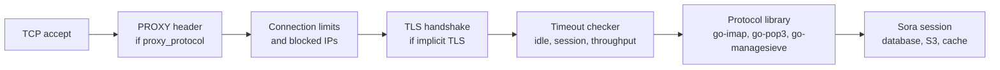

# Sora Protocols

This document describes the four mail protocols a Sora backend serves: IMAP, POP3, LMTP and
ManageSieve. It covers what each server advertises, the commands it accepts, the limits and
timeouts it enforces, and the replies a client or a mail transfer agent sees when something goes
wrong. It also lists every `[[server]]` key these four server types read, with its default.

It is written for operators who configure and debug Sora, and for contributors who change the
protocol servers. The proxy variants of these protocols (`imap_proxy`, `pop3_proxy`, `lmtp_proxy`,
`managesieve_proxy`) are in [PROXY.md](PROXY.md). Certificates are in [TLS.md](TLS.md), logins and
password checks in [AUTHENTICATION.md](AUTHENTICATION.md), and the security reasoning behind the
limits in [SECURITY.md](SECURITY.md).

## Table of contents

1. [Overview](#1-overview)
2. [Defining a protocol server](#2-defining-a-protocol-server)
3. [Connections, TLS and the PROXY protocol](#3-connections-tls-and-the-proxy-protocol)
4. [Timeouts](#4-timeouts)
5. [IMAP](#5-imap)
6. [Controlling IMAP capabilities](#6-controlling-imap-capabilities)
7. [POP3](#7-pop3)
8. [LMTP](#8-lmtp)
9. [ManageSieve](#9-managesieve)
10. [Server block key reference](#10-server-block-key-reference)
11. [Reloading settings](#11-reloading-settings)
12. [Metrics and log lines](#12-metrics-and-log-lines)

---

## 1. Overview

A Sora node runs one listener for each `[[server]]` block in its configuration. Four block types
serve mail protocols directly from the database and S3:

| Type | Protocol | Used by | Typical port |
|---|---|---|---|
| `imap` | IMAP4rev2 and IMAP4rev1 | Mail clients and webmail, to read and organise mail | 143 (STARTTLS), 993 (TLS) |
| `pop3` | POP3 | Mail clients that download the inbox | 110 (STLS), 995 (TLS) |
| `lmtp` | LMTP | Your mail transfer agent (MTA), to hand incoming mail to Sora | 24 |
| `managesieve` | ManageSieve | Mail clients, to upload Sieve filter scripts | 4190 |

These are the "backend" servers. In a larger deployment, proxies sit in front of them and route
each user to one backend; see [PROXY.md](PROXY.md). A backend works the same whether a client
connects directly or through a proxy. The differences are in how it learns the real client
address (section 3) and how the proxy logs in for the user ([AUTHENTICATION.md](AUTHENTICATION.md)).

Every connection to an IMAP, POP3 or ManageSieve backend passes the same layers, from the socket up:



LMTP uses the same PROXY and connection-limit layers but a simpler timeout model (section 8).

The protocol parsing is done by Migadu forks of open-source libraries, pinned in `go.mod`:
`github.com/migadu/go-imap`, `github.com/migadu/go-pop3`, `github.com/migadu/go-managesieve` and
`github.com/migadu/go-smtp` (which replaces `github.com/emersion/go-smtp` and serves LMTP). Some
limits in this document come from those libraries and cannot be configured; they are marked as
fixed.

---

## 2. Defining a protocol server

Each server is one `[[server]]` block. Three keys are required, and a fourth section,
`[servers]`, holds one setting shared by all servers on the node.

```toml
[servers]
trusted_networks = ["10.0.0.5/32", "10.0.0.6/32"]   # your proxy hosts

[[server]]
type = "imap"
name = "imap"
addr = ":993"
tls = true

[[server]]
type = "lmtp"
name = "lmtp"
addr = "10.0.0.20:24"
```

- `type` selects the protocol. Valid values for this document are `imap`, `pop3`, `lmtp` and
  `managesieve`. Other types (proxies, HTTP APIs, metrics) are described in
  [CONFIGURATION.md](CONFIGURATION.md).
- `name` identifies the server in logs, in the `server_name` label of metrics, in
  `sora-admin` connection listings, and when a reload matches old and new blocks. It must be unique
  on the node.
- `addr` is the listen address, `host:port` or `:port`. It must be unique on the node.

A block with an unknown `type`, a duplicate `name` or a duplicate `addr` stops startup. You may
define several blocks of the same type, for example one IMAP server with implicit TLS on 993 and
one with STARTTLS on 143.

Keys that belong to another server type do not stop startup. Sora logs a
`WARNING: Server <name> (type: <type>) has '<key>' configured, but this only applies to ...`
line at startup for each of them. Section 10 lists which keys each type reads.

### `[servers] trusted_networks`

`trusted_networks` is a list of CIDR blocks (a bare address also works). It is empty by default.
An entry that is neither stops startup.
It answers one question: which peers may tell Sora the real client address. On a backend it
controls:

- which peers may send a PROXY protocol header (section 3);
- which peers may send forwarding data: XCLIENT on POP3 and LMTP, and the `x-` fields of the IMAP
  `ID` command. Behind a PROXY header, IMAP and POP3 judge the client the header names, not the
  load balancer that sent it ([SECURITY.md](SECURITY.md#31-trusted_networks));
- which peers skip the per-IP connection limit;
- which peers skip auth rate limiting, unless `auth_rate_limit.exempt_networks` is set (see
  [AUTHENTICATION.md](AUTHENTICATION.md));
- which peers may deliver over LMTP. When the list is empty, LMTP falls back to loopback and the
  RFC 1918 private ranges (section 8).

List only your proxy and load-balancer hosts. At startup Sora logs a warning when the list
contains a whole private range such as `10.0.0.0/8`, and it refuses to start when a server has
`proxy_protocol = true` while the list is empty.

---

## 3. Connections, TLS and the PROXY protocol

### TLS modes

A listener is in one of three modes:

| `tls` | `tls_use_starttls` | Mode |
|---|---|---|
| `false` | ignored | Plaintext. No STARTTLS is offered. |
| `true` | `false` | Implicit TLS: the TLS handshake comes first (993, 995). |
| `true` | `true` | Plaintext port that offers STARTTLS (STLS for POP3). |

`tls_use_starttls = true` without `tls = true` is ignored, with a startup warning. The certificate
comes either from the global `[tls]` section or from `tls_cert_file` and `tls_key_file`; use one
of the two per listener. `tls_verify = true` requires a client certificate, which mail clients do
not send, so leave it off on these servers. All TLS details are in [TLS.md](TLS.md).

On IMAP, POP3 and ManageSieve plaintext ports without the PROXY protocol, Sora watches the first
bytes from the client. If they are a TLS ClientHello (a client set to TLS but pointed at the
plaintext port), Sora writes
`ERROR: TLS connection attempted on plain-text port. Use STARTTLS or connect to the TLS port.`
and closes the connection. The event is counted in `sora_connection_timeouts_total` with
`reason="tls_on_plain_port"`.

### When plaintext login is allowed

Each server computes "insecure auth" as `insecure_auth || !tls`:

- With `tls = false`, plaintext login is always allowed, whatever `insecure_auth` says. This is the
  usual setup for a backend that only proxies reach over a private network. At startup Sora logs
  `plaintext authentication is allowed without TLS on a publicly reachable address` when such a
  listener binds to a public address.
- With implicit TLS, every connection is encrypted, so the setting does not matter.
- With STARTTLS, `insecure_auth = false` (the default) refuses login until the client upgrades.
  IMAP advertises `LOGINDISABLED` and no `AUTH=` mechanism; POP3 hides `USER` and `SASL` from
  `CAPA` and answers `-ERR Authentication requires TLS. Use STLS first`; ManageSieve advertises an
  empty `SASL` and answers
  `NO "Authentication not permitted on insecure connection. Use STARTTLS first."`

LMTP has no AUTH command, so `insecure_auth` has no effect on it.

### PROXY protocol

With `proxy_protocol = true`, the listener requires a PROXY protocol header (version 1 or 2) on
every connection, before TLS. Sora uses the address in the header as the client address for
logs, rate limits and per-IP limits.

- Only peers in `[servers] trusted_networks` may connect. A connection from any other peer, or one
  without a header, is closed.
- `proxy_protocol_timeout` (default `5s`) bounds the wait for the header.
- On IMAP, a version 2 header may carry the client's JA4 TLS fingerprint and the proxy's session
  ID; Sora uses both (section 6).
- `max_connections_per_ip` counts the client the header names. That client is exempt only when its
  own address is in `trusted_networks`, not because the load balancer's is.

The PROXY protocol and how Sora's own proxies use it are described in [PROXY.md](PROXY.md).

### Connection limits

| Key | Default | Applies to | Effect |
|---|---|---|---|
| `max_connections` | `0` (no limit); LMTP: `1000` | all four | Open connections on this listener. |
| `max_connections_per_ip` | `0` (no limit) | IMAP, POP3, ManageSieve | Open connections from one client address: with `proxy_protocol`, the address the header names. A client whose own address is in `trusted_networks` is exempt. |
| `max_connections_per_user` | `0` (no limit) | IMAP, POP3, ManageSieve | Logged-in sessions of one account on this server. |
| `max_connections_per_user_per_ip` | `0` (no limit) | as above | Logged-in sessions of one account from one address on this server. |
| `listen_backlog` | `1024` when `0` | all four | Kernel accept queue length. |

A connection over `max_connections` or `max_connections_per_ip` is closed at once, without a
greeting. On IMAP, a connection from an address that the auth rate limiter has blocked is closed
the same way.

There is one exception: a client named in a PROXY header that is over `max_connections_per_ip`
(or, on IMAP, blocked). It gets a refusal greeting instead, after the TLS handshake on an
implicit-TLS listener:

- IMAP: `* BYE ...`
- POP3: `-ERR [SYS/TEMP] ...`
- ManageSieve: `BYE (TRYLATER) "Too many connections"`

This way the proxy in front fails only that client's login and does not count it as a backend
failure. See [SECURITY.md](SECURITY.md#4-connection-limits).

The per-user limits on a backend count sessions on that one server block only. A login over the
limit is refused and the session stays unauthenticated: IMAP answers
`NO [LIMIT] Maximum connections reached`, and POP3 and ManageSieve answer with a temporary error
(`-ERR [SYS/TEMP]` and `NO (TRYLATER)`). On IMAP, the per-user-per-IP count uses the client's real
address, as learned from the PROXY header or from ID forwarding. Cluster-wide per-user limits are
enforced by the proxies; see [PROXY.md](PROXY.md) and [CLUSTER.md](CLUSTER.md).

For the first 30 seconds after an IMAP, POP3 or ManageSieve listener starts, it accepts at most one
connection every 5 milliseconds. This spreads the reconnect wave after a restart. It is fixed.

### Backend maintenance

An operator can put a backend in maintenance with `sora-admin backends maintenance on`. Proxies
then stop routing to it, and after `[backend_maintenance] refuse_after` the backend itself refuses
new logins and deliveries ([PROXY.md](PROXY.md)). What clients see:

| Protocol | Reply |
|---|---|
| IMAP | `NO [UNAVAILABLE] Server in maintenance, please try again later` to LOGIN or AUTHENTICATE, after the password checked out |
| POP3 | `-ERR [SYS/TEMP] Server in maintenance, please try again later` at login |
| LMTP | `451 4.3.2 Server in maintenance, try again later` to MAIL |
| ManageSieve | Not affected. Logins are admitted. |

### Shutdown

On shutdown, IMAP sends `* BYE Server shutting down, please reconnect` to every session, POP3 sends
`-ERR Server shutting down, please reconnect`, and ManageSieve sends
`BYE (TRYLATER) "Server shutting down, please reconnect"`. Each then waits up to 30 seconds for
sessions to end. LMTP answers commands in progress with `421 4.2.1 service shutting down`. The full
shutdown order is in [OPERATIONS.md](OPERATIONS.md).

---

## 4. Timeouts

Timeouts protect the server from connections that never finish. There are four kinds:

- **Idle timeout**: how long a client may stay silent between commands.
- **Pre-login idle timeout**: the same, before the client has logged in.
- **Absolute session timeout**: the longest a session may last, however active.
- **Throughput check** (`min_bytes_per_minute`): closes a client that trickles bytes without ever
  finishing a command (a "slowloris").

Per-command timeouts, which cap the server-side work of one command, are listed with each
protocol.

### Idle and session timeouts

| Key | IMAP | POP3 | ManageSieve |
|---|---|---|---|
| `timeouts.command_timeout` | `30m` | `10m` | `3m` |
| `auth_idle_timeout` | `2m` | `2m` | `2m` |
| `timeouts.absolute_session_timeout` | `24h` | `24h` | `24h` |
| `timeouts.min_bytes_per_minute` | `0` (off) | `0` (off) | `0` (off) |

LMTP reads `timeouts.command_timeout` too, with a default of `5m`; its timeouts are in
section 8.8.

Notes:

- `command_timeout` is an idle timeout, despite its name. The IMAP default follows the 30-minute
  autologout floor of RFC 3501 §5.4, and the POP3 default the 10-minute floor of RFC 1939 §3.
- On IMAP, the go-imap library also sets its own read deadline of 35 minutes after login. It is
  fixed. A `command_timeout` of 35 minutes or more is capped by the library's 35 minutes, which
  closes the connection without a BYE; Sora logs a warning at startup for such a value.
- `auth_idle_timeout` is a top-level key of the `[[server]]` block, not part of `timeouts`. It
  replaces `command_timeout` until the client logs in. On POP3 and ManageSieve it also bounds a
  SASL continuation and the STARTTLS handshake.
- On POP3, the library also uses `command_timeout` as the longest time one command may take,
  `USER`, `PASS` and `AUTH` included.
- `absolute_session_timeout = "0"` removes the session limit.
- `min_bytes_per_minute` works in one-minute windows and starts two minutes after the connection
  opens. A window counts as stalled when the client sent some bytes, fewer than the threshold, and
  the server sent nothing (no command completed). Two stalled windows in a row close the
  connection. A window with no bytes either way is left to the idle timeout, and a client that
  completes a small command now and then (a NOOP poll) is never affected. IMAP IDLE suspends the
  check. `512` is a reasonable value.

What the client sees when a timeout fires:

| Protocol | Idle | Absolute | Throughput |
|---|---|---|---|
| IMAP | `* BYE [UNAVAILABLE] Idle timeout, please reconnect` | `* BYE [UNAVAILABLE] Maximum session duration exceeded, please reconnect` | `* BYE [UNAVAILABLE] Connection too slow, please reconnect` |
| POP3 | `-ERR Idle timeout, connection timed out` | `-ERR Maximum session duration exceeded` | `-ERR Connection too slow, please reconnect` |
| ManageSieve | `BYE (TRYLATER) "Connection timed out due to inactivity, please reconnect"` | `BYE (TRYLATER) "Maximum session duration exceeded, please reconnect"` | `BYE (TRYLATER) "Connection too slow, please reconnect"` |

Every timeout close is counted in `sora_connection_timeouts_total{protocol, server_name, hostname,
reason}` with `reason` one of `idle`, `session_max` or `slow_throughput`.

A changed timeout reaches connections accepted after a SIGHUP reload; existing connections keep
the values they started with (section 11).

The security reasoning for these values is in [SECURITY.md](SECURITY.md).

---

## 5. IMAP

The IMAP server (`type = "imap"`) speaks IMAP4rev2 (RFC 9051) and IMAP4rev1 (RFC 3501). A client
that does not `ENABLE IMAP4rev2` is served IMAP4rev1. The code is in
[server/imap/](../server/imap/); the wire protocol is handled by `github.com/migadu/go-imap`.

### 5.1 Greeting and capabilities

The greeting carries the capability list:

```
* OK [CAPABILITY IMAP4rev2 IMAP4rev1 SASL-IR LITERAL- AUTH=PLAIN] IMAP server ready
```

That is the list on an implicit-TLS port, or a plaintext port with insecure auth allowed. The
list depends on the connection state:

**Before login**

| Capability | When |
|---|---|
| `IMAP4rev2`, `IMAP4rev1` | Always. |
| `SASL-IR` | Always. |
| `LITERAL-` | Always. A non-synchronising literal is limited to 4096 bytes before login. |
| `STARTTLS` | On a STARTTLS listener, before the upgrade. |
| `AUTH=PLAIN` | When login is allowed on this connection (section 3). |
| `LOGINDISABLED` | When login is not allowed yet (STARTTLS listener with `insecure_auth = false`, before the upgrade). |
| `additional_caps` | Always, if configured (section 6). |

**After login**

| Capability | Specification | Notes |
|---|---|---|
| `IMAP4rev2`, `IMAP4rev1` | RFC 9051, RFC 3501 | |
| `SASL-IR` | RFC 4959 | |
| `UNSELECT`, `ENABLE`, `UTF8=ACCEPT` | RFC 3691, RFC 5161, RFC 6855 | Always present; cannot be removed. |
| `IDLE` | RFC 2177 | Section 5.7. |
| `UIDPLUS` | RFC 4315 | APPENDUID and COPYUID. |
| `ESEARCH`, `SEARCHRES` | RFC 4731, RFC 5182 | |
| `LIST-EXTENDED`, `LIST-STATUS` | RFC 5258, RFC 5819 | |
| `STATUS=SIZE` | RFC 8438 | |
| `CHILDREN` | RFC 3348 | When removed (section 6), `\HasChildren` / `\HasNoChildren` are sent only for `LIST ... RETURN (CHILDREN)`, which `LIST-EXTENDED` keeps (RFC 5258 §4). |
| `NAMESPACE` | RFC 2342 | Section 5.3. |
| `MOVE` | RFC 6851 | |
| `BINARY` | RFC 3516 | |
| `SPECIAL-USE`, `CREATE-SPECIAL-USE` | RFC 6154 | |
| `LITERAL+` | RFC 7888 | Replaces `LITERAL-` after login. |
| `CONDSTORE`, `QRESYNC` | RFC 7162 | Section 5.8. |
| `SORT`, `SORT=DISPLAY`, `ESORT` | RFC 5256, RFC 5957, RFC 5267 | |
| `ID` | RFC 2971 | Section 5.11. |
| `PREVIEW` | RFC 8970 | Only with `enable_preview = true`. Section 5.10. |
| `THREAD=REFERENCES`, `THREAD=REFS`, `THREAD=ORDEREDSUBJECT` | RFC 5256 | `REFS` is not defined in RFC 5256. Section 5.6. |
| `NOTIFY` | RFC 5465 | Section 5.7. |
| `METADATA` | RFC 5464 | Mailbox and server annotations. Section 5.9. |
| `MULTISEARCH` | RFC 7377 | Search across several mailboxes. |
| `ACL`, `RIGHTS=kxte` | RFC 4314 | Always present, whether or not shared mailboxes are enabled. See [SHARED_MAILBOXES.md](SHARED_MAILBOXES.md). |
| `APPENDLIMIT=<bytes>` | RFC 7889 | The `append_limit` value in bytes, e.g. `APPENDLIMIT=26214400` for the default. |
| `additional_caps` | | If configured. |

Not supported: `QUOTA`, `COMPRESS`, `CATENATE`, `WITHIN`, `UNAUTHENTICATE`, `METADATA-SERVER`,
`LIST-METADATA`, `OBJECTID`, `SAVEDATE`, `UIDONLY`, `MULTIAPPEND`, `LIST-MYRIGHTS`, `REPLACE`,
`URLAUTH`.

The list is the same for every client unless `disabled_caps` or `client_filters` remove entries
(section 6).

A command, option or modifier that belongs to an extension the session does not advertise is
refused with `BAD [CLIENTBUG]`, so a client cannot use an extension it was not offered. Sora
answers `BAD [CLIENTBUG] <command> is not supported` for `MOVE`, `UID EXPUNGE`, `SORT`, `THREAD`,
`ESEARCH IN`, `NAMESPACE`, `GETMETADATA`, `SETMETADATA`, `CREATE ... (USE ...)`,
`LIST ... RETURN (STATUS)`, `LIST ... RETURN (METADATA)`, `LIST (SPECIAL-USE)`, `STATUS SIZE`
and `FETCH BINARY`. The IMAP library does the same for the CONDSTORE and QRESYNC modifiers
(section 5.8).

### 5.2 Login

IMAP accepts `LOGIN` and `AUTHENTICATE PLAIN` (with or without an initial response, per SASL-IR).
Both go through the same checks: progressive delay and rate limit, credential lookup, the
maintenance gate, and the per-user connection limit. Replies a client may see:

| Situation | Reply |
|---|---|
| Wrong address or password, unknown user, an address that does not parse, or a rate-limited attempt | `NO [AUTHENTICATIONFAILED] Invalid address or password` |
| Empty password | `NO [AUTHENTICATIONFAILED] Authentication failed` |
| Too many logins waiting in the delay queue | `* BYE [ALERT] Too many concurrent authentication attempts. Please try again later.` |
| The database cannot be reached to check the login | `NO [UNAVAILABLE] authentication service temporarily unavailable, please try again later` |
| The server is shutting down | `NO [UNAVAILABLE] server is shutting down, please try again` |
| A master SASL login for a user it may not act as | `NO [AUTHORIZATIONFAILED] Proxy login not permitted for this user.` |
| Per-user limit reached | `NO [LIMIT] Maximum connections reached` |
| Backend in maintenance | `NO [UNAVAILABLE] Server in maintenance, please try again later` |

A rate-limited attempt and an address that does not parse get the same reply as a wrong password
on purpose, so the reply does not reveal anything about the account or the limiter.

`AUTHENTICATE` supports only the `PLAIN` mechanism. A client response must be one line of base64.
`*` cancels the exchange. A response that is not valid base64, contains a CR, or is a lone `=`
in reply to a continuation is refused with `BAD`. When the client does not answer a continuation
in time, the server sends `* BYE Timed out waiting for AUTHENTICATE response` and closes the
connection. Master users (`user@example.com@MASTER` with
`master_username`, and SASL authorization identities with `master_sasl_username`), the lookup cache
and the rate limiter are described in [AUTHENTICATION.md](AUTHENTICATION.md).

After a successful login, Sora creates the default mailboxes if INBOX does not exist yet, and may
start a cache warm-up that copies the newest INBOX messages from S3 to the local cache
(`[local_cache] enable_warmup`; see [STORAGE.md](STORAGE.md)).

### 5.3 Mailboxes

- The hierarchy delimiter is `/`.
- `NAMESPACE` returns one personal namespace with prefix `""`. When `[shared_mailboxes]` is
  enabled, it also returns one shared namespace with the configured prefix (`Shared/` by default).
  There is no "other users" namespace.
- Mailbox names are case-insensitive: `Work` and `work` are the same mailbox, and an account
  cannot hold both.
- The default mailboxes, created on first login or first delivery, are `INBOX`, `Sent`,
  `Drafts`, `Archive`, `Junk` and `Trash`. All six are subscribed. The last five carry the
  special-use attributes `\Sent`, `\Drafts`, `\Archive`, `\Junk` and `\Trash`.
- `RENAME INBOX <name>` follows RFC 3501 §6.3.5: it moves every message from INBOX into a new
  mailbox and leaves INBOX empty.
- The shared namespace root itself (`Shared` by default) holds no messages. It is listed as
  `\Noselect`; `SELECT`, `EXAMINE` and `STATUS` on it get `NO`, and `CREATE` of it is refused.
- Access to shared mailboxes is governed by ACL rights; see [SHARED_MAILBOXES.md](SHARED_MAILBOXES.md).

### 5.4 Messages and flags

**APPEND**

- A message larger than `append_limit` (default `25mb`, 26214400 bytes) is refused before it is
  read: `NO [TOOBIG] Literals are limited to <n> bytes for this command`. For a `LITERAL+`
  message, the library reads and discards the data so the stream stays in sync.
- An empty message is refused: `NO empty message rejected: a message must contain at least headers`.
- A missing target mailbox gets `NO [TRYCREATE]`.
- An APPEND without a date-time gets the current time as its INTERNALDATE (RFC 9051 §6.3.12).
- A body part that holds a NUL octet under an identity Content-Transfer-Encoding (none, `7bit`,
  `8bit` or `binary`), as a `~{n}` (literal8, RFC 3516) APPEND may send, is stored base64-encoded
  with its `Content-Transfer-Encoding` field changed to match. `BODY[...]` and `BODYSTRUCTURE`
  then describe the base64 form, which an ordinary literal can carry, and `BINARY[...]` returns
  the original octets (RFC 3516 §4.4 allows a lossless CTE change). Every other part, and every
  message without such a part, is stored exactly as sent. `RFC822.SIZE` is the stored size.
- When the session memory limit cannot hold the message:
  `NO [UNAVAILABLE] Session memory limit reached, please try again later`.
- When this node's upload spool is over its size limit:
  `NO [UNAVAILABLE] System storage limit reached, please try again later`.
- When the message cannot be written to the spool (for example, the disk is full or read-only):
  `NO [SERVERBUG] failed to save message to disk: <cause>`. The reply names the cause, such as
  `no space left on device`, never the spool path.
- The body is written to the local spool and uploaded to S3 in the background; see
  [STORAGE.md](STORAGE.md).

**Read-only selections**

A mailbox opened with `EXAMINE` reports an empty `PERMANENTFLAGS` list. `STORE` on it gets
`NO Mailbox is read-only (opened with EXAMINE)`, and `MOVE` from it gets `NO Mailbox is read-only`.

**COPY and MOVE**

- A `COPY` or `MOVE` into a mailbox of another account (a shared mailbox) may carry at most
  1,000 distinct message bodies. A larger one copies or moves nothing and is refused with
  `NO [LIMIT] COPY across accounts is limited to 1000 distinct message bodies` (or `MOVE ...`).
  See [SHARED_MAILBOXES.md](SHARED_MAILBOXES.md#storage-and-statistics).
- A `COPY` into the selected mailbox itself gets `NO Cannot copy messages to the same mailbox`.
- When a source message's body is renamed while it is copied or moved (by a `sora-admin`
  import), the command writes nothing and answers
  `NO [INUSE] Messages changed during the copy, please retry` (or `... the move ...`).
  A retry succeeds.

**Keywords**

- A message may carry at most 50 keywords (custom flags). An APPEND or STORE that would exceed this
  is refused with `NO [LIMIT] Too many keywords on a message (maximum 50)`. Delivery and import
  keep the first 50 instead of failing.
- On delivery and on APPEND, Sora sets one of the RFC 9979 attachment keywords, `$hasattachment` or
  `$hasnoattachment`, if it can tell from the MIME structure. On APPEND, a keyword the client set
  itself is kept. The keyword is only added when the message has room under the 50-keyword limit.
- Removing `\Flagged` also removes the RFC 9979 flag colour keywords, so the next flag shows the
  default colour.

**\Recent**

Sora tracks `\Recent` in memory on each server, per mailbox, from the highest UID at the last
read-write `SELECT`. It is approximate across several servers and is reset on restart. Within a
session, the `RECENT` count, `SEARCH RECENT` (and `NEW`, `OLD`) and the `\Recent` flag in `FETCH
FLAGS` all use the same threshold, so they agree. A client that has enabled IMAP4rev2, where
`\Recent` is deprecated, sees it on no message.

**EXPUNGE**

`EXPUNGE`, `UID EXPUNGE`, `CLOSE` and `MOVE` mark messages as expunged. The rows and S3 objects are
removed later by the cleaner, after `[cleanup] grace_period`; see [STORAGE.md](STORAGE.md).

**Spam training**

Moving a message into or out of `Junk` can submit it to an external spam filter for training, if
`[spam_training]` is configured; see [RELAY.md](RELAY.md).

### 5.5 Fetching message bodies

For an uploaded message, Sora reads the body from the local cache, then from S3, then from the local
upload spool (useful while S3 is unreachable). For a message still waiting for upload, it reads the
local spool first, then S3. Three replies are specific to Sora:

- `NO [UNAVAILABLE] Message body temporarily unavailable, please retry` when the body is staged
  for upload on another node and not yet in S3. Sora never sends an empty body in that case, so a
  client cannot mistake it for an empty message.
- `NO [LIMIT] Message too large for the session memory limit` when the message can never be
  fetched within the session memory budget: its body is larger than the whole budget, or a section
  (`BODY[TEXT]`, `BODY[2]`, `BINARY[2]`) does not fit beside the body it is copied from. A retry
  cannot succeed (RFC 5530 LIMIT: an implementation limit). A NOTIFY `MessageNew` fetch skips such
  a message at once.
- `NO [UNAVAILABLE] Session memory limit reached, please try again later` when the body or section
  would fit the budget, but other data the session holds at the moment does not leave room for it.
  A retry can succeed.

In both memory cases the message is not marked `\Seen`, and nothing of its response is sent.

Other rules for FETCH:

- **Implicit `\Seen`.** `BODY[...]` and `BINARY[...]` without `.PEEK` set `\Seen`, one message at a
  time, just before that message's response. A FETCH that fails part way has set `\Seen` only
  on the messages it answered. When the flag changes, the response includes the new `FLAGS`
  (and `MODSEQ` once CONDSTORE is enabled).
- **ENVELOPE.** The date is the message's `Date:` header in the zone it was written in, and
  `NIL` when the message has no `Date:` header that parses (SORT and THREAD then use the
  INTERNALDATE). The message ID is `NIL` when the message has no `Message-ID:` header. Messages
  stored by versions before these rules report what they reported before.
- **BINARY.** A `BINARY` or `BINARY.SIZE` section whose Content-Transfer-Encoding Sora cannot
  decode gets `NO [UNKNOWN-CTE]` (RFC 9051 §7.5.2).
- **Large sections fetched in pieces.** A client often fetches a large attachment in
  `<offset.size>` chunks. Sora keeps the last section it extracted or decoded for the session, so
  it does not reload the message for every chunk. A section up to 8 MiB is kept in memory; a
  larger one, up to 128 MiB, is kept in a temporary file that is deleted from the directory at once, up to 2 GiB
  of such files on the node.

`limits.session_memory_limit` (default `100mb`, `0` for no limit) bounds the memory one session
may hold at once for FETCH bodies, APPEND data, SEARCH results and previews. Each refusal is counted
in `sora_session_memory_limit_exceeded_total`, and the peak per session is observed in
`sora_session_memory_peak_bytes`. Start-up and a reload warn when the limit is below the
`max_message_size` of an `lmtp` server in the same file: messages between the two sizes are
delivered, but never fetched.

### 5.6 SEARCH, SORT, THREAD and MULTISEARCH

How search works, what it costs and how it is indexed is in [SEARCH.md](SEARCH.md). The settings
on the IMAP server block are:

| Key | Default | Meaning |
|---|---|---|
| `limits.search_rate_limit_per_min` | `60` | Expensive searches an account may run per window. `0` or less turns the limit off. |
| `limits.search_rate_limit_window` | `1m` | The window. |
| `limits.search_rate_limit_burst` | the per-window value | Searches allowed back to back before the rate applies. |
| `limits.thread_max_messages` | `50000` | Most matching messages one `THREAD` or `UID THREAD` may process. `0` or less keeps the default; there is no unlimited value. |

A search refused by the rate limit gets `NO [LIMIT]`. A `THREAD` that matches more than the cap
gets `NO [LIMIT] THREAD matches more than <n> messages, narrow the search`, never a partial result.
`THREAD` supports the algorithms `REFERENCES`, `REFS` and `ORDEREDSUBJECT`. An algorithm that is
not advertised (any other, or one removed in section 6) gets
`BAD [CLIENTBUG] THREAD <algorithm> is not supported`. An unknown `SORT` key gets `BAD`.

### 5.7 IDLE and NOTIFY

Change detection for IDLE and NOTIFY is polling of the shared database, so it works across several
Sora servers and read replicas. The latency is one poll interval plus replica lag.

- **IDLE**: Sora checks for changes every 15 seconds. Every 2 minutes it sends `* OK Still here`
  (or every half `command_timeout`, if that is shorter). The keepalive keeps NAT mappings open and
  stops the idle timeout from closing a client that is legitimately silent. The throughput check is
  suspended during IDLE. The current count is in `sora_imap_idle_connections_current`.
- **NOTIFY**: supports the events `MessageNew`, `MessageExpunge`, `FlagChange`, `MailboxName` and
  `SubscriptionChange`; any other gets a `BADEVENT` reply. The poll interval is the same 15 seconds.
  When more than 100 mailboxes change in one interval, Sora drops the watch with
  `* OK [NOTIFICATIONOVERFLOW]` and the client must re-synchronise. At most 64 new-message responses
  for the selected mailbox are sent per interval; the rest follow on the next ones.
- **Changes seen by polling.** A message that arrives and has its flags changed within one
  interval is announced once, with its current flags; the client does not get a separate flag
  update for the flags it was stored with. Changes a session made itself (its own `STORE`,
  `COPY`, `RENAME`) are not reported back to it as NOTIFY events.

### 5.8 CONDSTORE and QRESYNC

Both are advertised.

**When MODSEQ data is sent.** Sora sends `MODSEQ` data only to a client that has enabled
CONDSTORE on the connection. A client enables it with `ENABLE CONDSTORE` or `ENABLE QRESYNC`, or
by using a CONDSTORE enabling command: `SELECT ... (CONDSTORE)`, `FETCH ... (MODSEQ)`,
`CHANGEDSINCE`, `UNCHANGEDSINCE`, `SEARCH MODSEQ` or `STATUS ... (HIGHESTMODSEQ)` (RFC 7162
§3.1). The first such command reports the mailbox's `HIGHESTMODSEQ`.

**What is refused.** When CONDSTORE is not advertised to the session (removed in section 6), its
modifiers get `BAD [CLIENTBUG]`: `FETCH MODSEQ`, `CHANGEDSINCE`, `UNCHANGEDSINCE`, `SEARCH
MODSEQ`, `SELECT (CONDSTORE)` and `STATUS (HIGHESTMODSEQ)`. These are also refused with `BAD`:

- `SELECT ... (QRESYNC ...)` before `ENABLE QRESYNC`;
- `UID FETCH ... (VANISHED)` without `ENABLE QRESYNC` and `CHANGEDSINCE`:
  `BAD VANISHED requires ENABLE QRESYNC and CHANGEDSINCE`;
- a mod-sequence of `0` in `CHANGEDSINCE` or `QRESYNC`, a value above 2^63-1 in
  `UNCHANGEDSINCE` or `SEARCH MODSEQ`, and a `QRESYNC` UIDVALIDITY of `0` or `*`.

**STORE UNCHANGEDSINCE.** A `STORE ... UNCHANGEDSINCE` that fails for some messages answers
`OK [MODIFIED <set>]`, in the command's number space (sequence numbers for `STORE`, UIDs for
`UID STORE`), per RFC 7162 §3.1.3.

### 5.9 METADATA

`GETMETADATA` and `SETMETADATA` store annotations per mailbox, and per account for the server
entry (mailbox `""`).

- Entry names must start with `/private/` or `/shared/`, below the scope root itself. They are
  case-insensitive: `/private/Comment` and `/private/comment` are the same entry.
- A malformed entry name, an empty entry list, an empty options list, or a `SETMETADATA` that
  names one entry twice (in any letter case) gets `BAD [CLIENTBUG]`.
- A wildcard mailbox name (`*` or `%`) gets `NO [CLIENTBUG]`. Entry names are checked first.
- The size and count limits come from the `[metadata]` section (64 KiB per entry, 100 entries
  per mailbox, 50 server entries per account, 1 MiB per account by default); see
  [STORAGE.md](STORAGE.md).

### 5.10 PREVIEW

`enable_preview = true` advertises `PREVIEW` (RFC 8970). It is off by default because once it is
advertised, any client may ask for previews and each preview can cost an S3 download. Sora stores
no previews; it generates them from the body when asked and keeps them in a small in-memory cache.

- `FETCH ... (PREVIEW (LAZY))` is answered only from bodies already on this node (the local cache or
  the upload spool). Otherwise the answer is `NIL`, which LAZY allows. It never reads S3. One command
  generates at most 200 previews from local files.
- `FETCH ... (PREVIEW)` without LAZY downloads the body from S3 when needed, within these budgets:

| Key | Default | Meaning |
|---|---|---|
| `limits.preview_s3_per_min` | `300` | S3 downloads per account per minute for previews. `0` or less: no limit. |
| `limits.preview_s3_burst` | the smaller of 200 and `preview_s3_per_min` | Downloads allowed back to back. |
| `limits.preview_s3_node_per_min` | `3000` | S3 downloads per minute for the whole server. `0` or less: no limit. |
| `limits.preview_s3_max_size` | `[local_cache] max_object_size` | Largest message downloaded for a preview. |

One download is bounded by an 8-second deadline. When a budget, the size cut-off or the deadline
stops a download, the preview is `""` (RFC 8970 §3 forbids `NIL` here), which clients show as no
preview. The preview text is approximate and may change for the same message. `enable_preview`
needs a restart.

### 5.11 ID

The server answers `ID` with:

| Field | Key | Default |
|---|---|---|
| `name` | `id_name` | `Sora` |
| `version` | `id_version` | The build version, or `1.0` if the binary has none |
| `vendor` | `id_vendor` | `Migadu-Mail GmbH` |
| `support-url` | `id_support_url` | `https://migadu.com` |

Some clients change behaviour by server name, so these keys let you present a different identity.

The client's `name` and `version` are matched against `client_filters` (section 6). Before login,
when the connection comes from a peer in `trusted_networks` (behind a PROXY header, the client the
header names; see [SECURITY.md](SECURITY.md#31-trusted_networks)), Sora also reads the proxy's
forwarding fields (`x-originating-ip`, `x-originating-port`, `x-session-id`, `x-proxy-ttl`,
`x-forward-ja4-fingerprint` and others) and uses them as the client's address and fingerprint.
After login they are ignored: the peer is then relaying the client's own commands. A forwarded TTL
that has run out closes the connection to stop a proxy loop. The fields are described in
[PROXY.md](PROXY.md).

### 5.12 Per-command timeouts

These cap the server-side work of one command. They are safety nets, well above normal run times.
Set a value under `timeouts.imap_command_timeouts` to change it; `"0"` turns the cap off for that
command.

| Key | Default | Command |
|---|---|---|
| `search` | `30s` | SEARCH |
| `sort` | `30s` | SORT |
| `thread` | `30s` | THREAD |
| `multi_search` | `30s` | MULTISEARCH (ESEARCH across mailboxes) |
| `fetch` | `0` (no cap) | FETCH. Uncapped because a FETCH lasts as long as the client takes to read a large body. |
| `store` | `15s` | STORE |
| `copy` | `30s` | COPY |
| `move` | `30s` | MOVE |
| `rename` | `60s` | RENAME. Longer because `RENAME INBOX` moves every message. |

A command that runs out of time is cancelled and usually answered
`NO [UNAVAILABLE] Service temporarily unavailable, please try again later`. Other commands have no
per-command cap.

```toml
[[server]]
type = "imap"
name = "imap"
addr = ":993"
tls = true
timeouts.imap_command_timeouts.search = "15s"
timeouts.imap_command_timeouts.fetch = "10m"
```

### 5.13 Fixed limits from the IMAP library

These come from `github.com/migadu/go-imap` and cannot be configured:

- After login the library allows 35 minutes between commands.
- One command may be up to 50 KiB, not counting its literals.
- A literal in any command other than APPEND and SETMETADATA is limited to 4096 bytes:
  `NO [TOOBIG] Literals are limited to 4096 bytes for this command`. A SETMETADATA value may be as
  large as the `[metadata]` entry size limit (section 5.9).
- Before login, a non-synchronising literal (`{n+}`) over 4096 bytes is refused with
  `BAD Non-synchronizing literals are limited to 4096 bytes`.

### 5.14 Other replies

`STATUS` items: `DELETED` is answered when IMAP4rev2 is advertised (it is an IMAP4rev2 item);
`DELETED-STORAGE` gets `BAD [CLIENTBUG] STATUS DELETED-STORAGE is not supported`, because Sora has
no QUOTA; `RECENT` gets `BAD Unknown STATUS data item` from a client that has enabled IMAP4rev2,
also in `LIST ... RETURN (STATUS (RECENT))`. `CHECK` is accepted only with a mailbox selected.

| Reply | Meaning |
|---|---|
| `NO [UNAVAILABLE] Service temporarily unavailable, please try again later` | A temporary failure: database or S3 unavailable, a lock wait or a command timeout. The client should retry later. |
| `NO [SERVERBUG] <text>` | An unexpected server error. The text describes it; the log has the details. |
| `NO Command aborted` | The client disconnected while the command ran. |

---

## 6. Controlling IMAP capabilities

Some clients mishandle some IMAP extensions. Sora lets you remove capabilities for every client,
or only for matching clients, and add vendor tokens that some clients look for. `disabled_caps` and
`client_filters` apply to `type = "imap"` only. An `imap_proxy` block reads `additional_caps` (and
the `id_*` keys) for its own pre-login replies; see [PROXY.md](PROXY.md).

### `disabled_caps`

A list of capability names removed for every client of this server:

```toml
disabled_caps = ["IMAP4rev2", "ESEARCH"]
```

Rules:

- Only these names can be removed: `IMAP4rev1`, `IMAP4rev2`, `LITERAL+`, `MOVE`, `IDLE`,
  `UIDPLUS`, `ESEARCH`, `SEARCHRES`, `ESORT`, `SORT`, `SORT=DISPLAY`, `SPECIAL-USE`,
  `CREATE-SPECIAL-USE`, `LIST-EXTENDED`, `LIST-STATUS`, `STATUS=SIZE`, `BINARY`, `CONDSTORE`,
  `QRESYNC`, `NOTIFY`, `CHILDREN`, `ID`, `NAMESPACE`, `METADATA`, `THREAD=REFERENCES`,
  `THREAD=REFS`, `THREAD=ORDEREDSUBJECT`, `MULTISEARCH`, and `PREVIEW` when enabled. Names are
  case-insensitive (`idle` is `IDLE`).
- Removing a capability also removes every capability that depends on it, so a client never
  sees an extension whose base is gone. Sora logs every name it removed. The dependencies are:
  - `IMAP4rev2` includes `NAMESPACE`, `UNSELECT`, `UIDPLUS`, `ESEARCH`, `SEARCHRES`, `ENABLE`,
    `IDLE`, `SASL-IR`, `LIST-EXTENDED`, `LIST-STATUS`, `MOVE`, `LITERAL-`, `STATUS=SIZE` and
    `CHILDREN`. Removing one of these also removes `IMAP4rev2`, so clients fall back to
    IMAP4rev1 and really lose the extension.
  - `QRESYNC` depends on `CONDSTORE`.
  - `SORT=DISPLAY` and `ESORT` depend on `SORT`.
  - `SEARCHRES`, `ESORT` and `MULTISEARCH` depend on `ESEARCH`.
  - `CREATE-SPECIAL-USE` depends on `SPECIAL-USE`.

  `client_filters` follows the same rules (see below).
- With `IMAP4rev1`, `SASL-IR` is always advertised, and `LITERAL-` is offered until
  `LITERAL+` replaces it after login. After login, `UNSELECT`, `ENABLE` and `UTF8=ACCEPT`
  are also always advertised. These names cannot be removed this way; naming one of them
  removes neither it nor `IMAP4rev2`. `STARTTLS`, `LOGINDISABLED` and
  `AUTH=PLAIN` follow `tls`, `tls_use_starttls` and `insecure_auth`; `disabled_caps` does not
  change them. `ACL`, `RIGHTS=` and `APPENDLIMIT=` cannot be removed either.
- A list that removes both `IMAP4rev1` and `IMAP4rev2` (directly, or through a capability
  `IMAP4rev2` includes) stops startup, and `sora-admin config validate` reports it.
- A name that removes nothing (unknown, always advertised, or not offered by this server) is
  logged at WARN at startup and reported by `sora-admin config validate`.
- The commands and modifiers of a removed extension are refused with `BAD [CLIENTBUG]`
  (section 5.1), so a client that ignores the list cannot use them.
- The setting needs a restart.

### `additional_caps`

A list of extra tokens advertised verbatim, in every state, including the greeting:

```toml
additional_caps = ["X-ICEWARP-SERVER"]
```

Some clients enable features by vendor token. For example, eM Client treats a server that
advertises `X-ICEWARP-SERVER` as IceWarp and then shows custom keywords as tags. Every client sees
the token, so it can trigger the same vendor behaviour in other clients too. Empty strings are
skipped. Behind a proxy, the client sees the backend's tokens after login and the proxy's own
`additional_caps` before login; set it on both blocks for full coverage.

### `client_filters`

Each `[[server.client_filters]]` table removes capabilities for the clients it matches:

| Key | Type | Meaning |
|---|---|---|
| `client_name` | regular expression | Matched against the `name` the client sends in `ID`. |
| `client_version` | regular expression | Matched against the `version` the client sends in `ID`. |
| `ja4_fingerprints` | list of regular expressions | Matched against the client's JA4 TLS fingerprint. |
| `disable_caps` | list of strings | Capabilities to remove for a matching client. |
| `reason` | string | Free text, written to the debug log when the filter applies. |

```toml
[[server]]
type = "imap"
name = "imap"
addr = ":993"
tls = true

[[server.client_filters]]
client_name = "^ExampleMail$"
client_version = "^1\\."
disable_caps = ["CONDSTORE"]
reason = "ExampleMail 1.x mishandles MODSEQ"

[[server.client_filters]]
ja4_fingerprints = ["^t13d1516h2_8daaf6152771_"]
disable_caps = ["IDLE"]
reason = "A client with this TLS stack drops IDLE"
```

Matching:

- A filter matches when any of its `ja4_fingerprints` patterns matches the fingerprint, **or** when
  its name and version patterns both match the `ID` data. A name or version pattern that is left
  out counts as matching; a client that sent no `ID` never matches a name or version pattern.
- Every matching filter applies; their `disable_caps` add up.
- Patterns are Go regular expressions (RE2 syntax). A pattern that does not compile stops startup,
  naming the entry, the key and the pattern; `sora-admin config validate` reports it too, and a
  reload with it is skipped for that server.
- An entry needs at least one of `client_name`, `client_version` and `ja4_fingerprints`; one
  without, which would match no client, stops startup the same way. An empty `client_name` or
  `client_version` counts as left out, but an empty `ja4_fingerprints` pattern would match every
  fingerprint, so it stops startup too.
- The key is `ja4_fingerprints`, a list. A single `ja4_fingerprint` key is unknown and ignored.

Where the JA4 fingerprint comes from, in order of preference:

1. a PROXY protocol version 2 header from a trusted proxy;
2. the TLS handshake on this server, on implicit-TLS ports and after STARTTLS;
3. the `x-forward-ja4-fingerprint` field of an `ID` command from a trusted proxy.

When filters apply:

- A JA4 match from the handshake or the PROXY header is applied before the greeting, so even the
  greeting's capability list is filtered.
- A name and version match applies when the client sends `ID`. Clients usually send `ID` early,
  but anything they learned from an earlier `CAPABILITY` stays in their memory.
- A filter never takes away what the connection has already enabled, because an enabled
  extension stays active until the connection closes (RFC 9051 §6.3.1, RFC 7162 §3.1). Kept are:
  - an extension the client named in `ENABLE` (`IMAP4rev2`, `CONDSTORE`, `QRESYNC`), with every
    extension it includes;
  - `CONDSTORE`, once the client has sent any CONDSTORE enabling command (section 5.8);
  - `IMAP4rev2` on a server without `IMAP4rev1`.

  For example, a filter matched by an `ID` sent after `ENABLE IMAP4rev2` leaves `IMAP4rev2` and
  everything it includes in place, and removes only the rest. The session then logs
  `capability filters partly applied` with the names it kept.

As with `disabled_caps`, a filter that removes a capability included in `IMAP4rev2` also removes
`IMAP4rev2` for that session, unless the connection has it enabled (above), so the client falls
back to IMAP4rev1 and really loses the extension. The same list of removable names applies as for
`disabled_caps`, case-insensitively, except `IMAP4rev1`: the library picks the protocol version
from the server's own list, so only `disabled_caps` can remove it. Any other name is logged at
WARN when the server starts, with the entry number. When a filter changes the list, the session logs `capability filters applied`
with the client and the removed names.

---

## 7. POP3

The POP3 server (`type = "pop3"`) serves each account's INBOX. The code is in
[server/pop3/](../server/pop3/); the wire protocol is handled by `github.com/migadu/go-pop3`.

### 7.1 Greeting and CAPA

The greeting is `+OK Sora-POP3-Server ready`. There is no APOP timestamp. `CAPA` answers, in
this order:

| Line | When |
|---|---|
| `TOP` | Always. |
| `UIDL` | Always. |
| `USER` | When login is allowed on this connection (section 3). |
| `RESP-CODES` | Always. |
| `PIPELINING` | Always. |
| `STLS` | On a STARTTLS listener, before the upgrade. |
| `SASL PLAIN` | When login is allowed on this connection. |
| `LANG` | Always. |
| `UTF8` | Always. |
| `EXPIRE NEVER` or `EXPIRE <days>` | `NEVER` when `[cleanup] max_age_restriction` is unlimited. For retention of at least 24 hours, `<days>` is whole days rounded down. Omitted for positive retention under 24 hours: RFC 2449 §6.7 cannot express fractional days, `EXPIRE 0` forbids leaving mail on the server, and `EXPIRE 1` would promise a day of retention. |
| `AUTH-RESP-CODE` | Always. |
| `IMPLEMENTATION Sora-POP3-Server` | Always. |

The list is the same before and after login.

### 7.2 Commands

- Before login: `CAPA`, `USER`, `PASS`, `AUTH`, `STLS`, `UTF8`, `LANG`, `QUIT`, and `XCLIENT` from
  trusted peers (section 7.5).
- After login: `CAPA`, `STAT`, `LIST`, `UIDL`, `RETR`, `TOP`, `DELE`, `RSET`, `NOOP`, `LANG`, `UTF8`
  and `QUIT`. `UTF8` is also accepted after login, because some clients send it then.
- `UTF8` (RFC 6856) changes nothing by default. Addresses and passwords may contain UTF-8 with or
  without it, and `RETR` and `TOP` send messages as stored either way, also to a client that never
  sent `UTF8` (no surrogate, no `-ERR [UTF8]`). This is the default because the POP3 proxy hides
  `UTF8` from `CAPA` unless `remote_use_utf8 = true`, so most clients can never send it, and classic
  Outlook stops the whole download at the first `-ERR`.
- With `strict_utf8_content = true`, a session that has not sent `UTF8` gets
  `-ERR [UTF8] Message has UTF-8 headers, issue UTF8 to retrieve it` for `RETR` and `TOP` of a
  message with any byte above 0x7F in its header section (RFC 6856 §2.1 and §5). After `UTF8`,
  before or after login, the same command returns the message. Messages with ASCII headers are
  always sent, 8bit bodies included. No surrogate message is built. The server advertises `UTF8` to
  every client that connects to it directly; behind a `pop3_proxy` the client sees it only when the
  proxy has `remote_use_utf8 = true`, and the proxy passes a `UTF8` sent before login on only when
  the `[[pool]]` or `[server.remote_lookup]` that routes the user here has it too. Turn the setting
  on only then, or the messages cannot be downloaded at all. It is read at startup, not on reload.
- `APOP` is not supported: `-ERR Unknown command: APOP`. `LAST` gets `-ERR LAST is obsolete (RFC 1939)`.
- `AUTH` supports only `PLAIN`, with or without an initial response.

### 7.3 The maildrop

- The maildrop is INBOX, in UID order. Expunged messages are not listed.
- The list is loaded at the first `STAT`, `LIST`, `UIDL`, `RETR`, `TOP` or `DELE`, and kept for the
  rest of the session. Mail delivered later appears in the next session. Message numbers do not
  change during a session.
- `UIDL` returns the message's IMAP UID in INBOX, as a decimal number.
- `DELE` only marks a message. A deleted message disappears from `LIST`, `UIDL` and `STAT`, and
  `RSET` clears all marks.
- At `QUIT`, the marked messages are expunged, the same way an IMAP EXPUNGE does, and the reply is
  `+OK <n> messages expunged` (or `+OK Goodbye` when nothing was marked). If the expunge fails, the
  reply is `-ERR [SYS/TEMP] some messages could not be removed; maildrop unchanged`.
- A connection that ends without `QUIT` deletes nothing.
- There is no exclusive lock: two sessions may open the same maildrop at once.
- `STAT` and `LIST` report the stored size. `RETR` announces the size as sent, with bare line feeds
  counted as CRLF, so the two can differ slightly for such messages.
- `TOP n 0` returns the headers only.

Errors while reading a body: `-ERR Message not available` when it is permanently gone, and
`-ERR [SYS/TEMP] Message temporarily unavailable, please try again later` when S3 is unreachable or
the upload has not finished.

`limits.session_memory_limit` (default `100mb`) bounds the memory of one session. A listing too
large for it gets `-ERR [SYS/TEMP] Mailbox too large to open in this session`. A body that cannot
fit beside the session's message list gets `-ERR [SYS/PERM] Message too large for the session
memory limit`; SYS/PERM (RFC 3206) because only raising the limit helps. A body that would fit, but not beside what the session holds
at the moment, gets `-ERR [SYS/TEMP] Session memory limit reached, please try again later`.

### 7.4 Login and errors

| Situation | Reply |
|---|---|
| Wrong address or password, an address that does not parse, or rate-limited | `-ERR [AUTH] Authentication failed` |
| Login before TLS on a STARTTLS port with `insecure_auth = false` | `-ERR Authentication requires TLS. Use STLS first` |
| Too many logins waiting in the delay queue | `-ERR [SYS/TEMP] Too many concurrent authentication attempts. Please try again later.` |
| The database cannot be reached | `-ERR [SYS/TEMP] Service temporarily unavailable, please try again later` |
| A master SASL login with an authorization identity it may not use | `-ERR [AUTH] Proxy authentication requires master credentials` |
| Backend in maintenance | `-ERR [SYS/TEMP] Server in maintenance, please try again later` |
| `AUTH` response that is not valid base64 or not a valid PLAIN message | `-ERR Invalid SASL PLAIN response` |
| `AUTH` with a mechanism other than `PLAIN` | `-ERR Unsupported SASL mechanism` |
| `*` sent to cancel `AUTH` | `-ERR Authentication aborted` (not counted as an error) |

An address that does not parse is answered and counted like a wrong password, so the reply does
not tell a guessed name from a real one.

The library closes a session after 4 errors (failed logins included), with
`-ERR Too many errors, closing connection`. Each error adds a delay of 3 seconds times the error
count, up to 30 seconds. A command line is limited to 1024 bytes; a longer one gets
`-ERR Line too long` and the connection is closed. These limits are fixed. `limits.max_auth_errors`
does not apply to the POP3 backend.

### 7.5 XCLIENT

A trusted peer may send `XCLIENT` before login to pass the real client address. Its attributes
are `ADDR`, `PORT`, `SESSION`, `TTL` and `FORWARD` (upper case; other spellings are ignored). Sora's
POP3 proxy uses it; see [PROXY.md](PROXY.md).

- **Who may send it.** The connection's peer must be in `trusted_networks`. Behind a PROXY
  header, either the load balancer that sent the header or the client the header names may be.
- **Which address counts.** Behind a PROXY header, `ADDR` and `PORT` are applied only when the
  client the header names is itself in `trusted_networks`; otherwise they are ignored and the
  other attributes still apply ([SECURITY.md](SECURITY.md#31-trusted_networks)).
- **When.** Once per session, before login. A second one gets
  `-ERR [AUTH] XCLIENT already provided`, and one after login
  `-ERR [AUTH] XCLIENT not allowed after authentication`; both close the connection. A refused
  `XCLIENT` does not use up the allowance.

Other replies: `+OK XCLIENT parameters accepted`, `-ERR Connection not from trusted proxy`,
`-ERR Invalid XCLIENT parameters`, `-ERR Invalid forwarding parameters` (an `ADDR` that is not an
IP address, or a bad port), and `-ERR Proxy TTL expired`, which closes the connection.

### 7.6 Per-command timeouts

Set under `timeouts.pop3_command_timeouts`; `"0"` turns one off.

| Key | Default | Covers |
|---|---|---|
| `stat` | `10s` | Loading the maildrop for STAT. |
| `list` | `10s` | LIST. |
| `uidl` | `10s` | UIDL. |
| `retr` | `30s` | Loading the body (cache or S3). Sending it to the client is not timed. |
| `top` | `30s` | As `retr`. |
| `dele` | `10s` | DELE. |
| `quit` | `15s` | The expunge at QUIT. |

`USER`, `PASS` and `AUTH` are not covered; the progressive auth delay paces them. A command that runs
out of time gets an `-ERR [SYS/TEMP] ...` reply.

---

## 8. LMTP

The LMTP server (`type = "lmtp"`) is how your mail transfer agent (MTA) hands incoming mail to Sora.
LMTP is SMTP for the last hop: the server answers once per recipient after the data. The code is in
[server/lmtp/](../server/lmtp/); the wire protocol is handled by the go-smtp fork.

### 8.1 Who may connect

LMTP must not be reachable from the internet. Sora admits a connection by the socket peer's
address:

- If `[servers] trusted_networks` is set, only those networks may deliver.
- If it is empty, Sora admits `127.0.0.0/8`, `::1/128`, `10.0.0.0/8`, `172.16.0.0/12` and
  `192.168.0.0/16`, and logs that it does so at startup.

A connection from any other peer is closed as soon as it is accepted, before TLS and without a
greeting. It does not take a `max_connections` slot. Sora logs
`connection rejected - not from trusted network`, and the MTA treats the closed connection as a
temporary failure.

### 8.2 Greeting and LHLO

The greeting is `220 <hostname> LMTP Service Ready`, where `<hostname>` is the operating system host
name. `HELO` and `EHLO` get `500 5.5.1 This is a LMTP server, use LHLO`. `LHLO` advertises:

| Extension | When |
|---|---|
| `PIPELINING`, `8BITMIME`, `ENHANCEDSTATUSCODES`, `CHUNKING` | Always. |
| `STARTTLS` | With `tls = true` and `tls_use_starttls = true`, before the upgrade. |
| `SMTPUTF8` | Always. |
| `SIZE <bytes>` | Always, with `max_message_size` in bytes (for example `SIZE 52428800`). |
| `LIMITS RCPTMAX=1` | Always. |
| `XCLIENT ADDR PORT PROTO HELO LOGIN NAME` | Only to peers in `[servers] trusted_networks`. |

There is no `AUTH`, `DSN`, `BINARYMIME` or `REQUIRETLS`. `XCLIENT` is advertised only when the
socket peer is in a `trusted_networks` list that is set; with an empty list nobody gets it.

Other replies before a transaction:

- `LHLO` without a domain: `501 5.5.2 Domain/address argument required for HELO`.
- `LHLO` during a `BDAT` transfer: `550 5.5.1 Finish or reset the chunked transfer before greeting again`.
- `AUTH`: `504 5.7.4 Unsupported authentication mechanism`.

### 8.3 Envelope

- `MAIL FROM:<>` (the null sender) is accepted. Any other sender must be an address, or the
  reply is `553 5.1.7 Invalid sender`. The sender is read as leniently as Postfix reads it with its default
  `strict_rfc821_envelopes = no`: leading, trailing and consecutive dots in the local part
  (`first..last@example.com`), a quoted local part (`"john doe"@example.com`, `"a@b"@example.com`,
  `"alice@x>"@example.com`: `<` and `>` may stand inside the quotes), a domain without a dot
  (`user@localhost`) and an address literal (`user@[192.0.2.1]`) are accepted. The
  `user@domain@SUFFIX` form of a master login has no meaning in an envelope address: the last `@`
  starts the domain. A sender with a
  control character, a malformed domain, or over the length limits of a recipient is refused. A
  `MAIL` command that does not parse at all gets
  `501 5.5.2 Was expecting MAIL arg syntax of FROM:<address>`. The LMTP proxy passes these
  senders on to the backend as written. Recipients are not read leniently.
- A recipient that is not a valid address gets `553 5.1.3 Invalid recipient address syntax`, or
  `501 5.1.3 Was expecting RCPT arg syntax of TO:<address>` when the command does not parse. A
  recipient with more than one `@` (a quoted local part such as `"a@b.example"@example.com`, or
  `user@example.com@SUFFIX`) is not a valid address; the LMTP proxy answers it
  `550 5.1.3 Bad destination mailbox address syntax`.
  Addresses are compared in lower case.
- One recipient per transaction. A second `RCPT` gets `452 4.5.3 Maximum limit of 1 recipients reached`,
  and the MTA sends it in a new transaction.
- An unknown or deleted account gets `550 5.1.1 No such user here`; Sora checks the primary
  database before it answers this. A database error gets
  `451 4.4.3 Temporary failure, please try again later`, so the MTA retries.
- `user+detail@example.com` is delivered to the account of `user@example.com`. The detail is kept
  for Sieve.
- Addresses may contain any valid UTF-8 in the local part (RFC 6531). A Unicode domain is converted
  to its ASCII form. The local part may be up to 256 octets (longer than RFC 5321's 64, to allow SRS
  addresses), the domain up to 255, and the address up to 512. A non-ASCII address is accepted even
  when the MTA did not send the `SMTPUTF8` parameter.
- `VRFY` answers `252 2.5.0 Cannot VRFY user, but will accept message`.

**MAIL and RCPT parameters**

| Parameter | Reply |
|---|---|
| `SIZE=<n>` (MAIL) | Accepted; see section 8.4. |
| `BODY=7BIT`, `BODY=8BITMIME` (MAIL) | Accepted. |
| `SMTPUTF8` (MAIL) | Accepted. With a value: `501 5.5.4 SMTPUTF8 does not take a value` (RFC 6531 §3.4). |
| `BODY=BINARYMIME` | `555 5.5.4 BINARYMIME is not implemented`. Any other `BODY` value: `501 5.5.4 Unknown BODY value`. |
| `AUTH=` (MAIL) | `555 5.5.4 AUTH is not implemented`, because `LHLO` does not announce `AUTH`. |
| `RET`, `ENVID`, `NOTIFY`, `ORCPT` (DSN) | `555 5.5.4 <name> is not implemented`. |
| `XRCPTFORWARD` (RCPT) | Taken from trusted peers; silently ignored from others. A malformed value: `501 5.5.4 Malformed XRCPTFORWARD parameter: ...`. |
| Any other parameter | `555 5.5.4 Unknown MAIL FROM argument` or `555 5.5.4 Unknown RCPT parameter` (RFC 5321 §4.1.1.11). |

Two malformations are refused before any parameter is checked, with
`501 5.5.4 Unable to parse MAIL ESMTP parameters` (or `RCPT`): a parameter written with `=` and no
value (RFC 5321 §4.1.2), and a parameter given twice (RFC 6152 §3, RFC 1870 §6). Otherwise the
parameters are checked in the order sent and the first refused one decides the reply: `SIZE=abc
FOO=1` gets `501`, and `FOO=1 SIZE=abc` gets `555`.

**Command order**

Commands out of order get `503 5.5.1`:

| Command | Reply text |
|---|---|
| `MAIL` before `LHLO` | `Please introduce yourself first.` |
| A second `MAIL` in one transaction | `Sender already specified` |
| `RCPT` before `MAIL` | `Missing MAIL FROM command.` |
| `DATA` or `BDAT` without an accepted recipient | `Missing RCPT TO command.` |
| `MAIL`, `RCPT` or `DATA` during a `BDAT` transfer | `MAIL not allowed during message transfer` (or `RCPT`, `DATA`) |
| `RCPT` after a refused `BDAT` chunk | `RCPT not allowed after a refused BDAT` |

`DATA` with an argument gets `501 5.5.4 DATA command should not have any arguments`. A refused
`BDAT` chunk is still read and thrown away, so the connection stays in step, and the
transaction is reset. A `BDAT LAST` in a transaction with no accepted recipient gets no reply at
all, because LMTP answers once per accepted recipient, and there is none (RFC 2033 §4.2).

### 8.4 Message size

`max_message_size` (default `50mb`) is advertised in `LHLO` and enforced twice:

1. **At MAIL.** A `SIZE=` value above the limit gets `552 5.3.4 Max message size exceeded`. A value
   that is not a number gets `501 5.5.4 Unable to parse SIZE as an integer`, and one longer than
   20 digits (RFC 1870 §3, `size-value ::= 1*20DIGIT`) gets
   `501 5.5.4 SIZE value longer than 20 digits`, even when leading zeros leave a small number.
   Sizes of 4 GiB and more are compared correctly.
2. **While the data is read.** A message that turns out larger gets
   `552 5.3.4 message size exceeds maximum allowed size of <n> bytes` after the data. A `BDAT`
   chunk that takes the message over the limit gets `552 5.3.4 Max message size exceeded`; the
   chunk is thrown away and the transaction reset.

`max_message_size = "0"` means the default 50 MiB, not unlimited. A value above 2147483647 bytes
(2 GiB - 1) is lowered to that, with a warning at startup. An empty message gets
`550 5.6.0 empty message rejected: a message must contain at least headers`.

After `DATA` and the last `BDAT`, each reply carries the recipient, for example
`250 2.0.0 <user@example.com> OK: queued` or `552 5.3.4 <user@example.com> message size ...`.

### 8.5 Delivery

For each accepted message, Sora:

1. checks for a delivery loop (an `X-Sora-Loop` header together with a `Delivered-To` equal to the
   account's primary address), answering `550 5.4.6 routing loop detected (Delivered-To)`;
2. adds a `Received:` header and a `Delivered-To:` header naming the account's primary address;
3. checks that this node's upload spool has room for the message;
4. runs the built-in default Sieve script, then the user's active script (see
   [SIEVE.md](SIEVE.md));
5. writes the message to the local spool (with fsync), stores its metadata in PostgreSQL and queues
   the body for upload to S3 (see [STORAGE.md](STORAGE.md));
6. answers `250 2.0.0 <recipient> OK: queued`.

The `Received:` header has this form:

```
Received: from <helo> ([<client-ip>])
	by <hostname> with LMTP id <id>
	for <primary-address>; <date>
```

`<helo>` is the `HELO` value from XCLIENT if the MTA sent one, otherwise the `LHLO` name. The
protocol word is `UTF8LMTP` for an internationalised transaction (RFC 6531 §3.7.3).

The built-in default script does two things:

- A message whose `X-Spam` header contains `Yes` (in any case) is filed into the account's
  personal mailbox with the `\Junk` special-use attribute, or into `Junk` if none has it, or into
  INBOX if neither exists. Nothing else in the default script applies to it.
- A message to an address with a detail (`user+name@example.com`) is filed into a personal
  mailbox named after the detail in lower case, created if needed. Any sender can therefore
  create a folder in an account by writing to `user+name@`. A detail that names the shared
  namespace or a name the mailbox rules refuse is delivered to INBOX instead.

No message is ever stored in the shared namespace root itself; such a target falls back to INBOX.

A message delivered again with the same bytes (an MTA retry after a lost reply) is answered `250`
and not stored a second time in the same mailbox.

Temporary failures, all of which make the MTA retry:

| Reply | Cause |
|---|---|
| `451 4.3.2 Server in maintenance, try again later` | The backend is in maintenance (at MAIL; section 3). |
| `451 4.4.3 Recipient validation timed out, please try again later` | The RCPT timeout ran out. |
| `451 4.3.0 Message processing timed out, please try again later` | The DATA timeout ran out. |
| `452 4.3.1 Insufficient system storage` | The upload spool is over its size limit. |
| `452 4.3.1 Insufficient system storage, please try again later` | The spool disk is full or read-only. |
| `421 4.4.5 Server busy, try again later` | A lock could not be taken in time. |
| `421 4.4.2 Error reading message data` | The data could not be read from the connection. |
| `421 4.2.1 service shutting down` | The server is shutting down. |
| `451 4.3.0 <text>` | Another internal error, for example `failed to save message` or `failed to save message to disk: <cause>`. The text names the cause, never the spool path. |

When Sieve files a message into a shared mailbox that another account owns, the body is also
staged for upload under the owner's account. When that staging fails, the delivery fails with
`451 4.3.0 failed to save message`, so no message is stored without a body to upload. The MTA's
retry is deduplicated against the copies already stored.

There is no quota check at delivery.

### 8.6 Sieve redirect limits

Sieve `redirect` actions run during delivery, so their limits are on the LMTP server block:

| Key | Default | Meaning |
|---|---|---|
| `limits.redirect_rate_limit` | `100` | Redirects one account may make per window. Over the limit the redirect is skipped and the message is kept. `0`: no limit. |
| `limits.redirect_rate_window` | `1h` | The window. |
| `limits.max_redirect_hops` | `2` | A message whose `X-Sora-Loop` count has reached this value is not redirected again. `0` turns this check off; the `Delivered-To` loop check still applies. |

Redirected copies leave through `[relay]`; see [RELAY.md](RELAY.md) and [SIEVE.md](SIEVE.md).

### 8.7 XCLIENT

Peers in `[servers] trusted_networks` may send `XCLIENT` with `ADDR`, `PORT`, `PROTO`, `HELO`,
`LOGIN` and `NAME`. After it, the server greets again and the MTA must send `LHLO` again. Sora uses
`ADDR` as the client address and `HELO` in the `Received:` header. On a listener with
`proxy_protocol = true`, `ADDR` and `PORT` replace the address the PROXY header gave only when that
address is itself in `trusted_networks`; otherwise they are ignored and the other attributes still
apply ([SECURITY.md](SECURITY.md#31-trusted_networks)). From any other peer `XCLIENT`
is not advertised and gets `550 5.7.1 XCLIENT denied`. The LMTP proxy uses XCLIENT; see
[PROXY.md](PROXY.md).

Other XCLIENT replies:

- `503 5.5.1 XCLIENT not permitted after MAIL FROM`;
- `501 5.5.4 Invalid XCLIENT attributes: ...` for an attribute other than the six above, or a bad
  `ADDR`, `PORT` or `PROTO` value, or an empty `HELO`, `LOGIN` or `NAME`;
- `501 5.5.4 Invalid XCLIENT syntax: ...`;
- `451 4.0.0 XCLIENT temporarily unavailable`, a temporary failure inside the server.

### 8.8 Timeouts and fixed limits

| Setting | Value | Notes |
|---|---|---|
| Idle timeout | `timeouts.command_timeout`, default `5m` | The longest wait for one read. Between commands it ends with `421 4.4.2 Idle timeout, bye bye`; while message data arrives, with `421 4.4.2 Error reading message data` (per recipient after `DATA`). `0` means the default. Needs a restart. |
| Data timeout | 1 hour, fixed | The longest one `DATA` body or one `BDAT` chunk may take as a whole. |
| Write timeout | 2 minutes, fixed | |
| `timeouts.lmtp_command_timeouts.rcpt` | `10s` | Account lookup and mailbox creation at RCPT. `"0"` turns it off. |
| `timeouts.lmtp_command_timeouts.data` | `60s` | The work after the data has arrived: Sieve, spool, database. Not the transfer itself. `"0"` turns it off. |
| Command line length | 2000 bytes, fixed | `500 5.4.0 Too long line, closing connection`. |
| Protocol errors | 3, fixed | On the fourth, `500 5.5.1 Too many errors. Quiting now`. Counted are empty lines, unknown commands and commands that do not parse. |

The idle timeout applies to each read, so a large message from an MTA that keeps sending is not
cut off after a few minutes; only the data timeout bounds the transfer as a whole.

LMTP has no login, so the LMTP server does not read `auth_rate_limit`, `lookup_cache` or the master
credentials.

---

## 9. ManageSieve

The ManageSieve server (`type = "managesieve"`) lets clients upload and activate Sieve filter
scripts (RFC 5804). Script semantics and the Sieve engine are in [SIEVE.md](SIEVE.md). The code is
in [server/managesieve/](../server/managesieve/); the wire protocol is handled by
`github.com/migadu/go-managesieve`.

### 9.1 Capabilities

The greeting, the `CAPABILITY` reply and the reply after `STARTTLS` all carry the same capability
lines. The greeting looks like this:

```
"IMPLEMENTATION" "ManageSieve"
"VERSION" "1.0"
"SIEVE" "<extensions>"
"STARTTLS"
"SASL" "PLAIN"
"MAXSCRIPTSIZE" "<bytes>"
OK "Sora ManageSieve server ready."
```

- `STARTTLS` appears only on a STARTTLS listener before the upgrade. There the greeting's last line
  is `OK (STARTTLS) "Sora ManageSieve server ready."` The `CAPABILITY` reply ends with a bare `OK`.
- `SASL` is `""` while login is not allowed on the connection (section 3).
- `SIEVE` lists the extensions from `[sieve] enabled_extensions` that the engine supports, or the
  default set when that list is empty. The same set is used to validate scripts. See
  [SIEVE.md](SIEVE.md).
- `MAXSCRIPTSIZE` is `max_script_size` in bytes (16384 by default).
- `UNAUTHENTICATE`, `NOTIFY`, `MAXREDIRECTS`, `LANGUAGE` and `OWNER` are not advertised.

### 9.2 Commands

`CAPABILITY`, `STARTTLS`, `AUTHENTICATE` (PLAIN only), `NOOP`, `LOGOUT`, `LISTSCRIPTS`, `GETSCRIPT`,
`PUTSCRIPT`, `CHECKSCRIPT`, `HAVESPACE`, `RENAMESCRIPT`, `SETACTIVE` and `DELETESCRIPT`. A
non-standard `LOGIN "<address>" "<password>"` command is also accepted; it is not advertised, follows
the same TLS rule, and does not accept master SASL credentials. `UNAUTHENTICATE` and any other
command get `NO "Unknown command"`.

Behaviour:

- `PUTSCRIPT` checks the size before reading the script:
  `NO (QUOTA/MAXSIZE) "Script size <n> exceeds maximum allowed size <max>"`. It then compiles the
  script: `NO "Script validation failed: ..."` on error, `OK "Script stored"` or
  `OK "Script updated"` on success.
- An account may hold at most 100 scripts: `NO (QUOTA/MAXSCRIPTS) "Too many scripts for this account"`.
- One script is active at a time. `SETACTIVE ""` deactivates all scripts. Activation validates the
  script again.
- The active script cannot be deleted:
  `NO (ACTIVE) "Cannot delete the active script; deactivate it first"`.
- `DELETESCRIPT` answers `OK "Script deleted"`.
- `RENAMESCRIPT` keeps the script's content and active flag and answers a bare `OK`. A target
  name that already exists gets `NO (ALREADYEXISTS) ...`.
- `HAVESPACE` for an account at the 100-script limit gets
  `NO (QUOTA/MAXSCRIPTS) "Maximum number of scripts reached"`.
- A missing script gets `NO (NONEXISTENT) "Script does not exist"`. A database failure gets
  `NO (TRYLATER) "Service temporarily unavailable"`.
- A script that contains a NUL byte or is not valid UTF-8 is refused with
  `NO "Script validation failed: sieve script contains NUL or invalid UTF-8"`. A script name that
  is empty, contains control characters or is not valid UTF-8 is refused too.

### 9.3 Login and errors

- A failed login gets `NO "Authentication failed"`.
- `AUTHENTICATE` data that is not valid base64 gets `NO "Invalid authentication data"`, a PLAIN
  message with the wrong number of parts `NO "Invalid authentication format"`, and a mechanism
  other than `PLAIN` `NO "Unsupported authentication mechanism"`. `*` in reply to a
  continuation cancels with `NO "Authentication cancelled"`, which is not counted as an error.
- When the database cannot be reached, a login gets
  `NO (TRYLATER) "Service temporarily unavailable"`.
- After 10 errors (failed logins included) the server sends
  `BYE "Too many errors, closing connection"`. This is fixed, and `limits.max_auth_errors` does not
  apply.
- A command line may be up to 8192 bytes; a longer one gets `NO "Command line too long"` and the
  connection is closed. A line that does not end in CRLF gets
  `NO "Command line must end with CRLF"` and the connection is closed.
- There is no maintenance gate on ManageSieve.

### 9.4 Per-command timeouts

Set under `timeouts.managesieve_command_timeouts`; `"0"` turns one off. All default to `10s`:
`listscripts`, `getscript`, `putscript`, `checkscript`, `setactive`, `deletescript`,
`renamescript`, `havespace`. `AUTHENTICATE` and `LOGIN` are not covered. A command that runs out
of time usually gets `NO (TRYLATER) "Service temporarily unavailable"`.

---

## 10. Server block key reference

This section lists every key the four backend types read. Durations accept Go syntax (`30s`, `5m`,
`1h30m`) or a whole number of days on its own (`7d`). Sizes accept `b`, `kb`, `mb` and `gb` with binary multiples (`25mb` is 26214400 bytes), or a
plain number of bytes.

### 10.1 Identity and logging

| Key | Type | Default | Read by | Meaning |
|---|---|---|---|---|
| `type` | string | required | all | `imap`, `pop3`, `lmtp` or `managesieve`. |
| `name` | string | required | all | Unique server name. |
| `addr` | string | required | all | Listen address. |
| `debug` | bool | `false` | IMAP, LMTP | IMAP: writes a raw protocol trace, with LOGIN and AUTHENTICATE passwords masked but message content included, to the log file when `[logging] output` is a file, otherwise to standard output. LMTP: writes go-smtp's raw protocol trace, message content included, to standard output, and logs each message's headers at debug level before Sieve runs. No effect on POP3 and ManageSieve, where it is ignored with a startup warning. Needs a restart. |

### 10.2 TLS

| Key | Type | Default | Read by | Meaning |
|---|---|---|---|---|
| `tls` | bool | `false` | all | Turn TLS on (section 3). |
| `tls_use_starttls` | bool | `false` | all | With `tls = true`: plaintext port offering STARTTLS. |
| `tls_cert_file` | path | none | all | Certificate chain (PEM) when not using global `[tls]`. |
| `tls_key_file` | path | none | all | Private key (PEM). |
| `tls_verify` | bool | `false` | all | Require a client certificate. Mail clients send none; leave it off. |
| `tls_default_domain` | string | none | all | Certificate name for clients that send no SNI, with global `[tls]`. |

Details in [TLS.md](TLS.md).

### 10.3 Network and connections

| Key | Type | Default | Read by | Meaning |
|---|---|---|---|---|
| `proxy_protocol` | bool | `false` | all | Require a PROXY protocol header from `trusted_networks` peers. |
| `proxy_protocol_timeout` | duration | `5s` | all | Wait for the PROXY header. |
| `max_connections` | int | `0` = no limit (LMTP: `1000`) | all | Section 3. |
| `max_connections_per_ip` | int | `0` = no limit | IMAP, POP3, ManageSieve | Section 3. |
| `max_connections_per_user` | int | `0` = no limit | IMAP, POP3, ManageSieve | Section 3. |
| `max_connections_per_user_per_ip` | int | `0` = no limit | as above | Section 3. |
| `listen_backlog` | int | `1024` when `0` | all | Kernel accept queue. |

### 10.4 Authentication

| Key | Type | Default | Read by | Meaning |
|---|---|---|---|---|
| `insecure_auth` | bool | `false` | IMAP, POP3, ManageSieve | Allow login before STARTTLS. Forced on when `tls = false`. |
| `master_username` | string | none | IMAP, POP3, ManageSieve | Master user name for the `user@example.com@<master_username>` login form. Startup fails if set without `master_password`. |
| `master_password` | string | none | IMAP, POP3, ManageSieve | Its password. |
| `master_sasl_username` | string | none | IMAP, POP3, ManageSieve | Master SASL identity, used by proxies to log in as any user. Startup fails if set without `master_sasl_password`. |
| `master_sasl_password` | string | none | IMAP, POP3, ManageSieve | Its password. |
| `master_sasl_allowed_networks` | list of CIDR | none (any source) | IMAP, POP3, ManageSieve | Socket peers allowed to use master SASL. List your proxy hosts. |
| `auth_rate_limit` | table | disabled | IMAP, POP3, ManageSieve | Progressive delays and blocking after failed logins. |
| `lookup_cache` | table | enabled | IMAP, POP3, ManageSieve | In-memory cache of verified logins. |

How these work is in [AUTHENTICATION.md](AUTHENTICATION.md). Two points matter for the server
block:

- `lookup_cache` is on by default, with `positive_ttl = "5m"`, `negative_ttl = "1m"`,
  `max_size = 10000`, `cleanup_interval = "5m"` and `positive_revalidation_window = "30s"`. Keys
  left out of the table keep these defaults, and the cache stays on unless the table says
  `enabled = false`.
- `auth_rate_limit` is off unless `auth_rate_limit.enabled = true`. Its other keys then default to
  the values in [AUTHENTICATION.md](AUTHENTICATION.md).

### 10.5 Timeouts

| Key | Type | Default | Read by |
|---|---|---|---|
| `auth_idle_timeout` | duration | `2m` | IMAP, POP3, ManageSieve |
| `timeouts.command_timeout` | duration | IMAP `30m`, POP3 `10m`, ManageSieve `3m`, LMTP `5m` | all four |
| `timeouts.absolute_session_timeout` | duration | `24h` (`0`: none) | IMAP, POP3, ManageSieve |
| `timeouts.min_bytes_per_minute` | int | `0` (off) | IMAP, POP3, ManageSieve |
| `timeouts.imap_command_timeouts.*` | duration | section 5.12 | IMAP |
| `timeouts.pop3_command_timeouts.*` | duration | section 7.6 | POP3 |
| `timeouts.managesieve_command_timeouts.*` | duration | section 9.4 | ManageSieve |
| `timeouts.lmtp_command_timeouts.rcpt`, `.data` | duration | `10s`, `60s` | LMTP |

Section 4 explains each one; the LMTP timeouts are in section 8.8.

### 10.6 Limits

| Key | Type | Default | Read by |
|---|---|---|---|
| `limits.session_memory_limit` | size | `100mb` (`0`: none) | IMAP, POP3 |
| `limits.search_rate_limit_per_min` | int | `60` | IMAP |
| `limits.search_rate_limit_window` | duration | `1m` | IMAP |
| `limits.search_rate_limit_burst` | int | `search_rate_limit_per_min` | IMAP |
| `limits.thread_max_messages` | int | `50000` | IMAP |
| `limits.preview_s3_per_min` | int | `300` | IMAP |
| `limits.preview_s3_burst` | int | smaller of `200` and `preview_s3_per_min` | IMAP |
| `limits.preview_s3_node_per_min` | int | `3000` | IMAP |
| `limits.preview_s3_max_size` | size | `[local_cache] max_object_size` | IMAP |
| `limits.redirect_rate_limit` | int | `100` | LMTP |
| `limits.redirect_rate_window` | duration | `1h` | LMTP |
| `limits.max_redirect_hops` | int | `2` | LMTP |
| `limits.max_auth_errors` | int | `2` | Not read by backends; proxies only ([PROXY.md](PROXY.md)). |

### 10.7 Protocol-specific keys

| Key | Type | Default | Read by | Meaning |
|---|---|---|---|---|
| `append_limit` | size | `25mb` | IMAP | Largest message APPEND accepts; advertised as `APPENDLIMIT`. `0` also means 25 MiB. |
| `enable_preview` | bool | `false` | IMAP | Advertise `PREVIEW` (section 5.10). |
| `disabled_caps` | list | none | IMAP | Section 6. |
| `additional_caps` | list | none | IMAP | Section 6. |
| `client_filters` | array of tables | none | IMAP | Section 6. |
| `id_name`, `id_version`, `id_vendor`, `id_support_url` | string | section 5.11 | IMAP | `ID` reply fields. |
| `max_message_size` | size | `50mb` | LMTP | Largest message delivered. `0` also means 50 MiB; at most 2147483647 bytes. |
| `max_script_size` | size | `16kb` | ManageSieve | Largest Sieve script. |

Global settings these servers also read: `[servers] trusted_networks` (section 2),
`[tls]` ([TLS.md](TLS.md)), `[sieve]` ([SIEVE.md](SIEVE.md)), `[metadata]` and `[local_cache]`
([STORAGE.md](STORAGE.md)), `[shared_mailboxes]` ([SHARED_MAILBOXES.md](SHARED_MAILBOXES.md)),
`[cleanup] max_age_restriction` (POP3 `EXPIRE`), `[backend_maintenance]` ([PROXY.md](PROXY.md)).

---

## 11. Reloading settings

On SIGHUP Sora re-reads the configuration file and hands each running server its block, matched by
`name`. A server applies only the keys below; it logs every other changed key as needing a restart.
New values reach connections accepted after the reload. Existing sessions keep their values.

| Type | Keys applied on reload |
|---|---|
| `imap` | `timeouts.command_timeout`, `timeouts.absolute_session_timeout`, `timeouts.min_bytes_per_minute`, `limits.session_memory_limit`, `master_sasl_username`, `master_sasl_password`, `master_sasl_allowed_networks` |
| `pop3` | the same as `imap` |
| `managesieve` | `timeouts.command_timeout`, `timeouts.absolute_session_timeout`, `timeouts.min_bytes_per_minute`, `max_script_size`, `master_sasl_username`, `master_sasl_password`, `master_sasl_allowed_networks` |
| `lmtp` | `max_message_size` |

Two exceptions to "existing sessions keep their values":

- The `master_sasl_*` keys are read at each login, so a connection that has not logged in yet
  uses the new values.
- LMTP reads `max_message_size` at every `LHLO`, `MAIL`, `DATA` and `BDAT`, so an open connection
  gets the new limit with its next transaction. A value that does not parse keeps the running
  one, with the warning `LMTP config reload: invalid max_message_size, keeping the running value`.

A server block added to the file is not started, and a removed one is not stopped, until a restart.
The full reload behaviour is in [OPERATIONS.md](OPERATIONS.md).

---

## 12. Metrics and log lines

All metrics are listed in [METRICS.md](METRICS.md). The ones most tied to protocol behaviour:

| Metric | What it tells you |
|---|---|
| `sora_connection_timeouts_total{protocol,server_name,hostname,reason}` | Connections closed by a timeout (`idle`, `session_max`, `slow_throughput`) or for TLS on a plaintext port (`tls_on_plain_port`). |
| `sora_session_memory_limit_exceeded_total` | Operations refused by `session_memory_limit`. |
| `sora_session_memory_peak_bytes` | Peak memory per session. |
| `sora_imap_idle_connections_current` | IMAP sessions in IDLE. |
| `sora_imap_search_refused_total` | Searches refused, by reason. |
| `sora_command_timeout_threshold_seconds{protocol}` | The configured IMAP `command_timeout`. |
| `sora_backend_maintenance_sessions_refused_total{protocol}` | Logins and deliveries refused by maintenance. |

Log lines worth knowing:

| Log message | Meaning |
|---|---|
| `Connection closed - timeout` | Sora's own timeout checker closed a connection (every IMAP timeout, and the throughput check on POP3 and ManageSieve); the `reason` field says which. |
| `capability filters applied` | A client filter removed capabilities for a session. |
| `connection registration rejected` / `rejected connection registration` | A per-user connection limit was reached and the login was refused. |
| `login refused: this backend is in maintenance` | The maintenance gate refused an IMAP login. |
| `connection rejected - not from trusted network` | An LMTP peer outside the admitted networks. |
| `IMAP: command_timeout is at or above the protocol library's 35m read deadline; ...` | `command_timeout` is too long to take effect. |
