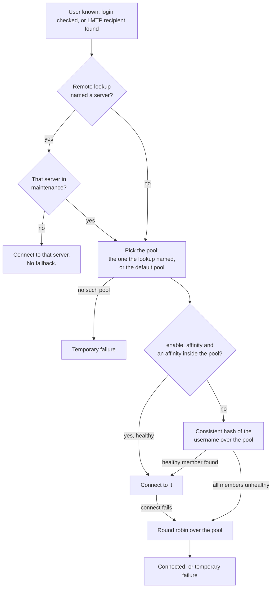

# Sora Proxy

This document covers Sora's proxy servers: the front ends that accept client connections for
IMAP, POP3, ManageSieve, LMTP and the User API, check who the user is, and pass the connection on to
one of several backend Sora servers. It explains how a proxy picks a backend (remote lookup, named
backend pools, affinity, consistent hashing, round robin), how it talks to the backend (TLS, PROXY
protocol, IMAP ID, XCLIENT), how it reacts to failed and drained backends, and the caches it keeps.

It is written for operators who run proxies in front of backends, and for contributors who change
the routing code in [server/proxy/](../server/proxy/) and the protocol proxies.

## Contents

1. [What a proxy does](#1-what-a-proxy-does)
2. [Proxy server settings](#2-proxy-server-settings)
3. [How a backend is chosen](#3-how-a-backend-is-chosen)
4. [Remote lookup](#4-remote-lookup)
5. [Named backend pools](#5-named-backend-pools)
6. [Affinity, consistent hashing and round robin](#6-affinity-consistent-hashing-and-round-robin)
7. [Backend health, DNS and connect timeouts](#7-backend-health-dns-and-connect-timeouts)
8. [The backend leg](#8-the-backend-leg)
9. [Backend maintenance mode](#9-backend-maintenance-mode)
10. [Lookup cache](#10-lookup-cache)
11. [Auth cache](#11-auth-cache)
12. [Affinity cache](#12-affinity-cache)
13. [Proxy nodes and the database](#13-proxy-nodes-and-the-database)
14. [What clients see when routing fails](#14-what-clients-see-when-routing-fails)
15. [Monitoring and tools](#15-monitoring-and-tools)
16. [Reloading and restarting](#16-reloading-and-restarting)

---

## 1. What a proxy does

A Sora backend stores mail: it has the PostgreSQL metadata, the S3 bodies and the local upload
spool. A proxy stores nothing. It holds the client connection, finds out which backend the user
belongs on, opens a connection to that backend and then relays bytes in both directions until one
side closes.

You run proxies when one backend is not enough: to spread users across several backends, to move
users between backends without changing client settings, or to take a backend out of service
without dropping mail.

There is one proxy type per protocol. Each is a `[[server]]` block in the config file:

| `type` | Proxies to | Who logs in |
|---|---|---|
| `imap_proxy` | backend `imap` servers | the user, with `LOGIN` or `AUTHENTICATE PLAIN` |
| `pop3_proxy` | backend `pop3` servers | the user, with `USER`/`PASS` or `AUTH PLAIN` |
| `managesieve_proxy` | backend `managesieve` servers | the user, with `AUTHENTICATE "PLAIN"` |
| `lmtp_proxy` | backend `lmtp` servers | nobody: the proxy looks up each recipient |
| `user_api_proxy` | backend `http_user_api` servers | the backend: the proxy routes by the user in the request |

A login through the IMAP, POP3 or ManageSieve proxy has two halves:

1. **The proxy checks the password.** It asks the remote lookup API, or PostgreSQL, or its caches.
2. **The proxy logs in to the backend for the user.** It uses the `master_sasl_username` and
   `master_sasl_password` of its `[[server]]` block with SASL PLAIN, naming the user as the
   authorization identity. The backend has the same master SASL credentials and accepts the login
   without the user's password. See [AUTHENTICATION.md](AUTHENTICATION.md) for master credentials.

After the backend accepts the login, the proxy sends the backend's reply to the client and becomes
a byte pipe. Everything after login (capabilities, IDLE, FETCH) is the backend's.

The LMTP proxy does not log in. For each `RCPT TO` it finds the recipient's backend, connects (or
reuses the connection it holds) and forwards the command. Like the backend, it does not announce
`DSN`, so the sending MTA issues the notifications a sender asked for (RFC 3461 §5.2.2); `NOTIFY`,
`ORCPT`, `RET` and `ENVID` sent anyway are accepted and not forwarded. As on the backend, `MAIL`
before `LHLO` gets `503 5.5.1`. A later `LHLO`, or a completed `STARTTLS`, starts the session over:
the transaction in progress ends, and a held backend connection is closed, so the next recipient
reaches the backend on a new connection (with `remote_use_xclient`, its `XCLIENT HELO=` is the new
`LHLO` name). After `STARTTLS` the MTA must send `LHLO` again before `MAIL`. The User API proxy
forwards each HTTP request; the backend checks the JWT token.

A node can run proxies and backend servers in the same process. A node that runs only proxies is a
**proxy node**. [Section 13](#13-proxy-nodes-and-the-database) explains when such a node connects
to PostgreSQL.

---

## 2. Proxy server settings

These keys go in a `[[server]]` block whose `type` ends in `_proxy`. Keys shared with backend
servers (TLS on the listener, connection limits, timeouts, auth rate limits) are only summarised
here; [CONFIGURATION.md](CONFIGURATION.md), [TLS.md](TLS.md) and [SECURITY.md](SECURITY.md) have
them in full.

### Backends and routing

| Key | Type | Default | Used by | Meaning |
|---|---|---|---|---|
| `remote_addrs` | list of strings | none | all | The backends, as `host:port` or `host`. Hostnames are resolved (see [section 7](#7-backend-health-dns-and-connect-timeouts)). Required unless the file has `[[pool]]` blocks, and forbidden when it has them. |
| `remote_port` | integer or string | none | all | Port added to a backend written without one, in `remote_addrs` and in `[[pool]]` blocks. Required when a pool backend has no port. 0 to 65535. |
| `enable_affinity` | bool | `false` | all | Use cluster-wide affinity when choosing a backend. Needs `[cluster]` with `[cluster.affinity] enabled = true`. |
| `remote_health_checks` | bool | `true` | all | Track backend failures and skip backends that keep failing. `false` treats every backend as healthy. |
| `remote_dns_refresh` | duration | `5m` | all | How often backend hostnames are re-resolved. `"0"` keeps the addresses resolved at startup. |
| `connect_timeout` | duration | `30s` | all | Limit for one TCP connect (and the TLS handshake) to a backend. Also the limit for reading the backend greeting and for the proxy's own login to the backend. |
| `master_sasl_username`, `master_sasl_password` | string | none | IMAP, POP3, ManageSieve | Credentials the proxy logs in to the backend with. Must match the backend's. Sora refuses to start with a username and an empty password. |
| `master_username`, `master_password` | string | none | IMAP, POP3, ManageSieve | Lets an operator log in through this proxy as `user@example.com@MASTER` with the master password. See [AUTHENTICATION.md](AUTHENTICATION.md). |
| `remote_lookup` | table | disabled | all | The remote lookup API, `[server.remote_lookup]`. See [section 4](#4-remote-lookup). |
| `lookup_cache` | table | see [section 10](#10-lookup-cache) | all | The in-memory cache of lookup and login results, `[server.lookup_cache]`. |

### The backend leg

These say how the proxy talks to backends from `remote_addrs`. With `[[pool]]` blocks each pool
carries its own copy and these server keys are not used for pool members (except as noted).
[Section 8](#8-the-backend-leg) explains each one.

| Key | Type | Default | Used by | Meaning |
|---|---|---|---|---|
| `remote_tls` | bool | `false` | all | Use TLS to the backend. |
| `remote_tls_use_starttls` | bool | `false` | IMAP, POP3, ManageSieve, LMTP | Connect in plaintext and upgrade with the protocol's STARTTLS after the greeting. Needs `remote_tls = true`; without it the key is ignored with a warning. The User API proxy has no STARTTLS and warns if it is set. |
| `remote_tls_verify` | bool | `false` | all | Verify the backend's certificate. Note the default: on a `[[server]]` block it is **off** unless you set it. In `[[pool]]` and `[server.remote_lookup]` it defaults to on. |
| `remote_tls_ca_file` | path | system roots | all | PEM file of CA certificates for verifying backends that are in no pool. Pool members use their pool's `remote_tls_ca_file`. |
| `remote_use_proxy_protocol` | bool | `false` | all | Send a PROXY protocol v2 header with the client's address at the start of each backend connection. |
| `remote_use_id_command` | bool | `false` | IMAP | Send an IMAP `ID` command with the client's address before logging in. |
| `remote_use_xclient` | bool | `false` | POP3, LMTP | Send an `XCLIENT` command with the client's address. |
| `remote_use_utf8` | bool | `false` | POP3 | Advertise `UTF8` and `LANG` before login, and repeat a client's pre-login `UTF8` to the backend. Turn on only when every backend is Sora. |

### Listener, limits and timeouts

| Key | Default for proxies | Notes |
|---|---|---|
| `addr` | none (required) | Listen address. |
| `tls`, `tls_cert_file`, `tls_key_file`, `tls_use_starttls`, `tls_default_domain` | off | Client-side TLS. See [TLS.md](TLS.md). |
| `tls_verify` | `false` | `true` requires and verifies a client certificate on the listener. Mail clients do not send one; leave it off. (It has nothing to do with backend certificates, which `remote_tls_verify` covers.) |
| `insecure_auth` | `false` | Plaintext logins are allowed anyway when the listener has no TLS. |
| `auth_idle_timeout` | `2m` | Idle time allowed before login (LMTP: before the first accepted recipient). |
| `timeouts.command_timeout` | IMAP `30m`, POP3 `10m`, ManageSieve `3m` | Idle timeout. |
| `timeouts.absolute_session_timeout` | `24h`, LMTP `5m` | Longest a session may last. |
| `timeouts.min_bytes_per_minute` | `0` (off) | Slow-client guard. |
| `max_connections` | `0` (unlimited) | Per proxy listener. |
| `max_connections_per_ip` | `0` (unlimited) | Per proxy listener. The LMTP proxy ignores it with a warning. With `[cluster]` enabled, the IMAP, POP3 and ManageSieve proxies count an address's connections on every node; see [CLUSTER.md](CLUSTER.md#65-per-ip-connection-counts-imap-pop3-and-managesieve-proxies). With `proxy_protocol`, the address counted is the client the header names ([SECURITY.md](SECURITY.md#4-connection-limits)). |
| `max_connections_per_user`, `max_connections_per_user_per_ip` | `0` | IMAP, POP3 and ManageSieve proxies only, and only with `[cluster]` enabled; see [CLUSTER.md](CLUSTER.md). The LMTP proxy ignores them with a warning. |
| `limits.max_auth_errors` | `2` | Protocol errors before login (unknown or malformed commands, logins refused without TLS) before the connection is closed. Wrong passwords do not count. |
| `auth_rate_limit` | off | See [AUTHENTICATION.md](AUTHENTICATION.md). With `[cluster]` enabled, the IMAP, POP3 and ManageSieve proxies share it; see [CLUSTER.md](CLUSTER.md#66-authentication-rate-limits-imap-pop3-and-managesieve-proxies). |
| `listen_backlog` | `1024` (mail proxies) | TCP accept backlog. |
| `debug` | `false` | Log the protocol exchange, with passwords masked. |
| `proxy_protocol`, `proxy_protocol_timeout` | off, `5s` | Accept a PROXY header from a load balancer in front of the proxy. The load balancer's address must be in `[servers] trusted_networks`. |
| `jwt_secret` | none | User API proxy: the secret the backends sign tokens with. The proxy is not started without it. See [USER_API.md](USER_API.md). |

The IMAP, POP3, ManageSieve and LMTP proxies accept new connections slowly for their first 30
seconds (with a 5 ms pause before each), so a restart does not hit the database with every client
at once.

The LMTP proxy accepts connections only from addresses in `[servers] trusted_networks`: add your
MTA's address. Remember that the same list also lets those hosts send PROXY headers and client
addresses to the servers of that node ([SECURITY.md](SECURITY.md)).

---

## 3. How a backend is chosen

Every proxy follows the same order. The first step that gives an answer wins.



In words:

1. **Lookup pin.** If the remote lookup answered with a `server`, the proxy connects to exactly that
   backend. This is a hard pin: if the connection fails, the login fails. It is never routed to
   another backend, and affinity is neither read nor written. The one exception is a pinned backend
   in maintenance; see [section 9](#9-backend-maintenance-mode).
2. **Pool.** Everything below is confined to one group of backends. Without `[[pool]]` blocks that
   group is `remote_addrs`. With pools it is the pool the lookup named, or the pool marked
   `default = true` when it named none. A pool the proxy does not have, or no pool and no default,
   is a temporary failure; see [section 5](#5-named-backend-pools).
3. **Affinity.** With `enable_affinity = true` and a cluster that runs the affinity store
   (`[cluster.affinity] enabled = true`), the proxy looks for the backend this
   user was last connected to, first for this protocol, then for the user's other protocols. It is
   used only if it is a member of the pool, is not in maintenance, and has not been marked unhealthy.
4. **Consistent hash.** The username is hashed onto a ring of the pool's members. The same user
   lands on the same backend on every proxy, as long as the members are the same.
5. **Round robin.** Used when no healthy member came out of the steps above, or when connecting to
   the chosen member failed. It walks the pool from a rotating start, skipping members that are
   unhealthy or in maintenance, and connects to the first that answers.

After a successful connection, with `enable_affinity = true`, the proxy records the backend as the
user's affinity for this protocol. The mail proxies do not do this for a lookup pin.

Which users reach which step:

| User | Steps |
|---|---|
| Lookup answered `server` | 1 only |
| Lookup answered `pool` | 2 to 5, in that pool |
| Lookup answered neither (auth-only) | 2 to 5, in the default pool |
| Checked in PostgreSQL (no lookup, or `lookup_local_users`) | 2 to 5, in the default pool |

The decision is made in `DetermineRoute` and `ConnectWithProxy` in
[server/proxy/connection_manager.go](../server/proxy/connection_manager.go). The User API proxy has
its own copy in `routeUser` in [server/userapiproxy/server.go](../server/userapiproxy/server.go):
it uses steps 1 to 4 but not round robin, so a user whose consistent-hash choice and all its
successors are unhealthy gets an error.

---

## 4. Remote lookup

The remote lookup is an HTTP API that you write. The proxy asks it about each user. It can do two
jobs: check the password (by returning the password hash), and say where the user lives (a backend
or a pool). It lets you keep users in your own system, spread them over backends or pools that do
not share a database, and resolve aliases and tokens before the backend sees them.

Enable it per proxy server:

```toml
[[server]]
type = "imap_proxy"
name = "imap-proxy"
addr = ":993"
# ...

[server.remote_lookup]
enabled = true
url = "https://lookup.example.com/sora?email=$email&ip=$ip"
auth_token = "a-long-random-token"
timeout = "5s"
```

### 4.1 The request

The proxy sends `GET` to `url` after replacing placeholders:

- `$email` becomes the user, URL-encoded. The URL must contain it: nothing else carries the user.
  A `+detail` part is removed first (`anna+lists@example.com` is sent as `anna@example.com`). A
  token suffix is kept (`anna@example.com@TOKEN` is sent as is), so your API can check tokens.
- `$ip` becomes the client's IP address. When the proxy accepts PROXY protocol from a load
  balancer, this is the client address from the PROXY header.
- `route_only=true` is appended (with `?` or `&`) when the proxy only needs the route and has
  already settled the password question. That is every LMTP and User API lookup, and an IMAP, POP3
  or ManageSieve login with the proxy's own `master_username` and `master_password`.

With `auth_token` set, the request carries `Authorization: Bearer <auth_token>`.

The URL must be an absolute URL with a host, and use `https://` unless its host is `localhost` or
a loopback address. Sora refuses to start a proxy with a plain `http://` URL to any other host,
because the request and answer carry password hashes. It also refuses a URL that does not parse,
has no host or has a scheme other than `http` or `https`, a URL with `$email` or `$ip` in the host,
and a `timeout`, `circuit_breaker` or `transport` duration or a `remote_port` it cannot parse, with
`lookup_local_users` or without. `sora-admin config validate` fails the file for the same reasons.

### 4.2 The answer

The answer to a successful lookup is status `200` with a JSON object:

```json
{"address": "anna@example.com", "password_hash": "$2a$12$...", "pool": "pool-b"}
```

| Field | Required | Meaning |
|---|---|---|
| `address` | yes | The account the user really is. The proxy logs in to the backend as this address. Answering another address than the one asked about is how you resolve aliases and tokens. |
| `password_hash` | yes, except on `route_only=true` requests | The hash the proxy checks the client's password against. Any scheme Sora can verify (bcrypt, SSHA512, SHA512; see [AUTHENTICATION.md](AUTHENTICATION.md)). |
| `server` | no | A backend, `host:port` or `host`. A hard pin (see [section 3](#3-how-a-backend-is-chosen)). |
| `pool` | no | A named pool. Read only when `server` is empty. |

Other fields are ignored. In particular an `account_id` field is not read: the proxy derives a
numeric account ID from `address` (the first 8 bytes of its SHA-256), which it uses to track
connections.

Where the user goes depends on `server` and `pool`:

| `server` | `pool` | Mode | Route |
|---|---|---|---|
| set | any | routing | That backend, nothing else. `pool` is ignored. |
| empty, `null` or absent | set | pool | Affinity, hash, round robin inside that pool. |
| empty, `null` or absent | empty or absent | auth-only | Affinity, hash, round robin inside the default pool (or `remote_addrs`). |

A `server` without a port gets `remote_port` from `[server.remote_lookup]`. When that is not set,
it gets a port for the proxy's own protocol: the proxy's `remote_port`, or the protocol's standard
port. A bare IPv6 address gets a port the same way.

The proxy reads at most 1 MiB of the body.

### 4.3 Status codes

| Answer | Treated as | Counts as a failure for the circuit breaker |
|---|---|---|
| `200` with valid JSON | found | no |
| `200` without `address`, without `password_hash` (when required), or not JSON | invalid answer: the login fails | yes |
| other `2xx` | service unavailable | yes |
| `404` | user not found | no |
| `3xx` | user not found | no |
| `401`, `403` | password rejected | no |
| other `4xx` | password rejected | no |
| `5xx` | service unavailable | yes |
| timeout, connection error | service unavailable | yes |

The HTTP client does not follow redirects: every `3xx` is "user not found".

"User not found" is where `lookup_local_users` matters:

- `lookup_local_users = false` (the default): the login fails. The LMTP proxy answers the
  recipient with `550 5.1.1 User unknown`, or `450 4.1.1` with `user_not_found_response = "tempfail"`.
- `lookup_local_users = true`: the proxy checks the user in its own PostgreSQL database, as a proxy
  without remote lookup would. This lets you keep some users in the API and others in Sora.

"Password rejected" and "invalid answer" fail the login with no fallback. "Service unavailable"
never falls back to PostgreSQL either; what the client sees is listed in
[section 14](#14-what-clients-see-when-routing-fails).

### 4.4 Timeouts, connections and the circuit breaker

| Key | Default | Meaning |
|---|---|---|
| `timeout` | `5s` | Limit for the whole request, including connecting, TLS and reading the answer. |
| `transport.dial_timeout` | `10s` | Limit for the TCP connect, including DNS. Only matters when shorter than `timeout`. |
| `transport.tls_handshake_timeout` | `10s` | Limit for the TLS handshake. Only matters when shorter than `timeout`. |
| `transport.max_idle_conns` | `100` | Idle connections kept open in total. |
| `transport.max_idle_conns_per_host` | `100` | Idle connections kept open per host. |
| `transport.max_conns_per_host` | `0` (unlimited) | Connections per host. |
| `transport.idle_conn_timeout` | `90s` | How long an idle connection is kept. |
| `transport.keep_alive` | `30s` | TCP keep-alive interval. |
| `transport.expect_continue_timeout` | `1s` | Wait for `100 Continue`. |

Each proxy server has its own HTTP client and its own circuit breaker. The breaker stops calling an
API that keeps failing:

- **Closed** (normal): requests go through. The breaker counts requests and failures. Once there
  are at least `min_requests` requests and the share of failures reaches `failure_ratio`, it opens.
  With `interval = "0s"` the counts are kept until the state changes; with a positive `interval`
  they are cleared every interval.
- **Open**: every lookup fails at once as "service unavailable", for `timeout`.
- **Half-open**: up to `max_requests` lookups go through. The first success closes the breaker; the
  first failure opens it again.

| Key (`[server.remote_lookup.circuit_breaker]`) | Default |
|---|---|
| `max_requests` | `3` |
| `interval` | `0s` |
| `timeout` | `30s` |
| `failure_ratio` | `0.6` |
| `min_requests` | `3` |

The breaker's state is logged when it changes (`remotelookup: Circuit breaker state changed`).
Health monitoring registers a remote lookup check, based on the breaker's state, for each IMAP,
POP3, ManageSieve and LMTP proxy with a remote lookup.

### 4.5 Other remote lookup keys

| Key | Default | Meaning |
|---|---|---|
| `enabled` | `false` | Turn the lookup on. |
| `url` | none | Required when enabled. |
| `auth_token` | none | Bearer token sent with each request. |
| `lookup_local_users` | `false` | Check PostgreSQL when the API says "user not found". Also makes a proxy node connect to PostgreSQL ([section 13](#13-proxy-nodes-and-the-database)). |
| `user_not_found_response` | `"reject"` | LMTP proxy only: `"reject"` (550) or `"tempfail"` (450) for a recipient the API does not know, when `lookup_local_users` is off. Other values mean `"reject"`. |
| `restrict_to_pool` | `false` | Refuse a `server` that is not one of the proxy's own backends (by configured name or resolved address). Protects against a compromised API pointing the proxy at an internal host. Without pools the user is then routed as in auth-only mode; with pools the login fails. |
| `remote_port` | none | Port added to a `server` without one. When unset, the port of the proxy's own protocol is used ([section 4.2](#42-the-answer)). |
| `remote_tls`, `remote_tls_use_starttls`, `remote_use_proxy_protocol`, `remote_use_id_command`, `remote_use_xclient`, `remote_use_utf8` | `false` | Backend-leg settings for a pinned `server` (not for pools). |
| `remote_tls_verify` | `true` | Verify a pinned `server`'s certificate. |

The backend-leg settings in `[server.remote_lookup]` apply only to the backend a `server` answer
pins. A user routed into a pool uses the pool's settings; an auth-only user on a proxy without pools
uses the `[[server]]` block's settings. The User API proxy uses its `[[server]]` settings for pins
too.

### 4.6 Caching of answers

The remote lookup client does not cache. Each proxy server's lookup cache
([section 10](#10-lookup-cache)) remembers successful logins and their routes, so a user who logs
in again with the same password within `positive_ttl` (default 5 minutes) causes no request to the
API. A route change in the API reaches a user at their first login after that.

Answers are not cached when the API is unavailable. "Password rejected" is cached as a failed login
for `negative_ttl` (default 1 minute), keyed to that password. On the LMTP proxy, "user not found"
is cached for `negative_ttl`.

### 4.7 A minimal API

A lookup API needs only to:

1. Read the address from the URL (and `route_only` if present).
2. Answer `404` for users it does not know.
3. Otherwise answer `200` with `address`, `password_hash` (unless `route_only=true`), and either
   `server`, `pool` or neither.

Examples:

```json
{"address": "anna@example.com", "password_hash": "$2a$12$Qm...", "pool": "pool-a"}
```

```json
{"address": "ben@example.org", "password_hash": "{SSHA512}k3Jd...", "server": "10.0.1.21:143"}
```

```json
{"address": "carl@example.net", "password_hash": "$2a$12$Zt..."}
```

An LMTP lookup for `anna@example.com` carries `route_only=true` and may be answered without
`password_hash`:

```json
{"address": "anna@example.com", "pool": "pool-a"}
```

---

## 5. Named backend pools

A pool is a named group of backends. Pools let one set of proxies serve several groups of backends
that do not share users, for example two Sora installations with separate databases, or a Sora
installation and an older server you are migrating from. The remote lookup answers with the pool's
name, and the proxy picks a member of that pool exactly as it would pick from `remote_addrs`:
affinity, consistent hash, round robin, all confined to the pool.

### 5.1 Configuration

Pools are top-level `[[pool]]` blocks, declared once per node and used by every proxy server in the
file:

```toml
[[pool]]
name = "pool-a"
backends = ["10.0.1.21", "10.0.1.22"]
default = true
remote_use_proxy_protocol = true

[[pool]]
name = "pool-b"
backends = ["10.0.2.21", "10.0.2.22"]
remote_use_proxy_protocol = true
remote_tls = true
remote_tls_ca_file = "/etc/sora/pool-b-ca.pem"
```

| Key | Type | Default | Meaning |
|---|---|---|---|
| `name` | string | none (required) | Unique, no whitespace. The lookup API uses it in `pool`. |
| `backends` | list of strings | none (required) | `host`, `host:port`, an IP, or `[IPv6]:port`. A backend without a port gets each proxy's `remote_port`. A bare IPv6 address is one host, not host and port. |
| `default` | bool | `false` | Route users without a pool name here. At most one pool. |
| `remote_tls` | bool | `false` | TLS to these backends. |
| `remote_tls_use_starttls` | bool | `false` | Plaintext connect, then the protocol's STARTTLS (IMAP, POP3, ManageSieve, LMTP). The User API proxy always uses TLS from the start. Needs `remote_tls`. |
| `remote_tls_verify` | bool | `true` | Verify certificates. |
| `remote_tls_ca_file` | path | system roots | PEM file of CAs for these backends. Needs `remote_tls`. Loaded at startup; an unreadable file stops the proxy from starting. |
| `remote_use_proxy_protocol` | bool | `false` | PROXY v2 header to these backends. |
| `remote_use_id_command` | bool | `false` | IMAP `ID` with the client address. |
| `remote_use_xclient` | bool | `false` | POP3 and LMTP `XCLIENT`. |
| `remote_use_utf8` | bool | `false` | Repeat a POP3 client's pre-login `UTF8` to these backends. |

A pool inherits nothing from the `[[server]]` blocks: its `remote_*` keys are the whole backend-leg
configuration for its members. Writing backends without ports is what lets one pool serve all the
proxies of a node: the IMAP proxy with `remote_port = 143` dials `10.0.1.21:143`, the LMTP proxy
with `remote_port = 24` dials `10.0.1.21:24`.

### 5.2 Validation

Sora checks the pools at startup and refuses to start when:

- a pool has no `name`, a name with whitespace, the same name as another pool, or no `backends`;
- a backend is empty or has whitespace inside it (`"192.0.2.10 :143"`; spaces at the ends are
  trimmed);
- a backend appears twice, in one pool or in two. Names are compared without letter case and IPs in
  canonical form. A backend without a port stands for its host on every port, so it clashes with
  any other entry for that host. Entries with different explicit ports may share a host;
- `remote_tls_use_starttls` or `remote_tls_ca_file` is set without `remote_tls`;
- more than one pool has `default = true`;
- any proxy server lists `remote_addrs` (pools and `remote_addrs` cannot be mixed in one file);
- a pool backend has no port and a proxy server has no `remote_port`;
- there is no default pool and a proxy server has no enabled remote lookup (then every user comes
  without a pool name), or sets `lookup_local_users = true` (local users have no pool name).

### 5.3 Routing with pools

- An answer with `pool` routes inside that pool.
- An answer without `server` or `pool`, and a user found in PostgreSQL, route inside the default
  pool.
- A pool name the proxy does not have is refused: `ErrUnknownPool`, a temporary failure to the
  client. So is a missing name without a default pool (`ErrNoDefaultPool`). The user is never sent
  to another pool's backends, where their account does not exist.
- A lookup that fails, or that the User API proxy cannot use, is a temporary failure
  (`ErrRouteLookupFailed`). With pools the proxy never guesses the default pool.
- A `server` answer still pins. If the pinned host is a member of a pool, its connection uses that
  pool's CA file and is checked to stay inside the pool. A pin that cannot be connected to never
  falls back into a pool.
- An affinity that points outside the user's current pool is deleted and the user is routed
  afresh. This is how a user the API moves to another pool lands there. An affinity of another
  protocol outside the pool is skipped, not deleted.
- The LMTP proxy holds one backend connection per session, across transactions. Until a recipient
  of a transaction is accepted, each recipient is routed as on a fresh connection: if its pool or
  backend differs from the held connection's, that connection is dropped and the proxy connects to
  the recipient's backend. After that, a recipient of the same transaction that needs another pool
  or backend gets `451 4.3.0`, so the sending MTA retries it in a new transaction.

Each routing decision on a proxy with pools increments
`sora_proxy_pool_route_total{protocol, pool, result}`, where `result` is `routed`,
`unknown_pool` (with `pool="unknown"`), `no_default` or `ambiguous_pool`.

### 5.4 A proxy without pools that gets a pool name

A proxy configured with `remote_addrs` ignores a `pool` in the answer. It logs
`Lookup answer names a pool but this proxy has no [[pool]] blocks - using remote_addrs` and routes
the user into `remote_addrs`. This lets you roll out configs and the API independently, but it also
means an API that names pools too early sends users to the wrong backends.

### 5.5 Pools and DNS

Pool members written as hostnames are resolved like `remote_addrs`
([section 7](#7-backend-health-dns-and-connect-timeouts)). If DNS makes two pools share an address
and port, both pools are refused (`ambiguous_pool`) until the overlap clears; other pools keep
working. This is checked again at every re-resolution.

### 5.6 Rolling out pools

Start from proxies that use `remote_addrs`:

1. Run a Sora build with pool support on every proxy.
2. On every proxy node, replace `remote_addrs` in every proxy block with one `[[pool]]` that lists
   the same backends and has `default = true`. Add `remote_port` to each proxy block if the pool
   backends have no ports. Restart the proxies. Routing does not change: every user still lands in
   the same backends.
3. Add the new pools to every proxy node and restart them. Nothing routes to them yet.
4. Make the lookup API answer `pool` for users. Watch `sora_proxy_pool_route_total` for
   `unknown_pool`: it means a proxy that does not know a pool the API named.
5. When the API names a pool for every user, remove `default = true`. Sora then refuses to start
   unless every proxy server has an enabled remote lookup without `lookup_local_users`.

Moving a user to another pool is a change in the API's answer. It takes effect at the user's next
login that misses the lookup cache (at most `positive_ttl` later); sessions already open stay on the
old backend until they end. Sora does not copy mail between pools.

---

## 6. Affinity, consistent hashing and round robin

### 6.1 Consistent hashing

Each pool (or `remote_addrs`) has a hash ring with 150 points per member. The username is hashed
onto the ring and the next member clockwise is chosen. A member that is in maintenance or marked
unhealthy is skipped and the next one tried. Every proxy with the same members makes the same
choice, so a user reaches the same backend through any proxy, for any protocol, without
coordination. Adding or removing a member moves only the users whose ring position it owned.

The username hashed is the address the user logged in as after alias and token resolution (the
`address` of a lookup answer, or the base address for PostgreSQL logins). The LMTP proxy hashes the
recipient's base address.

### 6.2 Affinity

Affinity remembers the backend a user was last connected to. It matters when the hash and reality
differ: when a user failed over to another backend, affinity keeps them there even after the first
backend recovers, so their client does not jump back and forth.

- Affinity needs `[cluster]` enabled with `[cluster.affinity] enabled = true`. The affinity map is
  shared between cluster nodes by gossip, so all proxies agree. Without a cluster there is no
  affinity and `enable_affinity` has no effect. [CLUSTER.md](CLUSTER.md) describes the gossip.
- The proxy reads and writes affinity only with `enable_affinity = true` in its block.
- An entry is kept per user and protocol (`imap`, `pop3`, `lmtp`, `managesieve`, `userapi`). After
  a successful connection the proxy sets the entry if there is none, or changes it if the user
  connected elsewhere. Entries expire after `[cluster.affinity] ttl` (default `24h`) from when they
  were set; they are not extended by use.
- When looking up a user, the proxy tries the same protocol first, then the user's entries for
  other protocols in the order IMAP, POP3, LMTP, ManageSieve, so that delivery, POP3 and IMAP of one
  user reach the same machine. Another protocol's entry is translated to this proxy's address for
  the same host.
- An entry is dropped when its backend is no longer a member of the user's pool, is in maintenance,
  or is marked unhealthy. Unlike hashing and round robin, affinity does not give an unhealthy
  backend another try after a minute.
- A lookup pin never uses affinity, and the mail proxies do not set it for a pinned user. The User
  API proxy records the pinned backend as the user's `userapi` affinity, which only matters if the
  API later stops pinning that user. It does not set affinity for login and token refresh
  requests, which anyone can send for any user.

`[cluster.affinity] enabled` turns the affinity map on for the node.
`[cluster.affinity] cache_path` keeps it on disk across restarts ([section 12](#12-affinity-cache)).

### 6.3 Round robin

Each pool has its own rotating start position. Round robin tries each member once, skipping those
in maintenance or marked unhealthy, and returns the first successful connection. If every member is
in maintenance the connection is refused (`all remote servers are in maintenance`); otherwise, when
none answers, `all remote servers are unavailable`.

---

## 7. Backend health, DNS and connect timeouts

### 7.1 Health

Proxies do not probe backends. They learn from their own connection attempts:

- A failed connection to a member counts as a failure, but only if the client's session was still
  alive (a client hanging up, or the overall deadline running out, does not count against the
  backend).
- After **3 consecutive failures** the member is marked unhealthy. Hashing and round robin skip it.
- **1 minute** after its last failure, hashing and round robin give it another try. A successful
  connection marks it healthy and resets the count.
- Affinity does not use that one-minute retry ([section 6.2](#62-affinity)).
- A pinned `server` that is not one of the proxy's own backends is tracked the same way,
  separately. While a pinned backend (of either kind) is marked unhealthy, logins pinned to it fail
  at once, until its one-minute retry.
- A backend in maintenance is never connected to, and maintenance never counts as a failure.

`remote_health_checks = false` turns this off: every backend counts as healthy.

The health state is per proxy server and is lost on restart. It is shown by the Admin API at
`/admin/proxy/backends` and by `sora-admin health status --backends`.

### 7.2 DNS

Backends written as hostnames are resolved when the proxy starts:

- All addresses of one family become members. A name with three A records is three members.
- If a name has both IPv4 and IPv6 addresses, only one family is kept: the one the system resolver
  ranks first, then pinned for as long as the name still has addresses of that family. Two proxies
  with different connectivity can therefore pick different families for the same name; a warning is
  logged. Prefer names with one family for backends.
- The pool is resolved again in the background when it is older than `remote_dns_refresh` (default
  `5m`) and a routing decision needs it. Logins never wait for DNS.
- A name that stops resolving keeps its last known addresses.
- Health is kept per address across re-resolution. Established sessions are not affected by a
  change; an affinity to an address that left the pool is dropped at the user's next login.
- `remote_dns_refresh = "0"` keeps the startup addresses forever.

A remote lookup `server` given as a hostname is resolved when it is dialed.

### 7.3 Connect timeouts

`connect_timeout` (default `30s`) limits each TCP connect and each implicit-TLS handshake.
The IMAP and ManageSieve proxies put an overall deadline around a connection attempt, so a dead
pool cannot take one timeout per backend. One attempt's budget is `connect_timeout`, doubled
when the manager or any named pool uses implicit TLS. With `n = number of backends + 1` (the
preferred backend plus fallbacks), the overall budget is `min(n + 0.5, 4)` times that per-attempt
budget. The extra half attempt allows scheduling and teardown between dials. At the default,
the cap is 120 seconds for plaintext and 240 seconds for implicit TLS.

A caller cancellation or a shorter caller deadline is not charged to backend health. A phase
that was allowed its full `connect_timeout` and failed counts even when the process resumes
after the overall deadline has also elapsed.

After connecting, the proxy reads the backend's greeting and does its own login within
`connect_timeout` each. A greeting other than `* OK` (IMAP) is a failure.

---

## 8. The backend leg

### 8.1 How the backend must be set up

For each protocol, the backend server block must accept what the proxy sends:

| Proxy sends | Backend needs |
|---|---|
| SASL PLAIN login as the user, authenticated by `master_sasl_username`/`master_sasl_password` | The same `master_sasl_username` and `master_sasl_password` on the backend's `imap`, `pop3` and `managesieve` blocks. Optionally `master_sasl_allowed_networks` set to the proxy addresses. |
| PROXY v2 header (`remote_use_proxy_protocol`) | `proxy_protocol = true` on the backend block, and the proxy addresses in `[servers] trusted_networks`. A backend with `proxy_protocol = true` then requires the header on every connection. |
| IMAP `ID` (`remote_use_id_command`) | The proxy addresses in `[servers] trusted_networks`. |
| `XCLIENT` (`remote_use_xclient`) | The proxy addresses in `[servers] trusted_networks`. |
| LMTP connections | The proxy address in `[servers] trusted_networks`, or, when that list is empty, a private (RFC 1918) or loopback address. |

`[servers] trusted_networks` is empty by default. With it empty, a backend ignores `ID` and
`XCLIENT` client addresses, and refuses to start with `proxy_protocol = true`. List only the proxy
addresses: every host in the list may claim any client address. See [SECURITY.md](SECURITY.md).

You need only one way to pass the client address. PROXY protocol works for all protocols and keeps
the backend from seeing the proxy's address at all. `ID` and `XCLIENT` work without changing the
backend's listener. On IMAP and POP3, a backend that receives a PROXY header judges `ID` and
`XCLIENT` by the client the header names, not by the proxy, so next to a header it ignores the `ID`
forwarding fields and refuses the POP3 `XCLIENT` (unless that client is itself in
`trusted_networks`); the login continues. The header already carries the client's address and
port, its JA4 fingerprint and the proxy session ID (8.4). LMTP `XCLIENT` is judged by the proxy
and still carries the client's `HELO` next to a PROXY header
([SECURITY.md](SECURITY.md#31-trusted_networks)).

### 8.2 Which settings apply

The backend-leg settings for one connection come from one place:

| Route | Settings from |
|---|---|
| Lookup `server` pin | `[server.remote_lookup]` (the User API proxy: its `[[server]]` block) |
| Inside a named pool | that `[[pool]]` block |
| `remote_addrs` (no pools) | the proxy's `[[server]]` block |

The POP3 proxy's pre-login `UTF8` and `LANG` advertisement always follows the `[[server]]` block's
`remote_use_utf8`, because the route is not known before login.

### 8.3 TLS

With `remote_tls = true` the proxy uses TLS to the backend: from the first byte, or, with
`remote_tls_use_starttls = true`, after the greeting with the protocol's upgrade command (`STARTTLS`
for IMAP and LMTP, `STLS` for POP3, `STARTTLS` for ManageSieve). A backend that refuses the upgrade,
or sends data after its OK, fails the connection.

The proxy offers TLS 1.2 or newer, never presents a client certificate and never renegotiates.

With verification on, the backend's certificate chain is checked against:

- the pool's `remote_tls_ca_file` for a pool member, however the user was routed to it (a lookup
  pin to a member too);
- for a backend in no pool, the proxy's own `remote_tls_ca_file`, or the system roots.

The name checked is the name the backend was configured by. A backend configured as
`backend1.example.com` is dialed at the address that name resolved to, but its certificate must be
valid for `backend1.example.com` (that name is also sent as SNI). A certificate valid for the dialed
address is accepted too. Whether or not verification is on, the proxy checks after the handshake
that the address it reached still belongs to the pool the route was made for.

### 8.4 PROXY protocol

With `remote_use_proxy_protocol`, every backend connection starts with a PROXY protocol version 2
header carrying the client's address and port and the address and port it connected to. When known,
the header carries two extra fields: type `0xE0` with the client's JA4 TLS fingerprint and type
`0xE1` with the proxy's session ID. The header is sent before any TLS.

### 8.5 IMAP ID forwarding

With `remote_use_id_command`, the IMAP proxy sends one `ID` command before it logs in. The fields
are `name` (`Sora-Proxy`), `x-originating-ip`, `x-originating-port`, `x-connected-ip`,
`x-connected-port`, `x-session-id`, `x-proxy-ttl` (10), and `x-forward-proxy-server`,
`x-forward-proxy-user`, `x-forward-proxy-source-ip` and, when known, `x-forward-ja4-fingerprint`. A
backend that refuses it (a tagged `NO` or `BAD`) is logged and the login continues without the
fields. When the tagged reply is not read within `connect_timeout`, or the connection fails before
it, the login fails as a backend failure (`NO [UNAVAILABLE]`): a late reply would be read as the
reply to the login.

### 8.6 XCLIENT

With `remote_use_xclient`, the POP3 proxy sends `XCLIENT ADDR=... PORT=... SESSION=... TTL=10
FORWARD=...` before it logs in; the LMTP proxy sends `XCLIENT ADDR=... PORT=... HELO=...
PROTO=ESMTP` (IPv6 addresses as `ADDR=IPV6:...`) before `MAIL FROM`.

A refusal (POP3 `-ERR`; LMTP `5xx`, or `4xx` other than `421`) is logged and the session
continues. The client's address can still have been supplied by a PROXY header. When the reply
is not read within `connect_timeout` (for an LMTP
backend that answers with a new `220` greeting, also the reply to the `LHLO` the proxy then sends),
the backend connection fails: POP3 answers `-ERR [SYS/TEMP]`, LMTP `451 4.4.1`. A late reply would
otherwise be read as the reply to the next command (POP3 replies carry no tag, so a late `+OK` would
pass for the login's). The LMTP connection also fails on a `421`, on a malformed reply or one with
any other code, and when the backend does not answer that `LHLO` with `250`.

### 8.7 POP3 UTF8

POP3 clients may send `UTF8` before logging in (RFC 6856). The POP3 proxy answers it itself. With
`remote_use_utf8` on the route, it repeats the command to the backend before logging in; a backend
that refuses it is logged and the session continues without UTF-8. The `[[server]]` block's
`remote_use_utf8` also decides whether the proxy advertises `UTF8` and `LANG` in `CAPA` before
login. Some versions of Outlook send `UTF8` after login when it is advertised, and abort if the
backend does not support it, so keep it off unless every backend is Sora.

---

## 9. Backend maintenance mode

Do not stop a backend outright: mail it accepted waits in its local spool until its uploader
sends it to S3, and only that node can do so. Maintenance mode lets you drain it: the proxies stop
sending it new users and sessions, the backend finishes its uploads, and then you stop it.

### 9.1 Starting and ending maintenance

```sh
sora-admin --config /etc/sora/config.toml backends maintenance on --host backend2.example.com --reason "disk swap" --wait
sora-admin --config /etc/sora/config.toml backends status
sora-admin --config /etc/sora/config.toml backends maintenance off --host backend2.example.com
```

- `--host` is the backend as the proxies know it, a name or an IP, without a port. One entry covers
  every protocol on that host.
- `--instance` is the backend's uploader instance ID (`[uploader] instance_id`, by default its
  hostname). It defaults to the host. An ID no node has ever reported under is refused.
- `--wait` returns when the backend has nothing left to upload and, by its own report, refuses new
  sessions and has none open.

The list lives in PostgreSQL. `sora-admin` writes it to the database in the config it is given. See
[ADMIN_CLI.md](ADMIN_CLI.md) for every flag.

### 9.2 What the proxies do

Every proxy with database access re-reads the list every `[backend_maintenance] poll_interval`
(default `5s`). Then:

- New logins, deliveries and User API requests are routed to other backends: hashing and round
  robin skip the backend, and affinity to it is dropped.
- A user pinned to it by a lookup `server` is routed as in auth-only mode: among the other members
  of the backend's own pool when the proxy has named pools (refused when the backend is in none),
  else among `remote_addrs`. The pin is kept, so it brings the user back when maintenance ends.
- Open IMAP sessions on it are closed gradually, `kick_rate` per second per proxy (default 10). The
  proxy stops passing new commands to the backend, lets the backend answer the commands it already
  has, and sends `* BYE [UNAVAILABLE] Server in maintenance, please reconnect` between two
  responses. The session ends when the backend closes, at most 30 seconds later. A client never
  sees an APPEND that went through without its OK.
- An LMTP session that holds a connection to the backend drops it at its next transaction, before
  any recipient is accepted, and routes again.
- POP3 and ManageSieve sessions are left to end on their own: closing a POP3 session before `QUIT`
  would lose its deletions.

Names and addresses match both ways: a host given by name also matches the addresses it resolves
to, and the addresses the backend node reports for itself. Every connection is also checked at the
socket, so a backend in maintenance is never reached under another name.

A backend in maintenance is never marked unhealthy. If every member of a pool is in maintenance,
the proxy refuses the connection rather than use one. The LMTP proxy then answers a recipient its
database does not know with a temporary failure rather than a bounce.

A proxy reads the list once before it accepts connections. If that first read fails, it connects to
no backend at all until a later read succeeds. A proxy without database access does not honor
maintenance; it logs `Backend maintenance is not honored on this node` at startup.

### 9.3 What the backend does

Once the backend has been in maintenance for `[backend_maintenance] refuse_after` (default `30s`),
it refuses new sessions itself, however they reach it: IMAP logins with `NO [UNAVAILABLE]`, POP3
logins with `-ERR [SYS/TEMP]`, LMTP transactions with `451 4.3.2` at `MAIL`, Admin API deliveries
with `503`. Sessions already open continue. The backend reads its maintenance state from its own
database when it starts (refusing until it knows) and every 10 seconds after.

### 9.4 Settings

| Key (`[backend_maintenance]`) | Default | Meaning |
|---|---|---|
| `poll_interval` | `5s` | How often proxies re-read the list. Must be positive. |
| `kick_rate` | `10` | IMAP sessions per second each proxy closes on a backend in maintenance. Anything not a positive finite number means 10. |
| `refuse_after` | `30s` | How long a backend in maintenance still accepts new sessions. `0` refuses at once. Keep it well above `poll_interval`. |

These take effect on restart.

After `maintenance off`, users moved away keep their new backend until their affinity expires, so
they do not all come back at once. Users placed by consistent hashing alone go back at their next
login.

---

## 10. Lookup cache

Each proxy server keeps an in-memory cache of recent logins (IMAP, POP3, ManageSieve) or recipients
(LMTP) and their routes. It saves a remote lookup or a database query, and a password check, for a
user who logs in again soon.

### 10.1 What is stored

An entry is keyed by the proxy server's name and the username exactly as the client sent it. It
holds the account ID, the resolved address, the route (pin or pool) with its backend-leg settings,
and a digest of the password used. The digest is a salted HMAC with a key generated at startup and
never written anywhere; it only tells whether a later login uses the same password. Nothing is
written to disk, and the cache is empty after a restart.

### 10.2 How logins use it

| Entry | Same password | Different password |
|---|---|---|
| success | accepted from the cache, routed as before | entry younger than `positive_revalidation_window`: rejected without asking; older: checked again |
| failure | rejected from the cache | checked again |

The master username form `user@example.com@MASTERUSER` logs in with two passwords, `master_password`
and the user's own ([AUTHENTICATION.md](AUTHENTICATION.md#81-master-username-master_username-and-master_password)),
and both use the one entry for that name. A success entry made with one of them never rejects the
other: the login is checked again, as for an older entry.

Entries are not extended by use: a success entry expires `positive_ttl` after it was made, and the
next login checks again. The IMAP and POP3 proxies delete the entry when the backend cannot be
reached or refuses the proxy's login, so the next attempt routes afresh. The LMTP proxy does not
delete it on a failed backend connection, so an outage does not send one lookup per delivery.

Failures are cached only when definite: a wrong password, or a user who does not exist. Database and
API outages are not cached.

A password change, credential removal or account deletion made through the Admin API or
`sora-admin` drops the account's entries from the lookup cache of every proxy, whichever node or
tool makes the change, so the old credentials stop working at once. A password changed in the remote lookup API's own system reaches
the proxy as entries expire: the old password still works for up to `positive_ttl` for a user who
used it recently, and the new one may be refused for up to `positive_revalidation_window`.

### 10.3 Settings

`[server.lookup_cache]`, per proxy server:

| Key | Default | Meaning |
|---|---|---|
| `enabled` | see below | Turn the cache on. |
| `positive_ttl` | `5m` | How long a success is kept. |
| `negative_ttl` | `1m` | How long a failure is kept. |
| `max_size` | `50000` | Entries per proxy server. When full, the oldest entry is removed. |
| `cleanup_interval` | `5m` | How often expired entries are removed. |
| `positive_revalidation_window` | `30s` | Age below which a different password on a success entry is rejected without a check. |

Durations take Go units (`90s`, `5m`, `1h`) or whole days (`1d`).

**Default state.** The IMAP, POP3, ManageSieve and LMTP proxies enable the cache with the defaults
above. A `[server.lookup_cache]` table changes only the keys it sets: a table that only sets
`positive_ttl` keeps the cache on with the other defaults. The User API proxy's cache is off unless
its table says `enabled = true`.

Backend servers keep a cache of their own; see [AUTHENTICATION.md](AUTHENTICATION.md).

---

## 11. Auth cache

The auth cache is a SQLite file of successful password checks against PostgreSQL. It survives
restarts. After a proxy restart, thousands of clients log in at once; with the cache, most of those
logins are checked against the file instead of PostgreSQL.

### 11.1 When it is used

Only by the IMAP, POP3 and ManageSieve proxies, and only for logins they check in PostgreSQL:
proxies without remote lookup, and users that fall back with `lookup_local_users`. Logins answered
by the remote lookup, and master logins, never use it. It needs the node to have database access
([section 13](#13-proxy-nodes-and-the-database)). One file serves every proxy on the node.

### 11.2 How a login uses it

1. Look up the address (lower-cased) in the file, ignoring entries older than `max_age`.
2. If found, check the password against the stored hash. If it matches, the login succeeds with no
   database query. The check itself still costs a hash verification (bcrypt is slow by design).
3. If it does not match, delete the entry and continue with the database.
4. If not found, check the password in PostgreSQL. On success, store the address, account ID and
   password hash in the file.

Errors reading the file are logged and the login goes to the database. The cache never fails a
login by itself.

A password change, credential removal or account deletion made through the Admin API or
`sora-admin` removes the account's entries on every node, so the old credentials stop working at
the proxies at once.

### 11.3 On disk

```sql
CREATE TABLE auth_cache (
    address TEXT PRIMARY KEY,      -- lower-cased address
    account_id INTEGER NOT NULL,
    password_hash TEXT NOT NULL,   -- the hash from PostgreSQL
    cached_at INTEGER NOT NULL,    -- Unix time stored
    last_used INTEGER NOT NULL,    -- Unix time of the last hit
    hit_count INTEGER DEFAULT 0
);
```

The file holds password hashes. Sora creates it with mode `0600` (and sets that mode on an existing
file), creates its directory with mode `0755` if missing, and uses WAL mode (`-wal` and `-shm`
files next to it).

Every `cleanup_interval`, entries stored more than `max_age` ago, and entries not used for
`purge_unused`, are deleted.

### 11.4 Recovery

If the file cannot be opened because it is corrupt (`malformed`, `not a database`,
`file is encrypted`), Sora deletes it with its `-wal`, `-shm` and `-journal` files and creates an
empty one. Other errors (permissions, a missing or read-only directory) are not "fixed" that way:
Sora logs `AuthCache: Failed to initialize - continuing without auth cache` and runs without it.

### 11.5 Settings

| Key (`[auth_cache]`) | Default | Meaning |
|---|---|---|
| `enabled` | `false` | Turn the cache on. |
| `path` | `/tmp/sora/auth_cache.db` | The SQLite file. |
| `max_age` | `24h` | Entries older than this are not used, and are deleted at cleanup. |
| `purge_unused` | `168h` | Entries not used for this long are deleted at cleanup. |
| `cleanup_interval` | `1h` | How often cleanup runs. |

Durations accept `d` for days (`7d`).

Metrics: `sora_auth_cache_operations_total{result}` (`hit`, `miss`, `error`) and
`sora_auth_cache_entries_total`. The Admin API reports the cache at `/admin/auth-cache/stats`, and
`sora-admin auth-cache status` shows the same.

---

## 12. Affinity cache

Without it, a restarted proxy node starts with an empty affinity map and fills it from gossip and
new logins. Users whose affinity differed from their hash placement may land elsewhere meanwhile.
The affinity cache keeps the map in a SQLite file so the node starts with it.

```toml
[cluster.affinity]
enabled = true
ttl = "24h"
cleanup_interval = "1h"
cache_path = "/var/lib/sora/affinity_cache.db"
```

- Used only with `[cluster]` and `[cluster.affinity]` enabled and `cache_path` set.
- At startup, entries that have not expired are loaded. The file is opened before the node joins
  the cluster, and the gossip handler is registered right after the join, before the file is
  loaded; it queues incoming events until the initial snapshot is ready. Those events are then
  applied and written using their timestamps: an older SET cannot replace a newer stored
  assignment, and a newer delete removes the stored entry.
- Every change (set, update, delete, also those received by gossip) is written to the file in the
  background, in the order the changes were made, each write with a 2-second limit. A key changed
  again before its write starts is written once, with its latest state. Gossip changes apply only
  if newer than what the node has. Pending writes finish at shutdown.
- Expired entries are removed from memory and from the file every `cleanup_interval`.
- The directory must exist; Sora does not create it. The file gets mode `0600`, WAL mode.
- A corrupt file is deleted and recreated as for the auth cache. Any other error is logged
  (`Failed to initialize affinity cache - continuing without persistence`) and the node runs
  without it.

The table holds `key` (`user:protocol`), `username`, `protocol`, `backend`, `assigned_at`,
`expires_at` and `node_id`.

Metrics: `sora_affinity_manager_entries` and `sora_affinity_manager_broadcast_queue_size`. The Admin
API reports affinity at `/admin/affinity/stats`; `sora-admin affinity-cache status` shows the
stats.

---

## 13. Proxy nodes and the database

What a proxy needs PostgreSQL for:

- checking passwords, when it has no remote lookup or uses `lookup_local_users`;
- finding LMTP recipients, in the same cases;
- the User API proxy's `lookup_local_users` check that a token belongs to a local account;
- reading the backend maintenance list;
- the auth cache, which is attached to the database connection.

A node that runs only proxies, all of them with a remote lookup and none with
`lookup_local_users = true`, does not need PostgreSQL to check users and can leave `[database]`
out. It logs
`Skipping database initialization - running in proxy-only mode with remote_lookup`.

On a node without database access:

- backend maintenance is not honored;
- `[auth_cache]` is not used.

An `http_admin_api` server on a proxy node lets you see the proxies' backend health with
`sora-admin health status --backends`, since that state lives in the proxy process.

Sora treats the database as not configured when `[database.write]` and `[database.read]` are absent
or have empty `hosts`. A node that needs the database while it is not configured refuses to start,
and `sora-admin config validate` refuses its file, with `[database]: server "<name>" (<type>) needs
the database, but it is not configured in [database.write] or [database.read]`.

---

## 14. What clients see when routing fails

| Situation | IMAP | POP3 | ManageSieve | LMTP | User API |
|---|---|---|---|---|---|
| No pool for the route, pin unavailable, no backend reachable, backend login failed | `NO [UNAVAILABLE] Backend server temporarily unavailable` then `* BYE` | `-ERR [SYS/TEMP] Backend server temporarily unavailable` | `NO (UNAVAILABLE) "Backend server temporarily unavailable"` | `451 4.4.1 Backend connection failed` | `503` |
| Remote lookup unavailable (timeout, 5xx, breaker open) | `NO [UNAVAILABLE]` | `-ERR [SYS/TEMP]` | `NO (UNAVAILABLE)` | `451 4.4.3 Service temporarily unavailable, please try again later` | pools: `503`; no pools: routed by hash |
| Remote lookup invalid answer | `NO Authentication failed` | `-ERR [AUTH] Authentication failed` | `NO "Authentication failed"` | `451 4.4.3` | as above |
| User not found | `NO Authentication failed` | `-ERR [AUTH] Authentication failed` | `NO "Authentication failed"` | `550 5.1.1 User unknown` or `450 4.1.1` | login: `401 Invalid credentials`; with a token: `503`; unless `lookup_local_users` |
| Proxy shutting down | `NO [UNAVAILABLE]` | `-ERR [SYS/TEMP]` | `NO (UNAVAILABLE)` | `421 4.3.2` | |
| Maintenance list never loaded | as "no backend reachable" | | | | `503` |

Notes:

- A remote lookup outage reaches IMAP, POP3 and ManageSieve clients as a temporary failure they
  can retry, and does not count as a failed login for auth rate limiting.
- The IMAP backend-login failure that is not a connection problem reads
  `NO [UNAVAILABLE] Backend server authentication failed`.
- The LMTP proxy answers a recipient its database does not know with a temporary `450 4.1.1`
  instead of a bounce when no backend of the default pool (or of `remote_addrs`) is healthy and out
  of maintenance, because it cannot be sure. A recipient the remote lookup does not know gets the
  same reply whether the answer is fresh or comes from the lookup cache: `550 5.1.1`, or `450 4.1.1`
  with `user_not_found_response = "tempfail"`.
- An LMTP recipient that needs another backend or pool than the one holding an already accepted
  recipient of the same transaction gets
  `451 4.3.0 Recipient requires different backend server, start new transaction` (or `... pool ...`).
  While the transaction has no accepted recipient, the held connection is replaced instead.
- The LMTP proxy answers `MAIL` itself and sends it to the backend with the first recipient. When
  the backend refuses the sender (`501` or `553`, as a Sora backend answers a sender it cannot
  parse or does not accept), each recipient gets `553 5.1.7 Invalid sender`, a bounce, as on a
  direct connection; when it refuses the declared `SIZE=` (`552`), each recipient gets
  `552 5.3.4`. Any other refusal of `MAIL` counts as a failed backend connection (`451 4.4.1`).

---

## 15. Monitoring and tools

### Metrics

| Metric | Labels | Meaning |
|---|---|---|
| `sora_proxy_routing_method_total` | `protocol`, `method` | Routing decisions by method: `remotelookup`, `affinity`, `affinity_cross_protocol`, `consistent_hash`, `roundrobin`. |
| `sora_proxy_backend_connections_total` | `protocol`, `result` | Backend connections, `success` or `failure`. |
| `sora_proxy_pool_route_total` | `protocol`, `pool`, `result` | Pool routing: `routed`, `unknown_pool`, `no_default`, `ambiguous_pool`. |
| `sora_remote_lookup_result_total` | `protocol`, `result` | Lookup outcomes, e.g. `success`, `transient_error_rejected`, `user_not_found_fallback`, `user_not_found_rejected`, `shutdown`. |
| `sora_remote_lookup_duration_seconds` | `protocol`, `result` | Lookup latency (recorded by the LMTP proxy). |
| `sora_lookup_cache_hits_total`, `sora_lookup_cache_misses_total`, `sora_lookup_cache_entries_total`, `sora_lookup_cache_hit_rate` | | Lookup cache. |
| `sora_auth_cache_operations_total`, `sora_auth_cache_entries_total` | `result` | Auth cache. |
| `sora_affinity_manager_entries`, `sora_affinity_manager_broadcast_queue_size` | | Affinity map. |
| `sora_backend_maintenance_hosts` | | Hosts in maintenance as this proxy last read the list. |
| `sora_backend_maintenance_poll_failures_total` | | Failed reads of the list. |
| `sora_backend_maintenance_sessions_closed_total` | `proxy` | Sessions closed for maintenance. |
| `sora_backend_maintenance_refusing` | | On a backend: 1 while it refuses new sessions. |
| `sora_backend_maintenance_sessions_refused_total` | `protocol` | On a backend: new sessions refused. |

[METRICS.md](METRICS.md) lists every metric.

### Log lines worth knowing

- `Using consistent hash`, `Using cluster affinity`, `Using cross-protocol affinity for cache locality`: the route chosen.
- `ConnectionManager: Backend marked unhealthy after consecutive failures`: a backend reached 3 failures.
- `No backend pool for route - refusing to route elsewhere`: an unknown pool or no default pool.
- `Lookup answer names a pool but this proxy has no [[pool]] blocks - using remote_addrs`.
- `refusing out-of-pool backend (restrict_to_pool)`.
- `ConnectionManager: Backend name did not resolve - keeping last known addresses`.
- `ConnectionManager: Backend name is dual-stack - keeping one address family`.
- `Backend maintenance: hosts entered maintenance`.

### Admin tools

The proxies' state lives in the process that runs them, so these go through that node's Admin API
(`[admin_cli] addr` and `api_key`):

- Admin API `GET /admin/proxy/backends`: each proxy server's backends with their pool, health,
  failure counts, last success and failure, and maintenance state. `sora-admin health status
  --backends` prints the same without the pool, marking pinned backends `[remote_lookup]` and
  drained ones `[maintenance]`.
- `sora-admin affinity-cache status`, `GET /admin/affinity/stats`, and `/admin/affinity` to read,
  set or delete one user's affinity.
- `sora-admin auth-cache status`, `GET /admin/auth-cache/stats`.

`sora-admin backends ...` talks to PostgreSQL directly. See [ADMIN_CLI.md](ADMIN_CLI.md) and
[ADMIN_API.md](ADMIN_API.md).

---

## 16. Reloading and restarting

On `SIGHUP` the proxies apply these `[[server]]` keys:

| Type | Reloaded |
|---|---|
| `imap_proxy` | `limits.max_auth_errors`, `auth_idle_timeout`, `timeouts.command_timeout`, `timeouts.absolute_session_timeout`, `timeouts.min_bytes_per_minute`, `master_sasl_username`, `master_sasl_password` |
| `pop3_proxy`, `managesieve_proxy` | the same, and `debug` |
| `lmtp_proxy` | `timeouts.absolute_session_timeout`, `max_message_size` |
| `user_api_proxy` | `jwt_secret`, `allowed_origins` |

Everything else in this document needs a restart: `remote_addrs`, `[[pool]]`, `[server.remote_lookup]`,
`[server.lookup_cache]`, the backend-leg keys, `[auth_cache]`, `[backend_maintenance]` and
`[cluster.affinity]`. A reload logs the settings it found changed but did not apply, server keys
and global sections alike. See
[OPERATIONS.md](OPERATIONS.md).

A restarted proxy loses its lookup cache and backend health, and keeps its auth cache and affinity
cache files. Sessions it held are closed; clients reconnect and are routed again.
