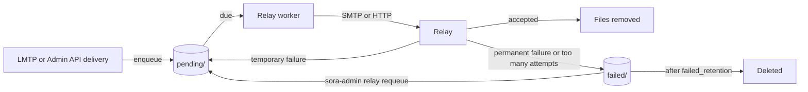

# Sora Relay

Sora stores mail; it does not send mail to the internet on its own. Two features still need to
send messages out: Sieve redirects and Sieve vacation replies. Sora hands those to one relay you
choose, an SMTP server or an HTTP endpoint, through a queue on local disk that retries until the
relay accepts. This document covers the relay settings, the queue and its retry rules, how to
inspect and repair the queue, and spam training, the separate HTTP feed that reports messages users
move into and out of Junk. It is for operators who run Sora and for contributors who change these
paths.

What a script asks for, and when Sora skips a redirect or a reply, is in [SIEVE.md](SIEVE.md).

## Contents

1. [What goes through the relay](#1-what-goes-through-the-relay)
2. [Configuring the relay](#2-configuring-the-relay)
3. [The HTTP relay request](#3-the-http-relay-request)
4. [The relay queue](#4-the-relay-queue)
5. [Failures, retries and the failed queue](#5-failures-retries-and-the-failed-queue)
6. [Operating the queue](#6-operating-the-queue)
7. [Spam training](#7-spam-training)
8. [Startup and reload](#8-startup-and-reload)
9. [Code map](#9-code-map)

---

## 1. What goes through the relay

| Message | Created by | Envelope sender | Envelope recipient |
|---|---|---|---|
| Sieve `redirect` | LMTP delivery, Admin API delivery | The original message's envelope sender | The redirect address |
| Sieve `vacation` reply | LMTP delivery, Admin API delivery | Empty (`<>`) | The original envelope sender |

Both are put in the relay queue on the node that delivered the message. A background worker on
that node sends them to the relay.



Without a relay (`[relay] type` empty), there is no queue and no worker. A redirected message is
then kept in INBOX instead, and vacation replies are not sent.

The relay has to accept these messages from the Sora node. A redirect keeps the original sender's
address, so the relay must allow foreign senders from Sora; Sora does not rewrite the sender
(no SRS). A vacation reply has an empty envelope sender, so the relay must also accept null-sender
mail from Sora.

---

## 2. Configuring the relay

`[relay] type` picks the relay. It is read at startup.

| `type` | Result |
|---|---|
| empty (the default) | No relay, no queue, no worker. |
| `"smtp"` | Messages are sent to an SMTP server. |
| `"http"` | Messages are posted to an HTTP endpoint ([section 3](#3-the-http-relay-request)). |
| anything else | Sora refuses to start: `unsupported [relay] type "<value>": expected "smtp" or "http"`. |

### SMTP relay

```toml
[relay]
type = "smtp"
smtp_host = "smtp.example.com:587"
smtp_tls = true
smtp_use_starttls = true
smtp_tls_verify = true
smtp_helo_host = "mail.example.com"
```

| Key | Type | Default | Meaning |
|---|---|---|---|
| `smtp_host` | string | none | The relay as `host:port`. Required for `type = "smtp"`. Sora does not check it at startup: without it every send fails and is retried. |
| `smtp_tls` | bool | — | Use TLS. Set it explicitly; `true` is recommended. With `smtp_tls = false` the connection is plaintext and `smtp_use_starttls` is ignored. |
| `smtp_use_starttls` | bool | `false` | With `smtp_tls = true`: connect in plaintext and upgrade with STARTTLS. The attempt fails if the relay does not offer STARTTLS. Without it, TLS starts with the first byte (the port 465 style). |
| `smtp_tls_verify` | bool | — | Verify the relay's certificate against the system roots and the host name in `smtp_host`. Set it explicitly; `true` is recommended. |
| `smtp_tls_cert_file` | string | none | Client certificate (PEM) for TLS client authentication. Needs `smtp_tls_key_file` too. |
| `smtp_tls_key_file` | string | none | The key for `smtp_tls_cert_file`. |
| `smtp_helo_host` | string | the machine's hostname, or `localhost` if it has none | The name in `EHLO`. Set it to the node's fully qualified name. |

| `smtp_tls` | `smtp_use_starttls` | Connection |
|---|---|---|
| `false` | any | Plaintext. |
| `true` | `false` | TLS from the first byte. |
| `true` | `true` | Plaintext, then STARTTLS. |

Things to know:

- **Sora does not authenticate to the relay.** There is no user name or password setting and no
  SMTP AUTH. Allow the Sora nodes on the relay by IP address, or use a client certificate.
- TLS needs version 1.2 or later.
- With STARTTLS, the `EHLO` before the upgrade says `localhost`; `smtp_helo_host` is sent on the
  `EHLO` after it, which is the one the relay records.
- If the client certificate or key cannot be loaded, every message fails permanently and goes
  straight to the failed queue.
- When the envelope or a header line is not ASCII, Sora asks for SMTPUTF8 (RFC 6531). If the relay
  does not offer it, the attempt fails and is retried as a temporary failure.
- Each message is one SMTP transaction with one recipient.

How SMTP answers are classified:

| Answer | Class |
|---|---|
| `2xx` after `DATA` | Delivered. |
| `5xx` to `MAIL`, `RCPT`, `DATA` or the end of data | Permanent. The message goes to the failed queue. |
| `4xx`, connection and TLS errors, a missing `smtp_host` | Temporary. The message is retried. |

### HTTP relay

```toml
[relay]
type = "http"
http_url = "https://mailer.example.com/v1/send"
auth_token = "change-me"
```

| Key | Type | Default | Meaning |
|---|---|---|---|
| `http_url` | string | none | Where Sora posts each message. Required for `type = "http"`. |
| `auth_token` | string | none | Sent as `Authorization: Bearer <token>` when set. |

The request times out after 30 seconds; this is fixed. HTTPS certificates are verified against the
system roots, with TLS 1.2 or later.

| Response | Class |
|---|---|
| `2xx` | Delivered. |
| `4xx` | Permanent. The message goes to the failed queue. |
| anything else, and connection errors | Temporary. The message is retried. |

### The relay circuit breaker

Both relay types send through a circuit breaker, which stops hammering a relay that is down.

- It opens after `circuit_breaker_threshold` (default 5) temporary failures in a row, however long
  each attempt took, so a relay that hangs until each attempt times out opens it too. Permanent
  failures do not count: they are answers about one message, not signs that the relay is down.
- While it is open, the worker puts messages back in the queue **without** counting an attempt.
- After `circuit_breaker_timeout` (default `30s`) it lets up to `circuit_breaker_max_requests`
  (default 3) messages through. The first success closes it; any failure opens it again. The
  worker checks every 5 seconds and starts a pass as soon as the breaker lets messages through.
- State changes are logged as `SMTP Relay: Circuit breaker state changed` (or `HTTP Relay: ...`)
  with `from` and `to`.

These settings live in `[relay.queue]` ([section 4](#4-the-relay-queue)).

---

## 3. The HTTP relay request

For each message Sora sends one `POST` to `http_url` with `Content-Type: application/json`:

```json
{
  "from": "sender@example.org",
  "recipients": ["friend@example.net"],
  "message": "Received: from ...\r\nDelivered-To: user@example.com\r\n..."
}
```

| Field | Meaning |
|---|---|
| `from` | The envelope sender. |
| `recipients` | The envelope recipient. Always exactly one address. |
| `message` | The complete message (RFC 5322 headers and body) as a string. |

Sora reads only the status code of the response.

---

## 4. The relay queue

The queue exists whenever `[relay] type` is set. There is no switch to turn it off.

### Where it lives

`[relay.queue] path` (default `/var/spool/sora/relay`) holds three directories, which Sora creates
at startup (mode 0755). If it cannot create them, Sora stops with a fatal error.

| Directory | Holds |
|---|---|
| `pending/` | Messages waiting for their next attempt, including new ones. |
| `processing/` | Messages being sent right now. |
| `failed/` | Messages the relay refused for good, or that ran out of attempts. |

Each message is a pair of files with the same id (a UUID): `<id>.msg` is the raw message and
`<id>.json` is its metadata. Sora writes each file to a temporary name first (prefix `.tmp-`) and
renames it, writing the body before the metadata, so a crash never leaves metadata pointing at a
half-written body.

```json
{
  "id": "<uuid>",
  "from": "sender@example.org",
  "to": "friend@example.net",
  "type": "redirect",
  "queued_at": "<time>",
  "attempts": 2,
  "last_attempt": "<time>",
  "next_retry": "<time>",
  "errors": ["[<time>] temporary failure: <error>", "[<time>] temporary failure: <error>"]
}
```

`type` is `redirect` or `vacation`. Each failed attempt adds one line to `errors`, prefixed with
its time; a permanent failure is marked `PERMANENT:`.

**The queue is local to the node.** It is not shared with other nodes or stored in PostgreSQL. For
a redirect without `:copy`, the queue file is the only copy of the message. Put the path on
persistent storage that survives a restart, and include it in what you watch and back up.

### The worker

When the relay is configured, Sora starts one worker per node. It:

1. At startup, moves anything left in `processing/` back to `pending/` (a crash left it there),
   runs a cleanup pass, and sends whatever is due.
2. Runs a pass every `worker_interval` (default `1m`).
3. Runs a pass at once when a delivery, over LMTP or the Admin API, queues a message, so redirects
   and replies are sent right away.
4. Checks the circuit breaker every 5 seconds and runs a pass when it lets messages through.
5. Runs a cleanup pass every `cleanup_interval` (default `1h`).

A pass takes due messages, earliest retry first, up to `batch_size` (default 100), and sends up to
`concurrency` (default 5) at the same time. Files placed in `pending/` from outside, such as by
`sora-admin relay requeue`, are noticed within a minute.

A message that was being sent when the process died is sent again after the restart. The relay
may then receive it twice.

### `[relay.queue]` keys

| Key | Type | Default | Meaning |
|---|---|---|---|
| `path` | string | `"/var/spool/sora/relay"` | The queue directory. |
| `worker_interval` | duration | `"1m"` | How often the worker runs a pass. `0` or less stops startup. An invalid value logs a warning and uses `1m`. |
| `batch_size` | integer | `100` | Most messages sent in one pass. `0` or less means 100. |
| `concurrency` | integer | `5` | Most messages sent at the same time. `0` or less means 5. |
| `max_attempts` | integer | `10` | Attempts before a message moves to the failed queue. `0` or less means 10. |
| `retry_backoff` | list of durations | `["1m", "5m", "15m", "1h", "6h", "24h"]` | Wait after the 1st, 2nd, ... failed attempt. The last value repeats. An invalid entry logs a warning and the default list is used. |
| `circuit_breaker_threshold` | integer | `5` | Temporary failures in a row that open the breaker. |
| `circuit_breaker_timeout` | duration | `"30s"` | How long the breaker stays open before it lets trial messages through. An invalid value stops startup. |
| `circuit_breaker_max_requests` | integer | `3` | Trial messages allowed while the breaker is half open. |
| `failed_retention` | duration | `"168h"` (7 days) | How long a message stays in `failed/`, counted from its last attempt. `0` keeps failed messages until they are deleted or requeued. A negative or invalid value stops startup. |
| `cleanup_interval` | duration | `"1h"` | How often the cleanup pass runs. An invalid value stops startup. |

Durations accept Go syntax (`"90s"`, `"1h30m"`) and whole days (`"7d"`).

```toml
[relay.queue]
path = "/var/spool/sora/relay"
worker_interval = "1m"
max_attempts = 10
retry_backoff = ["1m", "5m", "15m", "1h", "6h", "24h"]
failed_retention = "168h"
```

---

## 5. Failures, retries and the failed queue

What happens after each attempt:

| Outcome | What Sora does |
|---|---|
| Delivered | Removes both files. |
| Circuit breaker open | Moves the message back to `pending/`, due now, without counting an attempt. |
| Permanent failure | Adds the error and moves the message to `failed/` at once. |
| Temporary failure | Counts the attempt. If `attempts` has reached `max_attempts`, moves the message to `failed/`. Otherwise sets `next_retry` from `retry_backoff` and moves it back to `pending/`. |

With the defaults, the first attempt happens right away and the waits after each failed attempt
are:

| After failed attempt | Next attempt in |
|---|---|
| 1 | 1 minute |
| 2 | 5 minutes |
| 3 | 15 minutes |
| 4 | 1 hour |
| 5 | 6 hours |
| 6, 7, 8, 9 | 24 hours each |
| 10 | none: the message moves to `failed/` |

That is about 103 hours (4 days and 7 hours) from the first attempt to the last, plus up to one
`worker_interval` of delay per attempt.

### The failed queue

A message in `failed/` is never retried on its own. It stays until `failed_retention` has passed
since its last attempt (with `failed_retention = "0"`, until someone deletes or requeues it), and
the cleanup pass then deletes it for good, logging a warning:

```text
RelayQueue: Deleted permanently failed message after retention - no copy remains
```

with the id, sender, recipient, type, attempts, age and last error. Until then, every cleanup pass
with something in `failed/` logs a warning:

```text
Relay: Permanently failed messages waiting in the failed queue - recover with sora-admin relay requeue
```

with the count, the oldest message's age, id and recipient, its last error, and the retention.

To retry after fixing the cause, requeue the messages ([section 6](#6-operating-the-queue)).
Requeueing resets the attempt count and the error history.

### Crash debris

The cleanup pass also removes, once they are more than an hour old: leftover temporary files
(`.tmp-*`) in any of the three directories, and a body or metadata file in `pending/` whose
partner is missing in both `pending/` and `processing/`. Each removal is logged
(`RelayQueue: Removed orphaned queue file`).

---

## 6. Operating the queue

### `sora-admin relay`

These commands work on the queue directory named by `[relay.queue] path` in the config you pass,
so run them on the node that owns the queue. They refuse to run when `[relay] type` is empty.

| Command | What it does |
|---|---|
| `sora-admin relay stats --config FILE` | Counts the messages in each directory. Reports a queue the server has not created yet, and does not create it. |
| `sora-admin relay list --config FILE [--queue pending\|processing\|failed] [--limit 100]` | Lists messages (default queue `pending`). |
| `sora-admin relay show --config FILE --id ID [--queue pending]` | Shows one message's metadata. |
| `sora-admin relay delete --config FILE --id ID\|all [--queue failed] --confirm` | Deletes one message or all messages of a queue (default queue `failed`). |
| `sora-admin relay requeue --config FILE --id ID\|all --confirm` | Moves messages from `failed/` back to `pending/`, due now, with attempts and errors reset. |

`stats` also prints the `max_attempts` and `worker_interval` the server uses, defaults included.
Full flags are in [ADMIN_CLI.md](ADMIN_CLI.md).

### Log lines

| Log line | Level | Meaning |
|---|---|---|
| `Relay handler configured: type=smtp` (or `type=http`) | info | Startup: the relay and its breaker settings. |
| `Relay worker started` | info | Startup: the worker settings. |
| `RelayQueue: Enqueued message` | info | A message entered the queue (`type`, `id`, `from`, `to`). |
| `Relay: Processing message` | info | An attempt starts (`attempt`, `age`). |
| `Relay: Delivered message successfully` | info | The relay accepted it. |
| `Relay: Temporary delivery failure (4xx/network), will retry` | error | A temporary failure. |
| `RelayQueue: Message delivery failed` | info | The retry was scheduled (`retry_at`). |
| `Relay: Permanent delivery failure (5xx), dropping message` | error | A permanent failure; the message moved to `failed/`. |
| `RelayQueue: Message exceeded max attempts, moving to failed` | error | Out of attempts. |
| `Relay: Circuit breaker preventing delivery, releasing back to queue` | warn | The breaker is open. |
| `RelayQueue: Recovered orphaned messages from processing directory` | info | Crash recovery at startup. |

### Metrics

| Metric | Type | Labels | Meaning |
|---|---|---|---|
| `sora_relay_queue_depth` | gauge | `state` (`pending`, `processing`, `failed`) | Messages in each directory, refreshed on every pass. |
| `sora_relay_delivery_total` | counter | `type` (`redirect`, `vacation`), `result` (`success`, `temporary_failure`, `permanent_failure`, `circuit_breaker_blocked`, `no_handler`) | Attempts by outcome. |
| `sora_relay_delivery_duration_seconds` | histogram | `type`, `result` | How long an attempt took. |
| `sora_relay_queue_age_seconds` | histogram | `type` | Time from queueing to each attempt. |
| `sora_relay_queue_operations_total` | counter | `operation` (`enqueue`, `acquire`, `mark_success`, `mark_failure`, `mark_permanent_failure`, `release`), `result` (`success`, `error`) | Queue file operations. |
| `sora_relay_queue_operation_duration_seconds` | histogram | `operation` | How long they took. |
| `sora_lmtp_external_relay_total` | counter | `result` (`success`, `failure`, `circuit_breaker_open`) | Calls to the relay itself. |

### Health checks

| Check | Every | Fails when |
|---|---|---|
| `relay_queue` | 60 s | More than 1000 messages are pending, or more than 100 are in processing. Messages in `failed/` do not fail it. |
| `circuit_breaker_smtp_relay` or `circuit_breaker_http_relay` | 15 s | The breaker is open, or more than half of the requests in its current count failed. |

Both are non-critical. See [METRICS.md](METRICS.md) for how health checks are reported.

### What to alert on

- `sora_relay_queue_depth{state="failed"} > 0`: mail that will be deleted after
  `failed_retention` unless someone requeues it.
- `sora_relay_queue_depth{state="pending"}` growing for an hour or more: the relay is down or
  refusing.
- A breaker that stays open.
- A rise in `sora_relay_delivery_total{result="permanent_failure"}`: the relay refuses messages,
  often because of sender policy (SPF, foreign senders).

---

## 7. Spam training

Spam training tells an external spam filter which messages users consider spam. When a user moves
a message into Junk, Sora posts it to your endpoint as spam; when the user moves it out of Junk,
as ham (not spam). It has nothing to do with the relay queue: each report is a single HTTP request,
made once.

### What triggers it

Training runs on IMAP backends, for the IMAP `MOVE` and `UID MOVE` commands only:

- Destination named `Junk` and source not: the message is reported as `spam`.
- Source named `Junk` and destination not: reported as `ham`.

The name is compared without regard to case, and only a mailbox named exactly `Junk` counts:
`Archive/Junk`, or a folder of another name marked `\Junk`, does not. `COPY`, `APPEND`, a client
that copies and then deletes instead of using `MOVE`, the User API and Sieve `fileinto` do not
trigger training.

### What is sent

For each moved message, Sora hands a report to a bounded queue served by a fixed number of
background workers, so a large `MOVE` does not start one S3 download per message at once. A worker
reads the message from S3 and strips attachments. A message larger than `max_message_size` is
skipped before its body is downloaded. The `MOVE` answers at once and does not wait.

Stripping works like this:

- A message that is not multipart is sent as it is.
- For a multipart message, Sora keeps the `text/plain` and `text/html` parts at any depth of the
  MIME tree and drops everything else. Each kept part is sent with headers that describe the bytes
  that follow. If it keeps exactly one part, that part becomes the body; if several, they are
  joined as `multipart/alternative`.
- If the message has no text part, the body becomes the line
  `[No text content - attachments stripped for spam training]`.
- If the message cannot be parsed, it is sent unstripped.

Then Sora posts JSON to `endpoint`, with `Authorization: Bearer <auth_token>` when a token is set:

```json
{
  "type": "spam",
  "message": "From: sender@example.org\r\nSubject: ...\r\n\r\n...",
  "user": "user@example.com",
  "source_mailbox": "INBOX",
  "dest_mailbox": "Junk",
  "timestamp": "2026-01-15T10:30:00Z"
}
```

| Field | Meaning |
|---|---|
| `type` | `spam` or `ham`. |
| `message` | The message after stripping. |
| `user` | The address of the user who moved it. |
| `source_mailbox`, `dest_mailbox` | The folder names. |
| `timestamp` | When the report was built (RFC 3339). |

A `2xx` answer is success. Anything else is a failure.

### Failures

Nothing is retried. A report that fails is logged at warning level as
`Spam training submission failed` (with `type`, `user` and the error) and dropped. A message whose
body has not reached S3 yet is skipped with `failed to fetch message body from S3 for spam training`.

Each request may take up to `timeout` (default `10s`). The training client has its own circuit
breaker:

- It opens after `circuit_breaker.threshold` (default 5) failures in a row. Any failure counts,
  including `4xx` answers.
- While open, reports fail at once without a request.
- After `circuit_breaker.timeout` (default `30s`) it lets up to `circuit_breaker.max_requests`
  (default 3) through. A success closes it; a failure opens it again.
- State changes are logged as `Spam training circuit breaker state change`.

### `[spam_training]` keys

```toml
[spam_training]
enabled = true
endpoint = "https://spamfilter.example.com/train"
auth_token = "change-me"
timeout = "10s"

[spam_training.circuit_breaker]
threshold = 5
timeout = "30s"
max_requests = 3
```

| Key | Type | Default | Meaning |
|---|---|---|---|
| `enabled` | bool | `false` | Turns training on. It is on only when `endpoint` is set as well. |
| `endpoint` | string | none | The URL Sora posts to. |
| `auth_token` | string | none | Bearer token for the request. |
| `timeout` | duration | `"10s"` | Time limit for one request. An invalid value logs `Failed to initialize spam training client` and leaves training off. |
| `max_message_size` | size | `"10mb"` | Larger messages are not submitted. |
| `circuit_breaker.threshold` | integer | `5` | Failures in a row that open the breaker. `0` or less means 5. |
| `circuit_breaker.timeout` | duration | `"30s"` | How long the breaker stays open. |
| `circuit_breaker.max_requests` | integer | `3` | Trial requests while half open. `0` or less means 3. |

When training starts, Sora logs `Spam training client initialized` with the endpoint.

---

## 8. Startup and reload

- `[relay]`, `[relay.queue]` and `[spam_training]` are read once, at startup. To change them,
  restart Sora. A reload (`SIGHUP`) reports a change to these sections as needing a restart and
  applies nothing.
- Any node with `[relay] type` set starts a queue and a worker, whatever servers it runs. Set the
  relay on the nodes that deliver mail (the ones with `lmtp` or `http_admin_api` servers).
- Spam training is used by `imap` servers only.

---

## 9. Code map

| What | Where |
|---|---|
| `[relay]` and `[relay.queue]` settings and defaults | [config/relay.go](../config/relay.go) |
| SMTP and HTTP relay handlers, error classes, relay breakers | [server/delivery/relay.go](../server/delivery/relay.go) |
| The disk queue | [server/relayqueue/queue.go](../server/relayqueue/queue.go), [server/relayqueue/pending_index.go](../server/relayqueue/pending_index.go) |
| The worker | [server/relayqueue/worker.go](../server/relayqueue/worker.go) |
| Wiring at startup | [cmd/sora/main.go](../cmd/sora/main.go) (`initializeServices`) |
| `sora-admin relay` | [cmd/sora-admin/relay.go](../cmd/sora-admin/relay.go) |
| The circuit breaker | [pkg/circuitbreaker/breaker.go](../pkg/circuitbreaker/breaker.go) |
| Health checks | [pkg/health/integration.go](../pkg/health/integration.go) |
| `[spam_training]` settings | [config/spam_training.go](../config/spam_training.go) |
| Spam training client and attachment stripping | [pkg/spamtraining/](../pkg/spamtraining/) |
| What triggers training | [server/imap/spam_training.go](../server/imap/spam_training.go), [server/imap/move.go](../server/imap/move.go) |
