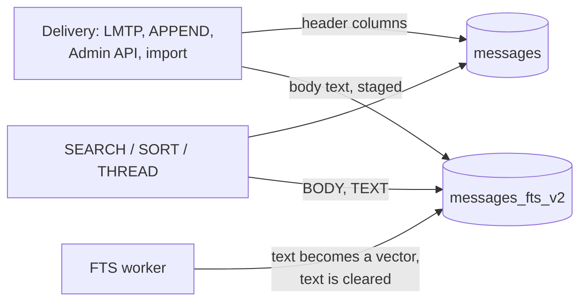

# Sora Search

This document explains how Sora searches mail: what is indexed, how a search is answered, what
it costs, and the limits that protect the server. It covers IMAP `SEARCH`, `SORT`, `THREAD` and
multi-mailbox `ESEARCH`, the User API search, the full-text search (FTS) worker that builds the
body index, FTS retention, and the search rate limit.

It is written for operators who run Sora and want to know what their users can find and what
search costs the database, and for contributors who change the search code. PostgreSQL itself,
its connection pools and its timeouts are covered in [DATABASE.md](DATABASE.md). How the protocol
servers behave in general is in [PROTOCOLS.md](PROTOCOLS.md).

## Contents

1. [Overview](#1-overview)
2. [Header search](#2-header-search)
3. [Body search](#3-body-search)
4. [The FTS table and the FTS worker](#4-the-fts-table-and-the-fts-worker)
5. [Messages without a body vector](#5-messages-without-a-body-vector)
6. [FTS retention](#6-fts-retention)
7. [Cleanup of search data](#7-cleanup-of-search-data)
8. [How a search is run](#8-how-a-search-is-run)
9. [Limits](#9-limits)
10. [The search rate limit](#10-the-search-rate-limit)
11. [Other ways to search](#11-other-ways-to-search)
12. [Operating search](#12-operating-search)
13. [Where to look in the code](#13-where-to-look-in-the-code)

---

## 1. Overview

Sora keeps message metadata in PostgreSQL and message bodies in S3. A search never reads S3. It
runs entirely in PostgreSQL, on two kinds of data:

- **Header columns.** Each message row in the `messages` table carries the headers clients
  search most: Subject, the From, To and Cc addresses, Message-ID, In-Reply-To and
  References, plus all recipients as JSON. Header criteria match these columns directly.
- **Body vectors.** The text of each message body is turned into a PostgreSQL `tsvector`, a list
  of the words in the text, and stored in the table `messages_fts_v2`. Body criteria match these
  vectors through a GIN index, PostgreSQL's index for "which rows contain this word".

Flags, keywords, dates, sizes, UIDs, sequence numbers and MODSEQ are ordinary indexed columns on
`messages` and `message_state` and cost little to search.

Sora does not keep the raw header block or the body text in the database. A header that has no
column of its own cannot be searched (see [section 2](#2-header-search)). The body vector is the
only copy of the body's words that the database has (see [section 4](#4-the-fts-table-and-the-fts-worker)).



---

## 2. Header search

Sora stores the searchable headers in dedicated columns of `messages` when a message arrives. The
table below lists every header criterion and how it matches. "Substring" means the search term
must appear somewhere in the stored value, ignoring case. Sora lowercases the term and compares
it with `strpos()`, so `%` and `_` in a term are ordinary characters, not wildcards.

| Criterion | Column | How it matches |
|---|---|---|
| `SUBJECT` | `subject` | Substring of the decoded Subject. |
| `FROM` | address columns | Substring of any From address or display name. |
| `TO` | address columns | Substring of any To address or display name. |
| `CC` | address columns | Substring of any Cc address or display name. |
| `BCC`, `HEADER Bcc`, `HEADER Reply-To`, `HEADER Sender` | `recipients_json` | Substring of any address or display name of that header. |
| `HEADER Message-ID` | `message_id` | A whole ID in angle brackets (`<id@example.com>`) is matched exactly, ignoring case. Any other term is a substring of the field as written, with its angle brackets. |
| `HEADER In-Reply-To` | `in_reply_to` | Substring of the stored message IDs, written with their angle brackets, ignoring case. |
| `HEADER References` | `references` | Substring of the stored chain of message IDs, written with their angle brackets, ignoring case. |
| `HEADER` with any other name | none | Matches no message. Sora logs `HEADER search on non-indexed header returns no results` at debug level. |

The address columns are the first From, To and Cc name and address (also used by `SORT`), plus
`extra_addresses`, which holds every further From, To and Cc name and address.

What this means for users:

- **Every address counts.** A message sent to `alice@example.com, bob@example.com` matches both
  `TO alice` and `TO bob`.
- **Search terms with angle brackets.** `HEADER Message-ID "<id@example.com>"`,
  `HEADER In-Reply-To "<id@example.com>"` and `HEADER References "<id@example.com>"` all work, as
  do the same terms without brackets.
- **Message-ID fields that are not one plain ID.** For a field with comments, an empty or
  malformed value, a quoted local part, a domain literal, or several `Message-ID:` fields, Sora
  keeps the field text as written (`message_id_raw`), and `HEADER Message-ID` matches against
  that text.
- **Headers such as `List-Id`, `X-Spam-Flag` or `Received` are not searchable.** The command
  succeeds with no matches.

### Testing whether a header is present

An empty term is a substring of every string, so `HEADER <name> ""` asks whether the message has
that header at all (RFC 9051 §6.4.4). For From, To, Cc, Bcc, Sender, Reply-To, Subject,
Message-ID, In-Reply-To and References, Sora records at delivery which of these fields the
message has (`header_presence`), and an empty term matches exactly the messages that have the
field, even when it is empty. `SUBJECT ""` is the same test for Subject. For a message stored
before Sora recorded this, an empty term is answered from the stored columns as it was before:
such a message matches when the column has a value. `FROM ""`, `TO ""` and `CC ""` match a
message that has at least one address in that header.

### Stored lengths

Stored values are cut to fixed lengths, so only the start of a very long value is searchable:

| Column | Stored length |
|---|---|
| `subject` | first 600 bytes |
| `from_email_sort`, `from_name_sort`, `to_email_sort`, `to_name_sort`, `cc_email_sort` | first 200 bytes each, lowercased |
| `extra_addresses` | what the five columns above leave of 1300 bytes, lowercased |
| `in_reply_to`, `references` | first 2000 bytes |

So in a message with very many recipients, the addresses past about 1300 bytes are not
searchable.

### The covering index

Header search reads one index, `idx_messages_mailbox_headers_v3`. It is keyed by mailbox and
carries every column the header criteria and the search result need, so PostgreSQL answers a
header search from the index alone, without visiting the table. The cost of a header search is
therefore proportional to the number of messages in the mailbox, not to the size of the whole
database. This holds only while autovacuum keeps the table's visibility map current; see
[DATABASE.md](DATABASE.md#10-maintenance). `BCC`, `HEADER Sender`, `HEADER Reply-To` and
`HEADER References` read columns outside the index, so they read the mailbox's rows from the
table. They are rare searches.

The schema also has trigram indexes on these columns (`idx_messages_*_trgm`) from older
migrations. The search code does not use them.

### Dates

`SINCE`, `ON` and `BEFORE` compare the INTERNALDATE (the arrival time) by its UTC day.

`SENTSINCE`, `SENTON` and `SENTBEFORE` compare the day of the message's `Date:` header in the
zone the header was written in, as RFC 9051 §6.4.4 asks ("disregarding time and timezone"). A
message sent `Tue, 31 Dec 2024 20:00:00 -0800` is found by `SENTON 31-Dec-2024`, not by
`SENTON 1-Jan-2025`. A message without a `Date:` header that parses matches none of the three.
Messages stored before Sora kept the header's zone are compared by the UTC day, and those stored
before Sora recorded a missing `Date:` header are compared by the date they were given.

## 3. Body search

### What text is indexed

When a message is delivered, Sora extracts one piece of plain text from it, after Sieve has run
(so headers a Sieve script added or removed are taken into account):

1. the first `text/plain` part that is not an attachment, or
2. if there is none, the first `text/html` part, converted to text. Embedded base64 images
   (`data:` URIs) are removed first, and HTML longer than 1 MB is cut to its first 1 MB before
   conversion. Malformed HTML is repaired first, so text after a stray `<` is kept.

Which parts count:

- A part with a `Content-Disposition` other than `inline` (an attachment, or an unknown or
  malformed disposition) is never indexed.
- In `multipart/related`, only the root part counts; the others are resources such as images.
- `multipart/encrypted` and attached messages (`message/rfc822`) are not looked into. Nesting is
  followed up to 32 levels.
- A part with a Content-Transfer-Encoding Sora cannot decode is skipped. A part with an unknown
  charset is still read, without charset conversion.
- A text part whose `Content-Type` parameters do not parse is used only when the message has no
  well-formed text part.
- A broken multipart (a malformed part header or a missing boundary) ends that multipart, but
  the parts after it in the enclosing one are still read.

Only the first suitable part is used, so a message with several text parts is indexed by the
first one.

Sora then keeps the first 64 KB of that text (cut at a character boundary) and stages it for
indexing. When text is cut, Sora logs `Database: truncating text_body for FTS indexing to 64KB
for very large message` and counts it in `sora_large_body_storage_skipped_total`. A message
whose extracted text is empty gets no body vector at all.

### How the text becomes a vector

The FTS worker ([section 4](#4-the-fts-table-and-the-fts-worker)) turns the text into a vector
with this expression, from [db/fts.go](../db/fts.go):

```sql
strip(to_tsvector('simple', regexp_replace(text_body, '[^ \t\n\r<>]{101,}', '', 'g')))
```

In plain words:

- Every run of more than 100 characters without a space, tab, line break or angle bracket is
  removed first. These are mostly base64 and hex blobs. A word or URL longer than 100 characters
  is therefore not searchable.
- The `simple` text search configuration lowercases words. It does not stem them ("running" stays
  "running") and has no stop words ("the" is indexed).
- `strip()` removes word positions. The vector records which words occur, not where.

### How a body term matches

Sora matches a `BODY` term with `plainto_tsquery('simple', term)`. The term is split into words
the same way, and a message matches when its vector contains **all** of them, in any order and
anywhere in the text. So:

- `BODY "quarterly report"` matches a body that contains both words, even far apart.
- `BODY "report"` does not match "reports" or "reporting". There is no stemming and no prefix
  matching.
- Matching is by whole word. A term that is part of a word does not match.

### TEXT

IMAP `TEXT` searches the header and the body. Sora answers it as "the body matches the term as
described above, **or** the term is a substring of the Subject, or of a From, To or Cc address or
name". The header half follows the rules of [section 2](#2-header-search).

### Shared mailboxes

Body vectors belong to the account that owns the mailbox. A search in a shared mailbox looks up
the owner's vectors, so body search works in shared mailboxes for every user who may read them.
See [SHARED_MAILBOXES.md](SHARED_MAILBOXES.md).

---

## 4. The FTS table and the FTS worker

### The table

`messages_fts_v2` (migration 000050) has one row per body per account:

| Column | Meaning |
|---|---|
| `content_hash` | The BLAKE3 hash of the message body, the same key the body has in S3. |
| `account_id` | The account that owns the mailbox the message is in. |
| `text_body` | The staged plain text. Set at delivery, cleared the moment the vector is computed. |
| `text_body_tsv` | The vector. `NULL` while the row waits for the worker. |
| `sent_date` | The message's sent date, used by retention ([section 6](#6-fts-retention)). |
| `created_at` | When the row was staged. The worker takes the oldest rows first. |

The primary key is `(content_hash, account_id)`. A body that sits in several mailboxes of one
account (after a COPY, or delivery to two aliases) has one row. A body delivered to many accounts
has one row in each account.

Its indexes:

| Index | Purpose |
|---|---|
| `idx_messages_fts_v2_account_tsv` | GIN on `(account_id, text_body_tsv)`, only rows that have a vector, `fastupdate = off`. The search index. |
| `idx_messages_fts_v2_account_id` | Deleting one account's rows. |
| `idx_messages_fts_v2_queue` | `created_at` of rows still waiting for a vector. The worker's queue. |
| `idx_messages_fts_v2_sent_date` | `sent_date` of rows that have one. Retention pruning. |

The search index has two columns so that PostgreSQL can combine "rows of this account" and "rows
containing this word" inside the index. A body search then costs in proportion to the matches in
one account, not to the matches in the whole database. This needs the `btree_gin` extension (see
[DATABASE.md](DATABASE.md#2-requirements)).

### The vector is the only copy

Sora clears `text_body` as soon as it computes the vector. After that, the vector is the only
copy of the body's words in the database. It cannot be rebuilt from the database: rebuilding it
would mean fetching every body from S3 and parsing it again, and Sora has no command that does
this. Treat `messages_fts_v2` as data, not as a cache:

- Include it in your database backups.
- Do not truncate or drop it to "rebuild" it.
- Pruned rows ([section 6](#6-fts-retention)) are gone for good.

### Staging at delivery

LMTP delivery, IMAP `APPEND`, Admin API delivery and `sora-admin import` stage the text in the
same transaction that stores the message. Staging is best effort: it runs in its own savepoint,
and if it fails the message is still delivered, but is not searchable by body. Sora then logs
`Database: failed to insert message fts payload (non-fatal, message will be unsearchable)`.

Staging does not call PostgreSQL's text parser, so it adds little to delivery time. If another
account already has a vector for the same body, the new row is staged without text: the worker
will copy the existing vector instead of parsing the text again.

### The worker

Every node that runs IMAP, POP3 or LMTP backends starts one FTS worker
([server/fts/worker.go](../server/fts/worker.go)). It runs once at startup and then every
30 seconds. Each run processes batches until the queue is empty:

1. Take up to 1000 queued rows, oldest first, with `FOR UPDATE SKIP LOCKED`. Several nodes can
   work on the queue at once; each skips the rows another node holds.
2. For each body in the batch, compute the vector **once**, from one row that carries text, 100
   bodies per SQL statement. The text never leaves the database.
3. Copy that vector to every other queued row of the same body, in other accounts, at most 1000
   rows per statement.
4. Commit. A batch has 30 seconds. When two thirds of that time is spent, the worker commits what
   it has done and leaves the rest for the next batch.

Between batches the worker pauses for one second. After an error it logs `FTS Worker: failed to
process batch, backing off briefly`, waits five seconds and stops until the next 30-second tick.
Each successful batch logs `FTS Worker: generated vectors for messages batch` with the count.

A body that PostgreSQL cannot parse (an invalid byte sequence, or text too long for a `tsvector`)
gets an empty vector, so that the queue keeps moving. Sora logs `FTS: failed to index
content_hash, marking poison` for it. That message is not searchable by body. Other errors
(timeouts, deadlocks, lost connections) never empty a vector: the batch rolls back and is tried
again.

New mail becomes searchable by body once the worker has indexed it, normally within one
30-second tick. Until then it matches header criteria only.

### Copy and move between accounts

A COPY or MOVE into a mailbox owned by another account (a shared mailbox) creates a row for the
new owner without text. The worker fills it by copying the vector of the source. No row is
created for a body that has no vector anywhere (because it was empty, or was pruned), so such a
message stays unsearchable by body in the new mailbox too. A COPY or MOVE inside one account
changes nothing in the FTS table.

---

## 5. Messages without a body vector

Many messages legitimately have no usable vector:

- the extracted text was empty (for example, a message with only an attachment);
- the message was older than `fts_retention` when it arrived, or its row was pruned later
  ([section 6](#6-fts-retention));
- staging failed at delivery;
- PostgreSQL could not parse the text (an empty vector);
- the row is still waiting for the worker.

Sora treats them like this:

| Search | A message without a vector |
|---|---|
| `BODY x` | does not match. |
| `NOT BODY x` | matches. |
| `TEXT x` | matches only if the term is in one of the header columns. |
| Any search without `BODY` or `TEXT` | is unaffected. |

No error is raised. A search over unindexed mail finds less.

For contributors: every query joins the FTS table with a `LEFT JOIN` whose account condition sits
in the `ON` clause (`ftsScopedJoin` in [db/search.go](../db/search.go)). Putting
`account_id = ...` in the `WHERE` clause instead would silently drop every message that has no
FTS row, even from searches that do not look at the body. The tests
`TestFTSAccountScopeNeverInWhereClause` and `TestMessagesWithoutFTSRowStayVisible` guard this.

---

## 6. FTS retention

`fts_retention` in the `[cleanup]` section limits how long body vectors are kept.

```toml
[cleanup]
fts_retention = "365d"   # keep body search for mail sent in the last year
```

| Value | Effect |
|---|---|
| empty (the default) | Vectors are kept forever. |
| a duration, such as `"180d"` or `"4320h"` | Vectors of messages sent longer ago than this are deleted. |

Durations take Go units (`h`, `m`, `s`) or a whole number of days (`"180d"`). An invalid value is
logged as a warning and treated as empty (keep forever). A negative value stops startup.

How it works:

- **Age is measured from the sent date**, the message's `Date` header. When a message has no
  usable `Date` header, LMTP and Admin API delivery use the time of delivery and IMAP `APPEND`
  uses the message's internal date.
- **Old mail is not staged at all.** Delivery, `APPEND` and import skip staging for a message whose
  sent date is already past the retention. `sora-admin import` takes `--fts-retention` to choose a
  different window for an import; its default is `[cleanup] fts_retention`. See
  [IMPORT_EXPORT.md](IMPORT_EXPORT.md).
- **Pruning runs in the cleanup cycle.** The cleaner deletes expired rows in batches of 1000, up
  to 10 batches per cycle, pausing two seconds between batches. Only one node runs a cleanup
  cycle at a time, every `[cleanup] wake_interval` (default `1h`). So pruning removes at most
  10,000 rows per cycle across the whole deployment. Rows without a sent date are never pruned.
  The cleaner logs `Cleanup: Pruned expired FTS indexes deeply from messages_fts_v2 table` with
  the count.
- **The message itself is not touched.** Only body search for it stops working. Header search,
  fetching and everything else are unchanged.
- **Retention cannot be undone.** Raising `fts_retention` later does not bring pruned vectors
  back.

Because there is one row per body per account, a body delivered to many accounts is pruned once
per account. When you first set a retention on a large database, the backlog drains at the rate
above; plan for it.

`[cleanup]` is read at startup. Restart the node after changing `fts_retention`.

---

## 7. Cleanup of search data

Besides retention, the cleaner removes FTS rows in two more ways.

**Orphans.** When the last message of a body in an account is permanently deleted, that account's
FTS row is not needed any more. In each cycle the cleaner scans `messages_fts_v2` in key order,
continuing where the previous cycle stopped and starting again from the beginning once it reaches
the end, up to 1,000,000 rows or 30 seconds. It collects at most 1000 rows that no message refers
to, and deletes them. Before deleting, it checks each row again, so a message delivered in the
meantime keeps its row. The cleaner logs `Cleanup: Deleted orphaned FTS vectors` with the count.

A message that is expunged but still inside the `[cleanup] grace_period` still has its row in
`messages`, so its FTS row is kept. `sora-admin messages restore` therefore brings back a message
that is still searchable by body.

**Deleted accounts.** When an account is finally deleted or purged, the cleaner deletes all of
its FTS rows, 1000 at a time. See [STORAGE.md](STORAGE.md).

---

## 8. How a search is run

This section is for operators who read slow-query logs and for contributors. The code is
`getSearchMessagesQueryExecutor` in [db/search.go](../db/search.go).

Every IMAP search is limited to one mailbox and to live (not expunged) messages. Sora builds the
SQL from the criteria and picks one of these shapes. Each shape has its own `operation` label in
`sora_db_queries_total` and `sora_db_query_duration_seconds`, so you can see which shape is slow.

| Shape | Chosen when | `operation` label |
|---|---|---|
| Metadata only | No `BODY` or `TEXT` anywhere in the criteria. | `search_messages_simple` |
| TEXT union | Exactly one `TEXT` term at the top level, no `BODY`, no full-text term inside `NOT` or `OR`. The header half and the body half run as two queries joined with `UNION`. | `search_messages_complex_text_union` |
| TEXT union, prefiltered | As above, in a mailbox of 10,000 messages or more. | `search_messages_complex_text_union_prefilter` |
| Prefiltered body search | A `BODY` or `TEXT` term, in a mailbox of 10,000 messages or more. | `search_messages_complex_prefilter` |
| Per-message body probe | A `BODY` or `TEXT` term in a smaller mailbox. | `search_messages_complex_fast` |
| THREAD | Every `THREAD`. Joins the FTS table only when the criteria contain `BODY` or `TEXT`. | `search_thread` |

The two body shapes differ like this:

- **Per-message probe.** For each message in the mailbox, look up its FTS row and test the
  vector. The cost grows with the size of the mailbox.
- **Prefiltered.** First find all of the account's bodies that contain the words, once, through
  the composite GIN index (a `MATERIALIZED` CTE), then join the mailbox's messages to that set.
  The cost grows with the number of matches in the account.

Neither shape is faster everywhere, so Sora picks by the mailbox's message count. The constant is
`ftsCTEThreshold = 10000`. The count comes from the IMAP session. Multi-mailbox `ESEARCH` and the
User API have no count and always use the per-message probe.

Other details:

- A search by sequence numbers first turns them into UIDs with one query, so the main query
  filters on UIDs. If that query fails, the search fails.
- Keywords in the criteria are matched in the case the mailbox already uses for them.
- Searches read from the read endpoint, or from the write endpoint when the session has written
  something (see [DATABASE.md](DATABASE.md#5-which-queries-use-which-endpoint)).

When you run `EXPLAIN` on a body search by hand, bind the account the way Sora does, as a
`bigint` (`42::bigint`). With a plain integer literal the planner may not use the composite GIN
index, and the plan you see is not the plan Sora gets.

---

## 9. Limits

### Criteria checks

Before it builds a query, Sora checks the criteria of every `SEARCH`, `SORT`, `THREAD` and
multi-mailbox `ESEARCH` ([db/search_validator.go](../db/search_validator.go)). A "group" below is
the top level of the criteria or the inside of one `NOT` or `OR` branch.

These are answered with `NO [LIMIT] Search criteria too complex`:

| Limit | Value |
|---|---|
| Length of one search term or header value | 1000 bytes |
| `BODY` terms in one group | 10 |
| `TEXT` terms in one group | 10 |
| `BODY`, `TEXT` and header terms together in one group | 50 |
| UID sets, or sequence sets, in one group | 20 |
| Flag and keyword tests in one group | 20 |
| Nesting depth of `NOT` and `OR` | 30 |
| Criteria nodes in the whole command | 256 |

These are answered with `BAD [CLIENTBUG] Search criteria invalid`:

- a term, header name or keyword containing a NUL character;
- a term, header name or keyword that is not valid UTF-8;
- an empty header name.

Criteria that cannot match, such as `SINCE` later than `BEFORE` or `LARGER` greater than or equal
to `SMALLER`, are valid: the search succeeds with no matches. An empty `BODY` or `TEXT` term
matches every message.

The client sees only the generic text. Sora logs the exact reason at debug level as
`rejecting search criteria` and counts the refusal in
`sora_protocol_errors_total{error_type="criteria_rejected"}`, with `severity="server_limit"` for
the first table and `severity="client_error"` for the second.

The User API search holds `q`, `from` and `subject` to the same 1000 bytes each. Above it the
request is answered `400 Bad Request` with an error that names the parameter and the bound
([USER_API.md](USER_API.md#8-search)); that refusal is not an IMAP criteria refusal and is
neither logged as one nor counted in `criteria_rejected`.

### Result caps

| Command | Cap | Answer above the cap |
|---|---|---|
| `SEARCH`, `SORT` | 100,000 matching messages | `NO [LIMIT] Search matches too many messages, narrow the search` |
| Multi-mailbox `ESEARCH` | 100,000 per mailbox | the same |
| `THREAD` | `limits.thread_max_messages` (default 50,000) | `NO [LIMIT] THREAD matches more than N messages, narrow the search` |
| User API search | 100 messages | The newest 100, with `"truncated": true` |

A search whose only criterion is `ALL` is not capped, so clients and tools such as imapsync can
list every UID of a large mailbox. Any other criterion counts, even `UID 1:*`. A result exactly
at the cap is returned in full. Sora never returns a partial result as success.

`THREAD` has no exemption for `ALL`. Set its cap in an IMAP `[[server]]` block:

```toml
[[server]]
type = "imap"
name = "imap"
addr = ":143"
limits.thread_max_messages = 50000
```

Zero or a negative value means the default. There is no unlimited setting.

Each refusal is logged at info level as `search refused at the result cap`, with the command, the
mailbox and its message count, and counted in `sora_imap_search_refused_total{reason="result_cap"}`.

### Timeouts

Two timeouts apply to an IMAP search, and the shorter wins:

| Timeout | Where | Default |
|---|---|---|
| Per-command timeout | `timeouts.imap_command_timeouts.search`, `.sort`, `.thread`, `.multi_search` in an IMAP `[[server]]` block | `30s` each |
| Database search timeout | `[database] search_timeout` | `1m` |

So with the defaults an IMAP search stops after 30 seconds. To let long searches run longer,
raise both. A `SEARCH` or `SORT` that runs out of time is answered with `NO [UNAVAILABLE] Service
temporarily unavailable, please try again later`. The User API search has only `search_timeout`. See
[DATABASE.md](DATABASE.md#6-timeouts) and [PROTOCOLS.md](PROTOCOLS.md).

### Memory

Sora charges the session 64 bytes per matching message against the session memory limit
(`limits.session_memory_limit`, see [SECURITY.md](SECURITY.md)). A search over the limit fails
with `NO [SERVERBUG]`.

---

## 10. The search rate limit

The rate limit stops one account from running expensive searches back to back. It applies to IMAP
only.

### What is charged

Clients navigate with `SEARCH`, `SORT` and `THREAD` all the time: a search for unseen messages on
every mailbox switch, a `SORT` of one page of UIDs. Those run on indexed metadata and are free.
The rate limit charges only these ([server/imap/search_rate_limit.go](../server/imap/search_rate_limit.go)):

| Command | Charged when |
|---|---|
| `SEARCH` (also single-mailbox `ESEARCH`) | The criteria match on content anywhere, including inside `NOT` and `OR`: `BODY`, `TEXT`, `FROM`, `TO`, `CC`, `BCC`, `SUBJECT` or any `HEADER`. |
| `SORT` | The criteria match on content, or a top-level UID set does not limit the command to at most 1000 messages. |
| `THREAD` | As `SORT`, and always when the answer uses sequence numbers (`THREAD`, not `UID THREAD`). |
| Multi-mailbox `ESEARCH` | Always. It runs one search per mailbox. |

A UID set containing `*` or the saved result `$` never counts as limiting, whatever its size. A
sequence set never counts either.

Free: criteria made only of UID or sequence sets, flags and keywords, dates, sizes and `MODSEQ`.

### How it counts

Each account has a token bucket in the memory of each IMAP server:

- The bucket holds `limits.search_rate_limit_burst` searches.
- It refills continuously at `limits.search_rate_limit_per_min` searches per
  `limits.search_rate_limit_window`.
- Each charged command takes one search. When the bucket is empty, the command is refused.

The bucket is per account, across all of the account's connections to that server. It is not
shared between nodes, and a restart empties it.

### Configuration

The keys go in an IMAP `[[server]]` block:

| Key | Type | Default | Meaning |
|---|---|---|---|
| `limits.search_rate_limit_per_min` | integer | `60` | Searches per window. `0` or less turns the limit off. |
| `limits.search_rate_limit_window` | duration | `"1m"` | The refill window. An invalid value is logged and `1m` is used. |
| `limits.search_rate_limit_burst` | integer | the value of `search_rate_limit_per_min` | Searches allowed back to back. `0` or less means the default. |

```toml
[[server]]
type = "imap"
name = "imap"
addr = ":143"
limits.search_rate_limit_per_min = 60
limits.search_rate_limit_window = "1m"
limits.search_rate_limit_burst = 30
```

With these values an account can run 30 expensive searches at once, then one per second.

### What the client sees

A refused command gets `NO [LIMIT]` (RFC 5530) with the time to wait, so a client can tell
throttling from failure:

```
NO [LIMIT] search rate limit exceeded: 60 searches per 1m0s, please wait 1s before trying again
```

Each refusal is counted in `sora_imap_search_refused_total{reason="rate_limit"}` and in
`sora_protocol_errors_total{protocol="imap",command="SEARCH",error_type="rate_limited"}`. The
limiter logs a refusal at debug level at most once a minute per account.

---

## 11. Other ways to search

- **SORT** uses the same query builder as `SEARCH`, with the same shapes, caps and timeouts. Sort
  keys use the `*_sort` columns, so sorting by From, To or Cc uses the first address only. `FROM`,
  `TO` and `CC` sort by the address's local part (the part before the last `@`, RFC 5256 §3);
  `DISPLAYFROM` and `DISPLAYTO` by the display name, or the address when there is none
  (RFC 5957). When a header starts with a group (`Cc: team: a@example.com;`), its first address
  is the group start, so the header sorts by the group name, all of it even when it holds an `@`
  (RFC 3501 §7.4.2). A message without a `Date:` header sorts by its INTERNALDATE under `DATE`.
  Strings are compared with the `i;unicode-casemap` collation (RFC 5256 §7): case is ignored and
  compatibility characters are decomposed, then the strings are compared byte by byte, never by
  the database's own collation. Ties are broken by ascending UID, also under `REVERSE`.
- **THREAD** fetches the matching messages' Message-ID, In-Reply-To and References (and, for the
  `REFERENCES` and `ORDEREDSUBJECT` algorithms, the subject, compared as `SORT SUBJECT` compares
  it) and builds threads in memory. Its cap
  is `limits.thread_max_messages`.
- **Multi-mailbox ESEARCH** (RFC 7377, `ESEARCH IN (...)`) runs one search per mailbox in scope.
  It skips shared mailboxes the user may not read (the `r` right) and the shared namespace root,
  which holds no messages. The user's own mailboxes need no rights check. `INBOXES` counts as
  part of `PERSONAL`.
- **User API search** (`GET /user/mailboxes/{name}/search?q=...`) takes one string and matches it
  like IMAP `TEXT`: a substring of the Subject or of any From, To or Cc address or name, or
  all of its words in the body. It returns the newest 100 matches by arrival time. It is not
  charged to the search rate limit. See [USER_API.md](USER_API.md).

---

## 12. Operating search

### What to watch

| Metric | Meaning |
|---|---|
| `sora_fts_queue_depth` | Rows waiting for a vector. Updated every 60 seconds. It should return to near zero between updates. If it keeps growing, new mail is not becoming searchable by body, and nothing else reports it. |
| `sora_fts_rows_indexed_total` | Rows given a vector by the worker, including vectors copied to other accounts. |
| `sora_fts_rows_total` | Approximate number of rows in `messages_fts_v2` (the planner's estimate). |
| `sora_large_body_storage_skipped_total` | Bodies whose text was cut to 64 KB before indexing. |
| `sora_imap_search_refused_total{reason}` | Searches refused by the result cap or the rate limit. |
| `sora_db_query_duration_seconds{operation=~"search_.*"}` | Time per search shape (see [section 8](#8-how-a-search-is-run)). |

See [METRICS.md](METRICS.md) for the full list.

### Log lines

| Line | Meaning |
|---|---|
| `FTS Background Worker starting...` | The worker started on this node. |
| `FTS Worker: generated vectors for messages batch` | A batch committed. |
| `FTS: batch time budget spent, committing partial progress` | A batch ran out of time and committed part of its work. |
| `FTS Worker: failed to process batch, backing off briefly` | A batch failed; the worker waits for the next tick. |
| `FTS: a body in this chunk cannot be tokenised, isolating it` | A group of bodies failed together; the worker retries them one by one to find the bad one. |
| `FTS: failed to index content_hash, marking poison` | One body could not be parsed and got an empty vector. |
| `Database: slow message scan detected` | Reading a search result took more than 5 seconds. |

### Advice

- Back up `messages_fts_v2` with the rest of the database ([section 4](#4-the-fts-table-and-the-fts-worker)).
- Leave `fts_retention` empty unless the size of `messages_fts_v2` is a problem. Setting it
  takes body search away from older mail for good.
- If users report that body search misses new mail, check `sora_fts_queue_depth` and the worker's
  log lines first.
- If users report that a header search misses mail, check the rules in
  [section 2](#2-header-search): only the headers listed there are searchable, and very long
  values are cut.
- If a node logs many search timeouts, look at `sora_db_query_duration_seconds` by `operation`
  before you raise the timeouts.

### Upgrades that change search

Several migrations change the search tables or the header index. On a large database they need
work by hand before you upgrade, on the primary over a direct connection. Each migration file
describes the steps in its header comment. The ones that build an index refuse to build it
themselves on more than 25,000 messages.

| Migration | What it adds | Before upgrading a large database |
|---|---|---|
| 000050 | `messages_fts_v2`. It copies the older table `messages_fts` itself only when that table has at most 25,000 rows. | Run the out-of-band backfill in [scripts/fts_v2_backfill.sql](../scripts/fts_v2_backfill.sql). |
| 000052 | `idx_messages_mailbox_headers`, the first covering index for header search. | Fix over-long rows with [scripts/fix_oversized_header_columns.sql](../scripts/fix_oversized_header_columns.sql), then build the index concurrently. |
| 000059 | `extra_addresses`, so FROM, TO and CC match every address, and the `_v2` covering index. | Add the column, build the new index concurrently and drop the old one. Optionally, once every node runs the new version, fill older rows with [scripts/backfill_extra_addresses.sql](../scripts/backfill_extra_addresses.sql); until then older messages match by their first address only. |
| 000060, 000061 | `sent_utc_offset` and `sent_date_unknown`, for the SENT* date rules and the `NIL` ENVELOPE date. | Add the columns with a short lock timeout. |
| 000062 | `idx_messages_mailbox_sent_date_unknown`. | Build the index concurrently. |
| 000070 | `header_presence` and the `_v3` covering index, which replaces `_v2`. | Add the column and build `_v3` concurrently. A database not yet at 000059 can skip `_v2` and build `_v3` directly. |
| 000073 | `message_id_raw` and its partial index. | Add the column and build the index concurrently. |

None of these fills in old rows from the stored bodies. Messages stored before an upgrade keep
the search behaviour they had, as described in [section 2](#2-header-search). The general steps
are in [DATABASE.md](DATABASE.md#9-migrations).

The older tables `messages_fts` and `message_contents` are still in the schema. Sora does not read
or write them.

---

## 13. Where to look in the code

| What | Where |
|---|---|
| Building and running search queries | [db/search.go](../db/search.go) |
| Criteria checks | [db/search_validator.go](../db/search_validator.go), [server/imap/search_validate.go](../server/imap/search_validate.go) |
| IMAP commands | [server/imap/search.go](../server/imap/search.go), [server/imap/sort.go](../server/imap/sort.go), [server/imap/thread.go](../server/imap/thread.go), [server/imap/multisearch.go](../server/imap/multisearch.go) |
| THREAD query | [db/thread.go](../db/thread.go) |
| What is charged to the rate limit | [server/imap/search_rate_limit.go](../server/imap/search_rate_limit.go) |
| The token bucket | [server/search_rate_limiter.go](../server/search_rate_limiter.go) |
| Body text extraction | `ExtractPlaintextBody` in [helpers/message.go](../helpers/message.go) |
| Header columns at delivery | `sortColumnsFor` and `InsertMessage` in [db/append.go](../db/append.go), `HeaderPresenceBit` in [helpers/header_presence.go](../helpers/header_presence.go) |
| FTS staging | `stageFTS` and `restageFTS` in [db/append.go](../db/append.go) |
| FTS worker | [server/fts/worker.go](../server/fts/worker.go), `ProcessFTSBatch` in [db/fts.go](../db/fts.go) |
| Retention and orphan cleanup | `PruneOldMessageVectors`, `GetUnusedFTSKeys` in [db/cleaner.go](../db/cleaner.go), [server/cleaner/worker.go](../server/cleaner/worker.go) |
| User API search | `SearchMessagesInMailbox` in [db/user_operations.go](../db/user_operations.go) |
| Schema | [db/migrations/000050_messages_fts_v2.up.sql](../db/migrations/000050_messages_fts_v2.up.sql), [db/migrations/000052_messages_mailbox_headers_index.up.sql](../db/migrations/000052_messages_mailbox_headers_index.up.sql), [000059](../db/migrations/000059_messages_extra_addresses.up.sql), [000070](../db/migrations/000070_messages_header_presence.up.sql), [000073](../db/migrations/000073_messages_message_id_raw.up.sql) |
