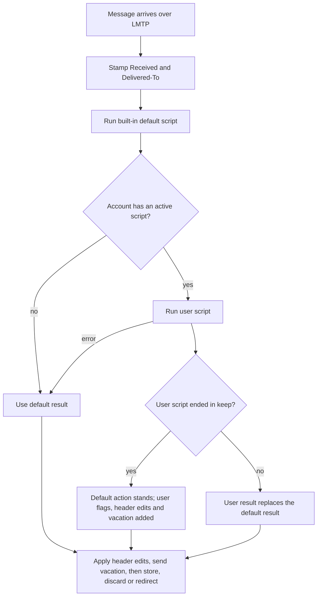

# Sora Sieve

Sieve is the filtering language users write to sort, flag, forward and auto-answer their mail at
delivery time (RFC 5228). This document covers how Sora runs Sieve scripts: where they are stored,
which extensions work, the built-in script that runs before every user script, what each action
does to the message, how redirect and vacation replies leave the server, the limits that protect
it, and how scripts are managed over ManageSieve. It is written for operators who configure and
support Sora, and for contributors who change the delivery path.

Outbound mail (redirects and vacation replies) goes through the relay described in
[RELAY.md](RELAY.md). Folder sharing, which Sieve can deliver into, is in
[SHARED_MAILBOXES.md](SHARED_MAILBOXES.md).

## Contents

1. [Where Sieve runs](#1-where-sieve-runs)
2. [Scripts and activation](#2-scripts-and-activation)
3. [The built-in default script](#3-the-built-in-default-script)
4. [Supported extensions](#4-supported-extensions)
5. [What each action does](#5-what-each-action-does)
6. [Errors, limits and timeouts](#6-errors-limits-and-timeouts)
7. [Redirect](#7-redirect)
8. [Vacation](#8-vacation)
9. [ManageSieve](#9-managesieve)
10. [LMTP and Admin API delivery compared](#10-lmtp-and-admin-api-delivery-compared)
11. [Configuration reference](#11-configuration-reference)
12. [Logs and metrics](#12-logs-and-metrics)
13. [Code map](#13-code-map)

---

## 1. Where Sieve runs

Sieve runs on the backend that stores the message, once per recipient, during delivery. Two
delivery paths run it:

- **LMTP**, the protocol your mail transfer agent (MTA) uses to hand messages to Sora. This is
  the normal path. See [PROTOCOLS.md](PROTOCOLS.md).
- **The Admin API delivery endpoint**, which injects a message over HTTP. See
  [ADMIN_API.md](ADMIN_API.md). It runs Sieve the same way, with the few differences in
  [section 10](#10-lmtp-and-admin-api-delivery-compared).

Proxies never run Sieve. An `lmtp_proxy` forwards the message to a backend, and the backend runs
the scripts.

For each LMTP delivery Sora:

1. Adds a `Received:` trace header and a `Delivered-To:` header with the account's primary
   address. Scripts see both.
2. Runs the built-in default script ([section 3](#3-the-built-in-default-script)).
3. Runs the user's active script, if the account has one.
4. Merges the two results.
5. Applies header edits, sends the vacation reply if there is one, and then stores, discards or
   redirects the message.



The script sees the message as it arrived, plus the two headers Sora adds. The envelope sender is
the `MAIL FROM` address (empty for a bounce). The envelope recipient is the `RCPT TO` address,
`+detail` included. When the recipient is an alias with a `+detail`, Sora rewrites it to the
account's primary local part and domain with the same detail, so `:detail` tests behave the same
for aliases and primary addresses.

---

## 2. Scripts and activation

Scripts are stored in PostgreSQL, per account, by name. Names are case-sensitive.

- An account has **at most one active script**. Activating a script deactivates the others.
- An account can store **at most 100 scripts**. Creating the 101st fails; replacing an existing
  script by name always works.
- There is no `include` extension, so the active script is the whole filter.

Users and operators manage scripts through four paths. Every path compiles the script against the
configured extension set before it stores or activates it, so a script that would fail at
delivery is refused up front. A script must be valid UTF-8 and must not contain a NUL byte
(RFC 5228 section 1.1); one that breaks either rule does not compile. A script name with a NUL
byte or invalid UTF-8 is refused too, also as the new name of a rename.

| Path | Size limit | Notes |
|---|---|---|
| ManageSieve (`managesieve` server) | `max_script_size` in the `[[server]]` block, default `16kb` | See [section 9](#9-managesieve). |
| User API `/user/filters` | 64 KB, fixed | Names may use letters, digits, `-`, `_` and `.`, up to 128 characters. See [USER_API.md](USER_API.md). |
| `sora-admin sieve put` | 64 KB, fixed | Reads the script from `--file` or standard input. See [ADMIN_CLI.md](ADMIN_CLI.md). |
| Import from Dovecot (`--sieve`) | 64 KB, fixed | See [IMPORT_EXPORT.md](IMPORT_EXPORT.md). |

`sora-admin sieve` also has `list`, `show`, `delete`, `activate`, `deactivate` and `rename`.

**A stored script that no longer compiles is skipped whole.** This happens when you remove an
extension from `[sieve] enabled_extensions` that a stored script uses. Delivery logs
`failed to get/create sieve executor` at warning level and keeps the default script's result, so
every rule in that script is lost until the user fixes it. Before you narrow the extension list,
check which scripts use the extensions you remove.

Sora keeps compiled scripts in a small in-process cache (100 scripts, 5 minutes), keyed by the
script text and the extension set. A changed script is never served from a stale compilation.

---

## 3. The built-in default script

Every delivery runs a built-in script first, before the user's script. It is compiled into
Sora ([server/delivery/default.sieve](../server/delivery/default.sieve)). There is no setting to change it
or turn it off, and there is no other global or per-domain script.

```sieve
require "fileinto";
require "envelope";
require "mailbox";
require "subaddress";
require "variables";

if anyof(
  header :contains "X-Spam" "Yes"
) {
  fileinto "Junk";
  stop;
}

if envelope :matches :detail "To" "*" {
  set :lower "detail" "${1}";
  fileinto :create "${detail}";
}
```

What it does:

- A message with an `X-Spam` header that contains `Yes` (in any case) goes to the account's Junk
  folder: the personal mailbox with the `\Junk` special-use attribute (RFC 6154), whatever it is
  named, so a renamed Junk folder keeps receiving spam. Only if no personal mailbox has `\Junk`
  does it go to the mailbox named `Junk` (the RFC 8579 `fileinto :specialuse` rule), and to INBOX
  if there is none. Your spam filter must add that header for this to work.
- A message sent to `user+tag@example.com` goes to a folder named after the detail, in lower case
  (`tag`). The folder is created if it does not exist.
- Everything else stays in INBOX.

The script needs the `fileinto`, `envelope`, `mailbox`, `subaddress` and `variables` extensions.
If `[sieve] enabled_extensions` leaves any of them out, the LMTP server fails to start with
`failed to parse default Sieve script`.

### How the two results are merged

| User script result | What happens |
|---|---|
| No active script | The default script's result is used. |
| The user script fails to compile, fails at run time, or times out | The default script's result is used. |
| Keep, explicit or implicit (the script only set flags, edited headers or sent a vacation reply, or did nothing) | The default script's action stands (Junk, the `+detail` folder, or INBOX). The user script's flags are added to the default's, its header edits run after the default's, and its vacation reply is sent. |
| `fileinto`, `redirect` or `discard` (including `reject`) | The user script's result replaces the default result completely: the default's flags, header edits and folder choice are dropped. |

So a user script that only sends a vacation reply does not stop spam from going to Junk, and a
user script that files a message somewhere takes over from the default script.

The Admin API delivery path runs this script and merges the results the same way.

---

## 4. Supported extensions

Sora uses the [go-sieve](https://github.com/migadu/go-sieve) interpreter. The extensions it
supports, and the default set, come from the `go-managesieve` library that Sora pins in `go.mod`.

| Extension | RFC | In the default set |
|---|---|---|
| `fileinto` | 5228 | yes |
| `envelope` | 5228 | yes |
| `encoded-character` | 5228 | yes |
| `comparator-i;octet` | 4790 | yes |
| `comparator-i;ascii-casemap` | 4790 | yes |
| `comparator-i;ascii-numeric` | 4790 | yes |
| `comparator-i;unicode-casemap` | 4790 | yes |
| `imap4flags` | 5232 | yes |
| `variables` | 5229 | yes |
| `relational` | 5231 | yes |
| `vacation` | 5230 | yes |
| `copy` | 3894 | yes |
| `regex` | draft-murchison-sieve-regex | yes |
| `date` | 5260 | yes |
| `index` | 5260 | yes |
| `mailbox` | 5490 | yes |
| `subaddress` | 5233 | yes |
| `body` | 5173 | yes |
| `mime` | 5703 | yes |
| `foreverypart` | 5703 | yes |
| `extracttext` | 5703 | yes |
| `reject` | 5429 | yes |
| `ereject` | 5429 | yes |
| `editheader` | 5293 | no |

The core commands (`require`, `if`/`elsif`/`else`, `stop`, `keep`, `discard`, `redirect`) need no
`require`.

Extensions that are **not** available: `include`, `environment`, `duplicate`, `enotify`,
`spamtest`, `virustest`, `ihave`, and the IMAP-event and metadata extensions. A script that
requires one of them is refused.

### Choosing the set: `[sieve] enabled_extensions`

- Left empty (the default), scripts may use the 23 extensions of the default set: all of the
  above except `editheader`.
- Set to a list, scripts may use exactly the listed extensions that Sora supports. The list
  replaces the default set; it does not add to it. To allow `editheader`, list every extension
  you want, `editheader` included.
- Names Sora does not support are dropped. At startup Sora logs a warning:
  `[sieve] enabled_extensions names extensions the engine does not support; they are ignored, and the default set is used if none remain`.
  If no valid name remains, the default set is used.
- Keep `fileinto`, `envelope`, `mailbox`, `subaddress` and `variables` in the list, or the LMTP
  server will not start ([section 3](#3-the-built-in-default-script)).

The same set is used everywhere: LMTP delivery, Admin API delivery, ManageSieve validation and
its `SIEVE` capability, User API filter validation and its capabilities endpoint, and
`sora-admin sieve put`. The one exception is the `managesieve_proxy`, which advertises its own
`supported_extensions` before login ([section 9](#9-managesieve)).

`editheader` is off by default because it lets users rewrite the headers of mail they receive,
including headers other systems rely on. Even when it is on, `deleteheader` cannot remove
`Received` or `Auto-Submitted` headers; such a command is ignored.

### Behaviour of particular extensions in Sora

- **`date`:** Sora reads a header date by the RFC 5322 grammar, including its obsolete forms:
  comments and extra white space between the parts, two- and three-digit years, and leap
  seconds. In a `Received:` field it reads the date after the last `;`. Some dates do not parse,
  and then every `date` test on that field is false and `:count` is 0 (RFC 5260 section 4):
  - a zone that is not an RFC 5322 zone, such as `GMT+1`, `UTC-0500`, `+01`, `+01:00`,
    `CET/CEST`, or minutes above 59 as in `+0060`;
  - anything but white space or a comment after the zone, as in `-0400 EDT`.

  An alphabetic zone Sora does not know (`CET`, `XYZ`, a one-letter military zone) is read as
  `-0000`: the time of day as written, at offset zero (RFC 5322 section 4.3). `:originalzone`
  then gives the zone as `+0000`. A field that holds an RFC 3339 date-time
  (`2019-01-01T12:00:00+01:00`) is also a date; there an offset hour above 23 (`+24:00`) is not
  a date. `:zone` and the date-part argument may use variables. All `currentdate` tests in one
  run see the same moment. The sent date that Sora stores for IMAP `SORT` and `THREAD` is read
  separately, and an invalid zone there counts as UTC (RFC 5256 section 2.2).
- **`envelope`:** the `auth` part never matches, because a delivery has no authenticated user.
- **`mailbox`:** `fileinto :create` creates a missing folder ([section 5](#5-what-each-action-does)).
  The `mailboxexists` test is true only when every named folder exists and the user may deliver
  into it: an own folder, or a shared folder on which the user holds the right to add messages.
- **`subaddress`:** the separator is `+`. `:user` is the part before the first `+`, `:detail` the
  part after it.
- **`body`, `mime`, `foreverypart`, `extracttext`:** these walk the MIME structure of the message
  as it arrived. A message with a header but no blank line after it has no body; every `body`
  test is then false.
- **`regex` and `:matches`:** the text matched is cut to 256 KB first. One match may take up to
  the whole script budget (`[sieve] max_execution_time`).
- **`reject` and `ereject`:** handled as `discard`. No bounce, DSN or MDN is ever sent
  ([section 5](#5-what-each-action-does)).

---

## 5. What each action does

Each action below is described for LMTP delivery. Where the Admin API path differs, see
[section 10](#10-lmtp-and-admin-api-delivery-compared).

### keep (and implicit keep)

The message is stored in INBOX, or in the folder the default script chose
([section 3](#3-the-built-in-default-script)). A message is kept unless an action cancels the
implicit keep (`fileinto` without `:copy`, `redirect` without `:copy`, `discard`, `reject`).

### fileinto

- The message goes to the named folder instead of INBOX. Folder names are matched
  case-insensitively.
- If the folder does not exist, the message goes to INBOX instead. Sora logs
  `Sieve fileinto "<name>" is unavailable or has no insert right; keeping in INBOX` at warning
  level.
- With `:create` (extension `mailbox`), Sora creates a missing folder, and any missing parent
  folders, and delivers into it. When the folder already exists, own or shared, `:create` is
  ignored and the message is filed exactly as without it. `:create` never creates a folder in the
  shared namespace. If the name is not a valid folder name, nothing is created and the message
  goes to INBOX.
- With `:copy` (extension `copy`), the message goes to the named folder **and** to INBOX.
- A script that files one message into several folders stores a copy in each; a folder named
  twice gets one copy. One run may file into at most **32** folders. A script that files into
  more fails at run time ([section 6](#6-errors-limits-and-timeouts)).
- `fileinto` and `redirect` combine: if one run does both, the message is filed and also
  redirected.

Filing into a shared folder owned by another account needs the insert (`i`) right on that folder.
Without it, the message goes to the recipient's own INBOX, with the same warning as for a missing
folder. The stored message belongs to the folder's owner. See
[SHARED_MAILBOXES.md](SHARED_MAILBOXES.md#9-sharing-and-the-rest-of-sora).

### redirect

The message is sent to another address through the relay queue, and is not stored, unless
`:copy` or `keep` asks for a local copy. Redirect has its own checks and limits; see
[section 7](#7-redirect).

### discard

Nothing is stored and nothing is sent back. Sora answers the LMTP transaction with success. A
vacation reply decided in the same run is still sent (RFC 5230 §4.7).

### reject and ereject

Sora handles both as `discard`: the message is dropped and the MTA gets success. No bounce, DSN
or MDN goes to the sender. Sora logs the action and its reason (cut to 256 bytes), for example
`user sieve reject, discarded without a bounce` with a `reason` field.

A script that combines `reject` with `keep`, `fileinto`, `redirect` or `vacation`, or runs
`reject` twice, fails at run time; the result is then the default script's
([section 6](#6-errors-limits-and-timeouts)).

### Flags (imap4flags)

`setflag`, `addflag`, `removeflag` and `fileinto :flags` set flags and keywords on the stored
message. `hasflag` tests them. Each stored copy gets its own flags (RFC 5232):

- a copy filed by `fileinto` gets that command's `:flags`, or, without `:flags`, the flags the
  script had set when the `fileinto` ran;
- the copy kept in INBOX gets the flags as they were at an explicit `keep`, or, for the implicit
  keep, the flags at the end of the script.

When two actions store into the same folder, the later action's flags win. A keyword that is not
a valid IMAP atom is dropped, and Sora logs `sieve set invalid IMAP keywords, dropped` with the
names, so support can find the script line.

### Header edits (editheader)

`addheader` and `deleteheader` change the stored message. Tests later in the same script see the
edited headers. The edits are applied before the message is hashed and stored, so the stored
message, its search index, the redirected copy and the vacation reply all see them. Every field
the script does not add or delete keeps its exact bytes, so a DKIM signature over them still
verifies. If the edited message cannot be parsed, Sora logs a warning and stores the original.

### vacation

See [section 8](#8-vacation).

---

## 6. Errors, limits and timeouts

A Sieve problem never makes delivery fail. Sora keeps the message instead. The one exception is
a user script that cannot be read: Sora defers the message rather than deliver it without the
user's rules.

| What goes wrong | What Sora does |
|---|---|
| The user's script does not compile (for example after an extension was removed) | Logs `failed to get/create sieve executor` at warning level; the default script's result is used. |
| The script fails at run time (more than 5 redirects, more than 32 `fileinto` folders, `reject` conflicts, a regex error) | Logs `user sieve script evaluation error` at warning level; the default script's result is used. |
| The script runs longer than `[sieve] max_execution_time` | Same as a run-time error. |
| The interpreter panics | Recovered and handled as a run-time error, so the LMTP connection stays up. |
| The default script fails at run time | Logs `default sieve script evaluation error`; the message is kept in INBOX unless the user script decides otherwise. |
| Reading the active script from the database fails | Logs `failed to get active sieve script` at warning level and defers the message: LMTP answers `451 4.3.0`, the Admin API reports a transient error, and the MTA retries. Nothing is stored, redirected or replied to. An account without an active script is not an error; the default script's result is used. |

Every run, default or user, is counted in `sora_sieve_executions_total{protocol, result}` with
`result` `success` or `failure`.

### Execution budget

`[sieve] max_execution_time` bounds each script run, default `2s`. Sora clamps it to between
`100ms` and `60s`. An empty, unparsable, zero or negative value means the default. The value is
read at startup; a change needs a restart.

If less time is left on the LMTP `DATA` command (`timeouts.lmtp_command_timeouts`, see
[PROTOCOLS.md](PROTOCOLS.md)), the run gets only that time.

The same budget is the deadline of each single `:regex` or `:matches` match. The budget is checked
cooperatively, not enforced by a hard clock:

- When the text is larger than 1 KB, the matcher checks the deadline as it reads the text, about
  every 64 bytes, and stops with a timeout when the deadline has passed.
- A match on text of 1 KB or less, and the compilation of a pattern, run without checks. The
  input, pattern and program-size limits below keep them short.

So a run can go on a little past the budget, until its next check.

### Fixed interpreter limits

These come from go-sieve and are not configurable.

| Limit | Value | When exceeded |
|---|---|---|
| Tokens in a script | 5000 | The script does not compile. |
| Nesting of blocks | 15 | The script does not compile. |
| Nesting of tests | 15 | The script does not compile. |
| Redirect actions in one run | 5 | The run fails ([section 7](#7-redirect)). |
| Folders one run files into | 32 (set by Sora) | The run fails. |
| Variables in a script | 128 | The script fails. |
| Variable name length | 32 bytes | The script fails. |
| Variable value length | 4000 bytes | The value is cut. |
| Regex pattern length | 1000 bytes | The script fails. |
| Size of a compiled `:regex` pattern | 10000 cost units (see below) | The script fails. |
| Text fed to one regex or `:matches` match | 256 KB | The text is cut, the match goes on. |

The size of a compiled pattern is an estimate of the work the pattern can cause. Character
classes and case folding add to it, and a counted repeat multiplies it: `a{100}` costs about a
hundred times `a`. A `:regex` key with a fixed text is checked when the script is stored, so a
pattern that is too large, or does not compile at all, is refused up front.

---

## 7. Redirect

`redirect` forwards the message to another address. Sora does not deliver it directly: it puts
the message in the relay queue, and the relay worker sends it through the configured relay. See
[RELAY.md](RELAY.md).

### When a redirect happens

A redirect action is honoured only if all of these hold. If one of the first four fails, the
redirect is skipped and the message is kept, as if the line were not there:

1. The target parses as an email address.
2. The message has been redirected by Sora fewer than `max_redirect_hops` times (default 2). Sora
   counts hops in the `X-Sora-Loop` header (the highest value if there are several). `0` turns
   this check off.
3. The message is not automatic mail. A redirect is skipped when the envelope sender is empty (a
   bounce), when `Auto-Submitted` is present and not `no`, when `Precedence` is `bulk`, `junk` or
   `list`, or when a `List-Id` header is present. **So Sieve does not forward mailing-list mail,
   bounces or auto-replies.**
4. The account is under its redirect rate limit: at most `redirect_rate_limit` redirected
   addresses (default 100) per `redirect_rate_window` (default `1h`). `0` turns the limit off.
   Only addresses that were actually handed to the relay queue count. If the database check
   fails, the redirect is skipped.
5. A relay is configured (`[relay] type` set). Sora checks this after the script has run.
   Without a relay, the message is stored as when the relay queue cannot take a redirect (see
   below): where the rest of the script puts it, or in INBOX.

A script may redirect to several addresses; an address named twice is sent once. More than five
redirect actions in one run make the run fail, and the message is then handled as in
[section 6](#6-errors-limits-and-timeouts).

### The forwarded copy

- Envelope sender (`MAIL FROM`): the original envelope sender. **Sora does not rewrite it** (no
  SRS). If your relay does not rewrite it either, receivers that check SPF may reject or flag
  the forwarded copy.
- Envelope recipient: the redirect address.
- Body and headers: the message as Sora stored it (with `Received:`, `Delivered-To:` and any
  header edits), plus two headers on top:
  - `X-Sora-Loop: <n>`, the hop count the message arrived with plus one. It is counted before
    the script's header edits, so a script that deletes `X-Sora-Loop` does not reset it.
  - `X-Redirected-By: <primary address of the account that owns the script>`. Any
    `X-Redirected-By` already in the message is removed first.

A redirect is handed to the relay only after the delivery has stored every copy it stores. A
delivery that fails (`451` on LMTP, an error from the Admin API) relays nothing, so the sender's
retry relays each address once.

If the relay queue cannot take an address, the message is not redirected to that address; it still
goes to the others. Sora logs a warning with the address (`redirect_to`) and the error:

- LMTP: `sieve redirect could not be queued`, both when the queue refuses the message and when it
  cannot hand a queued one to the relay worker afterwards.
- Admin API delivery: `Sieve redirect could not be queued` when the queue refuses the message, and
  `Sieve redirect could not be handed to the relay` when it cannot hand a queued one to the relay
  worker afterwards.

The message is still stored wherever `fileinto`, `keep` or `:copy` puts it; when the redirects are
the only place it goes, it is kept in INBOX instead. When they are and every address is queued, the
message is not stored locally: **the queue file is the only copy**. If the relay later rejects it
permanently, the message waits in the failed queue until `failed_retention` deletes it
([RELAY.md](RELAY.md#5-failures-retries-and-the-failed-queue)).

### Loop detection

When a message arrives for a recipient and it carries both an `X-Sora-Loop` header and a
`Delivered-To` header equal to that recipient's primary address, Sora refuses it with
`550 5.4.6 routing loop detected (Delivered-To)`. Requiring the `X-Sora-Loop` marker avoids
refusing ordinary forwarded mail that another system stamped with `Delivered-To`.

---

## 8. Vacation

The `vacation` action (RFC 5230) sends an automatic reply. It does not change what happens to the
message: the reply is sent whether the message is kept, filed, redirected or discarded.

```sieve
require ["vacation"];
vacation :days 7 :subject "Away until Monday"
  "I am away until Monday and will answer when I am back.";
```

### When a reply is sent

A reply goes out only if all of these hold, checked in this order:

1. The envelope sender is not empty. Bounces never get a reply.
2. The envelope sender is not one of the `:addresses` the script lists (exact string match).
3. No reply with the same **response identity** went to this sender in the last `:days` days
   ([below](#the-days-window-and-the-response-identity)).
4. A relay is configured. Without one the reply is dropped.
5. The message is not automatic mail: no empty sender, no `Auto-Submitted` other than `no`, no
   `Precedence` of `bulk`, `junk` or `list`, no `List-Id` header.
6. The message is personal: at least one address in its `To`, `Cc`, `Bcc`, `Resent-To`,
   `Resent-Cc` or `Resent-Bcc` header belongs to the account (any of its addresses, with or
   without a `+detail`) or is one of the script's `:addresses`. Mail that reached the user through
   a list or alias that none of these headers shows gets no reply. If the ownership lookup fails,
   Sora sends the reply anyway.
7. With `:mime`, the reason is valid MIME ([below](#the-reply)).
8. Sora wins the claim on the `:days` window ([below](#the-days-window-and-the-response-identity)).

The reasons for skipping a reply are logged at debug level (for example
`[VACATION] suppressed: Precedence: bulk`).

### The `:days` window and the response identity

`:days` defaults to 7. Sora clamps it to between 1 and 365 days.

Sora remembers each reply per account, per sender address (exact match) and per **response
identity**:

- With `:handle "name"`, the identity is the handle.
- Without a handle, it is derived from the `:subject`, `:from`, `:mime` and reason arguments as
  written in the script, before variables are expanded.

So changing the reason text or the subject starts a new window: everyone gets the new reply once.
Two vacation actions that differ only in a variable's value share a window.

The check happens twice. When the script runs, Sora checks the database. Right before the reply is
handed to the relay queue, Sora claims the window under a database lock. If two deliveries race,
only one claim wins and only one reply is sent. If the claim fails with a database error, no
reply is sent.

### The reply

| Part | Value |
|---|---|
| Envelope sender | Empty (`MAIL FROM:<>`). |
| Envelope recipient | The original message's envelope sender. |
| `From` | The `:from` address, if it is a bare address that belongs to the account. Otherwise the account's primary address. A `:from` that is not the account's is ignored (logged at debug level). |
| `To` | The original envelope sender. |
| `Subject` | The `:subject`, even an empty one (`:subject ""`). Without `:subject`, `Auto: ` followed by the original subject, or `Automated reply` when the original message has no subject. Cut to 256 characters, and RFC 2047-encoded when it is not ASCII. |
| `Message-ID` | `<nanoseconds.vacation@host>`, where host is the machine's hostname. Give the machine a fully qualified name; Sora warns at startup when it is not. |
| `In-Reply-To`, `References` | Built from the original message so clients thread the reply. |
| `Auto-Submitted` | `auto-replied` |
| `Precedence` | `bulk` |
| `X-Auto-Response-Suppress` | `All` |
| `X-Redirected-By` | The account's primary address. |
| `Date` | The time the reply is built. |
| Body | The reason, as `text/plain; charset=utf-8`. |

With `:mime`, the reason must be a complete MIME entity (headers, blank line, body). Sora keeps
its `Content-*` headers and body as written and takes every other header from the table above.
Sora checks the entity before it sends it. Invalid MIME means no reply, and the window is not
used up. Examples of invalid MIME: a duplicate `Content-Type`, non-ASCII bytes in a header,
nesting deeper than 64 levels, a multipart boundary or close-delimiter line that is malformed,
and a body that does not match its `Content-Transfer-Encoding`.

The relay must accept mail from Sora with an empty envelope sender. If it signs outgoing mail
(DKIM), it signs these replies too.

### When sending fails

After the claim, the reply is put in the relay queue. If queueing fails, Sora logs
`Sieve vacation reply could not be queued; the response period is consumed` at warning level. The
window stays used: this sender gets no reply until it ends. After queueing, retries and failures
are the relay queue's ([RELAY.md](RELAY.md)).

---

## 9. ManageSieve

ManageSieve (RFC 5804) is the protocol mail clients use to upload and activate scripts. The
`managesieve` server type serves it on backends; the `managesieve_proxy` forwards it to backends.
This section covers the script side. Listener, TLS, authentication and timeout settings are in
[PROTOCOLS.md](PROTOCOLS.md), [TLS.md](TLS.md) and [AUTHENTICATION.md](AUTHENTICATION.md).

### Capabilities

The capability block looks like this (the `SIEVE` list is the effective extension set, and
`MAXSCRIPTSIZE` is `max_script_size` in bytes):

```text
"IMPLEMENTATION" "ManageSieve"
"VERSION" "1.0"
"SIEVE" "fileinto envelope encoded-character ..."
"STARTTLS"
"SASL" "PLAIN"
"MAXSCRIPTSIZE" "16384"
```

`STARTTLS` appears only on a plaintext listener with `tls_use_starttls = true`. `SASL` is `PLAIN`
where login is allowed (after STARTTLS, on implicit TLS, or with `insecure_auth`), and empty
otherwise. Sora does not advertise `MAXREDIRECTS`; the limit is 5 ([section 6](#6-errors-limits-and-timeouts)).

### Commands

| Command | Behaviour in Sora |
|---|---|
| `LISTSCRIPTS` | Lists the account's scripts and marks the active one. |
| `GETSCRIPT` | Returns a script. `NO (NONEXISTENT)` if there is none of that name. |
| `PUTSCRIPT` | Compiles the script against `[sieve] enabled_extensions` and stores it. A script over `max_script_size` is refused before it is read. A new script beyond 100 per account gives `NO (QUOTA/MAXSCRIPTS)`. Replacing a script keeps its active flag. |
| `CHECKSCRIPT` | Compiles the script and stores nothing. Sora never returns warnings. |
| `SETACTIVE` | Compiles the stored script again and activates it. `SETACTIVE ""` deactivates all scripts. |
| `DELETESCRIPT` | Refuses the active script with `NO (ACTIVE)`; deactivate it first. |
| `RENAMESCRIPT` | Renames in one step; the active flag stays. `NO (ALREADYEXISTS)` if the new name is taken, `NO (NONEXISTENT)` if there is no script of the old name. |
| `HAVESPACE` | Checks the size against `max_script_size` and the 100-script limit (replacing a script of the same name does not count as a new one). |

A compile failure answers `NO "Script validation failed: <reason>"`; so does a script or a new
script name with a NUL byte or invalid UTF-8. A database error answers a temporary failure; the
client may retry.

### The ManageSieve proxy

A `managesieve_proxy` advertises its own capability list before login, from
`supported_extensions` in its `[[server]]` block (the default set when unset, unsupported names
dropped with a warning). The backend validates scripts against `[sieve] enabled_extensions`. Keep
the two lists the same, or clients will be offered extensions the backend refuses.

---

## 10. LMTP and Admin API delivery compared

Both paths run the built-in default script and the user's script and merge their results the same
way. They use the same extension set, the same script cache, the same `fileinto` handling
(`:create` included), the same redirect and vacation code, and the same limits. On both, a queued
redirect or vacation reply wakes the relay worker at once. They differ in these ways:

| | LMTP | Admin API delivery |
|---|---|---|
| Explicit target mailbox | Not possible | A request that names a target mailbox skips Sieve completely |
| Redirect limits | From the `lmtp` `[[server]]` block | From the `http_admin_api` `[[server]]` block |

---

## 11. Configuration reference

### `[sieve]`

| Key | Type | Default | Meaning |
|---|---|---|---|
| `enabled_extensions` | list of strings | `[]` (the default set of 23) | The extensions scripts may require. Replaces the default set. See [section 4](#4-supported-extensions). |
| `max_execution_time` | duration | `"2s"` | Budget for one script run and for one regex match. Clamped to 100ms–60s. |

Both are read at startup. A reload (`SIGHUP`) changes nothing; it logs
`Config reload: global settings changed but require restart to take effect` with the changed keys
in `fields` (for example `sieve.enabled_extensions`). At startup, and in
`sora-admin config validate`, Sora warns about extension names it does not support.

### Keys in `[[server]]` blocks

| Key | Server types | Default | Meaning |
|---|---|---|---|
| `limits.redirect_rate_limit` | `lmtp`, `http_admin_api` | `100` | Redirected addresses allowed per account per window. `0` means no limit. |
| `limits.redirect_rate_window` | `lmtp`, `http_admin_api` | `"1h"` | The window for the limit above. Zero or a negative value stops startup (use `redirect_rate_limit = 0` to turn the limit off). A value that does not parse falls back to `1h` with a log line. |
| `limits.max_redirect_hops` | `lmtp`, `http_admin_api` | `2` | How many times Sora may redirect one message, counted in `X-Sora-Loop`. `1` allows one redirect. `0` means no limit; `Delivered-To` loop detection still applies. |
| `max_script_size` | `managesieve` | `"16kb"` | Largest script ManageSieve accepts. Reloads on `SIGHUP`. |
| `supported_extensions` | `managesieve_proxy` | the default set | Extensions the proxy advertises before login. |

The three `limits.redirect_*` keys need a restart to change.

```toml
[sieve]
# Allow editheader as well as the usual set.
enabled_extensions = [
  "fileinto", "envelope", "encoded-character",
  "comparator-i;octet", "comparator-i;ascii-casemap",
  "comparator-i;ascii-numeric", "comparator-i;unicode-casemap",
  "imap4flags", "variables", "relational", "vacation", "copy", "regex",
  "date", "index", "mailbox", "subaddress", "body",
  "mime", "foreverypart", "extracttext", "reject", "ereject",
  "editheader",
]
max_execution_time = "2s"

[[server]]
type = "lmtp"
name = "lmtp"
addr = ":24"
limits.redirect_rate_limit = 100
limits.redirect_rate_window = "1h"
limits.max_redirect_hops = 2

[[server]]
type = "managesieve"
name = "managesieve"
addr = ":4190"
max_script_size = "16kb"
```

Redirect and vacation also need `[relay]` ([RELAY.md](RELAY.md#2-configuring-the-relay)).

---

## 12. Logs and metrics

Useful log lines (LMTP session logs carry the session and message fields):

| Log line | Level | Meaning |
|---|---|---|
| `using user sieve script` | info | The account's active script runs (name, id, last update). |
| `default sieve fileinto` / `user sieve fileinto` | info | The script filed the message (`mailbox`, `copy`, `create`). |
| `user sieve keep - merging with default script result` | info | The user script kept; the default action stands. |
| `user sieve redirect` | info | The script redirected (`redirect_to`, `copy`). |
| `user sieve reject, discarded without a bounce` | info | A `reject` or `ereject`, handled as discard. |
| `user sieve vacation response triggered` | info | The script decided to send a reply (it may still be suppressed later). |
| `sieve message discarded` | info | Nothing was stored. |
| `failed to get/create sieve executor` | warn | The stored script does not compile; it was skipped. |
| `user sieve script evaluation error` | warn | The script failed at run time or timed out. |
| `failed to get active sieve script` | warn | The account's active script could not be read from the database; the delivery was deferred with `451 4.3.0`. |
| `Sieve fileinto "<name>" is unavailable or has no insert right; keeping in INBOX` | warn | `fileinto` named a missing folder, the shared namespace root, or a shared folder without the `i` right. |
| `sieve set invalid IMAP keywords, dropped` | warn | A flag name was not a valid IMAP keyword. |
| `mail loop detected via Delivered-To, rejecting` | warn | A redirect loop was refused with 550. |
| `sieve redirect could not be queued` | warn | LMTP: a redirect did not go out (`redirect_to`, `error`); the relay queue refused it or could not hand it to the relay worker. See [section 7](#7-redirect) for where the message is stored. |
| `Sieve redirect could not be queued` | warn | Admin API: the relay queue refused a redirect (`account_id`, `redirect_to`, `error`). |
| `Sieve redirect could not be handed to the relay` | warn | Admin API: the queue took a redirect but could not hand it to the relay worker. |
| `Sieve vacation reply could not be queued; the response period is consumed` | warn | The reply was lost for this window. |
| `[VACATION] suppressed: ...` | debug | Why a reply was not sent. |

With `debug = true` in the `lmtp` `[[server]]` block, Sora also logs every header the script sees.

| Metric | Labels | Meaning |
|---|---|---|
| `sora_sieve_executions_total` | `protocol` (`lmtp`, `http_delivery`), `result` (`success`, `failure`) | Script runs, default and user. |
| `sora_managesieve_scripts_uploaded_total` | | Scripts stored with `PUTSCRIPT`. |
| `sora_managesieve_scripts_activated_total` | | Scripts activated with `SETACTIVE`. |

Relay metrics for redirects and replies are in [RELAY.md](RELAY.md#6-operating-the-queue).

---

## 13. Code map

| What | Where |
|---|---|
| Compiling, running and interpreting results, the redirect checks, header edits | [server/sieveengine/sieve.go](../server/sieveengine/sieve.go) |
| The compiled-script cache | [server/sieveengine/script_cache.go](../server/sieveengine/script_cache.go) |
| The built-in default script | [server/delivery/default.sieve](../server/delivery/default.sieve) |
| LMTP delivery: default plus user script, merge, storing, redirect | [server/lmtp/session.go](../server/lmtp/session.go) |
| Admin API delivery path | [server/delivery/sieve.go](../server/delivery/sieve.go), [server/delivery/delivery.go](../server/delivery/delivery.go) |
| Vacation reply building and suppression | [server/delivery/vacation.go](../server/delivery/vacation.go), [server/delivery/vacation_mime.go](../server/delivery/vacation_mime.go) |
| Automatic-mail suppression rules | [helpers/suppression.go](../helpers/suppression.go) |
| `X-Sora-Loop`, `X-Redirected-By`, `Delivered-To`, `Received` | [helpers/loopdetect.go](../helpers/loopdetect.go) |
| Vacation windows in the database | [db/vacation.go](../db/vacation.go) |
| Script storage and the 100-script limit | [db/sieve_scripts.go](../db/sieve_scripts.go) |
| ManageSieve backend | [server/managesieve/](../server/managesieve/) |
| `[sieve]` settings | [config/config.go](../config/config.go) (`SieveConfig`) |

The interpreter is the `github.com/migadu/go-sieve` module, and the extension lists come from
`github.com/migadu/go-managesieve` (`managesieve/extensions.go`). A change to either is a version
bump in `go.mod`.
