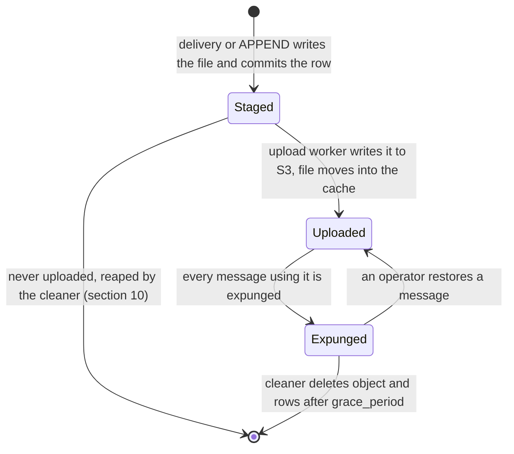

# Sora Storage

This document explains where Sora keeps mail and how a message body moves between those
places: from the local disk of the node that accepted it, to S3, into each node's local
cache, and finally out of the system when it is deleted. It covers content hashing and
deduplication, client-side encryption, the upload queue, the local cache, two-phase
deletion, retention, account deletion and purge, and what an operator must back up.

It is for operators who size, run and recover a deployment, and for contributors who change
the storage code. For the big picture first, read [ARCHITECTURE.md](ARCHITECTURE.md). Search
vectors are covered in [SEARCH.md](SEARCH.md), and PostgreSQL itself in
[DATABASE.md](DATABASE.md).

## Contents

1. [Overview](#1-overview)
2. [S3 keys](#2-s3-keys)
3. [Content hashing and deduplication](#3-content-hashing-and-deduplication)
4. [Client-side encryption](#4-client-side-encryption)
5. [The S3 client](#5-the-s3-client)
6. [The upload pipeline](#6-the-upload-pipeline)
7. [Reading a body](#7-reading-a-body)
8. [The local cache](#8-the-local-cache)
9. [Two-phase deletion](#9-two-phase-deletion)
10. [Failed uploads and lost nodes](#10-failed-uploads-and-lost-nodes)
11. [The cleanup cycle](#11-the-cleanup-cycle)
12. [When S3 is unavailable](#12-when-s3-is-unavailable)
13. [Deleting accounts](#13-deleting-accounts)
14. [What to back up](#14-what-to-back-up)
15. [Monitoring](#15-monitoring)
16. [Configuration reference](#16-configuration-reference)

---

## 1. Overview

Sora keeps a message in two parts. The metadata (mailbox, UID, flags, searchable headers,
MIME structure, size) is a row in PostgreSQL. The body, the raw message bytes, is an object in
an S3-compatible bucket. Between those two, each storage node has two local directories:

| Place | What it holds | If you lose it |
|---|---|---|
| PostgreSQL | All metadata, the upload queue, search vectors | You lose the mail: bodies without metadata cannot be found. |
| S3 bucket | Every uploaded body | You lose the mail. |
| Staging directory, `[uploader] path` | Bodies accepted by this node that are not in S3 yet | You lose exactly those messages. |
| Local cache, `[local_cache] path` | Copies of bodies this node uploaded or read recently | Nothing. Bodies are fetched from S3 again. |

A *storage node* is a node that runs `imap`, `pop3` or `lmtp`. Only storage nodes talk to S3
and use these directories (see [ARCHITECTURE.md](ARCHITECTURE.md#3-node-roles)).

A body goes through these states:



---

## 2. S3 keys

Every object is stored under the key:

```
<s3_domain>/<s3_localpart>/<content_hash>
```

for example `example.com/alice/4c1f…e09a` (the hash is 64 hexadecimal characters).
`s3_domain` and `s3_localpart` come from the account's **primary address at the time the
message row was written**. Each message row stores them in its own `s3_domain` and
`s3_localpart` columns, and every reader builds the key from those columns. So:

- When an account's primary address changes, existing objects stay where they are and
  remain readable. New messages are stored under the new address. One account can therefore
  have objects under more than one prefix.
- A message in a shared mailbox is stored under the mailbox **owner's** key, not the key of
  the user who delivered or copied it.
- Keys are per account. Two accounts never share an object.

All objects go into the one bucket named in `[s3] bucket`, with no extra prefix. Sora does
not create the bucket and does not check it at startup, so create it first. The credentials
need to list the bucket (the health check lists one key), and to get, put, copy and delete
objects.

---

## 3. Content hashing and deduplication

The **content hash** is the BLAKE3-256 hash of the stored bytes, written as 64 lowercase
hexadecimal characters. Sora computes it after it has added its own trace headers and after
any Sieve header edits, so it always describes exactly the bytes in S3. It names the body
everywhere: in the S3 key, in the staging directory and in the cache.

Deduplication works per S3 key, which means per account:

- **Messages of one account that have the same body share one object.** COPY and MOVE create
  new message rows that point at the same object; nothing new is written to S3. An APPEND of
  bytes the account already has under the same key is marked uploaded at once, with no new
  upload.
- **Accounts never share objects.** The same body in two accounts is two objects, under two
  keys.
- **Incoming mail is not deduplicated in practice.** Every delivery over LMTP or the Admin
  API gets its own `Received:` header, with a unique ID and a timestamp, and a
  `Delivered-To:` header. Two deliveries of the same message therefore have different bytes
  and different hashes, even into the same account.

The local cache is keyed by content hash alone, so on one node a body that two accounts
happen to share is cached once. That is safe: equal hashes mean equal bytes.

Two other checks stop the same message from being stored twice in one mailbox. They are
separate from the S3 deduplication above:

- a message with the same `Message-ID` and the same content hash as a live message in that
  mailbox is treated as a duplicate;
- a delivery whose bytes, as received before Sora added its headers, match a live message in
  that mailbox (the *delivery hash*) is treated as a duplicate. This absorbs an MTA retry
  after a lost `250` reply.

Both are answered as a success (LMTP `250`, APPEND `OK`), without storing a second copy. A
message without a `Message-ID` gets a new one for each APPEND, so two identical APPENDs of
such a message are two messages.

---

## 4. Client-side encryption

With encryption on, Sora encrypts each body before it sends it to S3, and decrypts it after
it reads it back. The S3 provider only ever sees ciphertext.

```toml
[s3]
encrypt = true
encryption_key = "<64 hexadecimal characters>"   # generate with: openssl rand -hex 32
```

- **The key** is 32 bytes written as 64 hexadecimal characters. Any other length, or a value
  that is not hexadecimal, stops `sora` at startup. `sora-admin` reads the same key from the
  same config.
- **The cipher** is AES-256-GCM. Each object is a random 12-byte nonce, then the ciphertext,
  then a 16-byte authentication tag, so it is 28 bytes larger than the message.
- **Integrity.** Decryption checks the tag. An object that fails the check is treated as
  corrupt: it is not retried, it does not count against the circuit breaker, and readers
  treat the body as lost.
- **Memory.** Encrypted bodies are encrypted and decrypted whole, in memory. Without
  encryption, a read streams from S3.
- **Copies.** A copy between two accounts' keys is a download, decrypt, encrypt and upload
  instead of a server-side S3 copy.

What encryption does **not** cover:

- The staging directory and the local cache hold **plaintext** bodies on the node's disk.
- PostgreSQL holds the metadata (subjects, addresses, search vectors) in plaintext.

Decide before you store mail:

- There is **one key** and no key rotation.
- Sora has no command to encrypt or decrypt existing objects. If you turn encryption on or
  off, or change the key, every object written before can no longer be read.
- **If you lose the key, you lose every body.** Back it up apart from the bucket.

---

## 5. The S3 client

The client lives in [storage/storage.go](../storage/storage.go), and the retries and circuit
breakers around it in [pkg/resilient/storage.go](../pkg/resilient/storage.go).

### Connection

- `[s3] endpoint` may be `host`, `host:port`, or a full URL with `http://` or `https://`.
  Without a scheme, Sora uses `https://`, or `http://` when `disable_tls = true`. With a
  scheme, `disable_tls` is ignored.
- Sora uses path-style URLs (`<endpoint>/<bucket>/<key>`) and signs every request for the
  region `us-east-1`. Neither is configurable.
- `[s3] timeout` (default `30s`) bounds each request, including the transfer of the body.
  For an IMAP body read it is also the budget for all retries together, so a hanging
  provider costs the client one timeout, not one per retry.
- `[s3] debug = true` logs every S3 request and response. Use it only to debug.

### Retries

The AWS SDK's own retries are off. Sora retries in its wrapper, with exponential backoff and
jitter:

| Operation | Retries | First pause | Longest pause |
|---|---|---|---|
| GET | 4 | 0.5 s | 10 s |
| PUT, COPY | 3 | 1 s | 30 s |
| DELETE, bulk DELETE | 3 | 1 s | 15 s |

Network errors, timeouts, HTTP 5xx and 429 are retried. A GET that answers 404 (no such key)
is not retried. Deleting a key that does not exist counts as success, including the
`InvalidRequest` answer some providers give for a missing file. Bulk deletes send at most
1000 keys per request and retry only the keys that failed.

### Circuit breakers

Each part of Sora that talks to S3 (the IMAP and POP3 servers, the User API, the upload
worker, the cleanup worker, the purge worker) has its own three breakers: one for GET, one for
PUT and one for DELETE. One part's open breaker does not stop the others. A breaker counts
requests in 10-second windows:

| Breaker | Opens when, in one window |
|---|---|
| GET | at least 5 requests and at least 60 % of them failed |
| PUT, DELETE | at least 3 requests and at least 50 % of them failed |

An open breaker rejects requests for 30 seconds, then lets up to 3 trial requests through.
Success closes it, failure opens it again. Only real outages count as failures: timeouts,
connection errors and 5xx. A 4xx answer, a client that hung up, and a corrupt object do not.
Breaker changes are logged as `S3 GET circuit breaker changed`, `S3 PUT circuit breaker
changed` and `S3 DELETE circuit breaker changed`.

### Health check

Every 60 seconds, each storage node lists one key of the bucket (a check named
`s3_storage`, marked critical). See [METRICS.md](METRICS.md).

---

## 6. The upload pipeline

Delivery never waits for S3. A node writes each new body to its own disk, records it in
PostgreSQL, answers the client, and uploads it in the background. This section follows that
path. The code is in [server/uploader/worker.go](../server/uploader/worker.go) and
[db/upload_worker.go](../db/upload_worker.go).

### 6.1 Staging

LMTP delivery, Admin API delivery and IMAP APPEND write the body to:

```
<[uploader] path>/<account id>/<content hash>
```

The write is atomic: Sora writes `<content hash>.tmp`, syncs it to disk, renames it into
place, and syncs the directory. Only then does it insert the message. A crash during the
write leaves at most a `.tmp` file, which the orphan sweep removes. Directories are created
with mode `0755` and files with `0644`, so restrict access with the permissions of the parent
directory.

If the file already exists with the right size (the same body is being delivered again, or
is still being uploaded), Sora leaves it alone and only updates its modification time. A
message filed into another account's shared mailbox is staged a second time, under the
owner's account ID, as a hard link (or a copy, if a link is not possible).

Keep the staging directory and the cache directory on the same filesystem. After an upload,
the staged file moves into the cache with a rename. Across filesystems that rename becomes a
copy.

### 6.2 The pending upload row

The same transaction that inserts the message inserts a row in `pending_uploads`, unless the
account already has this body in S3 under the same key. The row says "this body, for this
account, still has to be written to S3", and it names the node that holds the file:

| Column | Meaning |
|---|---|
| `account_id`, `content_hash` | Which body. One row per pair. |
| `size` | Expected size of the staged file. |
| `instance_id` | The [instance ID](ARCHITECTURE.md#8-node-identity) of the node that holds the file. Only that node uploads it. |
| `attempts` | Failed attempts that were the content's fault (see [6.5](#65-what-counts-as-a-failed-attempt)). |
| `last_attempt` | When a worker last took the row. |
| `lease_until`, `lease_owner` | Set while an upload is in flight. |
| `created_at` | When the body was first queued. |

A new delivery of a body whose row already exists re-arms the row: attempts go back to 0 and
the row moves to the delivering node, which has written a fresh file.

### 6.3 The worker loop

Each storage node runs one upload worker. It works through the queue at startup, every 10
seconds, and at once whenever a message is queued on this node. In each pass it:

1. **Leases a batch.** It takes up to `[uploader] batch_size` rows, oldest first, that belong
   to this node's instance ID, have fewer than `max_attempts` attempts, were not taken within
   the last `retry_interval`, and have no live lease. Taking them sets `last_attempt`.
2. **Uploads them**, at most `[uploader] concurrency` at a time. For each one it:
   1. works out the keys still missing an object (normally one);
   2. passes the write gate (see [6.4](#64-leases-and-the-write-gate));
   3. checks that the staged file has the size the row expects;
   4. streams the file to S3, once per missing key;
   5. in one transaction, marks the message rows uploaded and deletes the pending row;
   6. moves the staged file into the local cache.
3. **Leases the next batch**, until the queue is empty. Until the first upload of a pass
   succeeds, the worker waits for each batch to finish. If every upload in it failed for a
   reason that was not the content's fault, the pass stops there and the worker backs off
   (see [6.6](#66-backoff)).

### 6.4 Leases and the write gate

S3 deletes (by the cleanup worker and by account purges) and S3 writes for the same body
must never overlap. Sora orders them with a per-body PostgreSQL advisory lock and a lease on
the pending row:

- Before it writes, an upload briefly takes the body's lock. If a delete, a restore or a
  cross-account copy of that body is running, the upload is deferred until the row's
  `retry_interval` passes.
- Passing the gate leases the pending row to this upload for 2 minutes. The worker renews
  the lease every 30 seconds while the transfer runs. If it cannot renew in time, or the row
  is gone, it stops the transfer.
- A deleter never removes a body that still has a pending row, and account deletion leaves a
  leased row alone. So nothing can delete the body while it is being written.

The lease holds no database connection during the transfer.

### 6.5 What counts as a failed attempt

Only evidence about the **content** counts toward `max_attempts`:

- the row's content hash is malformed;
- the staged file's size differs from the row's size;
- the staged file is missing **and** S3 reports that the object is absent.

Everything S3 or PostgreSQL answers is about the provider or the database, not about the
bytes on disk, so it never counts: timeouts, 5xx, 403, 400, a refused connection, a database
error. Such an upload is taken again after `retry_interval`. The log line
`Uploader: Upload or finalize failed` carries a `looks_transient` hint for the reader.

A staged file that is missing while S3 already has every key is not a failure: the worker
marks the messages uploaded and drops the row (`Upload self-healed via S3 existence check`).

When a row reaches `max_attempts`, it is **parked**: no worker takes it again. See
[section 10](#10-failed-uploads-and-lost-nodes) for what happens to parked uploads.

### 6.6 Backoff

When the provider or the database turns away every upload in a pass, the worker stays idle
for `retry_interval`, then doubles the pause for each further failed pass, up to 10 minutes.
A few seconds of random jitter are added so that nodes do not all retry in the same second.
The first successful upload clears the backoff. The log lines are:

```
Uploader: storage turned away every upload in this cycle; backing off
Uploader: uploads are reaching S3 again, backoff cleared
```

### 6.7 The staging limit

`[uploader] max_staging_size` (no limit by default) caps how many bytes of mail **this node**
may hold waiting for upload. It counts this node's queued bodies, not the whole deployment's.
When a new message would go over the limit, Sora refuses it before writing it to disk:

| Path | Answer |
|---|---|
| LMTP | `452 4.3.1 Insufficient system storage` |
| IMAP APPEND | `NO [UNAVAILABLE] System storage limit reached, please try again later` |
| Admin API delivery | The delivery fails with `Insufficient system storage (staging limit reached)` |

Your MTA keeps the message and retries a `452`. LMTP also answers `452 4.3.1` when the
staging disk is full or read-only, whether or not a limit is set.

The worker keeps the total in memory and corrects it every 5 minutes from this node's rows
in `pending_uploads`. Set a limit below the free space of the staging disk, so that a long S3
outage makes the MTA queue mail instead of filling the disk.

### 6.8 The orphan sweep

Every 5 minutes the worker walks its staging directory and looks at every file older than
`[uploader] cleanup_grace_period` (default 1 hour). It removes such a file when no pending row
exists for it, or when its name is not a valid content hash (a `.tmp` leftover, for example).
The sweep frees the space of deliveries whose transaction rolled back and of bodies whose
account was deleted.

The grace period must be longer than any database transaction can take. Otherwise the sweep
could remove a file whose pending row is still about to commit.

### 6.9 Heartbeats

Every minute the worker writes the node's instance ID and the current time into
`instance_heartbeats`. The cleanup worker uses these heartbeats to tell a node that is merely
down for a while from one that is gone for good (see
[section 10](#10-failed-uploads-and-lost-nodes)).

### 6.10 Watching the queue

Every 5 minutes, and at startup, the worker reports the queue:

| Log line | Meaning |
|---|---|
| `UploaderMonitor: Queue status` | Pending and parked uploads in the whole deployment, with bytes. Logged when either is non-zero. |
| `UploaderMonitor: ALERT - uploads have failed and need attention` | Parked uploads exist. Followed by up to 10 `UploaderMonitor: Stuck upload` lines. |
| `UploaderMonitor: ALERT - pending uploads are not reaching S3` | This node's oldest pending upload is more than 1 hour old. Logged at most once an hour. Transient errors never park an upload, so this is the line that shows a long outage. |

The metrics are in [section 15](#15-monitoring).

### 6.11 Fixing parked uploads

`sora-admin uploader status` shows the queue and the parked uploads with their addresses.
`sora-admin uploader resolve` handles parked uploads one by one. Run it **on the node that
owns them**, since only that node's disk may still hold the bodies:

| Result | When | What it does |
|---|---|---|
| `[REPAIR]` | The object exists in S3 | Marks the messages uploaded and drops the pending row. |
| `[REARM]` | The staged file is intact on this node | Resets the attempts, so the worker uploads it on its next pass. |
| `[SKIP]` | The row belongs to another node, or the file has the wrong size | Nothing. Run it on the owner, or inspect by hand. |
| `[DELETE]` | The body is neither in S3 nor on this node | Deletes the messages and the pending row. The mail is lost. |

Use `--dry-run` first. See [ADMIN_CLI.md](ADMIN_CLI.md).

---

## 7. Reading a body

IMAP, POP3 and the User API read bodies the same way. Most commands never need the body:
message lists, flags, envelopes, MIME structure, sizes and search results come from
PostgreSQL. When a client asks for message content, Sora picks the source by the message's
upload state.

**The message is uploaded.**

1. The local cache. A cached file whose size does not match the message is deleted and
   ignored.
2. S3. A body that arrives is stored in the cache if it is no larger than
   `[local_cache] max_object_size`.
3. The staging file, if S3 failed and the file is still on this node.

**The message is not uploaded yet.**

1. The staging file on this node.
2. S3, in case another node has uploaded it since. While an upload is still pending, Sora
   tries up to 3 times, 0.5 seconds apart.

When neither works, the outcome depends on whether the body can still arrive:

| Situation | IMAP answer |
|---|---|
| S3 is unreachable, or an upload is still pending | `NO [UNAVAILABLE] Message body temporarily unavailable, please retry`. The client tries again later. |
| The body is gone for good: S3 says the key does not exist, the object is corrupt, or the upload was parked | The message is served with an empty body. |

A missing object for a message marked uploaded is real data loss, and Sora logs it as
`message marked uploaded but missing from S3 (NoSuchKey)`. What POP3 and the User API answer
is in [PROTOCOLS.md](PROTOCOLS.md) and [USER_API.md](USER_API.md).

A body that another node accepted and has not uploaded yet cannot be read on this node. It
becomes readable everywhere seconds later, once the upload finishes.

---

## 8. The local cache

The cache keeps message bodies on each storage node's disk, so that reading a message does
not always cost an S3 request. It is per node: nodes do not share caches. The code is in
[cache/cache.go](../cache/cache.go).

### What it holds

- Bodies this node uploaded, if they are no larger than `max_object_size` (default 5 MiB). The
  staged file moves into the cache after the upload; a larger one is deleted instead.
- Bodies this node read from S3, with the same size limit.
- Bodies fetched by warmup (below), with the same size limit.

Cached bodies are **plaintext**, even with S3 encryption on, and are keyed by content hash
alone: one copy serves every account on the node.

### Layout on disk

```
<[local_cache] path>/
  data/ab/cd/<the remaining 60 characters of the hash>   one file per body
  cache_index_00.db … cache_index_ff.db                  256 SQLite index files (WAL mode)
  .sora_warmup_state.<server hash>                       one IMAP server's warmup times, written at shutdown
```

The index records each file's size and when it was last read. It is split into 256 shards by
the first two characters of the hash.

### Size and eviction

The cache is kept within `capacity` as bodies are added, and a **purge cycle** runs at startup
and then every `purge_interval` (default 12 hours).

Each cycle does this:

1. **Capacity.** `capacity` (default 1 GiB) is split evenly over the 256 shards. Each shard
   that holds more than its share drops its least recently read files until it fits.
2. **Deleted mail.** A file that has not been read for `orphan_cleanup_age` (default 30 days),
   and whose content hash no longer appears in any message row of any account, is deleted.
3. **Tidying.** For one shard per cycle, index entries whose file is gone are removed, and so
   are empty directories.

The cache is safe to lose. If you delete the cache directory while `sora` is stopped, the
next start recreates it and refills it from S3.

### Warmup

Warmup preloads recent mail when a user logs in over IMAP, so that the first screen of
messages opens quickly.

- With `enable_warmup = true` (the default), an IMAP login queues a warmup for the account.
  It fetches the newest `warmup_message_count` messages (default 50) of each mailbox in
  `warmup_mailboxes` (default `["INBOX"]`) from S3 into the cache, skipping bodies already
  cached.
- One account is warmed at most once every `warmup_interval` (default 24 hours) per server.
  Each IMAP server saves the time of each warmup in its own `.sora_warmup_state.<server hash>`
  (the lowercase SHA-256 of its name) at shutdown and reads it back at startup, so a restart does not
  warm every account again. Warmups older than the interval are dropped from memory too.
- With `warmup_async = true` (the default), the warmup runs in the background. Ten workers
  per IMAP server process a queue of 50; a warmup that finds the queue full is dropped and
  tried at the next login. With `warmup_async = false`, the login waits for the warmup.
- One warmup may take at most `warmup_timeout` (default 5 minutes).

The counter `sora_warmup_operations_total` shows warmups by state (`enqueued`, `dropped`,
`started`, `completed`, `cancelled`, `error`).

### Statistics and manual purge

Every `metrics_interval` (default 5 minutes) each node writes its hit and miss counts to the
`cache_metrics` table. Once a day rows older than `metrics_retention` (default 30 days) are
deleted.

- `sora-admin cache stats`, `cache metrics` and `cache purge` show and empty the cache.
- The Admin API has `GET /admin/cache/stats`, `GET /admin/cache/metrics` and
  `POST /admin/cache/purge`.

See [ADMIN_CLI.md](ADMIN_CLI.md) and [ADMIN_API.md](ADMIN_API.md).

---

## 9. Two-phase deletion

Sora never deletes mail at once. Removing a message is two steps, so that a mistake can be
undone during a grace period.

### 9.1 Expunge

A message is **expunged** when:

- an IMAP client expunges it (`EXPUNGE`, `UID EXPUNGE`, `CLOSE`), or moves it to another
  mailbox (the old row is expunged);
- a POP3 client deletes it with `DELE` and ends the session with `QUIT`;
- its mailbox is deleted (see [9.3](#93-deleting-a-mailbox));
- it is older than `[cleanup] max_age_restriction` (see [9.4](#94-retention-with-max_age_restriction));
- its account is deleted (see [section 13](#13-deleting-accounts)).

Expunging sets `expunged_at` on the message row. Clients no longer see the message. Nothing
is removed from S3 yet.

### 9.2 Removal after the grace period

The cleanup worker runs at startup and then every `[cleanup] wake_interval` (default 1 hour).
In each cycle it looks for bodies where, within one account:

- every message row with that body is expunged,
- the most recent of those expunges is older than `[cleanup] grace_period` (default 14 days),
- and no pending upload exists for the body.

For each such body it deletes the S3 object first and then the expunged message rows. If the
process stops between the two, the next cycle sees the rows again, repeats the delete (which
succeeds, since the object is already gone) and removes the rows.

With the defaults, a body is removed between 14 days and 14 days and 1 hour after the last
message using it was expunged. One cycle spends at most about 2 minutes on S3 deletes, so a
large backlog takes several cycles.

| When | What happens | Can it be undone? |
|---|---|---|
| Expunge | The message disappears from the mailbox. | Yes: `sora-admin messages restore`, or the Admin API. |
| `grace_period` later, at the next cleanup cycle | The S3 object and the message rows are deleted. | No. |
| Later | Each node's cached copy goes at a purge cycle, once it has not been read for `orphan_cleanup_age`, or earlier when the cache trims for space. The search vectors go with the cleanup cycle's orphan sweep ([SEARCH.md](SEARCH.md)). | No. |

As long as one live message of the account still uses a body, the body stays, however old
the other expunged copies are.

To see and restore expunged messages:

```sh
sora-admin --config /etc/sora/config.toml messages list-deleted --email alice@example.com
sora-admin --config /etc/sora/config.toml messages restore --email alice@example.com ...
```

The Admin API offers `GET /admin/accounts/{email}/messages/deleted` and
`POST /admin/accounts/{email}/messages/restore`. Restoring works only while the rows still
exist, that is, until the cleanup worker removes them. See [ADMIN_CLI.md](ADMIN_CLI.md) for
the restore options.

Setting `grace_period = "0"` removes expunged mail at the next cleanup cycle, with no chance
to restore it.

### 9.3 Deleting a mailbox

IMAP `DELETE` only marks the mailbox as deleted, so the command returns at once. The next
cleanup cycle, with no grace period, expunges the mailbox's messages and removes the mailbox
row, up to 50 mailboxes per cycle. The bodies then follow the normal grace period.

### 9.4 Retention with `max_age_restriction`

`[cleanup] max_age_restriction` expunges old mail automatically. It is off by default. When
set, for example to `"365d"`, each cleanup cycle expunges every message whose row is older
than that, in every mailbox of every account.

- The age counts from when Sora created the message row (`messages.created_at`). Delivery,
  APPEND, import, COPY and MOVE all create a new row, so each of them starts a new clock for
  that copy. The `Date:` header and the IMAP internal date do not matter.
- The cycle expunges in batches of 1000, pauses 2 seconds between batches, and spends at most
  30 seconds. What does not fit waits for the next cycle.
- Expunged mail then waits the normal `grace_period` before its body is removed. So mail is
  gone for good about `max_age_restriction + grace_period` after it was stored.

Search vectors have their own retention, `[cleanup] fts_retention`. See
[SEARCH.md](SEARCH.md).

---

## 10. Failed uploads and lost nodes

A body that never reaches S3 exists only on the disk of the node that accepted it. This
section explains when Sora gives up on such a body and deletes its messages.

### When the cleanup worker removes unuploaded messages

In each cycle, and only while its S3 circuit breakers report S3 as healthy, the cleanup
worker deletes a message that is not uploaded when both of these hold:

1. The message was stored more than `grace_period` ago.
2. No pending upload can still deliver its body. That is: no upload of it is in flight right
   now, and every pending row for it is either
   - **parked** (it reached `[uploader] max_attempts`), or
   - owned by a node that shows **no sign of life** (no heartbeat and no lease of its own
     uploads) for `[cleanup] instance_liveness_threshold` (default 7 days), or
   - missing (for example, its account was deleted).

A node that has never written a heartbeat or taken a lease counts as alive, because Sora
cannot tell whether it is gone. Deleting mail by mistake is permanent; keeping it costs only
disk.

With the defaults this means:

- A **parked upload** loses its messages 14 days after they were stored, unless you fix it
  with `sora-admin uploader resolve` first. On every other node those messages read as empty
  as soon as the upload is parked.
- A **node that is down** keeps its unuploaded mail as long as it comes back within 7 days.
  Its messages read as `NO [UNAVAILABLE]` on other nodes meanwhile.
- A **node that is gone for good** loses its unuploaded mail once the messages are 14 days
  old and the node has been silent for 7 days.

Keep `instance_liveness_threshold` well above any reboot or maintenance window.

### Warnings about stranded uploads

Before it reaps, the cleanup worker reports nodes that own retryable uploads but show no sign
of life, up to 20 per cycle:

```
Cleanup: Upload instance is gone - reaping its unuploaded messages as they pass the grace period
Cleanup: Upload instance never reported liveness - its unuploaded messages can be neither delivered nor reaped
```

The second case means rows whose instance ID has never written a heartbeat: usually an ID that
no running node uses, after a hostname or `instance_id` change. Start a node with that
`[uploader] instance_id` and the same staging directory to upload them.

Heartbeat rows of nodes silent for `instance_liveness_threshold` are removed once those nodes
own no pending upload.

### Recovering a node

- **The node comes back with its disk.** Start it with the same instance ID and the same
  `[uploader] path`. Its worker picks up the queue at startup.
- **The disk is lost.** The bodies that were waiting on it are lost. Run
  `sora-admin uploader resolve` if some of them were parked, or let the cleanup worker remove
  the messages as described above.

---

## 11. The cleanup cycle

The cleanup worker ([server/cleaner/worker.go](../server/cleaner/worker.go)) runs on every
storage node. At the start of each cycle it tries to take a PostgreSQL advisory lock. Only one
node across the deployment gets it; the others log
`Cleanup: skipped: another instance holds the cleanup lock` and wait for their next tick. The
lock is held for the whole cycle.

The cycle runs at startup and then every `wake_interval` (default 1 hour). A value below 1
minute is raised to 1 minute. In order, one cycle:

1. **Retention.** If `max_age_restriction` is set, expunges messages older than it (at most
   30 seconds; see [9.4](#94-retention-with-max_age_restriction)).
2. **Failed uploads.** If S3 is healthy, reports stranded nodes and deletes unuploaded
   messages that can no longer be uploaded (see [section 10](#10-failed-uploads-and-lost-nodes)).
   If S3 is not healthy, logs `Cleanup: Skipping failed upload cleanup - S3 is unhealthy` and
   skips this step.
3. **Deleted accounts.** Hard-deletes up to 50 accounts that were soft-deleted more than
   `grace_period` ago (see [section 13](#13-deleting-accounts)).
4. **Deleted mailboxes.** Removes up to 50 mailboxes deleted over IMAP, expunging their
   messages.
5. **Vacation records.** Deletes records of vacation replies that can no longer stop a reply.
   These records stop a sender from getting a second reply within a vacation's `:days`. See
   [SIEVE.md](SIEVE.md).
6. **Redirect log.** Deletes entries of the Sieve redirect rate limit older than
   `grace_period`.
7. **Health status.** Deletes health status rows not updated for `health_status_retention`
   (default 30 days; `0` keeps them).
8. **Mailbox counters.** Repairs unseen counters that have drifted below zero.
9. **S3 objects.** Deletes the bodies and rows of expired expunged messages (see
   [9.2](#92-removal-after-the-grace-period)), 500 keys per S3 request, for at most about
   2 minutes per cycle.
10. **Search retention.** If `fts_retention` is set, prunes old search vectors.
11. **Search orphans.** Deletes up to 1000 search vectors that no message uses any more.
12. **Finished accounts.** Deletes the account row, its addresses and its search vectors for
    each soft-deleted account that is older than `grace_period` and has nothing left.

Steps 10 and 11 are described in [SEARCH.md](SEARCH.md).

The cycle ends with one summary line, `Cleanup: Cycle completed`, whose fields count what
each step did: `failed_uploads`, `soft_deleted_accounts`, `vacation_responses`,
`redirect_log`, `health_statuses`, `s3_objects`, `orphan_fts_hashes`, `finalized_accounts`
and `fts_pruned`.

Changes to `[cleanup]` need a restart. A SIGHUP logs
`Config reload: [cleanup] changed but requires restart to take effect`.

---

## 12. When S3 is unavailable

Sora keeps accepting mail while S3 is down, and catches up by itself afterwards.

- **Delivery and APPEND continue.** Bodies stay in the staging directory, with their pending
  rows. Only the staging limit or a full disk stops them (LMTP then answers `452 4.3.1`).
- **The upload worker backs off.** After a pass in which every upload failed, it waits
  `retry_interval`, doubling up to 10 minutes. These failures never count toward
  `max_attempts`, so nothing is parked because of an outage.
- **Reads.** Bodies in the local cache, and bodies still in staging on this node, stay
  readable. Other bodies get `NO [UNAVAILABLE]` in IMAP, and the client retries.
- **The cleanup worker** skips the removal of unuploaded messages while its breakers are not
  healthy. Its S3 deletes fail and are retried in later cycles; the rows stay until the
  objects are gone.
- **The health check** `s3_storage` fails.
- **After about an hour**, each node logs
  `UploaderMonitor: ALERT - pending uploads are not reaching S3`, and
  `sora_queue_processing_lag_seconds{queue_type="s3_upload"}` keeps rising.

When S3 comes back, the first successful upload clears the backoff, and the queue drains,
oldest first, with `concurrency` uploads in flight. Watch the staging disk during a long
outage. That is what `max_staging_size` is for.

---

## 13. Deleting accounts

There are two ways to delete an account. A **soft delete** keeps everything for a grace
period, so it can be undone. A **purge** removes everything now.

### 13.1 Soft delete

```sh
sora-admin --config /etc/sora/config.toml accounts delete --email alice@example.com --confirm
```

or `DELETE /admin/accounts/alice@example.com` on the Admin API, which also ends the account's
open sessions. Either sets `deleted_at` on the account. From then on:

- the account cannot log in and receives no mail;
- its addresses stay reserved: creating a new account with one of them fails with
  `an account with this email is in deletion grace period`;
- it can be restored, with `sora-admin accounts restore --email alice@example.com` or
  `POST /admin/accounts/{email}/restore`.

The cleanup worker then removes the account in stages. With the defaults:

| When | What happens |
|---|---|
| Day 0 | Soft delete. Nothing is removed. Restore brings everything back. |
| Day 14, at the next cycle | **Hard delete.** Mailbox by mailbox, every message is expunged and the mailbox removed. Sieve scripts, vacation records and pending uploads that are not in flight are deleted. Bodies still waiting for upload are never uploaded. |
| Day 28, at the next cycle | The account's bodies are deleted from S3 and its message rows removed. Messages that never reached S3 are removed earlier, by the failed-upload step of the cycles after the hard delete. |
| Same cycle, once nothing is left | The account row, its addresses and its search vectors are deleted. The addresses can be used again. |

Each hard delete runs in small steps, each in its own transaction, so a large account cannot
hold a long lock. Every step first checks that the account is still deleted, so a restore
stops it.

Restore the account before day 14 to get it back as it was. After the hard delete, a
restored account comes back without its mailboxes and messages. Once it is restored, and
until day 28, its expunged messages can still be brought back with
`sora-admin messages restore`, which recreates the mailboxes they were in.

### 13.2 Purge

A purge deletes the account and all its data now, without a grace period. It cannot be undone.

```sh
# one account
sora-admin --config /etc/sora/config.toml accounts delete --email alice@example.com --confirm --purge

# every account in a domain
sora-admin --config /etc/sora/config.toml accounts purge-domain --domain example.com --confirm
```

or `DELETE /admin/accounts/alice@example.com?purge=true` on the Admin API.

How it works:

1. **The request.** The account is soft-deleted (if it was not already) and marked with
   `purge_requested_at`, in one transaction. The Admin API also ends the account's sessions
   and answers `202 Accepted`. The request works on any node, a proxy without S3 included.
   `GET /admin/accounts/{email}` shows `purge_requested_at` until the account is gone.
2. **The purge worker.** Every storage node runs one. It looks for marked accounts every
   `[cleanup] purge_poll_interval` (default 30 seconds, at least 5 seconds), and at once when
   the Admin API on its own node marks one. It takes up to 10 accounts per cycle, oldest
   request first. A per-account advisory lock makes sure only one node purges an account.
3. **The purge.** For each account it hard-deletes the mailboxes and messages, deletes every
   S3 key of the account's expunged messages (with no grace period), deletes the search
   vectors, and finally deletes the addresses and the account row.
4. **Retries.** If something is still left at the end (an upload of one of its bodies is in
   flight, a body is locked by a restore or copy, S3 refuses a delete, or a message arrived
   shortly before the account went out of service), it runs the whole purge again, up to 5
   times in one go, with short pauses. If that is not enough, the attempt fails: the account
   stays out of service, and the next attempt waits 1 minute, doubling per failure up to
   1 hour. Making the request again clears that wait.

`sora-admin accounts delete --purge` and `purge-domain` mark the account the same way and then
run the purge themselves, under the same lock, so they need the S3 settings in the config. If
a server's purge worker is already purging the account, the command waits for it. If the
command stops halfway, the purge worker finishes the account.

A purge only deletes keys of the account's own messages, which are under the account's own
addresses, so it never touches another account's bodies. Restoring the account before the
purge finishes cancels it.

Metrics and log lines:

| Signal | Meaning |
|---|---|
| `sora_account_purges_pending` | Accounts marked and not purged yet. |
| `sora_account_purge_oldest_pending_seconds` | Age of the oldest request. If it keeps growing, no purge worker is making progress. |
| `sora_account_purges_total{result="success"\|"failure"}` | Purge attempts. |
| `Purge: account purged` | One account done, with `s3_objects_deleted` and `messages_deleted`. |
| `Purge: account purge failed; it stays out of service and is retried later` | One attempt failed, with `next_attempt`. |

---

## 14. What to back up

| What | Back it up? | Why |
|---|---|---|
| PostgreSQL | **Yes** | All metadata, accounts, passwords, flags, Sieve scripts and search vectors. Search vectors cannot be rebuilt without reading every body from S3 again. See [DATABASE.md](DATABASE.md). |
| The S3 bucket | **Yes** | Every uploaded body. Use your provider's replication or versioning, or copy the bucket. |
| `[s3] encryption_key` | **Yes, apart from the bucket** | Without it, an encrypted bucket is unreadable. |
| The config file and TLS keys | Yes | |
| `[uploader] path` | Keep it on durable storage instead | It holds the only copy of mail not yet in S3: normally for seconds, during an S3 outage for hours. A periodic backup of it is of little use. Do not put it on `tmpfs` or under a `/tmp` that is cleared at boot (the default is `/tmp/sora/uploads`). |
| `[local_cache] path` | No | Rebuilt from S3. |
| Auth cache, affinity cache | No | Rebuilt. See [PROXY.md](PROXY.md). |
| `[relay.queue] path` | See [RELAY.md](RELAY.md) | Outgoing redirects and vacation replies. |

### Restoring a matching pair

PostgreSQL and S3 are backed up separately, so a restore may combine a database from one
moment with a bucket from another.

- **Database older than the bucket.** The cleanup worker deletes a body only `grace_period`
  after the last expunge of it. A database restored to a point less than `grace_period`
  before the bucket's state therefore finds every body it refers to, except bodies removed by
  an account purge, which ignores the grace period. Bodies uploaded after that point stay in
  the bucket with nothing referring to them; Sora does not remove such objects. A pending
  upload in the restored database whose body did reach S3 is completed by the owning node's
  upload worker: it finds no staging file, checks S3, finds the object and marks the
  messages uploaded.
- **Bucket older than the database.** Bodies uploaded after the bucket's backup are missing.
  Those messages read as empty.

---

## 15. Monitoring

### Metrics

| Metric | Labels | What it shows |
|---|---|---|
| `sora_queue_depth` | `queue_type="s3_upload_pending"` | Uploads still being retried, in the whole deployment. Every storage node reports the same number, refreshed every 5 minutes. |
| `sora_queue_depth` | `queue_type="s3_upload_failed"` | Parked uploads in the whole deployment. Should be 0. |
| `sora_queue_depth` | `queue_type="s3_upload"` | Size of the batch this node leased last. |
| `sora_queue_processing_lag_seconds` | `queue_type="s3_upload"` | Age of this node's oldest pending upload; 0 when its queue is empty. |
| `sora_upload_worker_jobs_total` | `result="success"`, `"failure"`, `"cleanup"` | Uploads finished and failed, and staging files removed by the orphan sweep. |
| `sora_upload_worker_duration_seconds` | | Time per upload. |
| `sora_s3_upload_attempts_total` | `result` | S3 upload attempts. |
| `sora_s3_operations_total` | `operation`, `status` (`success`, `not_found`, `canceled`, `error`) | S3 operations after retries. |
| `sora_s3_operation_duration_seconds` | `operation` | Time per S3 request. |
| `sora_storage_errors_total` | `operation`, `error_type` | S3 request errors by kind (`timeout`, `access_denied`, `not_found`, `throttled`, `network_error`, ...). |
| `sora_cache_operations_total` | `operation`, `result` (`hit`, `miss`, `error`) | Cache reads. |
| `sora_cache_size_bytes`, `sora_cache_objects_total` | | Cache size and object count. |
| `sora_warmup_operations_total` | `server_name`, `state` | Cache warmups. |
| `sora_account_purges_pending`, `sora_account_purge_oldest_pending_seconds`, `sora_account_purges_total` | | Account purges (see [13.2](#132-purge)). |

All metrics are listed in [METRICS.md](METRICS.md).

### Suggested alerts

```yaml
groups:
  - name: sora-storage
    rules:
      # Uploads the worker has given up on. Their messages read as empty on every node but
      # the one that staged them, and are deleted once they pass cleanup.grace_period.
      - alert: SoraUploadsParked
        expr: max(sora_queue_depth{queue_type="s3_upload_failed"}) > 0
        for: 10m
        labels: {severity: critical}
        annotations:
          summary: "{{ $value }} uploads parked: run `sora-admin uploader resolve --dry-run` on the owning node"
      # A node's oldest upload has waited an hour: S3 or the database has been refusing it.
      - alert: SoraUploadBacklogStalled
        expr: max by (instance) (sora_queue_processing_lag_seconds{queue_type="s3_upload"}) > 3600
        for: 15m
        labels: {severity: warning}
      # Purges are requested but nothing finishes them.
      - alert: SoraAccountPurgeStalled
        expr: max(sora_account_purge_oldest_pending_seconds) > 3600
        for: 15m
        labels: {severity: warning}
```

Watch the free space of the staging and cache disks with your usual system monitoring.

---

## 16. Configuration reference

All five sections are global: they apply to the whole node, not to one `[[server]]` block.
They are read at startup; a change needs a restart. Durations take Go syntax plus days
(`"30s"`, `"12h"`, `"14d"`). Sizes take a number with `b`, `kb`, `mb` or `gb` in any case
(1024-based), or a plain number of bytes. See [CONFIGURATION.md](CONFIGURATION.md).

### `[s3]`

Required on every storage node.

| Key | Type | Default | Meaning |
|---|---|---|---|
| `endpoint` | string | none, required | S3 endpoint: `host`, `host:port`, or a URL with `http://` or `https://`. |
| `disable_tls` | bool | `false` | Use `http://` when `endpoint` has no scheme. Ignored when it has one. |
| `access_key` | string | none, required | Access key ID. |
| `secret_key` | string | none, required | Secret access key. |
| `bucket` | string | none, required | Bucket for message bodies. Sora does not create it. |
| `timeout` | duration | `"30s"` | Limit for one S3 request, body transfer included. An invalid value stops `sora`. |
| `debug` | bool | `false` | Log every S3 request and response. |
| `encrypt` | bool | `false` | Client-side AES-256-GCM encryption (see [section 4](#4-client-side-encryption)). |
| `encryption_key` | string | none | 64 hexadecimal characters. Required when `encrypt = true`. |

### `[local_cache]`

| Key | Type | Default | Meaning |
|---|---|---|---|
| `path` | string | `"/tmp/sora/cache"` | Cache directory. Created if missing. Put it on the same filesystem as `[uploader] path`. |
| `capacity` | size | `"1gb"` | Total size the cache is kept within. |
| `max_object_size` | size | `"5mb"` | Largest body cached, after an upload, an S3 read or a warmup. Also the default of the IMAP server's `preview_s3_max_size`. |
| `purge_interval` | duration | `"12h"` | How often the cache is trimmed and cleaned. |
| `orphan_cleanup_age` | duration | `"30d"` | Unread time after which a cached body of deleted mail is removed. |
| `metrics_interval` | duration | `"5m"` | How often hit and miss counts are written to `cache_metrics`. |
| `metrics_retention` | duration | `"30d"` | How long `cache_metrics` rows are kept. |
| `enable_warmup` | bool | `true` | Preload recent mail at IMAP login. |
| `warmup_message_count` | int | `50` | Messages per mailbox to preload. |
| `warmup_mailboxes` | list of strings | `["INBOX"]` | Mailboxes to preload. |
| `warmup_async` | bool | `true` | Warm in the background. `false` makes the login wait. |
| `warmup_timeout` | duration | `"5m"` | Longest time one warmup may run. |
| `warmup_interval` | duration | `"24h"` | Shortest interval between two warmups of one account. |

An invalid duration or size in this section is logged as a warning and the default is used.

### `[uploader]`

| Key | Type | Default | Meaning |
|---|---|---|---|
| `path` | string | `"/tmp/sora/uploads"` | Staging directory for bodies not yet in S3. Must be durable. |
| `instance_id` | string | the hostname | The node's [instance ID](ARCHITECTURE.md#8-node-identity), the owner of its pending uploads. Unique per `sora` process, stable across restarts. |
| `batch_size` | int | `10` | Pending rows taken per database query. Each body is still its own S3 request. |
| `concurrency` | int | `20` | Uploads in flight at once. |
| `max_attempts` | int | `20` | Content failures after which an upload is parked. |
| `retry_interval` | duration | `"30s"` | How long a taken row waits before it can be taken again; also the first backoff pause. |
| `cleanup_grace_period` | duration | `"1h"` | Minimum age of a staging file before the orphan sweep may remove it. An invalid value stops `sora`. |
| `max_staging_size` | size | no limit | Most bytes this node may hold waiting for upload. An invalid value stops `sora`. |

### `[cleanup]`

| Key | Type | Default | Meaning |
|---|---|---|---|
| `grace_period` | duration | `"14d"` | How long expunged mail and deleted accounts stay restorable. Also the minimum age before unuploaded mail can be reaped, and the age at which redirect log entries are deleted. |
| `wake_interval` | duration | `"1h"` | How often the cleanup cycle runs. At least 1 minute. |
| `max_age_restriction` | duration | none | Expunge messages whose row is older than this. Empty turns it off. |
| `fts_retention` | duration | none (keep) | How long search vectors are kept. See [SEARCH.md](SEARCH.md). |
| `health_status_retention` | duration | `"30d"` | Age at which health status rows are deleted. `"0"` keeps them. |
| `instance_liveness_threshold` | duration | `"7d"` | How long a node must be silent before its unuploaded mail may be reaped. Must be positive. |
| `purge_poll_interval` | duration | `"30s"` | How often the purge worker looks for accounts to purge. At least 5 seconds. |

An invalid duration in this section is logged as a warning and the default is used. A
negative `grace_period`, `max_age_restriction`, `fts_retention` or `health_status_retention`,
and an `instance_liveness_threshold` of zero or less, are refused at start-up and by
`sora-admin config validate` when the node has a mail backend (`imap`, `lmtp`, or `pop3`).

### `[metadata]`

Limits for IMAP METADATA (RFC 5464), the key-value annotations clients store on mailboxes
and on the account. Entries are stored in PostgreSQL. Only the IMAP server uses this section.

| Key | Type | Default | Meaning |
|---|---|---|---|
| `max_entry_size` | int (bytes) | `65536` | Largest single value. |
| `max_entries_per_mailbox` | int | `100` | Most entries on one mailbox. If `0`, mailbox entries are limited by `max_entries_per_server` instead. |
| `max_entries_per_server` | int | `50` | Most account-level entries (set on the empty mailbox name `""`). |
| `max_total_size` | int (bytes) | `1048576` | Most bytes of values per account, mailbox and account entries together. |

A `SETMETADATA` that would break a limit is refused with `NO`, and nothing in it is stored. A
limit of `0` turns that check off. An overwrite counts only its change in size, and a delete
frees its slot.
